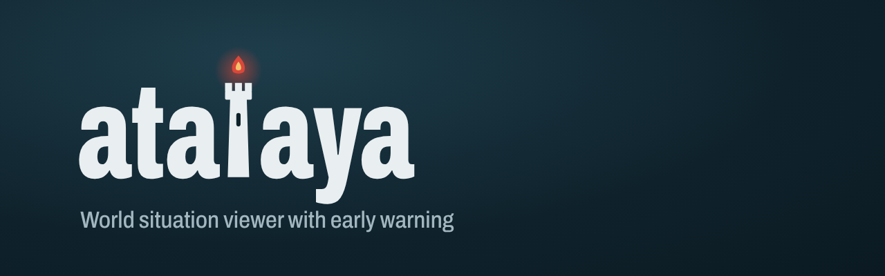
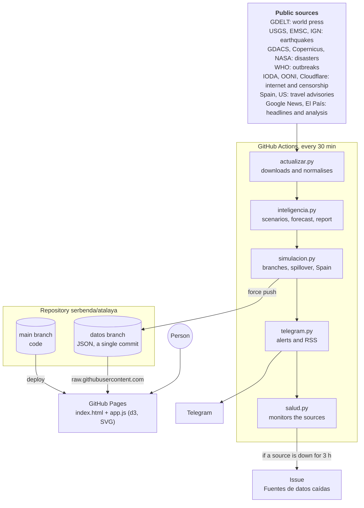
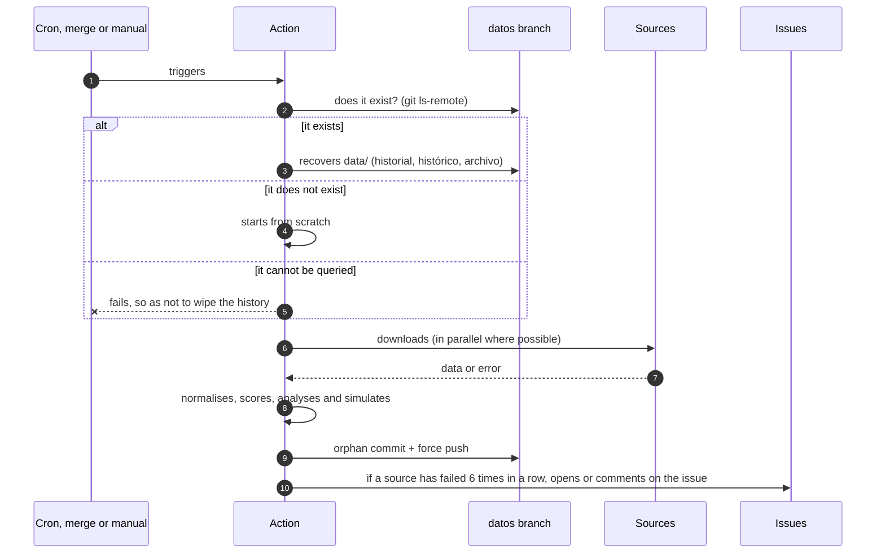
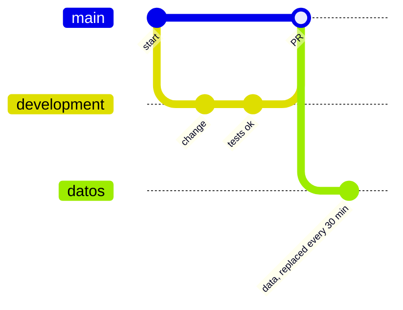
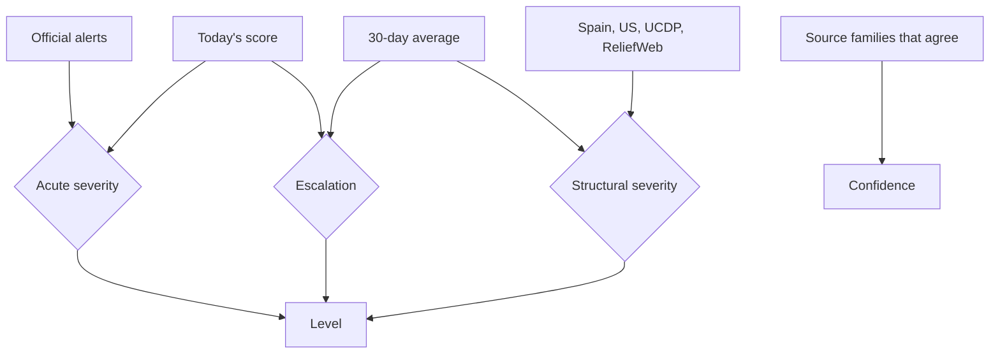

<div align="center">



# atalaya

**World situation viewer with early warning**

Conflicts, protests, disasters, epidemics, internet outages and censorship on a single map,<br>
with an alert level for each country, a daily report and scenario simulation.

[](https://github.com/serbenda/atalaya/actions/workflows/actualizar.yml)
[](https://github.com/serbenda/atalaya/actions/workflows/pruebas.yml)
[](https://github.com/sponsors/serbenda)

[Español](README.md) · **English**

</div>

> [!IMPORTANT]
> **No official validity.** atalaya summarises public sources automatically. Its levels, forecasts and simulations are estimates made with simple rules from news and open data: they are not official forecasts or intelligence assessments, they can be wrong and they are not fit for making decisions. To travel or act, always consult official sources such as your country's foreign ministry (in Spain, the [Ministerio de Asuntos Exteriores](https://www.exteriores.gob.es/es/ServiciosAlCiudadano/Paginas/Recomendaciones-de-viaje.aspx)).

---

## Documentation

| If you are going to… | Read |
|---|---|
| **Maintain atalaya** (what to touch for each task, periodic tasks, what not to touch) | [Maintainer guide](docs/mantenimiento.en.md) |
| Understand or fix a **data source** | [Data sources](docs/fuentes.en.md): each source with its URL, key, filters, known failures and how to check it |
| Understand or tune a **calculation** | [Calculations](docs/calculos.en.md): every formula, with examples and the constants |
| Set up **Telegram alerts** | [Telegram alerts](docs/telegram.en.md) |

This README gives the overview; the detail is in those guides.

---

## Contents

- [What it is](#what-it-is)
- [What you see on the website](#what-you-see-on-the-website)
- [Architecture](#architecture): for designers
- [Systems and DevOps](#systems-and-devops): for operators
- [Development](#development): for developers
- [Data](#data): what is stored and how
- [Analysis](#analysis): how each level is decided
- [Security, privacy and ethics](#security-privacy-and-ethics)
- [Sources](#sources)
- [Roadmap](#roadmap)
- [Developers](#developers)
- [Support the project](#support-the-project)

---

## What it is

An *atalaya* is a watchtower used to scan the horizon and raise the alarm in time. This project does the same with the world: every 30 minutes it gathers around twenty public sources, detects where things are heating up and explains it in plain language. The website is available in Spanish and English.

Three ideas guide it:

1. **Severity is not the same as change.** A war that has lasted for months is serious even if it is not getting worse today. A quiet country that suddenly rises is an early signal. atalaya measures both separately.
2. **Every conclusion shows its evidence.** Each level, judgement or simulation shows the indicators it rests on and how many types of source confirm it.
3. **Zero servers and zero costs.** Everything runs on GitHub Actions and GitHub Pages, with dependency-free Python and a static page.

## What you see on the website

| Part | What it is for |
|---|---|
| **Map** | A 3D globe you can spin (with real day and night) or a flat map. Each country's colour is its level; those getting worse pulse. Dots are events: conflicts, protests, earthquakes, disasters, epidemics, internet outages and censorship. Gold diamonds are strategic shipping routes. |
| **Report** | What a crisis unit would say: the countries you follow, the bottom line, key judgements with their confidence, what to watch in the next 72 hours, relevance for Spain, regions with most tension, key dates (elections), shipping routes, forecast accuracy and performance, and source status. |
| **Simulation** | What could happen in 7 days in each crisis: three branches with an approximate probability, spillover to neighbours (hatched on the map) and impact for Spain. Always with its notice that it has no official validity. |
| **Countries** | All countries with activity, sorted by level. |
| **Events** | Travel advisories, epidemics, internet outages, places with most conflicts and protests, earthquakes and disasters. |
| **Headlines** | Spanish-language press from the last few hours (Google News, EFE, RTVE and El País). |
| **Country sheet** | Level, reasons, confidence, trend chart, forecast, scenarios with their indicators, analysis (where violence is concentrated, who against whom, signals against, other explanations and what would disprove it), early signals (currency, elections), Spanish Foreign Ministry advice, Spain's interests, expert analysis (Elcano, IEEE, CIDOB), Spanish press and events. Use ☆ to follow the country. |
| **Alerts** | Telegram channel and RSS feed with level changes and key signals, plus a daily summary. |
| **History** | *See another day* shows the world as it was on any past day. In a country's chart, clicking a day takes you to that day. |
| **Play the week** | Animates the events of the last 7 days. |
| **Language** | ES / EN selector in the header, or `?lang=en` in the link. The choice is remembered in the browser. |

Everything can be shared with a link: `#pais=SDN` or `#dia=2026-10-28&pais=SDN` (add `?lang=en` for English).

---

## Architecture

### Overview



### Principles

| Principle | How it is met |
|---|---|
| **Static first** | The website is uncompiled HTML, CSS and JavaScript. There is no server or database. |
| **The browser does not call APIs** | The Action downloads everything. So there is no CORS, no exposed keys and no per-visitor request limits. |
| **No dependencies** | The backend uses only the Python standard library. The frontend only uses [d3](https://d3js.org/) from a CDN with a pinned version. Nothing to update and nothing that breaks because of a package. |
| **Data is a branch** | Git acts as a versioned store and a free CDN. Code lives in `main` and data in `datos`. |
| **Graceful degradation** | If a source goes down, its last good data is used and the website says so. No source can bring down the others. |
| **Explainable** | Readable rules instead of an opaque model. Every number has a line of code that explains it. |

### Design decisions

| Decision | Alternatives ruled out | Why |
|---|---|---|
| GitHub Actions as the engine | Own server, cloud functions | Free for public repositories, no maintenance, with built-in secrets and logs. |
| `datos` branch with a single commit that is replaced | Data commits in `main`, publishing to releases | `main` stays clean (changes only through PRs) and the branch does not grow even though it is published 48 times a day. |
| GDELT 2.0 event files | GDELT GEO API | The GEO API returned 404. The files also carry the actor type, which makes it possible to separate political violence from crime. |
| Share of violence, not volume | Counting news stories | The US or India are always heavily covered. Measuring what share of the coverage is violence corrects that bias. |
| d3 + SVG | Leaflet or MapLibre with tiles | No map provider or keys; the globe and the style are our own; 180 countries fit easily in SVG. |
| Transparent rules | Machine learning | With only a few days of data a model would learn nothing reliable; rules can be discussed and corrected, and their accuracy is measured. |
| Reading the Spanish Foreign Ministry website | US advisories only | The Ministry has no API, but it is the reference that matters in Spain, and the US advisories also reflect US foreign policy. |

---

## Systems and DevOps

### Workflows

| Workflow | When it runs | What it does |
|---|---|---|
| [`actualizar.yml`](.github/workflows/actualizar.yml) | Every 30 min (`7,37 * * * *`), when code changes are merged into `main`, and manually | Recovers the previous data, reconstructs past days if requested, downloads the sources, calculates alerts, sends the alerts and publishes to `datos`. |
| [`pruebas.yml`](.github/workflows/pruebas.yml) | On every PR and every push to `development` | Runs the tests with `unittest`. |



### Branching model



- **`development`**: where the work happens. Every push runs the tests.
- **`main`**: only receives changes through PRs. It is what GitHub Pages publishes and what the cron runs.
- **`datos`**: the Action's output. A single commit that is replaced: there is always just one version, with the history inside the files themselves.
- **`datos-prueba`**: same as `datos`, but for test runs. The website does not read it.

### Reliability

| Risk | Mitigation |
|---|---|
| A source goes down | Its last good data is kept and the website shows it under *Source status*. |
| A source changes format | It raises `FormatoInesperado` and is treated as down, without breaking the rest. |
| Long outage | After 6 runs in a row (3 hours), [`salud.py`](scripts/salud.py) opens or updates the issue *Fuentes de datos caídas*. |
| `datos` cannot be read | The Action fails before publishing: it never overwrites the history with empty data. |
| Two runs at once | `concurrency: actualizar-datos` queues them. |
| GitHub's cron is delayed | The Action runs by itself after every merge, and it can be run manually. |
| The browser mixes versions | CSS and JS links carry `?v=N`. |
| GDELT request limits | Its static files are downloaded, not its API. Headlines come from RSS. |
| Slow websites or websites with many pages | The Spanish Foreign Ministry is queried at most every 12 hours, with 6 parallel connections. |

### Testing changes with real data without touching the website

Actions → *Actualizar datos* → *Run workflow* → `development` branch with **Publicar** unchecked. The data is written to `datos-prueba`:

```bash
git fetch origin datos-prueba
git show origin/datos-prueba:data/alertas.json | python3 -m json.tool | less
```

### Reconstructing the past (backtesting)

To measure the model without waiting for weeks: Actions → *Actualizar datos* → *Run workflow* with **retroceso_dias** (for example `30`, at most `90`). [`retroceso.py`](scripts/retroceso.py) downloads a sample of each day's historical GDELT files (by default 48 of 96, one every half hour) and applies the same rules: score, level, scenarios and forecast. Reconstructed days go into `historico.json`, are recorded in `retroceso.json` and feed the performance measurement.

Limits: it only uses GDELT, because earthquakes, disasters, epidemics and internet outages have no historical archive that is easy to reprocess; and it never touches `historial.json`, which is the real baseline of "usual". A day already measured with all sources is never overwritten.

### Telegram alerts and RSS

[`telegram.py`](scripts/telegram.py) runs after the alerts are calculated and only reports what is new compared with the previous run: a country moves up a level or starts to worsen, a new internet outage or messaging block, a raised travel advisory, a serious disaster or outbreak, or a shipping route at high risk. Every day, from 7:00 UTC, it also sends a summary of the report. It does not repeat an alert for the same country within 6 hours (unless it moves to *alert*), and if there are more than 5 at once it groups them into one message. Every message reminds readers that it has no official validity. Messages are in Spanish.

To turn it on:

1. In Telegram, talk to [@BotFather](https://t.me/BotFather), send `/newbot` and keep the token.
2. Create a channel or group, add the bot as an administrator and get the chat identifier: for a public channel, `@channel_name` works; for a group, write something and look at `chat.id` in `https://api.telegram.org/bot<TOKEN>/getUpdates`.
3. In the repository, add the secrets `TELEGRAM_TOKEN` and `TELEGRAM_CHAT`.

The first run only saves the state, so as not to send everything already going on at once. A Telegram failure never breaks the update.

The same content is always published, bot or no bot, as an RSS feed in `data/avisos.xml` on the `datos` branch (linked in *How it works*).


To test it right away: **Actions → Probar Telegram → Run workflow**.

**Full step-by-step guide** (creating the bot, the channel, the identifier, the secrets, checking it and fixing errors): [`docs/telegram.en.md`](docs/telegram.en.md). Project bot: [@atalaya_world_bot](https://t.me/atalaya_world_bot).
### Variables and secrets

Settings → Secrets and variables → Actions. All are optional: without them, the source is simply not used.

| Name | Type | Enables | How to get it |
|---|---|---|---|
| `UCDP_TOKEN` | Secret | Verified conflict deaths (Uppsala University) | Email the API maintainer ([ucdp.uu.se/apidocs](https://ucdp.uu.se/apidocs/)) |
| `FIRMS_KEY` | Secret | Satellite fire detection (NASA FIRMS) | Free and instant: [firms.modaps.eosdis.nasa.gov/api/map_key](https://firms.modaps.eosdis.nasa.gov/api/map_key/) |
| `EARTHDATA_TOKEN` | Secret | Night lights and rainfall (NASA) | Free account at [urs.earthdata.nasa.gov](https://urs.earthdata.nasa.gov/); authorise *LAADS Web*, *LAADS DAAC Cumulus (PROD)* and *GES DISC* under *Applications*, then *Generate Token*. It expires after 60 days |
| `UCDP_VERSION` | Variable | Monthly UCDP version (default `26.0.9`) | The latest candidate version on the same page |
| `CLOUDFLARE_TOKEN` | Secret | Cloudflare Radar internet outages, with their cause | API token with Radar read permission |
| `RELIEFWEB_APPNAME` | Variable | ReliefWeb humanitarian crises (OCHA) | Approved application name at [apidoc.reliefweb.int](https://apidoc.reliefweb.int/) |
| `TELEGRAM_TOKEN` | Secret | Telegram alerts | [@BotFather](https://t.me/BotFather) |
| `TELEGRAM_CHAT` | Secret | The channel or group where alerts are sent | See *Telegram alerts and RSS* |
| `ATALAYA_URL` | Variable | Link from the alerts to the website (default `https://serbenda.github.io/atalaya/`) | The GitHub Pages address |

The workflow permissions are the minimum: `contents: write` to publish the data and `issues: write` to raise alerts.

### Costs and limits

- **GitHub Actions**: free for public repositories. Each run takes a few minutes; those that query the Spanish Foreign Ministry, a bit longer.
- **GitHub Pages**: free. The website weighs about 300 KB, plus the data.
- **raw.githubusercontent.com**: caches for about 5 minutes, plenty for data that changes every 30.
- **Storage**: the daily archive takes up around 50 MB a year on the `datos` branch.

### What to do if…

| Symptom | What to check |
|---|---|
| The website says "Updated 3 hours ago" | Actions → *Actualizar datos*: are there recent runs? GitHub's cron sometimes skips turns; run it manually. |
| The issue *Fuentes de datos caídas* appears | The issue says which source and what error. If it is *formato inesperado*, the source has changed and its function in `actualizar.py` needs adapting. |
| The website does not load data | Check that the `datos` branch exists and the `<meta name="atalaya-datos">` tag in `index.html`. |
| The website looks broken after a deploy | Bump the `?v=N` number in `index.html`. |

---

## Development

### Structure

```
atalaya/
├── index.html                 Single page
├── css/estilo.css             Styles, no preprocessor
├── js/i18n.js                 Languages (Spanish and English): interface and analysis texts
├── js/app.js                  Map, panel, report, simulation and history (d3)
├── data/
│   ├── mundo.geojson          Borders of 180 countries (public domain)
│   ├── paises.json            ISO 3166, with names in English and Spanish
│   ├── intereses_espana.json  Spain's interests by country (indicative, editable)
│   └── modelo.json            Model version, changes and acknowledged errors
├── scripts/
│   ├── actualizar.py          Sources, normalisation, scoring, alerts and history
│   ├── inteligencia.py        Scenarios, forecast, regions, Spain and report
│   ├── simulacion.py          Branches, spillover and impact for Spain
│   ├── aprendizaje.py         Learned forecast (validated logistic regression)
│   ├── luces.py               Blackouts from night lights (NASA Black Marble)
│   ├── lluvias.py             Extreme rainfall (NASA GPM IMERG)
│   ├── telegram.py            Telegram alerts and RSS feed
│   ├── retroceso.py           Reconstruction of the past with GDELT (backtesting)
│   └── salud.py               Checks the state of the sources
├── img/atalaya.svg            Website logo (also the favicon)
├── docs/                      Guides: maintenance, sources, calculations and Telegram (es, en), and logo
├── tests/                     Tests with sample responses from each source
└── .github/workflows/         actualizar.yml and pruebas.yml
```

### Locally

```bash
python3 scripts/actualizar.py            # downloads the data into data/ (takes a few minutes)
python3 -m http.server                   # and open http://localhost:8000 (or ?lang=en)
python3 -m unittest discover -s tests    # tests
```

On `localhost` the website reads `data/`; when published, the `datos` branch. To work with the real data without downloading anything:

```bash
git fetch origin datos && git --work-tree=. checkout origin/datos -- data && git reset -q
```

### The source contract

Each source is a function `fuente(paises)` in `actualizar.py` that returns:

| Returns | Means |
|---|---|
| `{"eventos": [...]}`, and optionally other data | All good. |
| `None` | Not responding: its last data is kept. |
| Raises `FormatoInesperado` | It responds, but in a different shape: treated as down and reported. |
| `{"eventos": [], "desactivada": True}` | Its token is missing: not used and not counted as a failure. |

Each event has this shape:

```jsonc
{
  "id": "usgs-us7000abcd",        // unique and stable between runs
  "tipo": "terremoto",            // conflicto, protesta, terremoto, desastre, epidemia, internet, censura, aviso, crisis or economia
  "titulo": "Terremoto de magnitud 6.8",
  "lugar": "120 km SSW of Kokopo, Papua New Guinea",
  "pais": "PNG",                  // ISO alpha-3, or null at sea
  "lat": -5.2, "lon": 151.9,
  "fecha": "2026-11-02T08:12:00Z",
  "peso": 17.8,                   // what it adds to the country's score
  "nivel": "rojo",                // verde, ambar or rojo
  "fuente": "USGS",
  "familia": "oficial",           // prensa, oficial, tecnica, sanitaria, humanitaria or academica
  "url": "https://…"
}
```

**Adding a source** takes four steps: write the function, add it to `FUENTES`, add a sample response and a test in `tests/`, and document it in the README.

### Frontend

- `js/app.js` is a single uncompiled module, organised in sections: map, floating card, moving the map, panel, history, time, controls and loading.
- The map recalculates the projection on every interaction (orthographic globe or Natural Earth) instead of scaling the SVG, so markers and labels keep their size.
- It respects `prefers-reduced-motion`: no pulsing, ripples or automatic spinning.
- It works on mobile: the panel moves to the bottom and can be collapsed.

### Languages

- The language comes from `?lang=en`, then the last choice saved in the browser, then the browser's language. Switching reloads the page in the other language.
- Interface texts go through `t("texto en español {n}", { n })` in [`js/i18n.js`](js/i18n.js): the key is the Spanish text itself, so the code still reads in Spanish and Spanish needs no dictionary.
- Texts generated by the Python analysis (reasons, scenarios, indicators, simulation, report) go through `tb()`, which translates them with a table of exact phrases and patterns for those with numbers or names. Anything unknown is shown in Spanish. **If you add or change a text in `scripts/`, add its translation to `FRASES` or `PATRONES` in `js/i18n.js`.**
- Dates, numbers and country names use the browser's `Intl` with the active language.
- Spanish press headlines, expert analysis titles and the Spanish Foreign Ministry's notes are shown in their original Spanish.
- The *How it works* dialog has one version per language in `index.html`.

### Conventions

- Names in Spanish, in the code and in the data.
- Work happens in `development` and changes reach `main` through PRs. Tests must pass.
- Website texts use plain language, without technical jargon.

---

## Data

Everything lives on the `datos` branch, in the `data/` folder:

| File | Content | Kept |
|---|---|---|
| `eventos.json` | Events from the last 7 days (30 for epidemics), headlines, analysis and status of each source | Replaced |
| `alertas.json` | Level, reasons, confidence, scenarios and forecast by country; shipping routes; summary; report; simulation | Replaced |
| `historial.json` | Daily score by country over the last 30 days, to work out what is usual | 30-day window |
| `historico.json` | By day and country: `[score, level, worsening, forecast]` | Forever |
| `archivo/AAAA-MM-DD.json` | Each day's snapshot: levels, report, simulation, routes and the 300 most relevant events | Forever |
| `archivo/indice.json` | The available days | Forever |
| `avisos.json` and `exteriores.json` | Latest travel advisory level and its changes | Replaced |
| `divisas_historial.json` | Daily exchange rate against the dollar | 30-day window |
| `incendios_historial.json` | Daily heat spots per country (FIRMS) | 45-day window |
| `luces.json`, `luces_puntos.json`, `luces_historial.json`, `luces_estado.json` | Night light at each watched place, its baseline and the days already read | 60-day window |
| `lluvias.json`, `lluvias_dias.json` | Extreme rainfall and cells with ≥ 50 mm over the last days | 4 days |
| `modelo_aprendido.json` | Learned forecast weights and their validation | Replaced daily |
| `retroceso.json` | Days reconstructed with GDELT | Forever |
| `telegram.json`, `rss.json` and `avisos.xml` | What has already been reported (to avoid repeats) and the RSS feed | Replaced |

---

## Analysis

> Summary. Every formula, with an example and its constants, is in [docs/calculos.en.md](docs/calculos.en.md).

### Score

Each country adds up points from what happened in the last 48 hours (30 days for epidemics):

| Signal | Points |
|---|---|
| Political violence (GDELT) | `3 × log2(1 + events)`, in full when it is at least 5% of what is reported about the country |
| Protests (GDELT) | `1.5 × log2(1 + protests)`, with the same share |
| Earthquakes (USGS, EMSC, IGN) | `(magnitude − 4)²`, plus 3, 10 or 25 if USGS issues a yellow, orange or red PAGER alert |
| Disasters (GDACS) | 1, 6 or 15 for a green, orange or red alert |
| Copernicus activation (EU) | 5 |
| NASA EONET events | Between 0.5 and 2 depending on the type |
| Outbreaks (WHO) | 3, or 8 for a serious disease (Ebola, Marburg, cholera…) |
| Internet outages (IODA) | `3 × (log10(severity) − 5)`, up to 12. Small outages do not count |
| Internet outages (Cloudflare) | 12 if ordered by the government nationwide, 8 if ordered in part of the country, 3 if technical and nationwide |
| New messaging block (OONI) | 6 |
| Spanish Foreign Ministry raises its advice | 5 per level |
| US raises its travel advisory | 4 per level |
| Humanitarian crisis on alert (ReliefWeb) | 6 |
| The currency loses ≥ 8% against the dollar in 7 days | 1.5, or 3 if it loses ≥ 15% |
| Satellite fires ≥ 2.5 times the usual (and ≥ 30 spots) | 2, or 3 if ≥ 4 times |
| Blackout seen by satellite (light ≤ 50% of normal on two nights) | 2, or 3 if it falls to 30% or less |
| Extreme rainfall over ≥ 3 cells | 2, or 3 if it covers ≥ 2,500 km² |

**So as not to confuse crime with conflict**, from GDELT only the main event of each story counts (`IsRootEvent`), and only violence involving armies, rebels, insurgents, governments, known armed groups or two different countries. The police do not count as a political actor, because in the press they almost always appear in crime reports.

**Rigour with sources.** A single story often generates several events in GDELT: it is counted once per story (URL). State-owned or state-controlled media in countries without a free press (RT, Sputnik, TASS, Xinhua, Global Times, CGTN, Press TV, IRNA, Tasnim, KCNA, Telesur…) count half: they are not discarded, because sometimes they are the only source, but they cannot light up a country on their own.

### Level: severity, escalation and confidence



| Level | Reached if any of these conditions is met |
|---|---|
| **Alert** | Score ≥ 40 · official red alert · 3 deviations above usual with ≥ 18 points · 30-day average ≥ 30 · more than 1,000 verified deaths in 90 days |
| **Watch** | Score ≥ 25 · official orange alert · 1.5 deviations above usual with ≥ 10 points · 3 days in a row rising with ≥ 10 points · average ≥ 18 · open humanitarian crisis · more than 100 verified deaths · Spain or the US advise against travel and there is activity of its own |

- **Escalation**: the country is above what is normal for it, or has been rising for three days. On the map, it pulses.
- **Confidence** (how well corroborated it is, not how serious): *well corroborated* if two or more source families agree, *corroborated* if there is an official, technical or health source, *press only* if only the news reports it.
- Travel advisories **reinforce, but never colour a country on their own**: they also reflect the foreign policy of whoever issues them.
- During the first week only the absolute thresholds count, because there is no history yet to know what is usual.

### Scenarios with indicators

This is the *indicators and warnings* method used by early-warning teams: each scenario has a list of observable signals and the number switched on is measured. Signals **in bold** are key and count double.

| Scenario | Indicators |
|---|---|
| **Military escalation** | **Violence is rising**, **clashes between countries**, events with the army or armed groups, a government raises its advisory, Spain advises against travel, neighbours on alert, shipping route at risk |
| **Coup or government crisis** | **Internet outage**, **messaging block**, **the press is talking about a coup**, events with the army, protests on the rise, a government raises its advisory, the currency is plunging, upcoming elections |
| **Serious unrest** | **Protests on the rise**, **riots**, messaging block, internet outage, violence is rising, the currency is plunging, upcoming elections |
| **Humanitarian emergency** | **Disaster with an official alert**, **serious outbreak**, **open humanitarian crisis**, intense violence, verified deaths, Spain advises against travel |

If more than half of the weight is switched on, the scenario is *likely*; with two points, *possible*; otherwise, *unlikely*. Each indicator's thresholds are relative to the country's news volume.

**Signals against.** If there are de-escalation signals (ceasefire or humanitarian access in GDELT, CAMEO codes 086 and 087), the escalation scenario is lowered one step and the simulation gives more weight to the crisis being contained.

### Structured analysis

To avoid settling on the most alarming explanation, each sheet includes what an analyst would do:

- **Where the violence is concentrated**: the regions with most events and their share. If almost everything happens in one place, it may be a local problem.
- **Who against whom**: the most cited pairs of actors, as coded by GDELT.
- **Signals against**: de-escalation, negotiations or truce.
- **Other possible explanations** (alternative hypotheses): state media propaganda, a media spike over an isolated event, a local problem, an external conflict, or a crisis that simply lasts.
- **What would disprove** the main scenario (devil's advocate): the signals that, if they appear, indicate the scenario was wrong.

### Early signals

- **Currencies**: a sharp fall against the dollar (≥ 8% in 7 days) often comes before protests, shortages or government crises.
- **Elections and referendums** in the next 45 days, according to Wikidata: they appear under *Key dates* and as an indicator.
- **Satellite fire detection** (NASA FIRMS, VIIRS sensor) in the countries with the most conflict and in open wars. It counts heat spots in the last 24 hours and compares them with the median of the same country's previous 30 days, because agricultural burning varies a lot with the season. With at least 30 spots and 2.5 times the usual, it adds points and switches on an indicator of the escalation scenario: in a combat zone they often reveal shelling and active front lines before the press does. It needs the free `FIRMS_KEY`.
- **Blackouts seen from space** (NASA Black Marble, VIIRS on the NOAA-20 satellite). Every night the light is measured in a circle of about 3 km around the most violent places in countries at war or on alert (up to 3 per country). Only good nights count: no clouds, the satellite almost overhead (under 60°) and no strong moon. Normal is the median of the good nights in the previous 30 days. If light falls to half or less on two good nights in a row, it adds points and switches on escalation and humanitarian-emergency indicators: attacks on the power grid, supply cuts or a city emptying out. It arrives about 2 days late.
- **Extreme rainfall** (NASA GPM IMERG, daily early run, 0.1° cells). A cell is extreme with 150 mm in one day or 250 mm in three; with at least 3 in a country (about 350 km²) it adds points and switches on the humanitarian-emergency indicator. Latitudes above 60°, Greenland and Antarctica are ignored, as the satellite measures poorly over snow.
- These two need a free NASA Earthdata account (`EARTHDATA_TOKEN`) and read HDF5 files, so they run in a separate workflow step with `h5py` and `numpy` ([`luces.py`](scripts/luces.py) and [`lluvias.py`](scripts/lluvias.py)); if they fail, the rest of atalaya carries on.
- Left out, because they require keys or usage agreements: ships (AIS), airspace (OpenSky) and displacement (IOM DTM, UNHCR). Exposed population (NASA SEDAC) is pending.

### 7-day forecast and its accuracy

The forecast says whether it is *likely*, *possible* or *unlikely* that the country will **worsen in a sustained way over the next 7 days**: move up a level, or start worsening relative to its normal when it was not, **for at least two days in a row**. A one-day jump is usually news noise, and continuing to worsen does not count, so it cannot score an easy hit.

**Learned forecast.** [`aprendizaje.py`](scripts/aprendizaje.py) learns from what happened how much each signal weighs, instead of setting it by hand. It is a logistic regression (standard-library Python, no packages) over 14 signals: the score and its usual level, the level, whether it is already worsening, the distance from normal, the weekly trend, days in a row rising, 12-hour acceleration, the share of coverage that is violence, events between countries, protests, events involving armies, de-escalation and neighbours on alert.

- **Validated over time.** It is trained on the oldest days and measured on the most recent 30%, which it has not seen. **It is only used if on those days it does at least 2% better than always giving the average rate**; otherwise the forecast keeps the fixed rules and the website says why.
- **It only uses signals that also exist on reconstructed days** (GDELT and the evolution of the score), so it can learn from the past without cheating. Internet shutdowns, censorship, fires and travel advisories still weigh in the scenarios and the simulation.
- It is retrained once a day and stored in `modelo_aprendido.json`, with its validation metrics and what weighs most. With the model active, each country sheet shows the probability; *likely* starts at 40% and *possible* at 20%. The simulation starts from that probability.

Each forecast is stored in `historico.json` with its probability and signals. Seven days later the outcome is checked, and the report shows the accuracy over the last 30 days. It is the only honest way to know whether it works.

**Performance.** Besides accuracy, the [Brier score](https://en.wikipedia.org/wiki/Brier_score) over the last 60 days is calculated (with the learned model's probability or, with the fixed rules, 40, 25 and 10% by grade) and compared with two naive baselines: always giving the average frequency, and relying only on each country's current level (persistence). If the model does not beat the baselines, the rules add nothing. The **calibration** table compares the probability each grade gives with how often the country actually worsened.

**Version and errors.** [`data/modelo.json`](data/modelo.json) stores the model version, its changes and the errors acknowledged and corrected; the website shows them in *How it works*.

### Simulation

[`simulacion.py`](scripts/simulacion.py) simulates every open crisis: countries on *alert* or *watch* and those likely to worsen. The 8 most serious are shown in detail and the rest in a table.

For each one it calculates three branches in multiples of 5%, with an **uncertainty margin** of ±5, ±10 or ±15 points depending on confidence:

- **Escalates**: starts at 10, 25 or 40% depending on the forecast. It rises with the indicators switched on, if it worsened over the last week, if it **sped up in the last 12 hours** (GDELT events in the last 12 h compared with the previous 12, which gives a trend from the first day), if there are neighbours in crisis and if the country is already on alert. It drops if things slow down. Between 5 and 75%; protests in a country without an alert are capped at 40%.
- **Is contained**: the complement. A protracted crisis is rarely resolved in a week, so in those cases it drops to a minimum of 5%.
- **Stays the same**: the rest. It is usually the most likely branch, because within a week a crisis most often stays as it is.

Each case shows **why** it has those probabilities, the **spillover** to its neighbours (35% of the probability of escalating, half as much again if the neighbour is already on *watch*), the **impact for Spain** and the signals that would confirm or disprove each branch.

**By region**, it calculates the probability that at least one crisis escalates. Crises in the same region are not independent, so instead of multiplying as if they were, it uses `1 − (1 − mean) ^ √n`.

**The most worrying** is not just the most likely: the summary ranks by probability of escalating × severity of the level × type of scenario.

**It recalibrates itself.** When there are at least 20 checked forecasts of a type, the starting probability is blended with its real accuracy: the more samples, the more weight the observed outcome gets (up to half).

### Known biases

| Bias | What is done |
|---|---|
| The press covers some countries more than others | Share of violence instead of volume, and thresholds relative to each country |
| GDELT confuses crime with conflict | Only main events and with political actors |
| The same repeated story inflates a country | It counts once per story |
| State media propaganda | It counts half, and the sheet warns if it is a large part of the coverage |
| Settling on the most alarming explanation | Signals against, alternative hypotheses and what would disprove each scenario |
| Long wars stop being news | Structural severity: 30-day average, Spanish Foreign Ministry and UCDP |
| Travel advisories are also politics | They only reinforce what the data already shows |
| Rules are a choice, not a truth | They are visible, they can be discussed and their accuracy is measured |

---

## Security, privacy and ethics

- **No personal data.** The website asks for nothing and uses no cookies or third-party analytics. It only loads d3 from jsDelivr and the font from Google Fonts. The browser only remembers, locally, the countries you follow and the language you chose.
- **No keys in the browser.** Optional tokens live in GitHub secrets and only the Action uses them.
- **Respectful reading of websites.** Identified with its own `User-Agent`, spaced-out retries and the Spanish Foreign Ministry at most twice a day.
- **Neutral language.** It describes facts and mechanisms and does not judge governments or parties.
- **Honesty.** It warns that it has no official validity in the simulation tab, in every forecast, in the map legend and in *How it works*. Every event links to its original source.

---

## Sources

> Summary. Each source in detail (request, filters, known failures and how to check it) is in [docs/fuentes.en.md](docs/fuentes.en.md).

| Source | Data | Access |
|---|---|---|
| [GDELT](https://www.gdeltproject.org/) | Geolocated events from the world press, every 15 min | Open |
| [Spanish Foreign Ministry](https://www.exteriores.gob.es/es/ServiciosAlCiudadano/Paginas/Recomendaciones-de-viaje.aspx) | Spain's travel advice by country | Website, twice a day |
| [Travel Advisories](https://travel.state.gov/content/travel/en/traveladvisories/traveladvisories.html) | US travel advisories | RSS |
| [USGS](https://earthquake.usgs.gov/), [EMSC](https://www.seismicportal.eu/), [IGN](https://www.ign.es/) | Earthquakes: world, Euro-Mediterranean and Spain | Open |
| [GDACS](https://www.gdacs.org/) | Disaster alerts (UN and European Commission) | RSS |
| [Copernicus EMS](https://mapping.emergency.copernicus.eu/) | EU emergency mapping activations | Open, with attribution: *Contains modified Copernicus Service information [year]* (Delegated Regulation (EU) 1159/2013, art. 8). The website states it under *How it is calculated*. |
| [NASA EONET](https://eonet.gsfc.nasa.gov/) | Active natural events | Open |
| [WHO](https://www.who.int/emergencies/disease-outbreak-news) | Disease outbreaks | Open |
| [IODA](https://ioda.inetintel.cc.gatech.edu/) | Internet outages by country (Georgia Tech) | Open |
| [OONI](https://explorer.ooni.org/) | Blocks of WhatsApp, Telegram, Signal and Messenger | Open |
| [Google News](https://news.google.com/), [El País](https://elpais.com/internacional/), EFE, RTVE | Spanish-language headlines | RSS |
| Real Instituto Elcano, IEEE, CIDOB | Expert analysis by country | Through Google News |
| [UCDP](https://ucdp.uu.se/) | Verified conflict deaths | Token |
| [Cloudflare Radar](https://radar.cloudflare.com/) | Internet outages and their cause | Token |
| [ReliefWeb](https://reliefweb.int/) | Humanitarian crises (OCHA) | Application name |
| [ExchangeRate-API](https://www.exchangerate-api.com/) | Daily exchange rates against the dollar | Open |
| [NASA FIRMS](https://firms.modaps.eosdis.nasa.gov/) | Satellite fires and heat spots (VIIRS) | Free key |
| [NASA Black Marble](https://blackmarble.gsfc.nasa.gov/) | Daily night lights (VJ146A1, LAADS DAAC) | Earthdata account |
| [NASA GPM IMERG](https://gpm.nasa.gov/data/imerg) | Daily satellite rainfall (early run, GES DISC) | Earthdata account |
| [Wikidata](https://www.wikidata.org/) | Upcoming elections and referendums | Open (SPARQL) |
| [world.geo.json](https://github.com/johan/world.geo.json) | Country borders | Public domain |

---

## Roadmap

- [ ] Turn on UCDP, Cloudflare Radar and ReliefWeb with their tokens.
- [ ] Review `intereses_espana.json` against official sources.
- [ ] Tune the thresholds with a month of history, the reconstruction of the past and the measured performance.
- [x] Telegram alerts and RSS.
- [x] Measure performance against baselines (Brier and calibration).
- [x] Website in English.
- [ ] Ships (AIS) on shipping routes and closed airspace (OpenSky, EASA).
- [ ] Food and displacement (WFP, IPC, UNHCR, IOM DTM) as early signals of humanitarian crises.
- [x] Satellite fire detection (NASA FIRMS) in conflict zones.
- [x] Forecast learned from the data and validated over time.
- [ ] Accessible table view as an alternative to the map.

---

## Developers

**Jesus Aguado** and **Sergio Bendaña** are the developers of atalaya.

---

## Support the project

atalaya is a personal project, free and without advertising. If you find it useful, you can support it on [GitHub Sponsors](https://github.com/sponsors/serbenda): it helps maintain the sources and add new ones.
