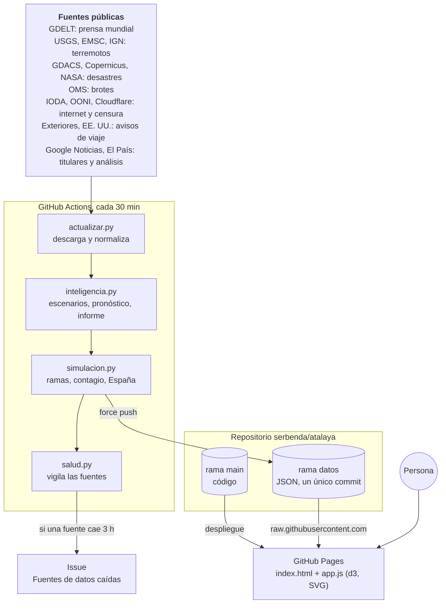
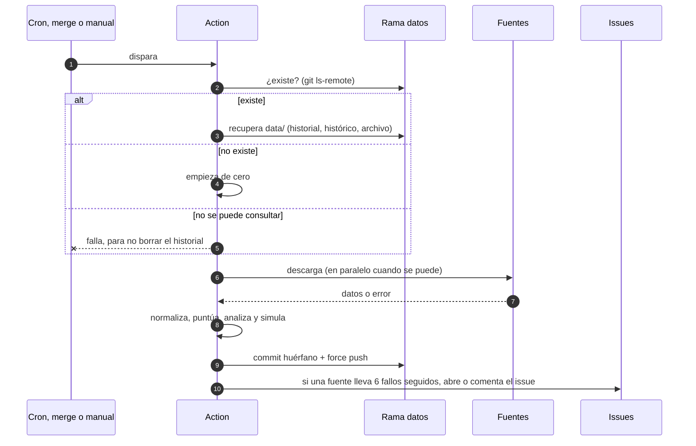
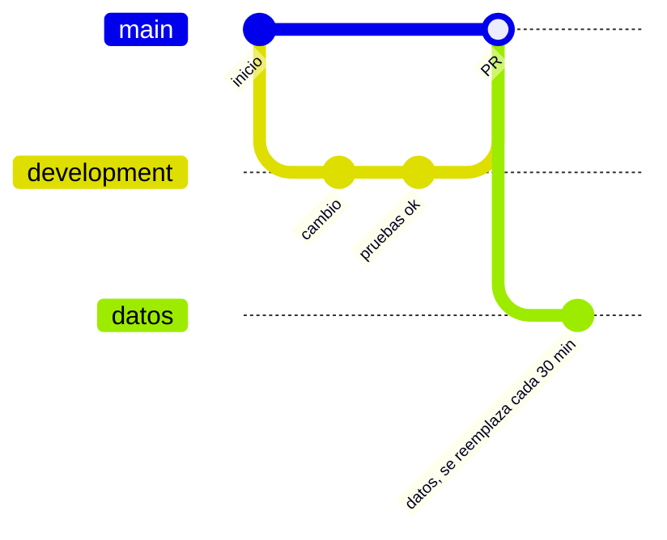
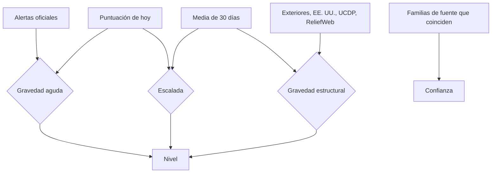

<div align="center">

# atalaya

**Visor de la situación mundial con alerta temprana**

Conflictos, protestas, desastres, epidemias, cortes de internet y censura en un solo mapa,<br>
con un nivel de alerta por país, un informe diario y simulación de escenarios.

[](https://github.com/serbenda/atalaya/actions/workflows/actualizar.yml)
[](https://github.com/serbenda/atalaya/actions/workflows/pruebas.yml)
[](https://github.com/sponsors/serbenda)

</div>

> [!IMPORTANT]
> **Sin validez oficial.** atalaya resume fuentes públicas de forma automática. Sus niveles, pronósticos y simulaciones son estimaciones hechas con reglas sencillas a partir de noticias y datos abiertos: no son predicciones oficiales ni análisis de inteligencia, pueden equivocarse y no sirven para tomar decisiones. Para viajar o actuar, consulta siempre fuentes oficiales como el [Ministerio de Asuntos Exteriores](https://www.exteriores.gob.es/es/ServiciosAlCiudadano/Paginas/Recomendaciones-de-viaje.aspx).

---

## Índice

- [Qué es](#qué-es)
- [Lo que ves en la web](#lo-que-ves-en-la-web)
- [Arquitectura](#arquitectura): para quien diseña
- [Sistemas y DevOps](#sistemas-y-devops): para quien lo opera
- [Desarrollo](#desarrollo): para quien lo programa
- [Datos](#datos): qué se guarda y cómo
- [Análisis](#análisis): cómo se decide cada nivel
- [Seguridad, privacidad y ética](#seguridad-privacidad-y-ética)
- [Fuentes](#fuentes)
- [Hoja de ruta](#hoja-de-ruta)
- [Apoya el proyecto](#apoya-el-proyecto)

---

## Qué es

Una *atalaya* es una torre desde la que se vigila el horizonte para dar la alarma a tiempo. Este proyecto hace lo mismo con el mundo: cada 30 minutos reúne una veintena de fuentes públicas, detecta dónde se está calentando algo y lo explica en castellano.

Tres ideas lo guían:

1. **Gravedad no es lo mismo que cambio.** Una guerra que dura meses es grave aunque hoy no empeore. Un país tranquilo que de repente sube es una señal temprana. atalaya mide las dos cosas por separado.
2. **Toda conclusión enseña sus pruebas.** Cada nivel, juicio o simulación muestra los indicadores en los que se apoya y cuántos tipos de fuente lo confirman.
3. **Cero servidores y cero costes.** Todo corre en GitHub Actions y GitHub Pages, con Python sin dependencias y una página estática.

## Lo que ves en la web

| Parte | Para qué sirve |
|---|---|
| **Mapa** | Globo 3D que se gira (con día y noche reales) o mapa plano. El color de cada país es su nivel; los que empeoran laten. Los puntos son eventos: conflictos, protestas, terremotos, desastres, epidemias, cortes de internet y censura. Los rombos dorados son rutas marítimas estratégicas. |
| **Informe** | Lo que contaría un gabinete de crisis: conclusión principal, juicios clave con su confianza, qué vigilar en las próximas 72 horas, interés para España, regiones con más tensión, rutas marítimas, acierto de los pronósticos y estado de las fuentes. |
| **Simulación** | Qué podría pasar en 7 días en cada crisis: tres ramas con probabilidad aproximada, contagio a los vecinos (rayados en el mapa) e impacto para España. Siempre con su aviso de que no tiene validez oficial. |
| **Países** | Todos los países con actividad, ordenados por nivel. |
| **Eventos** | Avisos de viaje, epidemias, cortes de internet, lugares con más conflictos y protestas, terremotos y desastres. |
| **Titulares** | Prensa en español de las últimas horas (Google Noticias, EFE, RTVE y El País). |
| **Ficha de país** | Nivel, motivos, confianza, gráfica de evolución, pronóstico, escenarios con sus indicadores, recomendación de Exteriores, intereses de España, análisis de expertos (Elcano, IEEE, CIDOB), prensa española y eventos. |
| **Histórico** | *Ver otro día* muestra el mundo tal como estaba cualquier día pasado. En la gráfica de un país, pinchar un día lleva a ese día. |
| **Reproducir la semana** | Anima los eventos de los últimos 7 días. |

Todo se puede compartir con un enlace: `#pais=SDN` o `#dia=2026-10-28&pais=SDN`.

---

## Arquitectura

### Visión general



### Principios

| Principio | Cómo se cumple |
|---|---|
| **Estático primero** | La web es HTML, CSS y JavaScript sin compilar. No hay servidor ni base de datos. |
| **El navegador no llama a APIs** | Todo lo descarga la Action. Así no hay CORS, ni claves expuestas, ni límites de peticiones por visitante. |
| **Sin dependencias** | El backend usa solo la biblioteca estándar de Python. El frontend, solo [d3](https://d3js.org/) desde un CDN con versión fija. Nada que actualizar ni que se rompa por un paquete. |
| **Los datos son una rama** | Git hace de almacén versionado y de CDN gratuito. El código vive en `main` y los datos en `datos`. |
| **Degradación elegante** | Si una fuente cae, se usan sus últimos datos buenos y la web avisa. Ninguna fuente puede tumbar a las demás. |
| **Explicable** | Reglas legibles en lugar de un modelo opaco. Cada número tiene una línea de código que lo explica. |

### Decisiones de diseño

| Decisión | Alternativas descartadas | Por qué |
|---|---|---|
| GitHub Actions como motor | Servidor propio, funciones en la nube | Gratis para repositorios públicos, sin mantenimiento, con secretos y registros integrados. |
| Rama `datos` con un único commit que se reemplaza | Commits de datos en `main`, publicar en releases | `main` queda limpio (solo cambios por PR) y la rama no crece aunque se publique 48 veces al día. |
| Ficheros de eventos de GDELT 2.0 | API GEO de GDELT | La API GEO devolvía 404. Los ficheros traen además el tipo de actor, lo que permite separar violencia política de delincuencia. |
| Proporción de violencia, no volumen | Contar noticias | De EE. UU. o India siempre se habla mucho. Medir qué parte de lo que se cuenta es violencia corrige ese sesgo. |
| d3 + SVG | Leaflet o MapLibre con teselas | Sin proveedor de mapas ni claves; el globo y el estilo son propios; 180 países caben de sobra en SVG. |
| Reglas transparentes | Aprendizaje automático | Con pocos días de datos un modelo no aprendería nada fiable; las reglas se pueden discutir y corregir, y se mide su acierto. |
| Exteriores leyendo su web | Solo avisos de EE. UU. | Exteriores no tiene API, pero es la referencia que importa en España, y la de EE. UU. también refleja su política exterior. |

---

## Sistemas y DevOps

### Flujos de trabajo

| Workflow | Cuándo se ejecuta | Qué hace |
|---|---|---|
| [`actualizar.yml`](.github/workflows/actualizar.yml) | Cada 30 min (`7,37 * * * *`), al fusionar cambios de código en `main` y a mano | Recupera los datos anteriores, descarga las fuentes, calcula alertas y publica en `datos`. |
| [`pruebas.yml`](.github/workflows/pruebas.yml) | En cada PR y en cada push a `development` | Ejecuta las pruebas con `unittest`. |



### Modelo de ramas



- **`development`**: donde se trabaja. Cada push ejecuta las pruebas.
- **`main`**: solo recibe cambios por PR. Es lo que publica GitHub Pages y lo que ejecuta el cron.
- **`datos`**: la salida de la Action. Un único commit que se reemplaza: siempre hay una sola versión, con el histórico dentro de los propios ficheros.
- **`datos-prueba`**: igual que `datos`, pero para ejecuciones de prueba. La web no la lee.

### Fiabilidad

| Riesgo | Mitigación |
|---|---|
| Una fuente cae | Se conservan sus últimos datos buenos y la web lo indica en *Estado de las fuentes*. |
| Una fuente cambia de formato | Lanza `FormatoInesperado` y se trata como caída, sin romper el resto. |
| Caída larga | Tras 6 ejecuciones seguidas (3 horas), [`salud.py`](scripts/salud.py) abre o actualiza el issue *Fuentes de datos caídas*. |
| No se puede leer `datos` | La Action falla antes de publicar: nunca sobrescribe el histórico con datos vacíos. |
| Dos ejecuciones a la vez | `concurrency: actualizar-datos` las pone en fila. |
| El cron de GitHub se retrasa | Tras cada merge la Action se lanza sola, y se puede ejecutar a mano. |
| El navegador mezcla versiones | Los enlaces a CSS y JS llevan `?v=N`. |
| Límites de peticiones de GDELT | Se descargan sus ficheros estáticos, no su API. Los titulares salen de RSS. |
| Webs lentas o con muchas páginas | Exteriores se consulta como mucho cada 12 horas, con 6 conexiones en paralelo. |

### Probar cambios con datos reales sin tocar la web

Actions → *Actualizar datos* → *Run workflow* → rama `development` con **Publicar** desmarcado. Los datos se escriben en `datos-prueba`:

```bash
git fetch origin datos-prueba
git show origin/datos-prueba:data/alertas.json | python3 -m json.tool | less
```

### Variables y secretos

Settings → Secrets and variables → Actions. Todos son opcionales: sin ellos, la fuente simplemente no se usa.

| Nombre | Tipo | Activa | Cómo conseguirlo |
|---|---|---|---|
| `UCDP_TOKEN` | Secreto | Muertes en conflictos verificadas (Universidad de Uppsala) | Email al responsable de la API ([ucdp.uu.se/apidocs](https://ucdp.uu.se/apidocs/)) |
| `UCDP_VERSION` | Variable | Versión mensual de UCDP (por defecto `26.0.9`) | La última versión candidata de la misma página |
| `CLOUDFLARE_TOKEN` | Secreto | Cortes de internet de Cloudflare Radar, con su causa | Token de API con permiso de lectura de Radar |
| `RELIEFWEB_APPNAME` | Variable | Crisis humanitarias de ReliefWeb (OCHA) | Nombre de aplicación aprobado en [apidoc.reliefweb.int](https://apidoc.reliefweb.int/) |

Los permisos del workflow son los mínimos: `contents: write` para publicar los datos e `issues: write` para avisar.

### Costes y límites

- **GitHub Actions**: gratis en repositorios públicos. Cada ejecución tarda unos minutos; las que consultan Exteriores, algo más.
- **GitHub Pages**: gratis. La web pesa unos 300 KB, más los datos.
- **raw.githubusercontent.com**: guarda en caché unos 5 minutos, de sobra para datos que cambian cada 30.
- **Almacenamiento**: el archivo diario ocupa del orden de 50 MB al año en la rama `datos`.

### Qué hacer si…

| Síntoma | Qué mirar |
|---|---|
| La web dice "Actualizado hace 3 horas" | Actions → *Actualizar datos*: ¿hay ejecuciones recientes? El cron de GitHub a veces se salta turnos; lánzalo a mano. |
| Aparece el issue *Fuentes de datos caídas* | El issue dice qué fuente y con qué error. Si es *formato inesperado*, la fuente ha cambiado y hay que adaptar su función en `actualizar.py`. |
| La web no carga datos | Comprueba que existe la rama `datos` y la etiqueta `<meta name="atalaya-datos">` de `index.html`. |
| La web se ve rota tras un despliegue | Sube el número de `?v=N` en `index.html`. |

---

## Desarrollo

### Estructura

```
atalaya/
├── index.html                 Página única
├── css/estilo.css             Estilos, sin preprocesador
├── js/app.js                  Mapa, panel, informe, simulación e histórico (d3)
├── data/
│   ├── mundo.geojson          Fronteras de 180 países (dominio público)
│   ├── paises.json            ISO 3166, con nombres en inglés y en español
│   └── intereses_espana.json  Intereses de España por país (orientativo, editable)
├── scripts/
│   ├── actualizar.py          Fuentes, normalización, puntuación, alertas e histórico
│   ├── inteligencia.py        Escenarios, pronóstico, regiones, España e informe
│   ├── simulacion.py          Ramas, contagio e impacto para España
│   └── salud.py               Comprueba el estado de las fuentes
├── tests/test_actualizar.py   Pruebas con respuestas de ejemplo de cada fuente
└── .github/workflows/         actualizar.yml y pruebas.yml
```

### En local

```bash
python3 scripts/actualizar.py            # descarga los datos en data/ (tarda unos minutos)
python3 -m http.server                   # y abre http://localhost:8000
python3 -m unittest discover -s tests    # pruebas
```

En `localhost` la web lee `data/`; publicada, la rama `datos`. Para trabajar con los datos reales sin descargar nada:

```bash
git fetch origin datos && git --work-tree=. checkout origin/datos -- data && git reset -q
```

### El contrato de una fuente

Cada fuente es una función `fuente(paises)` en `actualizar.py` que devuelve:

| Devuelve | Significa |
|---|---|
| `{"eventos": [...]}`, y opcionalmente otros datos | Todo bien. |
| `None` | No responde: se conservan sus últimos datos. |
| Lanza `FormatoInesperado` | Responde, pero con otra forma: se trata como caída y se avisa. |
| `{"eventos": [], "desactivada": True}` | Falta su token: no se usa ni cuenta como fallo. |

Cada evento tiene esta forma:

```jsonc
{
  "id": "usgs-us7000abcd",        // único y estable entre ejecuciones
  "tipo": "terremoto",            // conflicto, protesta, terremoto, desastre, epidemia, internet, censura, aviso o crisis
  "titulo": "Terremoto de magnitud 6.8",
  "lugar": "120 km SSW of Kokopo, Papua New Guinea",
  "pais": "PNG",                  // ISO alfa-3, o null en el mar
  "lat": -5.2, "lon": 151.9,
  "fecha": "2026-11-02T08:12:00Z",
  "peso": 17.8,                   // lo que suma a la puntuación del país
  "nivel": "rojo",                // verde, ambar o rojo
  "fuente": "USGS",
  "familia": "oficial",           // prensa, oficial, tecnica, sanitaria, humanitaria o academica
  "url": "https://…"
}
```

**Añadir una fuente** son cuatro pasos: escribir la función, añadirla a `FUENTES`, añadir una respuesta de ejemplo y una prueba en `tests/`, y documentarla en este README.

### Frontend

- `js/app.js` es un único módulo sin compilar, organizado por secciones: mapa, ficha flotante, mover el mapa, panel, histórico, tiempo, controles y carga.
- El mapa recalcula la proyección en cada interacción (globo ortográfico o Natural Earth) en lugar de escalar el SVG, para que marcadores y etiquetas mantengan su tamaño.
- Respeta `prefers-reduced-motion`: sin latidos, ondas ni giro automático.
- Funciona en móvil: el panel pasa a la parte de abajo y se puede plegar.

### Convenciones

- Nombres en castellano, en el código y en los datos.
- Se trabaja en `development` y los cambios llegan a `main` por PR. Las pruebas tienen que pasar.
- Los textos de la web hablan en lenguaje llano, sin jerga técnica.

---

## Datos

Todo vive en la rama `datos`, carpeta `data/`:

| Fichero | Contenido | Se guarda |
|---|---|---|
| `eventos.json` | Eventos de los últimos 7 días (30 para epidemias), titulares, análisis y estado de cada fuente | Se reemplaza |
| `alertas.json` | Nivel, motivos, confianza, escenarios y pronóstico por país; rutas marítimas; parte; informe; simulación | Se reemplaza |
| `historial.json` | Puntuación diaria por país de los últimos 30 días, para calcular lo habitual | Ventana de 30 días |
| `historico.json` | Por día y país: `[puntuación, nivel, empeora, pronóstico]` | Para siempre |
| `archivo/AAAA-MM-DD.json` | La foto de cada día: niveles, informe, simulación, rutas y los 300 eventos más relevantes | Para siempre |
| `archivo/indice.json` | Los días disponibles | Para siempre |
| `avisos.json` y `exteriores.json` | Último nivel de los avisos de viaje y sus cambios | Se reemplaza |

---

## Análisis

### Puntuación

Cada país suma puntos con lo ocurrido en las últimas 48 horas (30 días para epidemias):

| Señal | Puntos |
|---|---|
| Violencia política (GDELT) | `3 × log2(1 + hechos)`, al completo cuando es al menos el 5 % de lo que se cuenta del país |
| Protestas (GDELT) | `1,5 × log2(1 + protestas)`, con la misma proporción |
| Terremotos (USGS, EMSC, IGN) | `(magnitud − 4)²`, más 3, 10 o 25 si USGS emite alerta PAGER amarilla, naranja o roja |
| Desastres (GDACS) | 1, 6 o 15 según alerta verde, naranja o roja |
| Activación de Copernicus (UE) | 5 |
| Fenómenos de NASA EONET | Entre 0,5 y 2 según el tipo |
| Brotes (OMS) | 3, u 8 si es una enfermedad grave (ébola, Marburgo, cólera…) |
| Cortes de internet (IODA) | `3 × (log10(gravedad) − 5)`, hasta 12. Los cortes pequeños no cuentan |
| Cortes de internet (Cloudflare) | 12 si los ordena el gobierno en todo el país, 8 si los ordena en parte, 3 si son técnicos en todo el país |
| Bloqueo nuevo de mensajería (OONI) | 6 |
| Exteriores sube su recomendación | 5 por cada nivel |
| EE. UU. sube su aviso de viaje | 4 por cada nivel |
| Crisis humanitaria en alerta (ReliefWeb) | 6 |

**Para no confundir delincuencia con conflicto**, de GDELT solo cuentan los hechos principales de cada noticia (`IsRootEvent`) y la violencia en la que intervienen ejércitos, rebeldes, insurgentes, gobiernos, grupos armados conocidos o dos países distintos. La policía no cuenta como actor político, porque en la prensa casi siempre es crónica de sucesos.

### Nivel: gravedad, escalada y confianza



| Nivel | Se alcanza si se cumple alguna de estas condiciones |
|---|---|
| **Alerta** | Puntuación ≥ 40 · alerta oficial roja · 3 desviaciones sobre lo habitual con ≥ 18 puntos · media de 30 días ≥ 30 · más de 1.000 muertes verificadas en 90 días |
| **Vigilar** | Puntuación ≥ 25 · alerta oficial naranja · 1,5 desviaciones sobre lo habitual con ≥ 10 puntos · 3 días seguidos subiendo con ≥ 10 puntos · media ≥ 18 · crisis humanitaria abierta · más de 100 muertes verificadas · Exteriores o EE. UU. desaconsejan viajar y hay actividad propia |

- **Escalada**: el país está por encima de lo que es normal para él o lleva tres días subiendo. En el mapa, late.
- **Confianza**: *alta* si coinciden dos o más familias de fuente, *media* si hay una fuente oficial, técnica o sanitaria, *baja* si solo lo recoge la prensa.
- Los avisos de viaje **refuerzan, pero no colorean solos** un país: también reflejan la política exterior de quien los emite.
- Durante la primera semana solo cuentan los umbrales absolutos, porque aún no hay histórico para saber qué es lo habitual.

### Escenarios con indicadores

Es el método de *indicadores y alertas* de los equipos de alerta temprana: cada escenario tiene una lista de señales observables y se mide cuántas están encendidas. Las señales **en negrita** son clave y pesan el doble.

| Escenario | Indicadores |
|---|---|
| **Escalada militar** | **La violencia sube**, **enfrentamientos entre países**, hechos con ejército o grupos armados, un gobierno sube su aviso, España desaconseja viajar, vecinos en alerta, ruta marítima en riesgo |
| **Golpe o crisis de gobierno** | **Corte de internet**, **bloqueo de mensajería**, **la prensa habla de golpe**, hechos con ejército, protestas al alza, un gobierno sube su aviso |
| **Disturbios graves** | **Protestas al alza**, **disturbios**, bloqueo de mensajería, corte de internet, la violencia sube |
| **Emergencia humanitaria** | **Desastre con alerta oficial**, **brote grave**, **crisis humanitaria abierta**, violencia intensa, muertes verificadas, España desaconseja viajar |

Si se enciende más de la mitad del peso, el escenario es *probable*; con dos puntos, *posible*; si no, *poco probable*. Los umbrales de cada indicador son relativos al volumen de noticias del país.

### Pronóstico a 7 días y su acierto

El pronóstico combina la **pendiente** de la última semana (mínimos cuadrados), los escenarios y la escalada, y se expresa con lenguaje estimativo: es *probable*, *posible* o *poco probable* que el país empeore.

Cada pronóstico se guarda en `historico.json`. Siete días después se comprueba si el país subió de nivel o empeoró, y el informe muestra el porcentaje de acierto de los últimos 30 días. Es la única forma honesta de saber si las reglas sirven.

### Simulación

[`simulacion.py`](scripts/simulacion.py) simula todas las crisis abiertas: los países en *alerta* o *vigilar* y los que probablemente empeoren. Las 8 más graves se muestran en detalle y el resto en una tabla.

Para cada una calcula tres ramas en múltiplos del 5 %, con un **margen de incertidumbre** de ±5, ±10 o ±15 puntos según la confianza:

- **Escala**: parte del 10, 25 o 40 % según el pronóstico. Sube con los indicadores encendidos, si empeora en la última semana, si **se acelera en las últimas 12 horas** (hechos de GDELT de las últimas 12 h frente a las 12 anteriores, lo que da tendencia desde el primer día), si hay vecinos en crisis y si el país ya está en alerta. Baja si se frena. Entre el 5 y el 75 %; las protestas en un país sin alerta tienen un tope del 40 %.
- **Se contiene**: lo complementario. Una crisis prolongada rara vez se resuelve en una semana, así que en esos casos baja hasta un mínimo del 5 %.
- **Sigue igual**: el resto. Suele ser la rama más probable, porque en una semana lo más frecuente es que una crisis siga como está.

Cada caso muestra **por qué** tiene esas probabilidades, el **contagio** a sus vecinos (el 35 % de la probabilidad de escalar, la mitad más si el vecino ya está en *vigilar*), el **impacto para España** y las señales que confirmarían o desmentirían cada rama.

**Por regiones** se calcula la probabilidad de que al menos una crisis escale. Las crisis de una misma región no son independientes, así que en lugar de multiplicar como si lo fueran se usa `1 − (1 − media) ^ √n`.

**Lo más preocupante** no es solo lo más probable: el resumen ordena por probabilidad de escalar × gravedad del nivel × tipo de escenario.

**Se recalibra solo.** Cuando hay al menos 20 pronósticos comprobados de un tipo, la probabilidad de partida se mezcla con su acierto real: cuantas más muestras, más pesa lo observado (hasta la mitad).

### Sesgos conocidos

| Sesgo | Qué se hace |
|---|---|
| La prensa habla más de unos países que de otros | Proporción de violencia en lugar de volumen y umbrales relativos a cada país |
| GDELT confunde sucesos con conflicto | Solo hechos principales y con actores políticos |
| Las guerras largas dejan de ser noticia | Gravedad estructural: media de 30 días, Exteriores y UCDP |
| Los avisos de viaje son también política | Solo refuerzan lo que ya muestran los datos propios |
| Las reglas son una elección, no una verdad | Son visibles, se pueden discutir y se mide su acierto |

---

## Seguridad, privacidad y ética

- **Sin datos personales.** La web no pide nada y no usa cookies ni analítica de terceros. Solo carga d3 desde jsDelivr y la tipografía desde Google Fonts.
- **Sin claves en el navegador.** Los tokens opcionales viven en los secretos de GitHub y solo los usa la Action.
- **Lectura respetuosa de las webs.** Identificación con un `User-Agent` propio, reintentos espaciados y Exteriores como mucho dos veces al día.
- **Lenguaje neutral.** Describe hechos y mecanismos y no juzga a gobiernos ni a partidos.
- **Honestidad.** Avisa de que no tiene validez oficial en la pestaña de simulación, en cada pronóstico, en la leyenda del mapa y en *Cómo se calcula*. Cada evento enlaza a su fuente original.

---

## Fuentes

| Fuente | Datos | Acceso |
|---|---|---|
| [GDELT](https://www.gdeltproject.org/) | Hechos geolocalizados de la prensa mundial, cada 15 min | Libre |
| [Exteriores](https://www.exteriores.gob.es/es/ServiciosAlCiudadano/Paginas/Recomendaciones-de-viaje.aspx) | Recomendaciones de viaje de España por país | Web, dos veces al día |
| [Travel Advisories](https://travel.state.gov/content/travel/en/traveladvisories/traveladvisories.html) | Avisos de viaje de EE. UU. | RSS |
| [USGS](https://earthquake.usgs.gov/), [EMSC](https://www.seismicportal.eu/), [IGN](https://www.ign.es/) | Terremotos: mundo, Euromediterráneo y España | Libre |
| [GDACS](https://www.gdacs.org/) | Alertas de desastres (ONU y Comisión Europea) | RSS |
| [Copernicus EMS](https://mapping.emergency.copernicus.eu/) | Activaciones de cartografía de emergencia de la UE | Libre |
| [NASA EONET](https://eonet.gsfc.nasa.gov/) | Fenómenos naturales activos | Libre |
| [OMS](https://www.who.int/emergencies/disease-outbreak-news) | Brotes epidémicos | Libre |
| [IODA](https://ioda.inetintel.cc.gatech.edu/) | Cortes de internet por país (Georgia Tech) | Libre |
| [OONI](https://explorer.ooni.org/) | Bloqueos de WhatsApp, Telegram, Signal y Messenger | Libre |
| [Google Noticias](https://news.google.com/), [El País](https://elpais.com/internacional/), EFE, RTVE | Titulares en español | RSS |
| Real Instituto Elcano, IEEE, CIDOB | Análisis de expertos por país | A través de Google Noticias |
| [UCDP](https://ucdp.uu.se/) | Muertes en conflictos verificadas | Token |
| [Cloudflare Radar](https://radar.cloudflare.com/) | Cortes de internet y su causa | Token |
| [ReliefWeb](https://reliefweb.int/) | Crisis humanitarias (OCHA) | Nombre de aplicación |
| [world.geo.json](https://github.com/johan/world.geo.json) | Fronteras de los países | Dominio público |

---

## Hoja de ruta

- [ ] Activar UCDP, Cloudflare Radar y ReliefWeb con sus tokens.
- [ ] Revisar `intereses_espana.json` con fuentes oficiales.
- [ ] Ajustar los umbrales con un mes de histórico y el acierto medido de los pronósticos.
- [ ] Avisos por Telegram o RSS cuando un país pase a *alerta*.
- [ ] Barcos (AIS) en las rutas marítimas y espacio aéreo cerrado (OpenSky, EASA).
- [ ] Alimentos y desplazamientos (WFP, IPC, ACNUR) como señales tempranas de crisis humanitarias.
- [ ] Vista de tabla accesible como alternativa al mapa.

---

## Apoya el proyecto

atalaya es un proyecto personal, gratuito y sin publicidad. Si te resulta útil, puedes apoyarlo en [GitHub Sponsors](https://github.com/sponsors/serbenda): ayuda a mantener las fuentes y a añadir nuevas.
