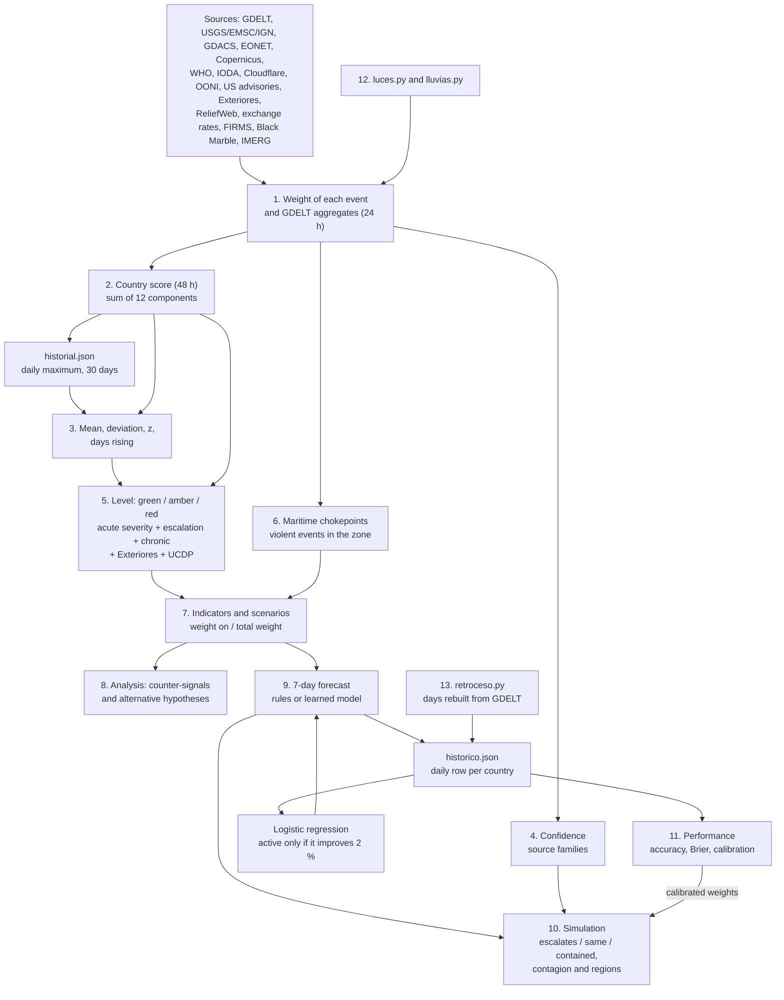

[Español](calculos.md) · **English**

# atalaya calculations

Full mathematical reference for atalaya: how raw events become each country's score, its alert level, the scenarios, the 7-day forecast, the simulation and the measurement of accuracy.

It is written for whoever maintains the project. Every formula comes from the code, and each section says where it lives, which constant to change to tune the behaviour and what else depends on it. If this document and the code disagree, the code wins.

> [!NOTE]
> Variable and constant names are the ones in the code, in Spanish. The examples use a made-up country, **country X**, with plausible numbers. Every example has been checked by running the real functions.

## Contents

0. [Overview](#0-overview)
1. [Event weights](#1-event-weights)
2. [Country score](#2-country-score)
3. [Baseline, z and escalation](#3-baseline-z-and-escalation)
4. [Confidence](#4-confidence)
5. [Alert levels](#5-alert-levels)
6. [Maritime chokepoints](#6-maritime-chokepoints)
7. [Indicators and scenarios](#7-indicators-and-scenarios)
8. [Analysis, alternative hypotheses and report](#8-analysis-alternative-hypotheses-and-report)
9. [7-day forecast](#9-7-day-forecast)
10. [Simulation](#10-simulation)
11. [Performance measurement](#11-performance-measurement)
12. [Satellite signals](#12-satellite-signals)
13. [Backtest reconstruction](#13-backtest-reconstruction)
14. [Telegram alerts](#14-telegram-alerts)
15. [Repeated constants and dependencies](#15-repeated-constants-and-dependencies)
16. [Assumptions and known limits](#16-assumptions-and-known-limits)
17. [One-diagram summary](#17-one-diagram-summary)

---

## 0. Overview

Each run of [actualizar.py](../scripts/actualizar.py) does, in this order:

1. Downloads the sources. Each event gets a **weight** and an **event level** (green, amber, red). GDELT does not give weighted events: it gives counts per country.
2. Adds up a **score** per country from the last 48 hours.
3. Compares the score with the country's **baseline** (30 days) and computes $z$.
4. Assigns a **confidence** from how many source families agree.
5. Decides the country's **level** with rules for acute severity, escalation and structural severity.
6. Computes the risk at the **maritime chokepoints**.
7. [inteligencia.py](../scripts/inteligencia.py) switches on **indicators**, rates **scenarios**, adds the **analysis** and the 7-day **forecast**, and writes the **report**.
8. [simulacion.py](../scripts/simulacion.py) **simulates** three branches per crisis, contagion and regions.
9. The **performance** of past forecasts is measured and the day's row is saved to `historico.json`.

Files that keep state between runs and matter for the calculations:

| File | What it stores | For which calculation |
|---|---|---|
| `historial.json` | Each day's **maximum** score per country, 31 days (today and the 30 before) | Baseline and $z$ (section 3) |
| `historico.json` | Per day and country: `[score, level, worsening, forecast grade, probability, features]`, from the **last** run of the day, no limit | Accuracy, Brier, learned model (sections 9 and 11) |
| `retroceso.json` | Which days in `historico.json` are reconstructed | Not mixing real and reconstructed days (sections 11 and 13) |
| `modelo_aprendido.json` | Model weights and validation | Learned forecast (section 9) |
| `incendios_historial.json`, `luces_historial.json`, `lluvias_dias.json`, `divisas_historial.json` | Signal series | Their own baselines (sections 1 and 12) |

The `historico.json` row has this format (written in `archivar`):

| Position | Content | Values |
|---|---|---|
| 0 | Score | number |
| 1 | Level | 0 green, 1 amber, 2 red |
| 2 | Worsening (escalation) | 0 or 1 |
| 3 | Forecast grade | 0 low, 1 medium, 2 high |
| 4 | Learned-model probability | number or `null` |
| 5 | Model features | list of 14 numbers |

---

## 1. Event weights

Code: each source's function in [actualizar.py](../scripts/actualizar.py), `nivel_por_peso`, `gdelt`, `sin_duplicados_sismicos`, `exteriores_nivel`, `divisas` and `incendios`.

### 1.1 Formulas per source

Each event carries a weight $w$ (what it adds to the country's score), an event level and a source family.

**Earthquakes** (USGS, EMSC, IGN). With magnitude $M$:

$$
w = \max(M-4,\ 0)^2 + b_{\text{PAGER}}
$$

where $b_{\text{PAGER}}$ is 3, 10 or 25 if USGS issues a yellow, orange or red PAGER alert, and 0 otherwise (EMSC and IGN have no PAGER). The event level comes from the weight:

$$
\text{level}(w) = \begin{cases} \text{red} & w \ge 12 \\ \text{amber} & 4 \le w < 12 \\ \text{green} & w < 4 \end{cases}
$$

| Source | What is downloaded |
|---|---|
| USGS | Magnitude 4.5 or more, worldwide, last week |
| EMSC | Magnitude 4 or more, box lat 24 to 50 and lon −25 to 45, from 7 days ago, up to 300 |
| IGN | Spain and surroundings, magnitudes below 2.5 are dropped |

**Seismic duplicates** (`sin_duplicados_sismicos`). The same earthquake can arrive from all three sources. They are sorted by preference USGS, EMSC, IGN, and an earthquake is dropped if one already chosen has

$$
\lvert t_1 - t_2 \rvert < 120\ \text{s} \quad \text{and} \quad d(1,2) < 100\ \text{km}
$$

with $d$ the great-circle distance (`distancia_km`, haversine formula with $2R = 12742$ km).

**Other sources:**

| Source | Weight $w$ | Event level | Family |
|---|---|---|---|
| GDACS (cyclone, flood, volcano, wildfire, tsunami) | green 1, orange 6, red 15 | GDACS's own | oficial |
| GDACS drought (DR) | 0, and no country | GDACS's own | oficial |
| GDACS wildfire or drought in green | dropped | | |
| NASA EONET | wildfire 0.5; storm 2; volcano 2; flood 2; landslide 2; dust 0.5; drought 1; snow 0.5; other 1 (earthquakes and ice are dropped) | green | oficial |
| Copernicus EMS (activations in the last 10 days) | 5 | amber | oficial |
| WHO, outbreak | 3, or 8 if the disease matches `EPIDEMIAS_GRAVES` | green, or amber if serious | sanitaria |
| IODA, internet outage | $\min(12,\ \max(0,\ 3(\log_{10}(s+1)-5)))$ with $s$ the IODA score; if 0, no event | amber if $w \ge 9$ | tecnica |
| Cloudflare Radar | 12 if ordered by the government nationwide; 8 if ordered by the government in part; 3 if technical and nationwide; otherwise 0 and no event | red if $w \ge 12$, else amber | tecnica |
| OONI, new block | 6 | amber | tecnica |
| OONI, usual block (2 or more apps) | 0 | green | tecnica |
| US advisories, raise | $4\,(n_{\text{new}} - n_{\text{before}})$; lowering: 0 | amber if raised and $n_{\text{new}} \ge 3$ | oficial |
| Exteriores, raise | $5\,(n_{\text{new}} - n_{\text{before}})$; any other update: 1 | amber if raised and $n_{\text{new}} \ge 3$ | oficial |
| ReliefWeb, crisis in `alert` | 6 | amber | humanitaria |
| ReliefWeb, crisis in `current` | 0 | green | humanitaria |
| Currency (section 1.4) | 1.5, or 3 if it falls 15 % or more | green | tecnica |
| FIRMS fires (section 12.1) | 2, or 3 if 4 times usual or more | green | tecnica |
| Blackout, Black Marble (section 12.2) | 2, or 3 if light falls to 30 % or less | green | tecnica |
| Extreme rain, IMERG (section 12.3) | 2, or 3 if it covers 2,500 km² or more | green | tecnica |
| UCDP | no events: gives deaths per country (section 5) | | academica |

**OONI** measures, per country and app (WhatsApp, Telegram, Signal, Messenger), the anomaly rate $a = \text{anomalies}/\text{measurements}$, only with 10 measurements or more. There are two windows: *now* (from 2 days ago to tomorrow) and *before* (from 14 to 2 days ago). A block is new if $a_{\text{now}} \ge 0.5$ and $a_{\text{before}} < 0.25$ (no data before counts as 0), and usual if just $a_{\text{now}} \ge 0.5$. There is an event only if some block is new, or two or more apps have a usual block.

**Travel advisories.** Changes are detected by comparing with the level saved by the previous run and are kept for 7 days (`VENTANA_MAPA`). Each run regenerates the event with its original date, so it only scores while it is inside the 48-hour scoring window.

### 1.2 Exteriores level (`exteriores_nivel`)

Spain's Foreign Ministry (Exteriores) has no API: the *Notas importantes* text of each country page (up to 600 characters) is read at most every 12 hours. The level is decided sentence by sentence, on normalised text (no accents, lower case), and the maximum wins:

| Rule, in this order | Level |
|---|---|
| "abandonen el país" (leave the country), or "recomienda/insta/aconseja … abandonar el país" | 4 |
| The sentence is not about travelling, but says "extremar la(s) precaución(es)" or "máxima precaución" (extreme caution) | 2 |
| Advises against travel and names zones, regions, borders, provinces… (`ZONAS`), without "todo el país/territorio" (the whole country) | 2 |
| Advises against travel "bajo cualquier/ninguna circunstancia" (under any circumstances) | 4 |
| Advises against travel "salvo" or "excepto" (except) | 3 |
| Advises against travel "totalmente/absolutamente/completamente" (totally) | 4 |
| Advises against travel, with no other nuance | 3 |
| No sentence matches | 1 |

"Advises against travel" is one of these phrases: *desaconseja(n) [totalmente…] [el/todo/cualquier/los/realizar] viaje(s)/viajar*, *no viajar* (except *no viajar de noche*, not at night), *aplazar el/su viaje* (postpone the trip), *evitar todo/cualquier viaje* (avoid all travel).

Examples checked with the code:

| Text | Level |
|---|---|
| "Se desaconseja viajar a las zonas fronterizas con Malí. Se recomienda extremar las precauciones en el resto del país." (Travel to the border areas with Mali is advised against. Extreme caution is advised in the rest of the country.) | 2 |
| "Se desaconseja viajar al país bajo cualquier circunstancia." (Travel to the country is advised against under any circumstances.) | 4 |
| "Se desaconseja viajar salvo por razones de extrema necesidad." (Travel is advised against except for extreme necessity.) | 3 |
| "Se recomienda a los españoles que abandonen el país." (Spaniards are advised to leave the country.) | 4 |
| "Se desaconseja participar en manifestaciones." (Taking part in demonstrations is advised against.) | 1 |

An Exteriores change is recorded when the page's *Última actualización* (last updated) date changes.

### 1.3 GDELT aggregation (`gdelt`)

GDELT does not provide weighted events but counts per country over the last 24 hours: the 96 fifteen-minute files up to the latest published (`GDELT_FICHEROS`). If more than half are missing, the source is treated as down.

For each row (a GDELT "event") with coordinates:

1. A country is assigned by coordinates or, if it falls at sea, by the place name. Mislabelled territories (Gaza, West Bank…) take precedence.
2. **Type.** Only if it is the main event of the article (`IsRootEvent = 1`):
   - *conflict*: CAMEO root code 18, 19 or 20 **and** political violence (`es_politico`): some actor of type MIL, REB, INS, SEP, UAF, GOV, SPY or OPP, or an actor with a known group, or two actors from different countries. Police (COP) do not count.
   - *protest*: root code 14.
3. **Chokepoints**: if it is a conflict and not a generic country point (geographic type other than 1), it is added to the nearby chokepoint (section 6). This happens **before** duplicates are removed.
4. **Once per article.** The row is dropped if the key $(\text{country}, \text{type}, \text{URL})$ was already seen. For rows with no type, the type is "de-escalation" if the base code is 086 or 087, and empty otherwise.
5. **State media.** The row weight is $v = 0.5$ if the URL belongs to an outlet in `MEDIOS_ESTATALES`, and $v = 1$ otherwise.
6. $v$ is added to `total`. If the row has no type but is a main event, with base code 086 (allow humanitarian aid) or 087 (military de-escalation) and political violence, $v$ is added to `desescalada`.
7. If it has a type, $v$ is added to `conflicto` or `protesta`, to its time half (`_12h` or `_12h_antes`, see section 3.4) and:
   - conflict between actors from two countries: to `interestatal`;
   - with MIL, REB, INS or UAF actors: to `militar`;
   - to the region (first administrative division of the place) and to the actor pair;
   - protest with base code 145 (violent protest): to `disturbios`;
   - if $v < 1$, 1 (not 0.5) is added to `estatal`.

With 5 violent events or more, the **regions** (top 3 with at least 10 % of the regional events) and the **actor pairs** (top 3 with at least 3 events) are kept. For the map, the 500 places with most mentions are published, and only if they have 3 mentions or more; these points have weight 0.

### 1.4 Currency (`divisas`)

A daily snapshot of exchange rates against the dollar (units per dollar) is kept for 30 days. With $r_0$ the rate in the latest snapshot from 7 or more days ago and $r_1$ today's:

$$
\text{fall} = 1 - \frac{r_0}{r_1}
$$

There is an event if $\text{fall} \ge 0.08$. It applies to every country using the currency (for example, the CFA franc to six or eight countries).

### Example

| Signal | Calculation | Weight | Level |
|---|---|---|---|
| Magnitude 6.0 earthquake | $(6-4)^2 = 4$ | 4 | amber |
| Magnitude 7.5 earthquake | $3.5^2 = 12.25$ | 12.25 | red |
| Magnitude 5.0 with yellow PAGER | $1 + 3$ | 4 | amber |
| IODA with $s = 3 \cdot 10^6$ | $3(\log_{10}(3\,000\,001) - 5) = 3 \cdot 1.477 = 4.4$ | 4.4 | green |
| IODA with $s = 10^9$ | $3 \cdot 4 = 12$ (cap) | 12 | amber |
| US raises its advisory from 2 to 4 | $4 \cdot 2$ | 8 | amber |
| Currency from 100 to 112 per dollar | $1 - 100/112 = 0.107$ | 1.5 | green |

### Constants

| Name | Value | File | Raise it / lower it |
|---|---|---|---|
| `nivel_por_peso` thresholds | 12 red, 4 amber | actualizar.py | Higher: fewer earthquakes set the country's level. Lower: moderate quakes put countries in amber or red |
| PAGER bonus | 3 / 10 / 25 | actualizar.py, `usgs` | More weight to USGS's damage estimate versus magnitude |
| GDACS weights | 1 / 6 / 15 | actualizar.py, `gdacs` | How much a disaster adds according to its alert |
| `EONET_TIPOS` | 0.5 to 2 | actualizar.py | How much each NASA phenomenon adds |
| Copernicus weight | 5, amber | actualizar.py, `copernicus` | Being amber, any activation puts the country in amber for 48 h |
| `EPIDEMIAS_GRAVES` | regular expression | actualizar.py | Which outbreaks weigh 8 and are amber instead of 3 and green |
| IODA threshold | $10^5$ (the "−5") | actualizar.py, `ioda` | Higher: only huge outages count. Lower: daily noise from many countries gets in |
| Cloudflare weights | 12 / 8 / 3 | actualizar.py, `cloudflare` | How much an outage weighs by cause and scope |
| OONI thresholds | 0.5 now, 0.25 before, 10 measurements | actualizar.py, `ooni` | Stricter: fewer blocks detected, fewer false positives |
| OONI weight | 6 | actualizar.py | How much a new block adds |
| US advisories | 4 per level | actualizar.py, `avisos_viaje` | How much a raise adds |
| Exteriores | 5 per level raised, 0 for an update without a raise | actualizar.py, `exteriores` | How much a raise adds |
| `EXTERIORES_CADA` | 12 h | actualizar.py | How often the Exteriores website (197 pages) is read |
| ReliefWeb | 6 in `alert` | actualizar.py | How much a crisis in alert adds |
| `CAIDA_DIVISA`, `CAIDA_DIVISA_GRAVE` | 0.08 and 0.15 | actualizar.py | Lower: more currencies trigger. The 0.08 is repeated in the `moneda_cae` indicator (section 15) |
| `GDELT_FICHEROS` | 96 | actualizar.py | GDELT window. Changing it changes the counts and the reconstruction factor (section 13) |
| `PESO_ESTATAL` | 0.5 | actualizar.py | 0 drops state media; 1 treats them like the rest |
| `ACTORES_POLITICOS` | MIL, REB, INS, SEP, UAF, GOV, SPY, OPP | actualizar.py | Adding COP would bring crime reporting in as conflict |
| `GDELT_VIOLENCIA`, `GDELT_PROTESTA`, `GDELT_DESESCALADA` | 18-20, 14, 086-087 | actualizar.py | Which CAMEO codes count in each category |
| Seismic duplicates | 120 s and 100 km | actualizar.py | Wider: distinct nearby earthquakes get merged |

**Rationale.** The weights translate very different sources to a common scale in which about 4 points is already notable and about 12 is serious, the same scale the level thresholds use. Sources that reflect serious human decisions (activating Copernicus, an orange or red alert) also set an event level that overrides the sum.

---

## 2. Country score

Code: `puntuar` in [actualizar.py](../scripts/actualizar.py).

### Formula

The score is the sum of 12 components (`CLAVES_PUNTOS`), each rounded to one decimal:

$$
S = S_{\text{conflict}} + S_{\text{protests}} + S_{\text{disasters}} + S_{\text{internet}} + S_{\text{censorship}} + S_{\text{advisories}} + S_{\text{epidemics}} + S_{\text{humanitarian}} + S_{\text{economy}} + S_{\text{fires}} + S_{\text{blackout}} + S_{\text{rain}}
$$

**GDELT components.** With $C$ the weighted violent events, $P$ the weighted protests and $T$ the country's weighted total of events (everything in section 1.3):

$$
q_C = \frac{C}{\max(T,\ 20)} \qquad S_{\text{conflict}} = 3 \log_2(1 + C) \cdot \min\left(1,\ \frac{q_C}{0.05}\right)
$$

$$
q_P = \frac{P}{\max(T,\ 20)} \qquad S_{\text{protests}} = 1.5 \log_2(1 + P) \cdot \min\left(1,\ \frac{q_P}{0.05}\right)
$$

$q_C$ is the *violence share* (`cuota_violencia`) and $q_P$ the *protest share*.

**Other components.** Each is the sum of the weights $w$ of the country's events of that type inside the window:

$$
S_k = \sum_{e \in k,\ t_e \ge t_{\text{now}} - \Delta_k} w_e
$$

| Event type | Component | Window $\Delta_k$ |
|---|---|---|
| internet | internet | 48 h |
| censura | censorship | 48 h |
| aviso (US and Exteriores) | advisories | 48 h |
| epidemia | epidemics | 30 days |
| crisis (ReliefWeb) | humanitarian | no window while it stays open |
| economia, incendios, apagon, lluvia | its own | 48 h |
| terremoto, desastre and anything else | disasters | 48 h |

At the same time, each country gets its **event rank**: the maximum level (0, 1, 2) of its events in the window, and `rango_desastre`, the same for the disasters component only.

GDELT covers 24 hours and the other sources 48. If GDELT fails, its last aggregates are reused so that conflict does not drop to zero.

### Example

Country X has $T = 300$, $C = 40$ and $P = 20$ in GDELT, plus a new messaging block (OONI, weight 6).

- $q_C = 40/300 = 0.133$, above 0.05, so the factor is 1. $S_{\text{conflict}} = 3 \log_2 41 = 3 \cdot 5.358 = 16.1$.
- $q_P = 20/300 = 0.067$, factor 1. $S_{\text{protests}} = 1.5 \log_2 21 = 1.5 \cdot 4.392 = 6.6$.
- $S_{\text{censorship}} = 6$.
- $S = 16.1 + 6.6 + 6 = 28.7$.

If the same country had $T = 1000$ (much talked about for other reasons), $q_C = 0.04$ and the factor would be $0.04/0.05 = 0.8$: $S_{\text{conflict}} = 16.07 \cdot 0.8 = 12.9$.

### Constants

| Name | Value | File | Raise it / lower it |
|---|---|---|---|
| `CUOTA_PLENA` | 0.05 | actualizar.py | Higher: more violence share needed to count the full volume; very newsworthy countries drop. Lower: volume rules and the bias towards always-covered countries returns |
| Conflict multiplier | 3 | actualizar.py, `puntuar` | Scales all conflict. It shifts the effective level thresholds (25, 40), the indicator thresholds (4, 12) and the model's "score" feature |
| Protest multiplier | 1.5 | actualizar.py, `puntuar` | The same for protests |
| Floor of $T$ | 20 | actualizar.py, `puntuar` | With few events, stops 2 events out of 3 from giving a 67 % share. Higher: countries with little coverage score less |
| `VENTANA_PUNTUACION` | 48 h | actualizar.py | Longer: steadier levels but slower to come down |
| `VENTANA_EPIDEMIAS` | 30 days | actualizar.py | How long an outbreak stays in the score (and in the level, if serious) |
| `CLAVES_PUNTOS`, `PARTE_DE` | 12 components | actualizar.py | A new event type must be added here; otherwise it adds to "disasters" |

**Rationale.** The logarithm makes going from 0 to 10 events weigh more than going from 100 to 110: what matters is that violence starts, not its exact volume. The share corrects press bias: there are always many events about the US or India, but they are a small part of what is reported about them.

---

## 3. Baseline, z and escalation

Code: `calcular_alertas`, `dias_subiendo` and `aceleracion` in [actualizar.py](../scripts/actualizar.py), and `main` (how `historial.json` is filled).

### Formulas

**Series.** `historial.json` stores, for each day, the **maximum** score across that day's runs. A country's series is the $n \le 30$ days before today (`DIAS_HISTORIAL`), with 0 on days it does not appear:

$$
x_1, \dots, x_n \qquad \mu = \frac{1}{n}\sum_i x_i \qquad \sigma = \sqrt{\frac{1}{n}\sum_i (x_i - \mu)^2}
$$

($\sigma$ is the population standard deviation, `pstdev`; it is 0 if $n \le 1$).

**z.** With $S$ today's score:

$$
z = \frac{S - \mu}{\max(\sigma,\ 2,\ 0.25\,\mu)}
$$

If there is no series, $z = 0$.

**Days rising in a row.** On the series with today at the end, $x_1, \dots, x_n, x_{n+1} = S$, count backwards from today how many days satisfy

$$
x_i > x_{i-1} + 0.5
$$

and stop at the first that does not.

**Trend** (text): "rising" if $z \ge 1$ or 3 or more days rising; "falling" if $z \le -1$; "stable" otherwise; "no data" if there is no series.

### 3.4 Acceleration over 12 hours

To have a trend from day one, without history, the two halves of the 24 hours of GDELT are compared. The cut is the time of the most recent event minus 12 hours. With $A$ the (weighted) conflict and protest events of the last 12 hours and $B$ those of the 12 before:

$$
a = \begin{cases} \dfrac{A + 1}{B + 1} & A + B \ge 8 \\ \text{no value} & A + B < 8 \end{cases}
$$

$a = 1$ is the same; $a = 2$, double.

### Example

Country X has 29 previous days: 23 days at 18 and then 19, 18, 19, 20, 22, 25. Today $S = 28.7$.

- $\mu = 18.52$ and $\sigma = 1.48$.
- Denominator: $\max(1.48;\ 2;\ 0.25 \cdot 18.52 = 4.63) = 4.63$. The proportional floor wins.
- $z = (28.7 - 18.52)/4.63 = 2.20$.
- Days rising: 28.7 > 25.5; 25 > 22.5; 22 > 20.5; 20 > 19.5; 19 > 18.5; but 18 is not above 19.5. That is **5 days**.
- Trend: "rising".
- Acceleration: in the last 12 h there were 26 conflict and 12 protest events ($A = 38$); in the 12 before, 14 and 8 ($B = 22$). $a = 39/23 = 1.70$.

### Constants

| Name | Value | File | Raise it / lower it |
|---|---|---|---|
| `DIAS_HISTORIAL` | 30 | actualizar.py | Longer baseline: steadier, slower to accept a new situation as normal |
| Absolute floor of $\sigma$ | 2 | actualizar.py, `calcular_alertas` | Higher: countries with very steady scores need bigger jumps for a high $z$ |
| Relative floor of $\sigma$ | $0.25\,\mu$ | actualizar.py | Stops a country with a high, steady mean from giving huge $z$ for a small change |
| Daily rise threshold | 0.5 points | actualizar.py, `dias_subiendo` | Higher: each day must rise more to count |
| Trend thresholds | $z = \pm 1$, 3 days | actualizar.py | Only change the "rising/falling/stable" text |
| Acceleration minimum | 8 events | actualizar.py, `aceleracion` | Lower: more countries with acceleration, more noise |
| Acceleration smoothing | +1 | actualizar.py | Avoids dividing by 0 and tempers ratios with few events |

**Rationale.** Each country is compared with itself, not with others: 20 points is normal in a long war and alarming in a quiet country. The two floors of the denominator stop a country with a flat series from giving runaway $z$ for a small change.

---

## 4. Confidence

Code: `confianza` in [actualizar.py](../scripts/actualizar.py).

### Formula

A country collects the **families** of its events in the window that have $w > 0$ or a level other than green. The *prensa* (press) family is added if $S_{\text{conflict}} \ge 3$ or $S_{\text{protests}} \ge 3$. With $F$ the set of families:

$$
\text{confidence}(F) = \begin{cases} \text{high} & \lvert F \rvert \ge 2 \\ \text{medium} & \lvert F \rvert = 1 \text{ and } F \ne \{\text{prensa}\} \\ \text{low} & \text{otherwise} \end{cases}
$$

Possible families: prensa (GDELT), oficial (earthquakes, GDACS, EONET, Copernicus, travel advisories, Exteriores), tecnica (IODA, Cloudflare, OONI, currencies, satellites), sanitaria (WHO), humanitaria (ReliefWeb) and academica (UCDP).

Two additions:

- If the US advisory is at level 4, *oficial* is added when computing confidence.
- If UCDP gives 25 deaths or more, *academica* is added and confidence is recomputed (section 5).

### Example

Country X has $S_{\text{conflict}} = 16.1 \ge 3$ (prensa) and an OONI block (tecnica). $F = \{\text{prensa}, \text{tecnica}\}$, so confidence is **high**. Without the block it would be **low**.

### Constants

| Name | Value | File | Raise it / lower it |
|---|---|---|---|
| Press threshold | 3 points | actualizar.py, `puntuar` | Higher: a little violence in the press does not count as a family |
| Families for "high" | 2 | actualizar.py, `confianza` | Affects the country card text, Telegram, the "media spike" hypothesis (section 8) and the simulation margin (section 10) |

**Rationale.** Confidence does not measure how serious something is, but how corroborated it is: two independent source types that agree are more reliable than many articles from the same family.

---

## 5. Alert levels

Code: `calcular_alertas` and the end of `main` in [actualizar.py](../scripts/actualizar.py).

### Rules

A rank $r \in \{0, 1, 2\}$ (green, amber, red) is computed. Each rule can only raise it, except where noted. With $S$, $\mu$, $z$ and $d$ (days rising) from section 3, $r_e$ the event rank from section 2 and $c$ = *calibrating* (see below):

| # | Condition | Effect | Reason shown |
|---|---|---|---|
| 1 | $S \ge 40$ | $r = 2$ | Very high activity |
| 1 | $25 \le S < 40$ | $r = 1$ | High activity |
| 1 | $r_e > 0$ | $r = \max(r, r_e)$ | Official red / orange alert |
| 2 | not $c$, $z \ge 3$ and $S \ge 18$ | $r = 2$, escalation | Far above usual |
| 2 | else: not $c$, $z \ge 1.5$ and $S \ge 10$ | $r \ge 1$, escalation | Above usual |
| 2 | $d \ge 3$ and $S \ge 10$ (also while calibrating) | $r \ge 1$, escalation | N days rising in a row |
| 3 | not $c$ and $\mu \ge 30$ | $r = 2$ | Prolonged crisis |
| 3 | else: not $c$ and $\mu \ge 18$ | $r \ge 1$ | Prolonged crisis |
| 3 | US advisory = 4 and $S \ge 3$ | $r \ge 1$ | US advises against travel |
| 3 | open humanitarian crisis (ReliefWeb) | $r \ge 1$ | Open humanitarian crisis |

A country is included in the output if $r > 0$ or $S > 0$. The countries evaluated are those with a score today, those in the history of the last 30 days and those with a US level 4 advisory.

**Calibrating mode.** If `historial.json` has fewer than `DIAS_CALIBRADO` = 7 days before today, $c$ is true and the rules that depend on the usual level ($z$ and $\mu$) are not applied. The absolute thresholds, events, days rising, the US advisory and ReliefWeb still apply.

**Later adjustments** (in `main`, after `calcular_alertas`):

| Condition | Effect | Reason |
|---|---|---|
| Exteriores at level 4, $S \ge 3$ and the country green | becomes amber | Exteriores advises against travel |
| Exteriores at level 4 (other cases) | reason only | Exteriores advises against travel |
| UCDP $\ge 25$ deaths in 90 days | reason and *academica* family | N verified deaths in 90 days (UCDP) |
| UCDP $\ge 1000$ | becomes red | |
| UCDP $\ge 100$ and the country green | becomes amber | |

These adjustments only apply to countries already in the output, and do not mark escalation.

### Example

Country X: $S = 28.7$, $r_e = 1$ (the OONI block is amber), $z = 2.20$, $d = 5$, $\mu = 18.52$, 29 days of history (not calibrating).

1. $S \ge 25$: $r = 1$, "High activity". $r_e = 1$: "Official orange alert".
2. $z = 2.20 < 3$; $z \ge 1.5$ and $S \ge 10$: escalation, "Above usual". $d = 5 \ge 3$: "5 days rising in a row".
3. $\mu = 18.52 \ge 18$: "Prolonged crisis".

Result: **amber**, with escalation, high confidence and trend "rising". To reach red it would need $S \ge 40$, $z \ge 3$ (that is, $S \ge 18.52 + 3 \cdot 4.63 = 32.4$) or $\mu \ge 30$.

### Constants

| Name | Value | File | Raise it / lower it |
|---|---|---|---|
| Very high / high activity | 40 / 25 | actualizar.py | Absolute thresholds. Lower: more amber and red countries regardless of history |
| Strong escalation | $z \ge 3$ and $S \ge 18$ | actualizar.py | Stricter: fewer reds from sudden changes |
| Escalation | $z \ge 1.5$ and $S \ge 10$ | actualizar.py | The floor of 10 stops a near-zero country escalating by going from 1 to 5 |
| Days rising | 3 days and $S \ge 10$ | actualizar.py | More days: slower but surer escalation |
| Prolonged crisis | $\mu \ge 30$ red, $\mu \ge 18$ amber | actualizar.py | Lower: more long wars coloured even when quiet today |
| US advisory | level 4 and $S \ge 3$ | actualizar.py | Removing $S \ge 3$ would let the advisory colour a country on its own |
| `DIAS_CALIBRADO` | 7 | actualizar.py | More days of waiting before trusting $z$ and $\mu$ |
| Exteriores | level 4 and $S \ge 3$ | actualizar.py, `main` | Same as the US advisory |
| UCDP | 25 / 100 / 1000 deaths | actualizar.py, `main` | The 25 is repeated in the `muertes_verificadas` indicator (section 15) |

**Rationale.** It separates three questions an early-warning team separates: how bad it is today (acute severity), whether it is worse than normal for that country (escalation) and whether it has been bad for a long time (structural severity). Travel advisories only reinforce what the project's own data already show, because they also reflect the foreign policy of whoever issues them.

---

## 6. Maritime chokepoints

Code: `PASOS`, the chokepoint part of `gdelt` and `calcular_pasos` in [actualizar.py](../scripts/actualizar.py).

### Formula

Each chokepoint has a zone: one or more points $(x_k, y_k)$ and a radius $R$. A GDELT conflict event from the last 24 hours, at a specific place (not a generic country point), counts for the chokepoint if

$$
\lvert \text{lat} - \text{lat}_{\text{chokepoint}} \rvert < 6^\circ \quad \text{and} \quad \min_k d\big((\text{lon}, \text{lat}), (x_k, y_k)\big) \le R
$$

With $n$ the events counted:

$$
\text{level} = \begin{cases} \text{red} & n \ge 25 \\ \text{amber} & 6 \le n < 25 \\ \text{green} & n < 6 \end{cases}
$$

| Chokepoint | Radius (km) | Zone points |
|---|---|---|
| Strait of Hormuz | 220 | 1 |
| Bab el-Mandeb and southern Red Sea | 250 | 2 |
| Suez Canal | 90 | 3 |
| Bosphorus | 80 | 2 |
| Strait of Gibraltar | 120 | 1 |
| Strait of Malacca | 250 | 3 |
| Taiwan Strait | 200 | 1 |
| Panama Canal | 100 | 1 |

Note: events are counted without removing per-article duplicates and without down-weighting state media (they are counted before those two steps).

### Example

In 24 hours there are 9 conflict events in the southern Red Sea within 250 km of one of Bab el-Mandeb's two points. $n = 9$: **amber**. This switches on the `ruta_cercana` indicator for Yemen, Djibouti and Eritrea (section 7) and enters the report as a Spanish interest.

### Constants

| Name | Value | File | Raise it / lower it |
|---|---|---|---|
| Thresholds | 25 red, 6 amber | actualizar.py, `calcular_pasos` | Lower: more route alerts, also from noise |
| `PASOS` radii and points | table above | actualizar.py | Larger: cities unrelated to the route get in (Gaza, Cairo) |
| Latitude filter | 6° | actualizar.py, `gdelt` | Only speeds things up; must exceed any radius in degrees |
| `PASOS_PAISES` | coastal countries | inteligencia.py | Which countries switch on `ruta_cercana` for each chokepoint |

**Rationale.** A route's risk depends on violence near the route, not on the level of the whole country: a conflict inland in Egypt does not affect the Suez Canal.

---

## 7. Indicators and scenarios

Code: `indicadores`, `ESCENARIOS`, `desescalando` and `escenarios` in [inteligencia.py](../scripts/inteligencia.py).

### 7.1 Indicators

Some thresholds are relative to the country's news volume. With $T$ the weighted GDELT total and $g_k$ a GDELT count (section 1.3):

$$
\text{notable}(k, m, c) \iff g_k \ge \max(m,\ c \cdot \max(T, 1))
$$

| Indicator | Switches on if |
|---|---|
| `violencia_sube` | $S_{\text{conflict}} \ge 4$ and ($z \ge 1$ or $d \ge 2$) |
| `violencia_alta` | $S_{\text{conflict}} \ge 12$ |
| `interestatal` | notable(interestatal, 5, 0.005) |
| `militar` | notable(militar, 5, 0.005) |
| `aviso_sube` | $S_{\text{advisories}} > 0$ |
| `exteriores_alto` | Exteriores level $\ge 3$ |
| `contagio` | 2 or more neighbours in red or escalating |
| `ruta_cercana` | the country borders a chokepoint that is not green |
| `corte_internet` | $S_{\text{internet}} > 0$ |
| `censura` | $S_{\text{censorship}} > 0$ (new blocks only; usual ones weigh 0) |
| `protestas_suben` | $S_{\text{protests}} \ge 4$ and ($z \ge 1$ or $q_P \ge 0.05$) |
| `disturbios` | notable(disturbios, 3, 0.003) |
| `golpe_en_prensa` | a headline about the country mentions "golpe de Estado", "golpista" or "asonada" (coup) |
| `desastre_grave` | `rango_desastre` $\ge 1$ |
| `epidemia_grave` | $S_{\text{epidemics}} \ge 8$ |
| `crisis_humanitaria` | open crisis in ReliefWeb |
| `muertes_verificadas` | UCDP $\ge 25$ |
| `moneda_cae` | currency fall $\ge 0.08$ |
| `incendios` | there is a fire anomaly (section 12.1) |
| `apagon` | there is a satellite blackout (section 12.2) |
| `lluvias_extremas` | there is extreme rain (section 12.3) |
| `eleccion_cercana` | an election or referendum in the next 45 days (Wikidata) |

**Neighbours** are computed in `calcular_vecinos`: two countries are neighbours if they share a polygon vertex rounded to 0.1°.

### 7.2 Scenarios

Each scenario is a list of weighted indicators (2 if key, 1 otherwise):

| Scenario | Indicators (weight) | Total weight $W$ |
|---|---|---|
| Military escalation | violencia_sube (2), interestatal (2), militar (1), aviso_sube (1), exteriores_alto (1), contagio (1), ruta_cercana (1), incendios (1), apagon (2) | 12 |
| Coup or government crisis | corte_internet (2), censura (2), militar (1), protestas_suben (1), golpe_en_prensa (2), aviso_sube (1), moneda_cae (1), eleccion_cercana (1) | 11 |
| Serious unrest | protestas_suben (2), disturbios (2), censura (1), corte_internet (1), violencia_sube (1), moneda_cae (1), eleccion_cercana (1) | 9 |
| Humanitarian emergency | desastre_grave (2), epidemia_grave (2), crisis_humanitaria (2), violencia_alta (1), muertes_verificadas (1), exteriores_alto (1), apagon (1), lluvias_extremas (2) | 12 |

With $E$ the sum of the weights of the indicators that are on:

$$
\text{risk} = \begin{cases} \text{high} & E/W > 0.5 \\ \text{medium} & E \ge 2 \\ \text{low} & E = 1 \end{cases}
$$

If $E = 0$, the scenario does not appear. The estimative language is high "Probable" (likely), medium "Posible" (possible), low "Poco probable" (unlikely).

**De-escalation.** With $D$ and $C$ the GDELT de-escalation and conflict counts:

$$
\text{de-escalating} \iff D \ge \max(3,\ 0.25\,C)
$$

If true, the military escalation scenario drops one grade (unless it was already low). Press talk of a truce does not lower anything: it is only shown as a counter-signal (section 8).

**Order.** First by risk (high, medium, low). At equal risk, the scenario that fits the country's largest component goes first: escalation with $S_{\text{conflict}}$; unrest with $S_{\text{protests}}$; humanitarian with $S_{\text{disasters}} + S_{\text{epidemics}} + S_{\text{humanitarian}}$; coup with $S_{\text{internet}} + S_{\text{censorship}}$. The first scenario that is not low is the **main scenario**, used by the analysis, the report and the simulation.

### Example

Country X, with $T = 300$, interstate 8, military 12, unrest 4, de-escalation 2, and one neighbour in red:

- On: violencia_sube ($16.1 \ge 4$ and $z = 2.2$), violencia_alta ($16.1 \ge 12$), interestatal ($8 \ge \max(5;\ 1.5)$), militar ($12 \ge 5$), censura ($6 > 0$), protestas_suben ($6.6 \ge 4$ and $z \ge 1$), disturbios ($4 \ge \max(3;\ 0.9)$). Contagion no: only 1 neighbour.
- Serious unrest: $E = 2 + 2 + 1 + 1 = 6$, $6/9 = 0.67 > 0.5$: **high**.
- Military escalation: $E = 2 + 2 + 1 = 5$, $5/12 = 0.42$: **medium**.
- Coup: $E = 2 + 1 + 1 = 4$, $4/11 = 0.36$: **medium**.
- Humanitarian: $E = 1$: **low**.
- De-escalation: $2 \ge \max(3;\ 10)$ no.
- Order: unrest (high); then escalation and coup (medium), escalation first because $S_{\text{conflict}} = 16.1$ is the largest component. Main scenario: **serious unrest**.

### Constants

| Name | Value | File | Raise it / lower it |
|---|---|---|---|
| `ESCENARIOS` (weights) | table above | inteligencia.py | Changing a weight changes $W$ and, with it, the "high" threshold of the whole scenario |
| "High" threshold | $E/W > 0.5$ | inteligencia.py, `escenarios` | Lower: more likely scenarios |
| "Medium" threshold | $E \ge 2$ | inteligencia.py | With 2, one key indicator or two normal ones suffice |
| `violencia_sube`, `violencia_alta`, `protestas_suben` thresholds | 4, 12, 4; $z \ge 1$; $d \ge 2$; $q_P \ge 0.05$ | inteligencia.py, `indicadores` | They are in section 2 points: they shift if the multipliers 3 and 1.5 change |
| `notable` | (5; 0.005), (5; 0.005), (3; 0.003) | inteligencia.py | The minimum protects small countries; the share, very newsworthy ones |
| `contagio` | 2 neighbours | inteligencia.py | With 1, any border with a war switches it on |
| `epidemia_grave` | 8 | inteligencia.py | Equal to a serious outbreak's weight in actualizar.py (section 15) |
| De-escalation | $\max(3;\ 0.25\,C)$ | inteligencia.py, `desescalando` and `analisis` | Repeated in two functions (section 15) |

**Rationale.** It is the indicators-and-warnings method: instead of a black box, each scenario is a list of observable signals, and the risk is the share of them that is on. So each judgement shows its evidence and says what is missing for it to get worse.

---

## 8. Analysis, alternative hypotheses and report

Code: `analisis`, `informe` and `intereses_espana` in [inteligencia.py](../scripts/inteligencia.py).

### 8.1 Counter-signals and alternative hypotheses

| Result | Condition |
|---|---|
| Counter-signal: de-escalation | $D \ge \max(3,\ 0.25\,C)$ |
| Counter-signal: truce in the press | a headline about the country mentions a ceasefire, truce, peace talks or agreement, cessation of hostilities or de-escalation |
| Alternative: propaganda | $\text{estatal}/\max(C + P + 0.5\,\text{estatal}, 1) \ge 0.3$ |
| Alternative: media spike | low confidence and level other than green |
| Alternative: local problem | the top region has at least 70 % of the regional events and it is not a conflict between countries |
| Alternative: external conflict | $\text{interestatal}/C \ge 0.5$ |
| Alternative: crisis that persists | open crisis and no escalation |
| What would disprove it | fixed list `DESMENTIRIA` for the main scenario |

For propaganda, rows are compared with rows: $C + P + 0.5\,\text{estatal}$ undoes the half weight of those outlets.

### 8.2 Daily report

**Country order:**

$$
\text{weight}(p) = 10\,r + 5\cdot[\text{escalation}] + \begin{cases} 4 & \text{high forecast} \\ 2 & \text{medium} \\ 0 & \text{low} \end{cases} + \frac{S}{10}
$$

- **Key judgements**: the first 6 that are not green, or green with a high forecast. The first is the **main conclusion**.
- **What to watch**: scenarios at medium risk and their first 2 indicators that are off ("if it appears…"), up to 6.
- **Interest for Spain**: countries not in green, or escalating, with interests in `intereses_espana.json`. Ordered by $\sum \text{interest weights} \cdot (r + 1)$. Gibraltar, Suez, Bab el-Mandeb and Hormuz are added if not green. Up to 8.
- **Regions**: with $n_r$, $n_a$ and $n_e$ the countries in red, in amber and escalating:

$$
\text{tension} = 2\,n_r + n_a + n_e \qquad \text{level} = \begin{cases} \text{red} & \text{tension} \ge 6 \\ \text{amber} & \text{tension} \ge 3 \\ \text{green} & \text{otherwise} \end{cases}
$$

### Example

Country X: amber ($r = 1$), escalating, high forecast (section 9), $S = 28.7$. $\text{weight} = 10 + 5 + 4 + 2.87 = 21.87$. A red country without escalation, with a medium forecast and $S = 45$, has $20 + 0 + 2 + 4.5 = 26.5$ and goes first.

A region with 1 country in red, 2 in amber and 2 escalating: $2 + 2 + 2 = 6$, level **red**.

### Constants

| Name | Value | File | Raise it / lower it |
|---|---|---|---|
| Propaganda threshold | 0.3 | inteligencia.py, `analisis` | Lower: the card warns of propaganda more often |
| Local problem | 0.7 | inteligencia.py | Lower: more cases treated as local |
| External conflict | 0.5 | inteligencia.py | |
| Order weights | 10 / 5 / 4 / 2 / $S/10$ | inteligencia.py, `informe` | Which countries come first in the report and the main conclusion |
| Judgements, watch, Spain, regions | 6 / 6 / 8 / 8 | inteligencia.py | Report length |
| Regional tension | 6 red, 3 amber | inteligencia.py | |
| `REGIONES` | 18 regions | inteligencia.py | Also used by the per-region simulation (section 10) |

**Rationale.** Structured analysis forces a look at the less alarming explanations before accepting the main one, as an analyst playing devil's advocate would.

---

## 9. 7-day forecast

Code: `pronostico` and `pendiente` in [inteligencia.py](../scripts/inteligencia.py), and all of [aprendizaje.py](../scripts/aprendizaje.py).

The forecast estimates whether the country will **worsen in a sustained way** over the next 7 days (the exact definition is in section 11.1). It has two methods: fixed rules and a learned model, used only if it passes validation.

### 9.1 Slope

Least-squares slope of the last 7 values of the series (today included), $y_0, \dots, y_{m-1}$ with $m \le 7$, in points per day:

$$
\beta = \frac{\sum_i (i - \bar{i})(y_i - \bar{y})}{\sum_i (i - \bar{i})^2}
$$

With fewer than 3 values, $\beta = 0$. The 7-day **projection** is $\max(0,\ S + 7\beta)$.

### 9.2 Fixed rules

With $e$ the risk of the worst scenario (2 high, 1 medium, 0 low), $a$ the acceleration (1 if no value) and $\text{accelerates} \iff a \ge 1.8 \text{ and } S \ge 6$:

| Grade | Condition (the first that holds) |
|---|---|
| high | ($\beta \ge 1.5$ and $S \ge 8$), or $e = 2$, or (escalation and $\beta > 0.5$), or (accelerates and $e \ge 1$) |
| medium | $\beta \ge 0.5$, or $e = 1$, or escalation, or accelerates |
| low | otherwise |

### 9.3 Learned model

**Features.** 14 signals that exist both on real days and on days reconstructed from GDELT only (section 13). With $G = S_{\text{conflict}} + S_{\text{protests}}$ the GDELT part of the score and $\pi = G/S$ (1 if $S = 0$); $\operatorname{clip}(x, a, b)$ bounds $x$ between $a$ and $b$:

| # | Feature | Value |
|---|---|---|
| 1 | puntuacion | $\ln(1 + G)$ |
| 2 | nivel | $r/2$ |
| 3 | escalada | 0 or 1 |
| 4 | z | $\operatorname{clip}(z, -3, 5)/5$ |
| 5 | pendiente | $\operatorname{clip}(\beta, -5, 5)/5$ |
| 6 | dias_subiendo | $\min(d, 7)/7$ |
| 7 | aceleracion | $\operatorname{clip}(\ln \max(a, 0.05), -2, 2)/2$ |
| 8 | cuota_violencia | $\operatorname{clip}(q_C, 0, 1)$ |
| 9 | entre_paises | $\text{interestatal}/C$ (0 if $C = 0$) |
| 10 | protestas | $P/\max(C + P, 1)$ |
| 11 | militar | $\text{militar}/C$ (0 if $C = 0$) |
| 12 | desescalada | $\operatorname{clip}(D/\max(C, 1), 0, 1)$ |
| 13 | vecinos_mal | $\min(v, 3)/3$, with $v$ the neighbours in red or escalating |
| 14 | media | $\ln(1 + \max(\mu, 0) \cdot \pi)$ |

**Samples.** Every country and day in `historico.json` that has features and 7 days of future in the file, without mixing real and reconstructed days in the same 8-day window. The outcome $y \in \{0, 1\}$ is "worsened in a sustained way" (section 11.1).

**Time-split validation.** With the sample days sorted $D_0 < \dots < D_{N-1}$:

$$
\text{cut} = D_{\lfloor 0.7 N \rfloor} \qquad \text{training: } d < \text{cut} \qquad \text{test: } d \ge \text{cut}
$$

It needs $N \ge 10$ days, 300 training samples and 100 test samples.

**Standardisation.** With each feature's training mean $m_j$ and standard deviation $s_j$ ($s_j = 1$ if it is 0):

$$
z_{ij} = \frac{x_{ij} - m_j}{s_j}
$$

**Logistic regression with L2.**

$$
\hat{p}_i = \sigma\Big(b + \sum_j w_j z_{ij}\Big) \qquad \sigma(u) = \frac{1}{1 + e^{-u}} \quad (u \text{ bounded to } \pm 30)
$$

It starts from $w = 0$ and $b = \ln\dfrac{\max(\bar{y}, 10^{-3})}{\max(1 - \bar{y}, 10^{-3})}$ (the base rate). Each of the 400 iterations is a full-batch gradient descent step, with $e_i = \hat{p}_i - y_i$, step $\eta = 0.5$ and $\lambda = 0.01$:

$$
b \leftarrow b - \eta \cdot \frac{1}{n}\sum_i e_i \qquad w_j \leftarrow w_j - \eta\left(\frac{1}{n}\sum_i e_i z_{ij} + \lambda w_j\right)
$$

This minimises the mean log loss plus $\tfrac{\lambda}{2}\lVert w \rVert^2$ (the bias is not regularised).

**Activation.** On the test days, the model's Brier score is compared with always saying the training rate $\bar{y}_{\text{train}}$:

$$
B = \frac{1}{n}\sum_i (\hat{p}_i - y_i)^2 \qquad \text{improvement} = 1 - \frac{B_{\text{model}}}{B_{\text{reference}}}
$$

The model is activated only if $\text{improvement} \ge 0.02$. It is then retrained on **all** samples and used. It is retrained once a day. The published **importance** is the weights $w_j$ sorted by absolute value.

**Grade with the model.**

$$
\text{grade} = \begin{cases} \text{high} & \hat{p} \ge 0.40 \\ \text{medium} & 0.20 \le \hat{p} < 0.40 \\ \text{low} & \hat{p} < 0.20 \end{cases}
$$

The validation calibration groups probabilities into the same bands: low $[0;\ 0.2)$, medium $[0.2;\ 0.4)$, high $[0.4;\ 1.01)$.

### Example

**Slope.** Country X's last 7 values: 19, 18, 19, 20, 22, 25, 28.7. $\bar{i} = 3$, $\sum (i - 3)^2 = 28$, $\sum (i-3)\,y_i = -57 - 36 - 19 + 0 + 22 + 50 + 86.1 = 46.1$. $\beta = 46.1/28 = 1.65$ points per day. Projection: $28.7 + 7 \cdot 1.65 = 40.2$.

**Rules.** $\beta \ge 1.5$ and $S \ge 8$: **high** ("Likely to worsen in the next 7 days"). $e = 2$ (unrest at high) would also suffice.

**Features** of country X (computed with the code): puntuacion $\ln(23.7) = 3.17$; nivel 0.5; escalada 1; z $2.2/5 = 0.44$; pendiente $1.65/5 = 0.33$; dias_subiendo $5/7 = 0.71$; aceleracion $\ln(1.7)/2 = 0.27$; cuota_violencia 0.13; entre_paises $8/40 = 0.2$; protestas $20/60 = 0.33$; militar $12/40 = 0.3$; desescalada $2/40 = 0.05$; vecinos_mal $1/3$; media $\ln(1 + 18.5 \cdot 22.7/28.7) = 2.75$.

**Activation.** If on the test days $B_{\text{model}} = 0.1290$ and $B_{\text{reference}} = 0.1300$, the improvement is $0.0077 < 0.02$ and the model is **not** used: the rules remain.

### Constants

| Name | Value | File | Raise it / lower it |
|---|---|---|---|
| Rule thresholds | $\beta$ 1.5 / 0.5; $S$ 8; $a$ 1.8; $S$ 6 | inteligencia.py, `pronostico` | Lower: more high forecasts, worse Brier if they do not come true |
| `UMBRAL_ALTO`, `UMBRAL_MEDIO` | 0.40 / 0.20 | inteligencia.py | Model only. They match the `calibracion` bands in aprendizaje.py and `PESOS_RIESGO` high (section 15) |
| `MIN_ENTRENAR`, `MIN_PROBAR` | 300 / 100 | aprendizaje.py | Lower: the model can activate sooner, with less reliable metrics |
| `PARTE_PRUEBA` | 0.3 | aprendizaje.py | Higher: tougher validation, less data to train on |
| `MEJORA_MINIMA` | 0.02 | aprendizaje.py | 0 activates any model that does not worsen the reference; higher, harder to activate |
| `L2` | 0.01 | aprendizaje.py | Higher: smaller weights, probabilities closer to the base rate |
| `ITERACIONES`, `PASO` | 400 / 0.5 | aprendizaje.py | Gradient descent convergence. With standardised variables, 0.5 is stable |
| Feature bounds | $z \in [-3, 5]$, $\beta \in [-5, 5]$, $d \le 7$, $\ln a \in [-2, 2]$, $v \le 3$ | aprendizaje.py, `rasgos` | Limit the effect of extreme values |
| `RASGOS` | 14, in this order | aprendizaje.py | Stored in this order in `historico.json`: changing the order or adding one invalidates old rows for training |

**Rationale.** The rules are explainable and work from day one. The model learns how much each signal weighs, but it is used only if it shows, on days it has not seen, that it beats the dumbest possible answer (always saying the average frequency).

---

## 10. Simulation

Code: [simulacion.py](../scripts/simulacion.py).

### 10.1 What is simulated

Countries that are not green, and green countries with a high forecast. They are sorted by level, forecast and score (highest first), and the first 40 are taken (`MAX_CASOS`). The website shows the first 8 in detail (`DETALLADOS`).

### 10.2 The three branches

For each case the probability that it **escalates** $e$, **is contained** $c$ and **stays the same** $g$ is computed.

**Starting point.** If a learned model is active, $e_0 = \hat{p}$. If not, $e_0 = \text{weight}[\text{grade}]$, with starting weights $0.40$ / $0.25$ / $0.10$ (high, medium, low), recalibrated if there are samples (section 10.5).

**Adjustments to the "escalates" branch:**

| Adjustment | When | Rules only |
|---|---|---|
| $+\min(0.15;\ 0.04 \cdot k)$ | $k$ indicators on in the main scenario | no |
| $+0.05$ | $\beta > 0.5$ | yes |
| $-0.05$ | $\beta < -0.5$ | yes |
| $+0.08$ | $a \ge 1.8$ | yes |
| $-0.05$ | $a \le 0.55$ | yes |
| $+\min(0.09;\ 0.03 \cdot v)$ | $v$ neighbours in red or escalating | yes |
| $+0.05$ | the country is red | yes |
| $-0.08$ | there is de-escalation | no |

With the learned model, trend, acceleration, neighbours and level are not added, because they are already inside $\hat{p}$. Then:

$$
e = \operatorname{clip}(e,\ 0.05,\ \text{cap}) \qquad \text{cap} = \begin{cases} 0.40 & \text{unrest scenario and country green} \\ 0.75 & \text{otherwise} \end{cases}
$$

**"Contained" branch:**

$$
c = 0.45 - \frac{e}{2} + 0.10 \cdot [\beta < -0.5 \text{ or } a \le 0.55] - 0.20 \cdot [\text{chronic}] + 0.10 \cdot [\text{de-escalation}]
$$

$$
c = \operatorname{clip}(c,\ 0.05,\ 0.50)
$$

It is **chronic** if some level reason is "Prolonged crisis", "US advises against travel", "Exteriores advises against travel", "Open humanitarian crisis" or mentions UCDP.

**"Same" branch:** $g = 1 - e - c$.

**Rounding.** Each is rounded to multiples of 5 ($\text{round}(20x) \cdot 5$) and the difference to 100 is added to "same".

### 10.3 Margins and words

$$
\text{interval} = [\max(0,\ p - m),\ \min(100,\ p + m)] \qquad m = \begin{cases} 5 & \text{high confidence} \\ 10 & \text{medium} \\ 15 & \text{low} \end{cases}
$$

Words: $p \ge 60$ "likely"; $p \ge 40$ "as likely as not"; $p \ge 20$ "possible"; below, "unlikely".

### 10.4 Contagion, regions and most worrying

**Contagion** to each neighbour that is not among the simulated cases:

$$
p_{\text{contagion}} = \frac{e}{100} \cdot 0.35 \cdot f \qquad f = \begin{cases} 1.5 & \text{the neighbour is not green} \\ 1 & \text{otherwise} \end{cases}
$$

It is shown only if $p_{\text{contagion}} \ge 0.05$, rounded to multiples of 5, and at most 4 neighbours per case. For a green neighbour, $e \ge 15\ \%$ is needed ($0.05/0.35 = 14.3\ \%$).

**Regions.** With $n$ cases in a region and $\bar{e}$ the mean of their escalation probability:

$$
P(\text{at least one escalates}) = 1 - (1 - \bar{e})^{\sqrt{n}}
$$

If they were independent it would be $1 - \prod_i (1 - e_i)$; raising to $\sqrt{n}$ instead of $n$ assumes the crises in a region are correlated.

**Most worrying** (`mas_escala`): the 3 cases with the largest

$$
e \cdot \text{severity}(\text{level}) \cdot \text{type}(\text{scenario})
$$

with severity red 3, amber 2, green 1, and type 1.0 for military escalation, coup and humanitarian emergency, 0.6 for unrest and 0.8 with no scenario. `mas_contiene` are the 3 with the largest $c$.

### 10.5 Recalibration (`pesos_calibrados`)

For each grade with at least 20 forecasts already checked in the accuracy measurement (section 11.2), with $o$ the observed frequency of worsening and $t$ the number of forecasts:

$$
\alpha = \min\left(1,\ \frac{t}{100}\right) \qquad \text{weight}' = \left(1 - \frac{\alpha}{2}\right)\text{weight} + \frac{\alpha}{2}\, o
$$

The observed rate weighs half at most.

### Example

Country X: high grade, main scenario unrest with $k = 4$ indicators, $\beta = 1.65$, $a = 1.70$, 1 neighbour in red, amber, reason "Prolonged crisis", high confidence, no model.

- $e = 0.40 + 0.15$ (capped from $0.16$) $+ 0.05$ (rising) $+ 0.03$ (1 neighbour) $= 0.63$. $a = 1.70 < 1.8$: nothing. Cap 0.75.
- $c = 0.45 - 0.315 - 0.20 = -0.065$, bounded to $0.05$.
- $g = 1 - 0.63 - 0.05 = 0.32$.
- Rounding: escalates 65, same 30, contained 5 (they add up to 100). Escalation interval with high confidence: $[60, 70]$, "likely".
- Contagion to a green, non-simulated neighbour: $0.65 \cdot 0.35 = 0.2275$, shown as **25 %**.
- Region with three cases at 40, 30 and 20 %: $\bar{e} = 0.30$, $1 - 0.7^{\sqrt{3}} = 0.461$, shown as **45 %** (independent would give 66 %).
- Recalibration: 50 high forecasts, 15 worsened. $o = 0.30$, $\alpha = 0.5$, $\text{weight}' = 0.75 \cdot 0.40 + 0.25 \cdot 0.30 = 0.375$. The medium grade, with 12 forecasts, is untouched.

### Constants

| Name | Value | File | Raise it / lower it |
|---|---|---|---|
| `PESOS_RIESGO` | 0.40 / 0.25 / 0.10 | simulacion.py | Starting point for "escalates". Repeated in `PROB_PRONOSTICO` (section 15) |
| "Escalates" adjustments | 0.04 capped at 0.15; ±0.05; +0.08; −0.05; 0.03 capped at 0.09; +0.05; −0.08 | simulacion.py, `probabilidades` | How much each signal moves the escalation probability |
| "Escalates" bounds | 0.05 to 0.75; 0.40 for unrest in green | simulacion.py | Higher: near-certain escalations, hardly credible within a week |
| "Contained" | 0.45; $e/2$; +0.10; −0.20; +0.10; bounds 0.05 to 0.50 | simulacion.py | Also capped at $0.95 - e$ so that "same" never falls below 5 % |
| `MARGEN` | 5 / 10 / 15 | simulacion.py | Interval width by confidence |
| `palabras` | 60 / 40 / 20 | simulacion.py | A different scale from the forecast's (40 / 20) |
| Contagion | 0.35; fragility 1.5; minimum 0.05; 4 neighbours | simulacion.py, `simular` | Higher: more hatched neighbours on the map |
| Regional correlation | $\sqrt{n}$ | simulacion.py | With $n$, crises would be assumed independent (higher); with 1, a single crisis |
| `gravedad`, `tipo_peso` | 3 / 2 / 1; 1.0 / 0.6 / 0.8 | simulacion.py | Which cases appear as "most worrying" |
| `MUESTRAS_CALIBRAR` | 20 | simulacion.py | Lower: recalibrates sooner, with more noise |
| Weight of observed | $t/100$, half at most | simulacion.py | With $t/50$ the observed rate would rule sooner |
| `MAX_CASOS`, `DETALLADOS` | 40 / 8 | simulacion.py | How many cases are simulated and how many are shown in detail |

**Rationale.** Within a week the most frequent outcome is that a crisis stays the same, so "same" is what remains after the other two branches, and strong escalations are capped. The margins are a reminder that this is an approximation, wider the less corroborated the case.

---

## 11. Performance measurement

Code: `empeoro` in [aprendizaje.py](../scripts/aprendizaje.py), `fiabilidad` and `rendimiento` in [inteligencia.py](../scripts/inteligencia.py).

### 11.1 What worsening means (`empeoro`)

For a country with level $r_0$ and escalation $x_0$ on day $t$, and its next 7 entries in `historico.json` $t_1, \dots, t_7$, a day $t_k$ is **worse** if

$$
\text{worse}_k = [\text{present}] \wedge \big(r_k > r_0 \ \vee\ (x_k = 1 \wedge x_0 = 0)\big)
$$

and the country **worsened** if there are two worse days in a row:

$$
y = \bigvee_{k=1}^{6} (\text{worse}_k \wedge \text{worse}_{k+1})
$$

Example: a country in amber ($r_0 = 1$) without escalation. If its next levels are 1, 2, 1, 2, 2, 1, 1, there are two worse days in a row (the 4th and 5th): $y = 1$. With 1, 2, 1, 2, 1, 2, 1 there are not: $y = 0$.

### 11.2 Accuracy (`fiabilidad`)

For the days with 7 entries of future, within the last 30 that can be evaluated, it counts per forecast grade how many countries there were (`total`) and how many worsened (`aciertos`). For the high grade, `aciertos/total` is the hit rate; for the low grade, it is the miss rate. The simulation uses this table to recalibrate (section 10.5).

### 11.3 Brier and baselines (`rendimiento`)

The dates of the last 67 days (60 + 7) are taken, only windows that do not mix real and reconstructed days. Each pair is (probability, outcome). The probability is the model's if it was saved, or the grade's under the rules: $0.40$ / $0.25$ / $0.10$ (`PROB_PRONOSTICO`). 30 pairs are needed.

$$
B = \frac{1}{n}\sum_i (p_i - y_i)^2
$$

Two naive baselines, computed on the same pairs:

$$
B_{\text{mean}} = \frac{1}{n}\sum_i (\bar{y} - y_i)^2 = \bar{y}(1 - \bar{y}) \qquad B_{\text{persistence}} = \frac{1}{n}\sum_i (\bar{y}_{r_i} - y_i)^2
$$

where $\bar{y}_{r}$ is the frequency of worsening among countries that were at level $r$. And the improvement:

$$
\text{improvement} = 1 - \frac{B}{B_{\text{ref}}}
$$

Above 0 is better than the baseline. The baselines know the period's actual frequency, so they are a demanding bar.

**Calibration**: per grade, the mean stated probability versus the observed frequency.

### Example

200 pairs: 120 in green with frequency 0.10; 60 in amber with 0.20; 20 in red with 0.25. Total frequency $\bar{y} = 29/200 = 0.145$.

- $B_{\text{mean}} = 0.145 \cdot 0.855 = 0.1240$.
- $B_{\text{persistence}} = (120 \cdot 0.09 + 60 \cdot 0.16 + 20 \cdot 0.1875)/200 = 0.1208$.
- If $B = 0.118$: improvement over the mean $1 - 0.118/0.1240 = 0.048$; over persistence $1 - 0.118/0.1208 = 0.023$.

### Constants

| Name | Value | File | Raise it / lower it |
|---|---|---|---|
| Horizon | 7 entries | aprendizaje.py, inteligencia.py | Repeated in `muestras`, `fiabilidad` and `rendimiento` |
| Days in a row to worsen | 2 | aprendizaje.py, `empeoro` | 1 counts one-day jumps again (noise); 3 makes the target very rare |
| Accuracy window | 30 days | inteligencia.py, `fiabilidad` | |
| Brier window | 60 days | inteligencia.py, `rendimiento` | |
| Minimum pairs | 30 | inteligencia.py | |
| `PROB_PRONOSTICO` | 0.40 / 0.25 / 0.10 | inteligencia.py | Must match the simulation's `PESOS_RIESGO` |

**Rationale.** Measuring against naive baselines is the only honest way to know whether the rules or the model add anything: if they do not beat "always say the average frequency", they are no use.

---

## 12. Satellite signals

### 12.1 Fires (NASA FIRMS)

Code: `incendios` in [actualizar.py](../scripts/actualizar.py).

Up to 18 countries with the most conflict in the previous run are watched, plus 12 fixed ones with open wars (`FIRMS_FIJOS`). The last day's hotspots in the bounding box of the country's largest polygon are requested, and those with confidence other than low that fall inside the country count. With $n$ today's hotspots and $h_1, \dots, h_k$ those of up to 30 previous days ($k \ge 7$):

$$
\text{usual} = \max(\operatorname{median}(h),\ 5) \qquad \text{times} = \frac{n}{\text{usual}}
$$

There is an event if $n \ge 30$ and $\text{times} \ge 2.5$. Weight 3 if $\text{times} \ge 4$, else 2.

Example: 140 hotspots today, median of 40. $\text{times} = 3.5$: weight 2 and the `incendios` indicator switches on.

### 12.2 Blackouts (NASA Black Marble), [luces.py](../scripts/luces.py)

**Places.** Up to 3 per country (`PUNTOS_POR_PAIS`) in the 20 red or amber countries with the most conflict ($S_{\text{conflict}} \ge 5$) and the 12 fixed ones. They are specific GDELT places (a name with 3 parts), more than 0.2° from another place in the same country. They stop being watched if they do not appear for 60 days.

**One night's measurement.** In the daily product VJ146A1 a square window of $13 \times 13$ pixels is taken (a radius of 6 pixels of 15″, about 463 m each: about 3 km on each side of the point). A pixel is good if:

- clouds: bits 6-7 of `QF_Cloud_Mask` $\le 1$ (confidently or probably clear);
- quality `QF_DNB` $= 0$;
- sensor zenith angle $< 60^\circ$;
- moon illumination $\le 50\ \%$ or the moon below the horizon (lunar zenith $\ge 90^\circ$);
- radiance between 0 and 10,000.

If at least 40 % of the window is good, the night's light is the mean of the good pixels.

**Comparison.** With the good nights sorted $L_1, \dots, L_m$ ($m \ge 8$), the baseline is the median of the nights in the 30 days before the last one, without the last two (at least 6):

$$
\text{base} = \operatorname{median}(L_j : j \le m - 2) \qquad \rho_m = \frac{L_m}{\text{base}} \qquad \rho_{m-1} = \frac{L_{m-1}}{\text{base}}
$$

There is a blackout if $\text{base} \ge 8$ nW/cm²/sr, $\rho_m \le 0.5$, $\rho_{m-1} \le 0.6$ and the two nights are 7 days or less apart. Weight 3 if $\rho_m \le 0.3$, else 2. The country value is the smallest $\rho_m$ among its places.

Example: baseline of 24 nW/cm²/sr; last night 9 ($\rho = 0.375$), the one before 13 ($\rho = 0.54 \le 0.6$), 2 days apart. Blackout, weight 2.

### 12.3 Extreme rain (NASA GPM IMERG), [lluvias.py](../scripts/lluvias.py)

From each day, the 0.1° cells with 50 mm or more (`MINIMO_GUARDAR`) and latitude within $\pm 60^\circ$ are kept. The last 4 days are kept and the last 3 available are used. A cell is **extreme** if

$$
\sum_{3\ \text{days}} \text{mm} \ge 250 \quad \text{or} \quad \text{mm}_{\text{last day}} \ge 150
$$

Extreme cells are assigned to a country by coordinates (excluding Greenland and Antarctica). With 3 or more cells, the area is

$$
A = \sum_{\text{cells}} 123 \cos(\text{lat}) \ \text{km}^2
$$

because a $0.1^\circ \times 0.1^\circ$ cell measures about $11.12 \times 11.12 = 123.6$ km² at the equator, and its east-west width shrinks with the cosine of latitude. Weight 3 if $A \ge 2500$ km², else 2.

Example: 4 extreme cells at latitude 10°: $4 \cdot 123 \cdot \cos 10^\circ = 4 \cdot 121.1 = 485$ km², weight 2. Reaching 2,500 km² at the equator takes 21 cells.

### Constants

| Name | Value | File | Raise it / lower it |
|---|---|---|---|
| `FIRMS_MIN`, `FIRMS_VECES` | 30 hotspots, 2.5 times | actualizar.py | Lower: more alerts, also from agricultural burning |
| Floor of usual | 5 hotspots | actualizar.py, `incendios` | Avoids dividing by almost 0 in countries with few hotspots |
| `FIRMS_MAX`, `FIRMS_FIJOS` | 18, 12 countries | actualizar.py | Which countries are watched. `FIRMS_FIJOS` equals `FIJOS` in luces.py |
| `RADIO` | 6 pixels | luces.py | Larger window: steadier, mixes in areas that do not go dark |
| `MIN_VALIDOS` | 0.4 | luces.py | Higher: fewer valid nights, fewer false blackouts from clouds |
| `MIN_BASE` | 8 nW/cm²/sr | luces.py | Below it, the place is too dark to judge |
| `MIN_NOCHES` | 6 | luces.py | Nights needed to trust the baseline |
| `CAIDA`, `CAIDA_GRAVE` | 0.5 and 0.3 (and 0.6 for the night before) | luces.py | Higher: more blackouts detected |
| `ATRAS`, `DIAS_HISTORIAL` | 30, 60 days | luces.py | Baseline and history windows |
| `EXTREMO_DIA`, `EXTREMO_TRES` | 150 and 250 mm | lluvias.py | Lower: in the tropics 100 mm in a day is common |
| `MINIMO_GUARDAR` | 50 mm | lluvias.py | Higher: the 3-day sum leaves out more days of moderate rain |
| `CELDAS_MIN`, `KM2_CELDA` | 3 cells, 123 km² | lluvias.py | Minimum alert area |
| `LAT_MAX` | 60° | lluvias.py | IMERG measures poorly over snow and at high latitudes |
| Weight-3 threshold | 2,500 km² | lluvias.py | |

**Rationale.** Satellites do not depend on what the press reports and often get there first. Each signal is compared with what is usual for the same place, because agricultural burning, city light and rainfall vary a lot from place to place.

---

## 13. Backtest reconstruction

Code: [retroceso.py](../scripts/retroceso.py).

### Formula

To measure the model without waiting for weeks, past GDELT days are reprocessed. With $k$ files requested per day (48 of 96 by default):

$$
\text{step} = \max\left(1,\ \left\lfloor \frac{96}{k} \right\rfloor\right)
$$

and files $0, \text{step}, 2\,\text{step}, \dots$ below 96 are downloaded. If fewer than half arrive, the day is skipped. With $n$ the files that arrive, the counts are scaled:

$$
\text{factor} = \frac{96}{n}
$$

and `total`, `conflicto`, `protesta`, `interestatal`, `militar`, `disturbios`, `desescalada` and the 12-hour halves are multiplied by it. `estatal`, regions and actor pairs are not scaled.

Then the same functions are applied: `puntuar` (GDELT only), `calcular_alertas` with its own baseline built only from reconstructed days, `escenarios`, `pronostico` (always with rules) and `rasgos`. The row is saved in `historico.json` with probability `null`, and the day is recorded in `retroceso.json`. A real day, already measured with all sources, is not overwritten. `historial.json` is not touched.

### Example

With 48 files requested, $\text{step} = 2$. If 45 arrive, $\text{factor} = 96/45 = 2.13$: 18 sampled violent events count as 38.4.

With 40 requested, $\text{step} = \lfloor 2.4 \rfloor = 2$ and 48 are requested anyway.

### Constants

| Name | Value | File | Raise it / lower it |
|---|---|---|---|
| Files per day | 48 | retroceso.py (argument) | More: more faithful and slower |
| Days | 30, at most 90 | retroceso.py (argument) | More days: more samples for the model |
| `CAMPOS_ESCALABLES` | 7 fields | retroceso.py | A new GDELT field that is a count must be added here |

**Rationale.** It allows accuracy to be measured from day one. Since it only uses GDELT, the learned model only uses GDELT signals, and reconstructed days are not compared with real days in the same window.

---

## 14. Telegram alerts

Code: [telegram.py](../scripts/telegram.py). Summary of the rules:

- **What is sent**: a country goes up a level; a country starts escalating (and is not green); events from the last 24 h of type censorship or internet that are not green, advisories with weight, red disasters or earthquakes and non-green outbreaks; a chokepoint that turns red.
- **No repeats**: each alert has a key (for example `nivel-SDN-rojo` or the event id). A key already sent is not repeated for 7 days.
- **Per-country cooldown**: no alert about the same country if one was sent less than 6 hours ago, unless the alert is urgent (red).
- **Grouping**: with more than 5 alerts at once, a single message is sent with the first 12 and the number of the rest.
- **First run** or no bot: only the state is saved and everything current is marked as seen.
- **Daily summary**: on the first run from 7:00 UTC.

| Name | Value | Raise it / lower it |
|---|---|---|
| `ESPERA_PAIS` | 6 h | Lower: more messages about the same country |
| `MAX_MENSAJES` | 5 | Higher: more separate messages before grouping |
| Memory of sent alerts | 7 days | Lower: old alerts may repeat |
| `HORA_RESUMEN_UTC` | 7 | Time of the daily summary |

---

## 15. Repeated constants and dependencies

Some values are written in more than one place. If you change one, change the others.

| Value | Where | What must match |
|---|---|---|
| 0.40 / 0.25 / 0.10 | `PESOS_RIESGO` (simulacion.py) and `PROB_PRONOSTICO` (inteligencia.py) | The probability measured in the rules Brier and the one the uncalibrated simulation uses |
| 0.40 / 0.20 | `UMBRAL_ALTO`, `UMBRAL_MEDIO` (inteligencia.py) and the `calibracion` bands (aprendizaje.py) | The model's grades and those of its calibration table |
| 0.08 | `CAIDA_DIVISA` (actualizar.py) and the `moneda_cae` indicator (inteligencia.py) | They match today, but separately: lowering one does not change the other |
| 25 deaths | UCDP in `main` (actualizar.py) and the `muertes_verificadas` indicator (inteligencia.py) | |
| 8 points | A serious outbreak's weight (actualizar.py) and the `epidemia_grave` indicator (inteligencia.py) | If you change the weight, check the threshold |
| $\max(3;\ 0.25\,C)$ | `desescalando` and `analisis` (inteligencia.py) | Counter-signal and scenario downgrade |
| `pendiente` | inteligencia.py and aprendizaje.py | Two identical copies of the same function |
| 12 fixed countries | `FIRMS_FIJOS` (actualizar.py) and `FIJOS` (luces.py) | |
| `RANGO` | actualizar.py, inteligencia.py, telegram.py | green 0, amber 1, red 2 |
| GDELT multipliers 3 and 1.5 | actualizar.py | The point thresholds of the indicators (4, 12, 4), of the levels (10, 18, 25, 40) and the model's `puntuacion` feature |
| 7-day horizon | `empeoro`, `muestras`, `fiabilidad`, `rendimiento`, `pronostico`, `simular` | The forecast, its measurement and the simulation talk about the same week |
| Order of `RASGOS` | aprendizaje.py | `historico.json` rows store the features in that order |

---

## 16. Assumptions and known limits

**GDELT noise.** GDELT codes news automatically: it confuses crime with conflict, repeats the same article, places events at the centre of the country and picks up mentions of old attacks. atalaya mitigates this (main events only, political actors, once per article, state media at half weight, share instead of volume), but does not remove it. With low confidence, the level may be a media spike.

**Levels flicker in reconstructed data.** Reconstructed days only have GDELT and a sample of files, and their baseline is short. A country can go up one day and down the next out of pure noise. That is why the forecast target is **sustained worsening** (two worse days in a row) and not a one-day jump: with one day, noise alone would "hit". For the same reason, continuing to escalate when it already was does not count.

**The learned model may be inactive.** It is activated only if, on the validation days, it improves the Brier score of always saying the base rate by at least 2 %. If it does not, the forecast uses the fixed rules and the website says why. This is expected with little history or a rare target (few countries worsen in a sustained way within a week): the base rate is already hard to beat. Its real state is in `modelo_aprendido.json`, on the `datos` branch.

**Satellite filters.** Night lights only count clear nights, with the satellite almost overhead and no strong moon; in cloudy seasons there may be no valid nights and the blackout is not detected, or arrives late (the product is already 2 days behind). The window is square, not a circle. Rainfall keeps only cells with 50 mm or more per day, so the 3-day sum does not include days below 50 mm. "In one day" means the last available day, and the 3 days are the last 3 available, not necessarily consecutive. IMERG ignores latitudes above 60°. FIRMS cannot tell a bombardment from agricultural burning: that is why it is compared with the country's own median.

**Fixed after reviewing this guide** (model version 2.2): the "up and down" bulletin is now computed after the Exteriores and UCDP adjustments; Exteriores at level 4 adds the *oficial* family, like the US level 4 advisory; an Exteriores update with no raise no longer adds points or switches on `aviso_sube`; the "propaganda" alternative compares rows with rows; and in the simulation "same" never falls below 5 % (`contiene` is capped at $0.95 - e$).

**Other limits worth knowing:**

- The baseline uses the day's **maximum** (`historial.json`), and the measurement uses the day's **last** run (`historico.json`).
- Any red or amber event sets the event rank, even if the source is not official (Cloudflare, OONI, IODA). The reason is still shown as "Official alert".
- Any ReliefWeb crisis (`alert` or `current`) puts the country in amber while it stays open.
- A serious outbreak keeps the country in amber for 30 days.
- The UCDP adjustment only applies to countries already in the output; a country with many verified deaths but no other signal does not appear.
- Chokepoints count events without removing per-article duplicates or down-weighting state media.
- `fiabilidad` does not separate real and reconstructed days; `rendimiento` and the model do.
- The "next 7 days" are the next 7 entries in `historico.json`: if days are missing, the window is longer.
- The 1.5 contagion fragility is almost never applied: neighbours that are not green are usually already among the simulated cases, and then there is no contagion.

---

## 17. One-diagram summary

