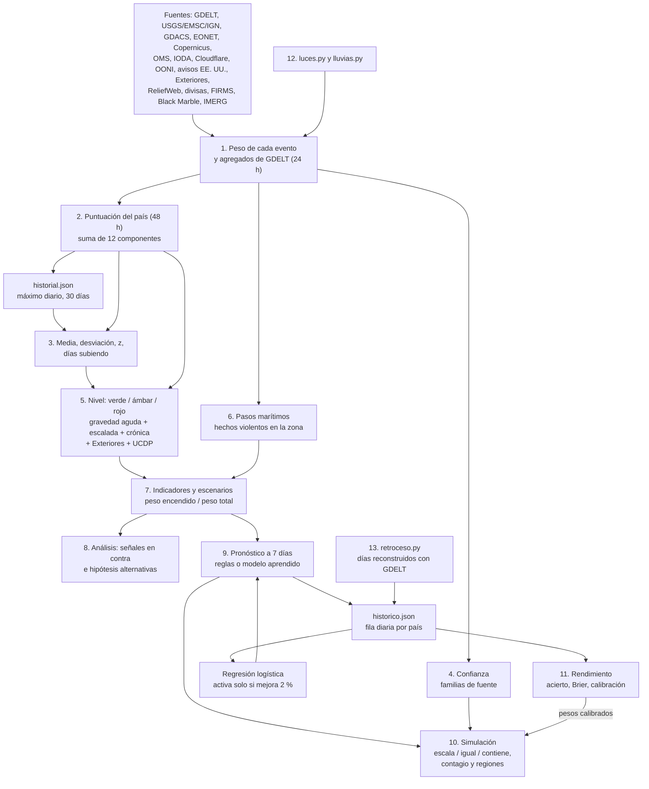

**Español** · [English](calculos.en.md)

# Cálculos de atalaya

Referencia matemática completa de atalaya: cómo se pasa de los eventos en bruto a la puntuación de cada país, su nivel de alerta, los escenarios, el pronóstico a 7 días, la simulación y la medición del acierto.

Está escrita para quien mantiene el proyecto. Cada fórmula sale del código, y cada sección dice dónde está, qué constante cambiar para ajustar el comportamiento y qué otras partes dependen de ella. Si este documento y el código no coinciden, manda el código.

> [!NOTE]
> Los nombres de variables y constantes son los del código, en castellano. Los ejemplos usan un país inventado, el **país X**, con números plausibles. Todos los ejemplos se han comprobado ejecutando las funciones reales.

## Índice

0. [Visión general](#0-visión-general)
1. [Peso de los eventos](#1-peso-de-los-eventos)
2. [Puntuación del país](#2-puntuación-del-país)
3. [Línea base, z y escalada](#3-línea-base-z-y-escalada)
4. [Confianza](#4-confianza)
5. [Niveles de alerta](#5-niveles-de-alerta)
6. [Pasos marítimos](#6-pasos-marítimos)
7. [Indicadores y escenarios](#7-indicadores-y-escenarios)
8. [Análisis, hipótesis alternativas e informe](#8-análisis-hipótesis-alternativas-e-informe)
9. [Pronóstico a 7 días](#9-pronóstico-a-7-días)
10. [Simulación](#10-simulación)
11. [Medición del rendimiento](#11-medición-del-rendimiento)
12. [Señales por satélite](#12-señales-por-satélite)
13. [Reconstrucción del pasado](#13-reconstrucción-del-pasado)
14. [Avisos por Telegram](#14-avisos-por-telegram)
15. [Constantes repetidas y dependencias](#15-constantes-repetidas-y-dependencias)
16. [Supuestos y límites conocidos](#16-supuestos-y-límites-conocidos)
17. [Resumen en un diagrama](#17-resumen-en-un-diagrama)

---

## 0. Visión general

Cada ejecución de [actualizar.py](../scripts/actualizar.py) hace, en este orden:

1. Descarga las fuentes. Cada evento recibe un **peso** y un **nivel de evento** (verde, ámbar, rojo). GDELT no da eventos con peso: da recuentos por país.
2. Suma una **puntuación** por país con lo de las últimas 48 horas.
3. Compara la puntuación con la **línea base** del país (30 días) y calcula $z$.
4. Asigna una **confianza** según cuántas familias de fuente coinciden.
5. Decide el **nivel** del país con reglas de gravedad aguda, escalada y gravedad estructural.
6. Calcula el riesgo de los **pasos marítimos**.
7. [inteligencia.py](../scripts/inteligencia.py) enciende **indicadores**, valora **escenarios**, añade el **análisis** y el **pronóstico** a 7 días, y escribe el **informe**.
8. [simulacion.py](../scripts/simulacion.py) **simula** tres ramas por crisis, el contagio y las regiones.
9. Se mide el **rendimiento** de los pronósticos pasados y se guarda la fila del día en `historico.json`.

Ficheros que guardan estado entre ejecuciones y que importan para los cálculos:

| Fichero | Qué guarda | Para qué cálculo |
|---|---|---|
| `historial.json` | Puntuación **máxima** de cada día por país, 31 días (hoy y los 30 anteriores) | Línea base y $z$ (sección 3) |
| `historico.json` | Por día y país: `[puntuación, nivel, empeora, grado del pronóstico, probabilidad, rasgos]`, la **última** ejecución del día, sin límite | Acierto, Brier, modelo aprendido (secciones 9 y 11) |
| `retroceso.json` | Qué días de `historico.json` son reconstruidos | No mezclar días reales y reconstruidos (secciones 11 y 13) |
| `modelo_aprendido.json` | Pesos y validación del modelo | Pronóstico aprendido (sección 9) |
| `incendios_historial.json`, `luces_historial.json`, `lluvias_dias.json`, `divisas_historial.json` | Series de las señales | Sus propias líneas base (secciones 1 y 12) |

La fila de `historico.json` tiene este formato (escrita en `archivar`):

| Posición | Contenido | Valores |
|---|---|---|
| 0 | Puntuación | número |
| 1 | Nivel | 0 verde, 1 ámbar, 2 rojo |
| 2 | Empeora (escalada) | 0 o 1 |
| 3 | Grado del pronóstico | 0 bajo, 1 medio, 2 alto |
| 4 | Probabilidad del modelo aprendido | número o `null` |
| 5 | Rasgos del modelo | lista de 14 números |

---

## 1. Peso de los eventos

Código: las funciones de cada fuente en [actualizar.py](../scripts/actualizar.py), `nivel_por_peso`, `gdelt`, `sin_duplicados_sismicos`, `exteriores_nivel`, `divisas` e `incendios`.

### 1.1 Fórmulas por fuente

Cada evento lleva un peso $w$ (lo que suma a la puntuación del país), un nivel de evento y una familia de fuente.

**Terremotos** (USGS, EMSC, IGN). Con magnitud $M$:

$$
w = \max(M-4,\ 0)^2 + b_{\text{PAGER}}
$$

donde $b_{\text{PAGER}}$ es 3, 10 o 25 si USGS emite alerta PAGER amarilla, naranja o roja, y 0 en otro caso (EMSC e IGN no tienen PAGER). El nivel del evento sale del peso:

$$
\text{nivel}(w) = \begin{cases} \text{rojo} & w \ge 12 \\ \text{ámbar} & 4 \le w < 12 \\ \text{verde} & w < 4 \end{cases}
$$

| Fuente | Qué se descarga |
|---|---|
| USGS | Magnitud 4,5 o más, todo el mundo, última semana |
| EMSC | Magnitud 4 o más, caja lat 24 a 50 y lon −25 a 45, desde hace 7 días, hasta 300 |
| IGN | España y entorno, se descartan magnitudes menores de 2,5 |

**Duplicados sísmicos** (`sin_duplicados_sismicos`). El mismo terremoto puede llegar de las tres fuentes. Se ordenan por preferencia USGS, EMSC, IGN, y un terremoto se descarta si ya hay uno elegido con

$$
\lvert t_1 - t_2 \rvert < 120\ \text{s} \quad \text{y} \quad d(1,2) < 100\ \text{km}
$$

con $d$ la distancia del gran círculo (`distancia_km`, fórmula del semiverseno con $2R = 12742$ km).

**Resto de fuentes:**

| Fuente | Peso $w$ | Nivel del evento | Familia |
|---|---|---|---|
| GDACS (ciclón, inundación, volcán, incendio, tsunami) | verde 1, naranja 6, rojo 15 | el de GDACS | oficial |
| GDACS sequía (DR) | 0, y sin país | el de GDACS | oficial |
| GDACS incendio o sequía en verde | se descarta | | |
| NASA EONET | incendio 0,5; tormenta 2; volcán 2; inundación 2; deslizamiento 2; polvo 0,5; sequía 1; nieve 0,5; otro 1 (terremotos y hielo se descartan) | verde | oficial |
| Copernicus EMS (activaciones de los últimos 10 días) | 5 | ámbar | oficial |
| OMS, brote | 3, u 8 si la enfermedad casa con `EPIDEMIAS_GRAVES` | verde, o ámbar si es grave | sanitaria |
| IODA, corte de internet | $\min(12,\ \max(0,\ 3(\log_{10}(s+1)-5)))$ con $s$ la puntuación de IODA; si da 0 no hay evento | ámbar si $w \ge 9$ | tecnica |
| Cloudflare Radar | 12 si lo ordena el gobierno en todo el país; 8 si lo ordena el gobierno en parte; 3 si es técnico en todo el país; si no, 0 y sin evento | rojo si $w \ge 12$, si no ámbar | tecnica |
| OONI, bloqueo nuevo | 6 | ámbar | tecnica |
| OONI, bloqueo habitual (2 o más aplicaciones) | 0 | verde | tecnica |
| Avisos de EE. UU., subida | $4\,(n_{\text{nuevo}} - n_{\text{antes}})$; bajada: 0 | ámbar si sube y $n_{\text{nuevo}} \ge 3$ | oficial |
| Exteriores, subida | $5\,(n_{\text{nuevo}} - n_{\text{antes}})$; cualquier otra actualización: 1 | ámbar si sube y $n_{\text{nuevo}} \ge 3$ | oficial |
| ReliefWeb, crisis en `alert` | 6 | ámbar | humanitaria |
| ReliefWeb, crisis en `current` | 0 | verde | humanitaria |
| Moneda (sección 1.4) | 1,5, o 3 si cae un 15 % o más | verde | tecnica |
| Incendios FIRMS (sección 12.1) | 2, o 3 si son 4 veces lo habitual o más | verde | tecnica |
| Apagón, Black Marble (sección 12.2) | 2, o 3 si la luz cae al 30 % o menos | verde | tecnica |
| Lluvias extremas, IMERG (sección 12.3) | 2, o 3 si cubren 2.500 km² o más | verde | tecnica |
| UCDP | no genera eventos: da muertes por país (sección 5) | | academica |

**OONI** mide, por país y aplicación (WhatsApp, Telegram, Signal, Messenger), la tasa de anomalías $a = \text{anomalías}/\text{medidas}$, solo si hay 10 medidas o más. Hay dos ventanas: *ahora* (de hace 2 días a mañana) y *antes* (de hace 14 a hace 2 días). Un bloqueo es nuevo si $a_{\text{ahora}} \ge 0{,}5$ y $a_{\text{antes}} < 0{,}25$ (sin datos de antes cuenta como 0), y habitual si $a_{\text{ahora}} \ge 0{,}5$ sin más. Solo hay evento si hay algún bloqueo nuevo o dos o más aplicaciones con bloqueo habitual.

**Avisos de viaje.** Los cambios se detectan comparando con el nivel guardado en la ejecución anterior y se conservan 7 días (`VENTANA_MAPA`). Cada ejecución vuelve a generar el evento con su fecha original, así que solo puntúa mientras esté dentro de las 48 horas de la puntuación.

### 1.2 Nivel de Exteriores (`exteriores_nivel`)

Exteriores no tiene API: se lee el texto de *Notas importantes* de cada ficha (hasta 600 caracteres) como mucho cada 12 horas. El nivel se decide frase a frase, sobre el texto normalizado (sin tildes, minúsculas), y gana el máximo:

| Regla, en este orden | Nivel |
|---|---|
| "abandonen el país", o "recomienda/insta/aconseja … abandonar el país" | 4 |
| La frase no habla de viajar, pero dice "extremar la(s) precaución(es)" o "máxima precaución" | 2 |
| Habla de no viajar y nombra zonas, regiones, fronteras, provincias… (`ZONAS`), sin "todo el país/territorio" | 2 |
| Habla de no viajar "bajo cualquier/ninguna circunstancia" | 4 |
| Habla de no viajar "salvo" o "excepto" | 3 |
| Habla de no viajar "totalmente/absolutamente/completamente" | 4 |
| Habla de no viajar, sin más matices | 3 |
| Ninguna frase lo cumple | 1 |

"Habla de no viajar" es una de estas expresiones: *desaconseja(n) [totalmente…] [el/todo/cualquier/los/realizar] viaje(s)/viajar*, *no viajar* (salvo *no viajar de noche*), *aplazar el/su viaje*, *evitar todo/cualquier viaje*.

Ejemplos comprobados con el código:

| Texto | Nivel |
|---|---|
| "Se desaconseja viajar a las zonas fronterizas con Malí. Se recomienda extremar las precauciones en el resto del país." | 2 |
| "Se desaconseja viajar al país bajo cualquier circunstancia." | 4 |
| "Se desaconseja viajar salvo por razones de extrema necesidad." | 3 |
| "Se recomienda a los españoles que abandonen el país." | 4 |
| "Se desaconseja participar en manifestaciones." | 1 |

Un cambio de Exteriores se registra cuando cambia la fecha de *Última actualización* de la ficha.

### 1.3 Agregación de GDELT (`gdelt`)

GDELT no aporta eventos con peso, sino recuentos por país de las últimas 24 horas: los 96 ficheros de 15 minutos anteriores al último publicado (`GDELT_FICHEROS`). Si faltan más de la mitad, la fuente se da por caída.

Para cada fila (un "hecho" de GDELT) con coordenadas:

1. Se asigna un país por coordenadas o, si cae en el mar, por el nombre del lugar. Los territorios mal etiquetados (Gaza, Cisjordania…) mandan.
2. **Tipo.** Solo si es el hecho principal de la noticia (`IsRootEvent = 1`):
   - *conflicto*: código CAMEO raíz 18, 19 o 20 **y** violencia política (`es_politico`): algún actor de tipo MIL, REB, INS, SEP, UAF, GOV, SPY u OPP, o un actor con grupo conocido, o dos actores de países distintos. La policía (COP) no cuenta.
   - *protesta*: código raíz 14.
3. **Pasos marítimos**: si es conflicto y no es un punto genérico de país (tipo geográfico distinto de 1), se suma al paso cercano (sección 6). Esto ocurre **antes** de quitar duplicados.
4. **Una vez por noticia.** Se descarta la fila si ya se vio la clave $(\text{país}, \text{tipo}, \text{URL})$. Para las filas sin tipo, el tipo es "desescalada" si el código base es 086 o 087, y vacío si no.
5. **Medios estatales.** El peso de la fila es $v = 0{,}5$ si la URL es de un medio de `MEDIOS_ESTATALES`, y $v = 1$ si no.
6. Se suma $v$ a `total`. Si la fila no tiene tipo pero es hecho principal, con código base 086 (permitir ayuda humanitaria) o 087 (desescalada militar) y violencia política, se suma $v$ a `desescalada`.
7. Si tiene tipo, se suma $v$ a `conflicto` o `protesta`, a su mitad temporal (`_12h` o `_12h_antes`, ver sección 3.4) y:
   - conflicto entre actores de dos países: a `interestatal`;
   - con actores MIL, REB, INS o UAF: a `militar`;
   - a la región (primera división administrativa del lugar) y a la pareja de actores;
   - protesta con código base 145 (protesta violenta): a `disturbios`;
   - si $v < 1$, se suma 1 (no 0,5) a `estatal`.

Con 5 hechos violentos o más se guardan las **regiones** (las 3 primeras con al menos el 10 % de los hechos regionales) y las **parejas de actores** (las 3 primeras con al menos 3 hechos). Para el mapa se publican los 500 lugares con más menciones, y solo si tienen 3 menciones o más; estos puntos tienen peso 0.

### 1.4 Moneda (`divisas`)

Se guarda una foto diaria de los tipos de cambio frente al dólar (unidades por dólar), 30 días. Con $r_0$ el tipo de la última foto de hace 7 días o más y $r_1$ el de hoy:

$$
\text{caída} = 1 - \frac{r_0}{r_1}
$$

Hay evento si $\text{caída} \ge 0{,}08$. Se aplica a todos los países que usan la moneda (por ejemplo, el franco CFA a seis u ocho países).

### Ejemplo

| Señal | Cálculo | Peso | Nivel |
|---|---|---|---|
| Terremoto de magnitud 6,0 | $(6-4)^2 = 4$ | 4 | ámbar |
| Terremoto de magnitud 7,5 | $3{,}5^2 = 12{,}25$ | 12,25 | rojo |
| Terremoto de 5,0 con PAGER amarilla | $1 + 3$ | 4 | ámbar |
| IODA con $s = 3 \cdot 10^6$ | $3(\log_{10}(3\,000\,001) - 5) = 3 \cdot 1{,}477 = 4{,}4$ | 4,4 | verde |
| IODA con $s = 10^9$ | $3 \cdot 4 = 12$ (tope) | 12 | ámbar |
| EE. UU. sube su aviso de 2 a 4 | $4 \cdot 2$ | 8 | ámbar |
| Moneda de 100 a 112 por dólar | $1 - 100/112 = 0{,}107$ | 1,5 | verde |

### Constantes

| Nombre | Valor | Fichero | Si lo subes / si lo bajas |
|---|---|---|---|
| Umbrales de `nivel_por_peso` | 12 rojo, 4 ámbar | actualizar.py | Más alto: menos terremotos fijan el nivel del país. Más bajo: terremotos moderados ponen países en ámbar o rojo |
| Bonus PAGER | 3 / 10 / 25 | actualizar.py, `usgs` | Más peso a la estimación de daños de USGS frente a la magnitud |
| Pesos de GDACS | 1 / 6 / 15 | actualizar.py, `gdacs` | Cuánto suma un desastre según su alerta |
| `EONET_TIPOS` | 0,5 a 2 | actualizar.py | Cuánto suma cada fenómeno de NASA |
| Peso de Copernicus | 5, ámbar | actualizar.py, `copernicus` | Al ser ámbar, cualquier activación pone el país en ámbar durante 48 h |
| `EPIDEMIAS_GRAVES` | expresión regular | actualizar.py | Qué brotes pesan 8 y son ámbar en lugar de 3 y verde |
| Umbral de IODA | $10^5$ (el "−5") | actualizar.py, `ioda` | Más alto: solo cuentan cortes enormes. Más bajo: entra ruido diario de muchos países |
| Pesos de Cloudflare | 12 / 8 / 3 | actualizar.py, `cloudflare` | Cuánto pesa un corte según causa y alcance |
| Umbrales de OONI | 0,5 ahora, 0,25 antes, 10 medidas | actualizar.py, `ooni` | Más estrictos: menos bloqueos detectados, menos falsos positivos |
| Peso de OONI | 6 | actualizar.py | Cuánto suma un bloqueo nuevo |
| Avisos EE. UU. | 4 por nivel | actualizar.py, `avisos_viaje` | Cuánto suma una subida |
| Exteriores | 5 por nivel que sube, 0 por una actualización sin subida | actualizar.py, `exteriores` | Cuánto suma una subida |
| `EXTERIORES_CADA` | 12 h | actualizar.py | Cada cuánto se lee la web de Exteriores (197 fichas) |
| ReliefWeb | 6 en `alert` | actualizar.py | Cuánto suma una crisis en alerta |
| `CAIDA_DIVISA`, `CAIDA_DIVISA_GRAVE` | 0,08 y 0,15 | actualizar.py | Más bajos: más monedas avisan. El 0,08 está repetido en el indicador `moneda_cae` (sección 15) |
| `GDELT_FICHEROS` | 96 | actualizar.py | Ventana de GDELT. Cambiarla cambia los recuentos y el factor de la reconstrucción (sección 13) |
| `PESO_ESTATAL` | 0,5 | actualizar.py | 0 descarta los medios estatales; 1 los trata como al resto |
| `ACTORES_POLITICOS` | MIL, REB, INS, SEP, UAF, GOV, SPY, OPP | actualizar.py | Añadir COP metería la crónica de sucesos como conflicto |
| `GDELT_VIOLENCIA`, `GDELT_PROTESTA`, `GDELT_DESESCALADA` | 18-20, 14, 086-087 | actualizar.py | Qué códigos CAMEO cuentan en cada categoría |
| Duplicados sísmicos | 120 s y 100 km | actualizar.py | Más amplios: se funden terremotos distintos cercanos |

**Por qué.** Los pesos traducen fuentes muy distintas a una escala común en la que unos 4 puntos ya son algo notable y unos 12 son grave, la misma escala que usan los umbrales de nivel. Las fuentes que reflejan decisiones humanas graves (activar Copernicus, una alerta naranja o roja) fijan además un nivel de evento que manda sobre la suma.

---

## 2. Puntuación del país

Código: `puntuar` en [actualizar.py](../scripts/actualizar.py).

### Fórmula

La puntuación es la suma de 12 componentes (`CLAVES_PUNTOS`), cada uno redondeado a una décima:

$$
S = S_{\text{conflicto}} + S_{\text{protestas}} + S_{\text{desastres}} + S_{\text{internet}} + S_{\text{censura}} + S_{\text{avisos}} + S_{\text{epidemias}} + S_{\text{humanitaria}} + S_{\text{economía}} + S_{\text{incendios}} + S_{\text{apagón}} + S_{\text{lluvias}}
$$

**Componentes de GDELT.** Con $C$ los hechos violentos ponderados, $P$ las protestas ponderadas y $T$ el total ponderado de hechos del país (todo lo de la sección 1.3):

$$
q_C = \frac{C}{\max(T,\ 20)} \qquad S_{\text{conflicto}} = 3 \log_2(1 + C) \cdot \min\left(1,\ \frac{q_C}{0{,}05}\right)
$$

$$
q_P = \frac{P}{\max(T,\ 20)} \qquad S_{\text{protestas}} = 1{,}5 \log_2(1 + P) \cdot \min\left(1,\ \frac{q_P}{0{,}05}\right)
$$

$q_C$ es la *cuota de violencia* (`cuota_violencia`) y $q_P$ la *cuota de protestas*.

**Resto de componentes.** Cada uno es la suma de los pesos $w$ de los eventos del país de ese tipo dentro de la ventana:

$$
S_k = \sum_{e \in k,\ t_e \ge t_{\text{ahora}} - \Delta_k} w_e
$$

| Tipo de evento | Componente | Ventana $\Delta_k$ |
|---|---|---|
| internet | internet | 48 h |
| censura | censura | 48 h |
| aviso (EE. UU. y Exteriores) | avisos | 48 h |
| epidemia | epidemias | 30 días |
| crisis (ReliefWeb) | humanitaria | sin ventana mientras siga abierta |
| economia, incendios, apagon, lluvia | el suyo | 48 h |
| terremoto, desastre y cualquier otro | desastres | 48 h |

A la vez se calcula, para cada país, el **rango de evento**: el máximo nivel (0, 1, 2) de sus eventos en la ventana, y el `rango_desastre`, lo mismo solo para el componente de desastres.

GDELT cubre 24 horas y el resto de fuentes 48. Si GDELT falla, se reutilizan sus últimos agregados para que el conflicto no caiga a cero.

### Ejemplo

El país X tiene en GDELT $T = 300$, $C = 40$ y $P = 20$, y además un bloqueo nuevo de mensajería (OONI, peso 6).

- $q_C = 40/300 = 0{,}133$, que supera 0,05, así que el factor es 1. $S_{\text{conflicto}} = 3 \log_2 41 = 3 \cdot 5{,}358 = 16{,}1$.
- $q_P = 20/300 = 0{,}067$, factor 1. $S_{\text{protestas}} = 1{,}5 \log_2 21 = 1{,}5 \cdot 4{,}392 = 6{,}6$.
- $S_{\text{censura}} = 6$.
- $S = 16{,}1 + 6{,}6 + 6 = 28{,}7$.

Si el mismo país tuviera $T = 1000$ (se habla mucho de él por otros motivos), $q_C = 0{,}04$ y el factor sería $0{,}04/0{,}05 = 0{,}8$: $S_{\text{conflicto}} = 16{,}07 \cdot 0{,}8 = 12{,}9$.

### Constantes

| Nombre | Valor | Fichero | Si lo subes / si lo bajas |
|---|---|---|---|
| `CUOTA_PLENA` | 0,05 | actualizar.py | Más alta: hace falta más proporción de violencia para contar todo el volumen; los países muy mediáticos bajan. Más baja: el volumen manda y vuelve el sesgo hacia los países de los que siempre se habla |
| Multiplicador de conflicto | 3 | actualizar.py, `puntuar` | Escala todo el conflicto. Con él cambian los umbrales efectivos de nivel (25, 40), de indicadores (4, 12) y el rasgo "puntuación" del modelo |
| Multiplicador de protestas | 1,5 | actualizar.py, `puntuar` | Lo mismo para protestas |
| Suelo de $T$ | 20 | actualizar.py, `puntuar` | Con pocos hechos, evita que 2 hechos de 3 den una cuota del 67 %. Más alto: los países con poca cobertura puntúan menos |
| `VENTANA_PUNTUACION` | 48 h | actualizar.py | Más larga: niveles más estables pero más lentos en bajar |
| `VENTANA_EPIDEMIAS` | 30 días | actualizar.py | Cuánto dura un brote en la puntuación (y en el nivel, si es grave) |
| `CLAVES_PUNTOS`, `PARTE_DE` | 12 componentes | actualizar.py | Añadir un tipo de evento nuevo exige añadirlo aquí; si no, suma en "desastres" |

**Por qué.** El logaritmo hace que pasar de 0 a 10 hechos pese más que pasar de 100 a 110: lo que importa es que empiece a haber violencia, no el volumen exacto. La cuota corrige el sesgo de la prensa: de EE. UU. o India siempre hay muchos hechos, pero son una parte pequeña de lo que se cuenta de ellos.

---

## 3. Línea base, z y escalada

Código: `calcular_alertas`, `dias_subiendo` y `aceleracion` en [actualizar.py](../scripts/actualizar.py), y `main` (cómo se llena `historial.json`).

### Fórmulas

**Serie.** `historial.json` guarda, para cada día, la puntuación **máxima** de las ejecuciones de ese día. La serie de un país son los $n \le 30$ días anteriores a hoy (`DIAS_HISTORIAL`), con 0 los días en que no aparece:

$$
x_1, \dots, x_n \qquad \mu = \frac{1}{n}\sum_i x_i \qquad \sigma = \sqrt{\frac{1}{n}\sum_i (x_i - \mu)^2}
$$

($\sigma$ es la desviación de población, `pstdev`; vale 0 si $n \le 1$).

**z.** Con $S$ la puntuación de hoy:

$$
z = \frac{S - \mu}{\max(\sigma,\ 2,\ 0{,}25\,\mu)}
$$

Si no hay serie, $z = 0$.

**Días seguidos subiendo.** Sobre la serie con hoy al final, $x_1, \dots, x_n, x_{n+1} = S$, se cuenta hacia atrás desde hoy cuántos días cumplen

$$
x_i > x_{i-1} + 0{,}5
$$

y se para en el primero que no lo cumple.

**Tendencia** (texto): "sube" si $z \ge 1$ o lleva 3 días subiendo o más; "baja" si $z \le -1$; "estable" en otro caso; "sin datos" si no hay serie.

### 3.4 Aceleración en 12 horas

Para tener tendencia desde el primer día, sin histórico, se comparan las dos mitades de las 24 horas de GDELT. El corte es la hora del hecho más reciente menos 12 horas. Con $A$ los hechos de conflicto y protesta (ponderados) de las últimas 12 horas y $B$ los de las 12 anteriores:

$$
a = \begin{cases} \dfrac{A + 1}{B + 1} & A + B \ge 8 \\ \text{sin dato} & A + B < 8 \end{cases}
$$

$a = 1$ es igual; $a = 2$, el doble.

### Ejemplo

El país X tiene 29 días previos: 23 días a 18 y luego 19, 18, 19, 20, 22, 25. Hoy $S = 28{,}7$.

- $\mu = 18{,}52$ y $\sigma = 1{,}48$.
- Denominador: $\max(1{,}48;\ 2;\ 0{,}25 \cdot 18{,}52 = 4{,}63) = 4{,}63$. El suelo proporcional manda.
- $z = (28{,}7 - 18{,}52)/4{,}63 = 2{,}20$.
- Días subiendo: 28,7 > 25,5; 25 > 22,5; 22 > 20,5; 20 > 19,5; 19 > 18,5; pero 18 no es mayor que 19,5. Son **5 días**.
- Tendencia: "sube".
- Aceleración: en las últimas 12 h hubo 26 hechos de conflicto y 12 de protesta ($A = 38$); en las 12 anteriores, 14 y 8 ($B = 22$). $a = 39/23 = 1{,}70$.

### Constantes

| Nombre | Valor | Fichero | Si lo subes / si lo bajas |
|---|---|---|---|
| `DIAS_HISTORIAL` | 30 | actualizar.py | Línea base más larga: más estable, tarda más en aceptar una situación nueva como normal |
| Suelo absoluto de $\sigma$ | 2 | actualizar.py, `calcular_alertas` | Más alto: los países con puntuación muy estable necesitan saltos mayores para dar $z$ alto |
| Suelo relativo de $\sigma$ | $0{,}25\,\mu$ | actualizar.py | Evita que un país con media alta y poca variación dé $z$ enormes por un pequeño cambio |
| Umbral de subida diaria | 0,5 puntos | actualizar.py, `dias_subiendo` | Más alto: hace falta subir más cada día para contar |
| Umbrales de tendencia | $z = \pm 1$, 3 días | actualizar.py | Solo cambian el texto "sube/baja/estable" |
| Mínimo de la aceleración | 8 hechos | actualizar.py, `aceleracion` | Más bajo: más países con aceleración, más ruido |
| Suavizado de la aceleración | +1 | actualizar.py | Evita dividir por 0 y modera los cocientes con pocos hechos |

**Por qué.** Cada país se compara consigo mismo, no con los demás: 20 puntos es normal en una guerra larga y alarmante en un país tranquilo. Los dos suelos del denominador evitan que un país con una serie plana dé $z$ disparados por un cambio pequeño.

---

## 4. Confianza

Código: `confianza` en [actualizar.py](../scripts/actualizar.py).

### Fórmula

Un país reúne las **familias** de sus eventos en la ventana que tienen $w > 0$ o nivel distinto de verde. La familia *prensa* entra si $S_{\text{conflicto}} \ge 3$ o $S_{\text{protestas}} \ge 3$. Con $F$ el conjunto de familias:

$$
\text{confianza}(F) = \begin{cases} \text{alta} & \lvert F \rvert \ge 2 \\ \text{media} & \lvert F \rvert = 1 \text{ y } F \ne \{\text{prensa}\} \\ \text{baja} & \text{en otro caso} \end{cases}
$$

Familias posibles: prensa (GDELT), oficial (terremotos, GDACS, EONET, Copernicus, avisos de viaje, Exteriores), tecnica (IODA, Cloudflare, OONI, monedas, satélites), sanitaria (OMS), humanitaria (ReliefWeb) y academica (UCDP).

Dos añadidos:

- Si EE. UU. tiene el aviso en nivel 4, se añade *oficial* al calcular la confianza.
- Si UCDP da 25 muertes o más, se añade *academica* y se recalcula (sección 5).

### Ejemplo

El país X tiene $S_{\text{conflicto}} = 16{,}1 \ge 3$ (prensa) y un bloqueo de OONI (tecnica). $F = \{\text{prensa}, \text{tecnica}\}$, así que la confianza es **alta**. Sin el bloqueo sería **baja**.

### Constantes

| Nombre | Valor | Fichero | Si lo subes / si lo bajas |
|---|---|---|---|
| Umbral de prensa | 3 puntos | actualizar.py, `puntuar` | Más alto: un poco de violencia en la prensa no cuenta como familia |
| Familias para "alta" | 2 | actualizar.py, `confianza` | Afecta al texto de la ficha, a Telegram, a la hipótesis "pico mediático" (sección 8) y al margen de la simulación (sección 10) |

**Por qué.** La confianza no mide lo grave que es algo, sino lo contrastado que está: dos tipos de fuente independientes que coinciden son más fiables que muchas noticias de la misma familia.

---

## 5. Niveles de alerta

Código: `calcular_alertas` y el final de `main` en [actualizar.py](../scripts/actualizar.py).

### Reglas

Se calcula un rango $r \in \{0, 1, 2\}$ (verde, ámbar, rojo). Cada regla solo puede subirlo, salvo donde se indica. Con $S$, $\mu$, $z$ y $d$ (días subiendo) de la sección 3, $r_e$ el rango de evento de la sección 2 y $c$ = *calibrando* (ver abajo):

| # | Condición | Efecto | Motivo que se muestra |
|---|---|---|---|
| 1 | $S \ge 40$ | $r = 2$ | Actividad muy alta |
| 1 | $25 \le S < 40$ | $r = 1$ | Actividad alta |
| 1 | $r_e > 0$ | $r = \max(r, r_e)$ | Alerta oficial roja / naranja |
| 2 | no $c$, $z \ge 3$ y $S \ge 18$ | $r = 2$, escalada | Muy por encima de lo habitual |
| 2 | si no: no $c$, $z \ge 1{,}5$ y $S \ge 10$ | $r \ge 1$, escalada | Por encima de lo habitual |
| 2 | $d \ge 3$ y $S \ge 10$ (también calibrando) | $r \ge 1$, escalada | N días seguidos subiendo |
| 3 | no $c$ y $\mu \ge 30$ | $r = 2$ | Crisis prolongada |
| 3 | si no: no $c$ y $\mu \ge 18$ | $r \ge 1$ | Crisis prolongada |
| 3 | aviso de EE. UU. = 4 y $S \ge 3$ | $r \ge 1$ | EE. UU. desaconseja viajar |
| 3 | crisis humanitaria abierta (ReliefWeb) | $r \ge 1$ | Crisis humanitaria abierta |

Un país sale en el resultado si $r > 0$ o $S > 0$. Se evalúan los países con puntuación hoy, los que estuvieron en el historial de los últimos 30 días y los que tienen aviso 4 de EE. UU.

**Modo calibrando.** Si `historial.json` tiene menos de `DIAS_CALIBRADO` = 7 días anteriores a hoy, $c$ es verdadero y no se aplican las reglas que dependen de lo habitual ($z$ y $\mu$). Siguen valiendo los umbrales absolutos, los eventos, los días subiendo, el aviso de EE. UU. y ReliefWeb.

**Ajustes posteriores** (en `main`, después de `calcular_alertas`):

| Condición | Efecto | Motivo |
|---|---|---|
| Exteriores en nivel 4, $S \ge 3$ y el país en verde | pasa a ámbar | Exteriores desaconseja viajar |
| Exteriores en nivel 4 (otros casos) | solo el motivo | Exteriores desaconseja viajar |
| UCDP $\ge 25$ muertes en 90 días | motivo y familia *academica* | N muertes verificadas en 90 días (UCDP) |
| UCDP $\ge 1000$ | pasa a rojo | |
| UCDP $\ge 100$ y el país en verde | pasa a ámbar | |

Estos ajustes solo se aplican a países que ya están en el resultado, y no marcan escalada.

### Ejemplo

El país X: $S = 28{,}7$, $r_e = 1$ (el bloqueo de OONI es ámbar), $z = 2{,}20$, $d = 5$, $\mu = 18{,}52$, 29 días de historial (no calibrando).

1. $S \ge 25$: $r = 1$, "Actividad alta". $r_e = 1$: "Alerta oficial naranja".
2. $z = 2{,}20 < 3$; $z \ge 1{,}5$ y $S \ge 10$: escalada, "Por encima de lo habitual". $d = 5 \ge 3$: "5 días seguidos subiendo".
3. $\mu = 18{,}52 \ge 18$: "Crisis prolongada".

Resultado: **ámbar**, con escalada, confianza alta y tendencia "sube". Para llegar a rojo necesitaría $S \ge 40$, $z \ge 3$ (es decir, $S \ge 18{,}52 + 3 \cdot 4{,}63 = 32{,}4$) o $\mu \ge 30$.

### Constantes

| Nombre | Valor | Fichero | Si lo subes / si lo bajas |
|---|---|---|---|
| Actividad muy alta / alta | 40 / 25 | actualizar.py | Umbrales absolutos. Más bajos: más países en ámbar y rojo sin mirar su historia |
| Escalada fuerte | $z \ge 3$ y $S \ge 18$ | actualizar.py | Más estricta: menos rojos por cambios bruscos |
| Escalada | $z \ge 1{,}5$ y $S \ge 10$ | actualizar.py | El suelo de 10 evita que un país casi a cero escale por pasar de 1 a 5 |
| Días subiendo | 3 días y $S \ge 10$ | actualizar.py | Más días: escalada más lenta pero más segura |
| Crisis prolongada | $\mu \ge 30$ rojo, $\mu \ge 18$ ámbar | actualizar.py | Más bajos: más guerras largas en color aunque hoy estén tranquilas |
| Aviso de EE. UU. | nivel 4 y $S \ge 3$ | actualizar.py | Quitar el $S \ge 3$ haría que el aviso coloreara solo un país |
| `DIAS_CALIBRADO` | 7 | actualizar.py | Más días de espera antes de fiarse de $z$ y $\mu$ |
| Exteriores | nivel 4 y $S \ge 3$ | actualizar.py, `main` | Igual que el aviso de EE. UU. |
| UCDP | 25 / 100 / 1000 muertes | actualizar.py, `main` | El 25 está repetido en el indicador `muertes_verificadas` (sección 15) |

**Por qué.** Se separan tres preguntas que un equipo de alerta temprana separa: qué tan mal está hoy (gravedad aguda), si está peor de lo normal para él (escalada) y si lleva mucho tiempo mal (gravedad estructural). Los avisos de viaje solo refuerzan lo que ya muestran los datos propios, porque también reflejan la política exterior de quien los emite.

---

## 6. Pasos marítimos

Código: `PASOS`, la parte de pasos de `gdelt` y `calcular_pasos` en [actualizar.py](../scripts/actualizar.py).

### Fórmula

Cada paso tiene una zona: uno o varios puntos $(x_k, y_k)$ y un radio $R$. Un hecho de conflicto de GDELT de las últimas 24 horas, en un lugar concreto (no un punto genérico de país), cuenta para el paso si

$$
\lvert \text{lat} - \text{lat}_{\text{paso}} \rvert < 6^\circ \quad \text{y} \quad \min_k d\big((\text{lon}, \text{lat}), (x_k, y_k)\big) \le R
$$

Con $n$ los hechos contados:

$$
\text{nivel} = \begin{cases} \text{rojo} & n \ge 25 \\ \text{ámbar} & 6 \le n < 25 \\ \text{verde} & n < 6 \end{cases}
$$

| Paso | Radio (km) | Puntos de la zona |
|---|---|---|
| Estrecho de Ormuz | 220 | 1 |
| Bab el-Mandeb y mar Rojo sur | 250 | 2 |
| Canal de Suez | 90 | 3 |
| Bósforo | 80 | 2 |
| Estrecho de Gibraltar | 120 | 1 |
| Estrecho de Malaca | 250 | 3 |
| Estrecho de Taiwán | 200 | 1 |
| Canal de Panamá | 100 | 1 |

Ojo: los hechos se cuentan sin quitar duplicados por noticia y sin rebajar los medios estatales (se cuentan antes de esos dos pasos).

### Ejemplo

En 24 horas hay 9 hechos de conflicto en el sur del mar Rojo a menos de 250 km de uno de los dos puntos de Bab el-Mandeb. $n = 9$: **ámbar**. Esto enciende el indicador `ruta_cercana` de Yemen, Yibuti y Eritrea (sección 7) y entra en el informe como interés para España.

### Constantes

| Nombre | Valor | Fichero | Si lo subes / si lo bajas |
|---|---|---|---|
| Umbrales | 25 rojo, 6 ámbar | actualizar.py, `calcular_pasos` | Más bajos: más avisos de rutas, también por ruido |
| Radios y puntos de `PASOS` | tabla de arriba | actualizar.py | Más grandes: entran ciudades ajenas a la ruta (Gaza, El Cairo) |
| Filtro de latitud | 6° | actualizar.py, `gdelt` | Solo acelera el cálculo; debe ser mayor que cualquier radio en grados |
| `PASOS_PAISES` | países ribereños | inteligencia.py | Qué países encienden `ruta_cercana` con cada paso |

**Por qué.** El riesgo de una ruta depende de la violencia cerca de la ruta, no del nivel de todo el país: un conflicto en el interior de Egipto no afecta al canal de Suez.

---

## 7. Indicadores y escenarios

Código: `indicadores`, `ESCENARIOS`, `desescalando` y `escenarios` en [inteligencia.py](../scripts/inteligencia.py).

### 7.1 Indicadores

Algunos umbrales son relativos al volumen de noticias del país. Con $T$ el total ponderado de GDELT y $g_k$ un recuento de GDELT (sección 1.3):

$$
\text{notable}(k, m, c) \iff g_k \ge \max(m,\ c \cdot \max(T, 1))
$$

| Indicador | Se enciende si |
|---|---|
| `violencia_sube` | $S_{\text{conflicto}} \ge 4$ y ($z \ge 1$ o $d \ge 2$) |
| `violencia_alta` | $S_{\text{conflicto}} \ge 12$ |
| `interestatal` | notable(interestatal, 5, 0,005) |
| `militar` | notable(militar, 5, 0,005) |
| `aviso_sube` | $S_{\text{avisos}} > 0$ |
| `exteriores_alto` | nivel de Exteriores $\ge 3$ |
| `contagio` | 2 o más vecinos en rojo o con escalada |
| `ruta_cercana` | el país da a un paso marítimo que no está en verde |
| `corte_internet` | $S_{\text{internet}} > 0$ |
| `censura` | $S_{\text{censura}} > 0$ (solo bloqueos nuevos; los habituales pesan 0) |
| `protestas_suben` | $S_{\text{protestas}} \ge 4$ y ($z \ge 1$ o $q_P \ge 0{,}05$) |
| `disturbios` | notable(disturbios, 3, 0,003) |
| `golpe_en_prensa` | un titular del país habla de "golpe de Estado", "golpista" o "asonada" |
| `desastre_grave` | `rango_desastre` $\ge 1$ |
| `epidemia_grave` | $S_{\text{epidemias}} \ge 8$ |
| `crisis_humanitaria` | crisis abierta en ReliefWeb |
| `muertes_verificadas` | UCDP $\ge 25$ |
| `moneda_cae` | caída de la moneda $\ge 0{,}08$ |
| `incendios` | hay anomalía de incendios (sección 12.1) |
| `apagon` | hay apagón por satélite (sección 12.2) |
| `lluvias_extremas` | hay lluvias extremas (sección 12.3) |
| `eleccion_cercana` | elecciones o referéndum en los próximos 45 días (Wikidata) |

Los **vecinos** se calculan en `calcular_vecinos`: dos países son vecinos si comparten algún vértice de su polígono redondeado a 0,1°.

### 7.2 Escenarios

Cada escenario es una lista de indicadores con peso (2 si es clave, 1 si no):

| Escenario | Indicadores (peso) | Peso total $W$ |
|---|---|---|
| Escalada militar | violencia_sube (2), interestatal (2), militar (1), aviso_sube (1), exteriores_alto (1), contagio (1), ruta_cercana (1), incendios (1), apagon (2) | 12 |
| Golpe o crisis de gobierno | corte_internet (2), censura (2), militar (1), protestas_suben (1), golpe_en_prensa (2), aviso_sube (1), moneda_cae (1), eleccion_cercana (1) | 11 |
| Disturbios graves | protestas_suben (2), disturbios (2), censura (1), corte_internet (1), violencia_sube (1), moneda_cae (1), eleccion_cercana (1) | 9 |
| Emergencia humanitaria | desastre_grave (2), epidemia_grave (2), crisis_humanitaria (2), violencia_alta (1), muertes_verificadas (1), exteriores_alto (1), apagon (1), lluvias_extremas (2) | 12 |

Con $E$ la suma de los pesos de los indicadores encendidos:

$$
\text{riesgo} = \begin{cases} \text{alto} & E/W > 0{,}5 \\ \text{medio} & E \ge 2 \\ \text{bajo} & E = 1 \end{cases}
$$

Si $E = 0$, el escenario no aparece. El lenguaje estimativo es alto "Probable", medio "Posible", bajo "Poco probable".

**Desescalada.** Con $D$ y $C$ los recuentos de desescalada y conflicto de GDELT:

$$
\text{desescalando} \iff D \ge \max(3,\ 0{,}25\,C)
$$

Si se cumple, el escenario de escalada militar baja un grado (si no era ya bajo). Que la prensa hable de tregua no rebaja nada: solo se muestra como señal en contra (sección 8).

**Orden.** Primero por riesgo (alto, medio, bajo). A igual riesgo, va primero el escenario que encaja con el componente que más pesa en el país: escalada con $S_{\text{conflicto}}$; disturbios con $S_{\text{protestas}}$; humanitaria con $S_{\text{desastres}} + S_{\text{epidemias}} + S_{\text{humanitaria}}$; golpe con $S_{\text{internet}} + S_{\text{censura}}$. El primer escenario que no es bajo es el **escenario principal**, y lo usan el análisis, el informe y la simulación.

### Ejemplo

El país X, con $T = 300$, interestatal 8, militar 12, disturbios 4, desescalada 2, y un vecino en rojo:

- Encendidos: violencia_sube ($16{,}1 \ge 4$ y $z = 2{,}2$), violencia_alta ($16{,}1 \ge 12$), interestatal ($8 \ge \max(5;\ 1{,}5)$), militar ($12 \ge 5$), censura ($6 > 0$), protestas_suben ($6{,}6 \ge 4$ y $z \ge 1$), disturbios ($4 \ge \max(3;\ 0{,}9)$). Contagio no: solo 1 vecino.
- Disturbios graves: $E = 2 + 2 + 1 + 1 = 6$, $6/9 = 0{,}67 > 0{,}5$: **alto**.
- Escalada militar: $E = 2 + 2 + 1 = 5$, $5/12 = 0{,}42$: **medio**.
- Golpe: $E = 2 + 1 + 1 = 4$, $4/11 = 0{,}36$: **medio**.
- Humanitaria: $E = 1$: **bajo**.
- Desescalada: $2 \ge \max(3;\ 10)$ no.
- Orden: disturbios (alto); luego escalada y golpe (medio), con escalada antes porque $S_{\text{conflicto}} = 16{,}1$ es el mayor componente. Escenario principal: **disturbios graves**.

### Constantes

| Nombre | Valor | Fichero | Si lo subes / si lo bajas |
|---|---|---|---|
| `ESCENARIOS` (pesos) | tabla de arriba | inteligencia.py | Cambiar un peso cambia $W$ y, con él, el umbral de "alto" de todo el escenario |
| Umbral de "alto" | $E/W > 0{,}5$ | inteligencia.py, `escenarios` | Más bajo: más escenarios probables |
| Umbral de "medio" | $E \ge 2$ | inteligencia.py | Con 2, basta un indicador clave o dos normales |
| Umbrales de `violencia_sube`, `violencia_alta`, `protestas_suben` | 4, 12, 4; $z \ge 1$; $d \ge 2$; $q_P \ge 0{,}05$ | inteligencia.py, `indicadores` | Están en puntos de la sección 2: cambian si cambian los multiplicadores 3 y 1,5 |
| `notable` | (5; 0,005), (5; 0,005), (3; 0,003) | inteligencia.py | El mínimo protege a los países pequeños; la cuota, a los muy mediáticos |
| `contagio` | 2 vecinos | inteligencia.py | Con 1, cualquier frontera con una guerra lo enciende |
| `epidemia_grave` | 8 | inteligencia.py | Igual al peso de un brote grave en actualizar.py (sección 15) |
| Desescalada | $\max(3;\ 0{,}25\,C)$ | inteligencia.py, `desescalando` y `analisis` | Repetida en dos funciones (sección 15) |

**Por qué.** Es el método de indicadores y alertas: en vez de una caja negra, cada escenario es una lista de señales observables, y el riesgo es qué parte de ellas está encendida. Así cada juicio enseña sus pruebas y dice qué falta para que empeore.

---

## 8. Análisis, hipótesis alternativas e informe

Código: `analisis`, `informe` e `intereses_espana` en [inteligencia.py](../scripts/inteligencia.py).

### 8.1 Señales en contra e hipótesis alternativas

| Resultado | Condición |
|---|---|
| Señal en contra: desescalada | $D \ge \max(3,\ 0{,}25\,C)$ |
| Señal en contra: tregua en prensa | un titular del país habla de alto el fuego, tregua, negociaciones o acuerdo de paz, cese de hostilidades o desescalada |
| Alternativa: propaganda | $\text{estatal}/\max(C + P + 0{,}5\,\text{estatal}, 1) \ge 0{,}3$ |
| Alternativa: pico mediático | confianza baja y nivel distinto de verde |
| Alternativa: problema local | la primera región tiene al menos el 70 % de los hechos regionales y no es un conflicto entre países |
| Alternativa: conflicto exterior | $\text{interestatal}/C \ge 0{,}5$ |
| Alternativa: crisis que dura | crisis abierta y sin escalada |
| Qué lo desmentiría | lista fija `DESMENTIRIA` del escenario principal |

En la propaganda se comparan filas con filas: $C + P + 0{,}5\,\text{estatal}$ deshace el medio peso de esos medios.

### 8.2 Informe diario

**Orden de los países:**

$$
\text{peso}(p) = 10\,r + 5\cdot[\text{escalada}] + \begin{cases} 4 & \text{pronóstico alto} \\ 2 & \text{medio} \\ 0 & \text{bajo} \end{cases} + \frac{S}{10}
$$

- **Juicios clave**: los 6 primeros que no están en verde, o que están en verde con pronóstico alto. El primero es la **conclusión principal**.
- **Qué vigilar**: escenarios con riesgo medio y los 2 primeros indicadores apagados ("si aparece…"), hasta 6.
- **Interés para España**: países que no están en verde, o que escalan, con intereses en `intereses_espana.json`. Orden por $\sum \text{pesos de interés} \cdot (r + 1)$. Se añaden Gibraltar, Suez, Bab el-Mandeb y Ormuz si no están en verde. Hasta 8.
- **Regiones**: con $n_r$, $n_a$ y $n_e$ los países en rojo, en ámbar y con escalada:

$$
\text{tensión} = 2\,n_r + n_a + n_e \qquad \text{nivel} = \begin{cases} \text{rojo} & \text{tensión} \ge 6 \\ \text{ámbar} & \text{tensión} \ge 3 \\ \text{verde} & \text{en otro caso} \end{cases}
$$

### Ejemplo

El país X: ámbar ($r = 1$), escalada, pronóstico alto (sección 9), $S = 28{,}7$. $\text{peso} = 10 + 5 + 4 + 2{,}87 = 21{,}87$. Un país en rojo sin escalada, con pronóstico medio y $S = 45$, tiene $20 + 0 + 2 + 4{,}5 = 26{,}5$ y va antes.

Una región con 1 país en rojo, 2 en ámbar y 2 que escalan: $2 + 2 + 2 = 6$, nivel **rojo**.

### Constantes

| Nombre | Valor | Fichero | Si lo subes / si lo bajas |
|---|---|---|---|
| Umbral de propaganda | 0,3 | inteligencia.py, `analisis` | Más bajo: la ficha avisa de propaganda más a menudo |
| Problema local | 0,7 | inteligencia.py | Más bajo: más casos se tratan como locales |
| Conflicto exterior | 0,5 | inteligencia.py | |
| Pesos del orden | 10 / 5 / 4 / 2 / $S/10$ | inteligencia.py, `informe` | Qué países salen primero en el informe y en la conclusión principal |
| Juicios, vigilar, España, regiones | 6 / 6 / 8 / 8 | inteligencia.py | Longitud del informe |
| Tensión regional | 6 rojo, 3 ámbar | inteligencia.py | |
| `REGIONES` | 18 regiones | inteligencia.py | También la usa la simulación por regiones (sección 10) |

**Por qué.** El análisis estructurado obliga a mirar las explicaciones menos alarmantes antes de dar por buena la principal, como haría un analista que hace de abogado del diablo.

---

## 9. Pronóstico a 7 días

Código: `pronostico` y `pendiente` en [inteligencia.py](../scripts/inteligencia.py), y todo [aprendizaje.py](../scripts/aprendizaje.py).

El pronóstico estima si el país **empeorará de forma sostenida** en los 7 días siguientes (la definición exacta está en la sección 11.1). Tiene dos métodos: reglas fijas y un modelo aprendido, que solo se usa si supera la validación.

### 9.1 Pendiente

Pendiente por mínimos cuadrados de los últimos 7 valores de la serie (incluido hoy), $y_0, \dots, y_{m-1}$ con $m \le 7$, en puntos por día:

$$
\beta = \frac{\sum_i (i - \bar{i})(y_i - \bar{y})}{\sum_i (i - \bar{i})^2}
$$

Con menos de 3 valores, $\beta = 0$. La **proyección** a 7 días es $\max(0,\ S + 7\beta)$.

### 9.2 Reglas fijas

Con $e$ el riesgo del peor escenario (2 alto, 1 medio, 0 bajo), $a$ la aceleración (1 si no hay dato) y $\text{acelera} \iff a \ge 1{,}8 \text{ y } S \ge 6$:

| Grado | Condición (la primera que se cumpla) |
|---|---|
| alto | ($\beta \ge 1{,}5$ y $S \ge 8$), o $e = 2$, o (escalada y $\beta > 0{,}5$), o (acelera y $e \ge 1$) |
| medio | $\beta \ge 0{,}5$, o $e = 1$, o escalada, o acelera |
| bajo | en otro caso |

### 9.3 Modelo aprendido

**Rasgos.** 14 señales que existen tanto en días reales como en días reconstruidos solo con GDELT (sección 13). Con $G = S_{\text{conflicto}} + S_{\text{protestas}}$ la parte de GDELT de la puntuación y $\pi = G/S$ (1 si $S = 0$); $\operatorname{clip}(x, a, b)$ acota $x$ entre $a$ y $b$:

| # | Rasgo | Valor |
|---|---|---|
| 1 | puntuacion | $\ln(1 + G)$ |
| 2 | nivel | $r/2$ |
| 3 | escalada | 0 o 1 |
| 4 | z | $\operatorname{clip}(z, -3, 5)/5$ |
| 5 | pendiente | $\operatorname{clip}(\beta, -5, 5)/5$ |
| 6 | dias_subiendo | $\min(d, 7)/7$ |
| 7 | aceleracion | $\operatorname{clip}(\ln \max(a, 0{,}05), -2, 2)/2$ |
| 8 | cuota_violencia | $\operatorname{clip}(q_C, 0, 1)$ |
| 9 | entre_paises | $\text{interestatal}/C$ (0 si $C = 0$) |
| 10 | protestas | $P/\max(C + P, 1)$ |
| 11 | militar | $\text{militar}/C$ (0 si $C = 0$) |
| 12 | desescalada | $\operatorname{clip}(D/\max(C, 1), 0, 1)$ |
| 13 | vecinos_mal | $\min(v, 3)/3$, con $v$ los vecinos en rojo o con escalada |
| 14 | media | $\ln(1 + \max(\mu, 0) \cdot \pi)$ |

**Muestras.** Cada país y día de `historico.json` que tiene rasgos y 7 días de futuro en el fichero, sin mezclar días reales con reconstruidos en la misma ventana de 8 días. El resultado $y \in \{0, 1\}$ es "empeoró de forma sostenida" (sección 11.1).

**Validación en el tiempo.** Con los días de las muestras ordenados $D_0 < \dots < D_{N-1}$:

$$
\text{corte} = D_{\lfloor 0{,}7 N \rfloor} \qquad \text{entrenamiento: } d < \text{corte} \qquad \text{prueba: } d \ge \text{corte}
$$

Hacen falta $N \ge 10$ días, 300 muestras de entrenamiento y 100 de prueba.

**Tipificación.** Con la media $m_j$ y la desviación $s_j$ de cada rasgo en el entrenamiento ($s_j = 1$ si vale 0):

$$
z_{ij} = \frac{x_{ij} - m_j}{s_j}
$$

**Regresión logística con L2.**

$$
\hat{p}_i = \sigma\Big(b + \sum_j w_j z_{ij}\Big) \qquad \sigma(u) = \frac{1}{1 + e^{-u}} \quad (u \text{ acotado a } \pm 30)
$$

Se parte de $w = 0$ y $b = \ln\dfrac{\max(\bar{y}, 10^{-3})}{\max(1 - \bar{y}, 10^{-3})}$ (la tasa base). Cada una de las 400 iteraciones es un paso de descenso de gradiente con todas las muestras, con $e_i = \hat{p}_i - y_i$, paso $\eta = 0{,}5$ y $\lambda = 0{,}01$:

$$
b \leftarrow b - \eta \cdot \frac{1}{n}\sum_i e_i \qquad w_j \leftarrow w_j - \eta\left(\frac{1}{n}\sum_i e_i z_{ij} + \lambda w_j\right)
$$

Es minimizar la pérdida logarítmica media más $\tfrac{\lambda}{2}\lVert w \rVert^2$ (el sesgo no se regulariza).

**Activación.** En los días de prueba se compara la puntuación de Brier del modelo con la de decir siempre la tasa del entrenamiento $\bar{y}_{\text{ent}}$:

$$
B = \frac{1}{n}\sum_i (\hat{p}_i - y_i)^2 \qquad \text{mejora} = 1 - \frac{B_{\text{modelo}}}{B_{\text{referencia}}}
$$

El modelo se activa solo si $\text{mejora} \ge 0{,}02$. Entonces se vuelve a entrenar con **todas** las muestras y se usa. Se reentrena una vez al día. La **importancia** que se publica son los pesos $w_j$ ordenados por valor absoluto.

**Grado con el modelo.**

$$
\text{grado} = \begin{cases} \text{alto} & \hat{p} \ge 0{,}40 \\ \text{medio} & 0{,}20 \le \hat{p} < 0{,}40 \\ \text{bajo} & \hat{p} < 0{,}20 \end{cases}
$$

La calibración de la validación agrupa las probabilidades en los mismos tramos: bajo $[0;\ 0{,}2)$, medio $[0{,}2;\ 0{,}4)$, alto $[0{,}4;\ 1{,}01)$.

### Ejemplo

**Pendiente.** Últimos 7 valores del país X: 19, 18, 19, 20, 22, 25, 28,7. $\bar{i} = 3$, $\sum (i - 3)^2 = 28$, $\sum (i-3)\,y_i = -57 - 36 - 19 + 0 + 22 + 50 + 86{,}1 = 46{,}1$. $\beta = 46{,}1/28 = 1{,}65$ puntos por día. Proyección: $28{,}7 + 7 \cdot 1{,}65 = 40{,}2$.

**Reglas.** $\beta \ge 1{,}5$ y $S \ge 8$: **alto** ("Probable que empeore en los próximos 7 días"). También bastaría $e = 2$ (disturbios en alto).

**Rasgos** del país X (calculados con el código): puntuacion $\ln(23{,}7) = 3{,}17$; nivel 0,5; escalada 1; z $2{,}2/5 = 0{,}44$; pendiente $1{,}65/5 = 0{,}33$; dias_subiendo $5/7 = 0{,}71$; aceleracion $\ln(1{,}7)/2 = 0{,}27$; cuota_violencia 0,13; entre_paises $8/40 = 0{,}2$; protestas $20/60 = 0{,}33$; militar $12/40 = 0{,}3$; desescalada $2/40 = 0{,}05$; vecinos_mal $1/3$; media $\ln(1 + 18{,}5 \cdot 22{,}7/28{,}7) = 2{,}75$.

**Activación.** Si en la prueba $B_{\text{modelo}} = 0{,}1290$ y $B_{\text{referencia}} = 0{,}1300$, la mejora es $0{,}0077 < 0{,}02$ y el modelo **no** se usa: siguen las reglas.

### Constantes

| Nombre | Valor | Fichero | Si lo subes / si lo bajas |
|---|---|---|---|
| Umbrales de las reglas | $\beta$ 1,5 / 0,5; $S$ 8; $a$ 1,8; $S$ 6 | inteligencia.py, `pronostico` | Más bajos: más pronósticos altos, peor Brier si no se cumplen |
| `UMBRAL_ALTO`, `UMBRAL_MEDIO` | 0,40 / 0,20 | inteligencia.py | Solo con modelo. Coinciden con los tramos de `calibracion` en aprendizaje.py y con `PESOS_RIESGO` alto (sección 15) |
| `MIN_ENTRENAR`, `MIN_PROBAR` | 300 / 100 | aprendizaje.py | Más bajos: el modelo puede activarse antes, con métricas menos fiables |
| `PARTE_PRUEBA` | 0,3 | aprendizaje.py | Más alta: validación más exigente, menos datos para entrenar |
| `MEJORA_MINIMA` | 0,02 | aprendizaje.py | 0 activa cualquier modelo que no empeore la referencia; más alto, más difícil activarlo |
| `L2` | 0,01 | aprendizaje.py | Más alto: pesos más pequeños, probabilidades más cerca de la tasa base |
| `ITERACIONES`, `PASO` | 400 / 0,5 | aprendizaje.py | Convergencia del descenso de gradiente. Con variables tipificadas, 0,5 es estable |
| Acotaciones de los rasgos | $z \in [-3, 5]$, $\beta \in [-5, 5]$, $d \le 7$, $\ln a \in [-2, 2]$, $v \le 3$ | aprendizaje.py, `rasgos` | Limitan el efecto de valores extremos |
| `RASGOS` | 14, en este orden | aprendizaje.py | Se guardan así en `historico.json`: cambiar el orden o añadir uno invalida las filas antiguas para entrenar |

**Por qué.** Las reglas son explicables y funcionan desde el primer día. El modelo aprende cuánto pesa cada señal, pero solo se usa si demuestra, en días que no ha visto, que acierta más que la respuesta más tonta posible (decir siempre la frecuencia media).

---

## 10. Simulación

Código: [simulacion.py](../scripts/simulacion.py).

### 10.1 Qué se simula

Los países que no están en verde y los que están en verde con pronóstico alto. Se ordenan por nivel, por pronóstico y por puntuación (de mayor a menor), y se toman los 40 primeros (`MAX_CASOS`). La web muestra en detalle los 8 primeros (`DETALLADOS`).

### 10.2 Las tres ramas

Para cada caso se calcula la probabilidad de **escala** $e$, **se contiene** $c$ y **sigue igual** $g$.

**Punto de partida.** Si hay modelo aprendido activo, $e_0 = \hat{p}$. Si no, $e_0 = \text{peso}[\text{grado}]$, con los pesos de partida $0{,}40$ / $0{,}25$ / $0{,}10$ (alto, medio, bajo), recalibrados si hay muestras (sección 10.5).

**Ajustes de la rama "escala":**

| Ajuste | Cuándo | Solo con reglas |
|---|---|---|
| $+\min(0{,}15;\ 0{,}04 \cdot k)$ | $k$ indicadores encendidos en el escenario principal | no |
| $+0{,}05$ | $\beta > 0{,}5$ | sí |
| $-0{,}05$ | $\beta < -0{,}5$ | sí |
| $+0{,}08$ | $a \ge 1{,}8$ | sí |
| $-0{,}05$ | $a \le 0{,}55$ | sí |
| $+\min(0{,}09;\ 0{,}03 \cdot v)$ | $v$ vecinos en rojo o con escalada | sí |
| $+0{,}05$ | el país está en rojo | sí |
| $-0{,}08$ | hay desescalada | no |

Con el modelo aprendido no se suman tendencia, aceleración, vecinos ni nivel, porque ya están dentro de $\hat{p}$. Después:

$$
e = \operatorname{clip}(e,\ 0{,}05,\ \text{tope}) \qquad \text{tope} = \begin{cases} 0{,}40 & \text{escenario disturbios y país en verde} \\ 0{,}75 & \text{en otro caso} \end{cases}
$$

**Rama "se contiene":**

$$
c = 0{,}45 - \frac{e}{2} + 0{,}10 \cdot [\beta < -0{,}5 \text{ o } a \le 0{,}55] - 0{,}20 \cdot [\text{crónica}] + 0{,}10 \cdot [\text{desescalada}]
$$

$$
c = \operatorname{clip}(c,\ 0{,}05,\ 0{,}50)
$$

Es **crónica** si algún motivo del nivel es "Crisis prolongada", "EE. UU. desaconseja viajar", "Exteriores desaconseja viajar", "Crisis humanitaria abierta" o menciona UCDP.

**Rama "sigue igual":** $g = 1 - e - c$.

**Redondeo.** Cada una se redondea a múltiplos de 5 ($\text{round}(20x) \cdot 5$) y la diferencia hasta 100 se suma a "sigue igual".

### 10.3 Márgenes y palabras

$$
\text{intervalo} = [\max(0,\ p - m),\ \min(100,\ p + m)] \qquad m = \begin{cases} 5 & \text{confianza alta} \\ 10 & \text{media} \\ 15 & \text{baja} \end{cases}
$$

Palabras: $p \ge 60$ "probable"; $p \ge 40$ "tan probable como no"; $p \ge 20$ "posible"; menos, "poco probable".

### 10.4 Contagio, regiones y lo más preocupante

**Contagio** a cada vecino que no está entre los casos simulados:

$$
p_{\text{contagio}} = \frac{e}{100} \cdot 0{,}35 \cdot f \qquad f = \begin{cases} 1{,}5 & \text{el vecino no está en verde} \\ 1 & \text{en otro caso} \end{cases}
$$

Solo se muestra si $p_{\text{contagio}} \ge 0{,}05$, redondeado a múltiplos de 5, y como mucho 4 vecinos por caso. Para un vecino en verde hace falta $e \ge 15\ \%$ ($0{,}05/0{,}35 = 14{,}3\ \%$).

**Regiones.** Con $n$ casos en una región y $\bar{e}$ la media de su probabilidad de escalar:

$$
P(\text{al menos una escala}) = 1 - (1 - \bar{e})^{\sqrt{n}}
$$

Si fueran independientes sería $1 - \prod_i (1 - e_i)$; elevar a $\sqrt{n}$ en lugar de a $n$ supone que las crisis de una región están correlacionadas.

**Lo más preocupante** (`mas_escala`): los 3 casos con mayor

$$
e \cdot \text{gravedad}(\text{nivel}) \cdot \text{tipo}(\text{escenario})
$$

con gravedad rojo 3, ámbar 2, verde 1, y tipo 1,0 para escalada militar, golpe y emergencia humanitaria, 0,6 para disturbios y 0,8 sin escenario. `mas_contiene` son los 3 con mayor $c$.

### 10.5 Recalibración (`pesos_calibrados`)

Para cada grado con al menos 20 pronósticos ya comprobados en la medición de acierto (sección 11.2), con $o$ la frecuencia observada de empeorar y $t$ el número de pronósticos:

$$
\alpha = \min\left(1,\ \frac{t}{100}\right) \qquad \text{peso}' = \left(1 - \frac{\alpha}{2}\right)\text{peso} + \frac{\alpha}{2}\, o
$$

Lo observado pesa como mucho la mitad.

### Ejemplo

El país X: grado alto, escenario principal disturbios con $k = 4$ indicadores, $\beta = 1{,}65$, $a = 1{,}70$, 1 vecino en rojo, ámbar, motivo "Crisis prolongada", confianza alta, sin modelo.

- $e = 0{,}40 + 0{,}15$ (tope de $0{,}16$) $+ 0{,}05$ (sube) $+ 0{,}03$ (1 vecino) $= 0{,}63$. $a = 1{,}70 < 1{,}8$: nada. Tope 0,75.
- $c = 0{,}45 - 0{,}315 - 0{,}20 = -0{,}065$, que se acota a $0{,}05$.
- $g = 1 - 0{,}63 - 0{,}05 = 0{,}32$.
- Redondeo: escala 65, igual 30, contiene 5 (suman 100). Intervalo de escala con confianza alta: $[60, 70]$, "probable".
- Contagio a un vecino en verde no simulado: $0{,}65 \cdot 0{,}35 = 0{,}2275$, se muestra **25 %**.
- Región con tres casos de 40, 30 y 20 %: $\bar{e} = 0{,}30$, $1 - 0{,}7^{\sqrt{3}} = 0{,}461$, se muestra **45 %** (independientes darían 66 %).
- Recalibración: 50 pronósticos altos, 15 empeoraron. $o = 0{,}30$, $\alpha = 0{,}5$, $\text{peso}' = 0{,}75 \cdot 0{,}40 + 0{,}25 \cdot 0{,}30 = 0{,}375$. El grado medio, con 12 pronósticos, no se toca.

### Constantes

| Nombre | Valor | Fichero | Si lo subes / si lo bajas |
|---|---|---|---|
| `PESOS_RIESGO` | 0,40 / 0,25 / 0,10 | simulacion.py | Punto de partida de "escala". Repetidos en `PROB_PRONOSTICO` (sección 15) |
| Ajustes de "escala" | 0,04 y tope 0,15; ±0,05; +0,08; −0,05; 0,03 y tope 0,09; +0,05; −0,08 | simulacion.py, `probabilidades` | Cuánto mueve cada señal la probabilidad de escalar |
| Topes de "escala" | 0,05 a 0,75; 0,40 en disturbios en verde | simulacion.py | Más alto: escaladas casi seguras, poco creíbles en una semana |
| "Se contiene" | 0,45; $e/2$; +0,10; −0,20; +0,10; tope 0,05 a 0,50 | simulacion.py | Se limita además a $0{,}95 - e$ para que "sigue igual" no baje del 5 % |
| `MARGEN` | 5 / 10 / 15 | simulacion.py | Anchura del intervalo según la confianza |
| `palabras` | 60 / 40 / 20 | simulacion.py | Escala distinta de la del pronóstico (40 / 20) |
| Contagio | 0,35; fragilidad 1,5; mínimo 0,05; 4 vecinos | simulacion.py, `simular` | Más alto: más vecinos rayados en el mapa |
| Correlación regional | $\sqrt{n}$ | simulacion.py | Con $n$ se supondrían crisis independientes (más alto); con 1, una sola crisis |
| `gravedad`, `tipo_peso` | 3 / 2 / 1; 1,0 / 0,6 / 0,8 | simulacion.py | Qué casos salen como "lo más preocupante" |
| `MUESTRAS_CALIBRAR` | 20 | simulacion.py | Más bajo: recalibra antes, con más ruido |
| Peso de lo observado | $t/100$, la mitad como mucho | simulacion.py | Con $t/50$ lo observado mandaría antes |
| `MAX_CASOS`, `DETALLADOS` | 40 / 8 | simulacion.py | Cuántos casos se simulan y cuántos se ven en detalle |

**Por qué.** En una semana lo más frecuente es que una crisis siga igual, así que "sigue igual" es lo que queda tras las otras dos ramas, y las escaladas fuertes tienen tope. Los márgenes recuerdan que es una aproximación, más ancha cuanto menos contrastado está el caso.

---

## 11. Medición del rendimiento

Código: `empeoro` en [aprendizaje.py](../scripts/aprendizaje.py), `fiabilidad` y `rendimiento` en [inteligencia.py](../scripts/inteligencia.py).

### 11.1 Qué es empeorar (`empeoro`)

Para un país con nivel $r_0$ y escalada $x_0$ el día $t$, y sus 7 entradas siguientes de `historico.json` $t_1, \dots, t_7$, un día $t_k$ es **peor** si

$$
\text{peor}_k = [\text{aparece}] \wedge \big(r_k > r_0 \ \vee\ (x_k = 1 \wedge x_0 = 0)\big)
$$

y el país **empeoró** si hay dos días peores seguidos:

$$
y = \bigvee_{k=1}^{6} (\text{peor}_k \wedge \text{peor}_{k+1})
$$

Ejemplo: un país en ámbar ($r_0 = 1$) sin escalada. Si sus niveles siguientes son 1, 2, 1, 2, 2, 1, 1, hay dos días peores seguidos (el 4.º y el 5.º): $y = 1$. Con 1, 2, 1, 2, 1, 2, 1 no los hay: $y = 0$.

### 11.2 Acierto (`fiabilidad`)

Para los días con 7 entradas de futuro, dentro de los últimos 30 evaluables, se cuenta por grado de pronóstico cuántos países hubo (`total`) y cuántos empeoraron (`aciertos`). Para el grado alto, `aciertos/total` es la tasa de acierto; para el bajo, es la tasa de fallo. La simulación usa esta tabla para recalibrar (sección 10.5).

### 11.3 Brier y referencias (`rendimiento`)

Se toman las fechas de los últimos 67 días (60 + 7), solo ventanas sin mezclar días reales y reconstruidos. Cada par es (probabilidad, resultado). La probabilidad es la del modelo si se guardó, o la del grado con reglas: $0{,}40$ / $0{,}25$ / $0{,}10$ (`PROB_PRONOSTICO`). Hacen falta 30 pares.

$$
B = \frac{1}{n}\sum_i (p_i - y_i)^2
$$

Dos referencias ingenuas, calculadas con los mismos pares:

$$
B_{\text{media}} = \frac{1}{n}\sum_i (\bar{y} - y_i)^2 = \bar{y}(1 - \bar{y}) \qquad B_{\text{persistencia}} = \frac{1}{n}\sum_i (\bar{y}_{r_i} - y_i)^2
$$

donde $\bar{y}_{r}$ es la frecuencia de empeorar de los países que estaban en el nivel $r$. Y la mejora:

$$
\text{mejora} = 1 - \frac{B}{B_{\text{ref}}}
$$

Mayor que 0 es mejor que la referencia. Las referencias conocen la frecuencia real del periodo, así que son un listón exigente.

**Calibración**: por grado, la probabilidad media dicha frente a la frecuencia observada.

### Ejemplo

200 pares: 120 en verde con frecuencia 0,10; 60 en ámbar con 0,20; 20 en rojo con 0,25. Frecuencia total $\bar{y} = 29/200 = 0{,}145$.

- $B_{\text{media}} = 0{,}145 \cdot 0{,}855 = 0{,}1240$.
- $B_{\text{persistencia}} = (120 \cdot 0{,}09 + 60 \cdot 0{,}16 + 20 \cdot 0{,}1875)/200 = 0{,}1208$.
- Si $B = 0{,}118$: mejora frente a la media $1 - 0{,}118/0{,}1240 = 0{,}048$; frente a la persistencia $1 - 0{,}118/0{,}1208 = 0{,}023$.

### Constantes

| Nombre | Valor | Fichero | Si lo subes / si lo bajas |
|---|---|---|---|
| Horizonte | 7 entradas | aprendizaje.py, inteligencia.py | Repetido en `muestras`, `fiabilidad` y `rendimiento` |
| Días seguidos para empeorar | 2 | aprendizaje.py, `empeoro` | 1 vuelve a contar los saltos de un día (ruido); 3 hace el objetivo muy raro |
| Ventana de acierto | 30 días | inteligencia.py, `fiabilidad` | |
| Ventana de Brier | 60 días | inteligencia.py, `rendimiento` | |
| Pares mínimos | 30 | inteligencia.py | |
| `PROB_PRONOSTICO` | 0,40 / 0,25 / 0,10 | inteligencia.py | Debe coincidir con `PESOS_RIESGO` de la simulación |

**Por qué.** Medir contra referencias ingenuas es la única forma honesta de saber si las reglas o el modelo aportan algo: si no mejoran a "decir siempre la frecuencia media", no sirven.

---

## 12. Señales por satélite

### 12.1 Incendios (NASA FIRMS)

Código: `incendios` en [actualizar.py](../scripts/actualizar.py).

Se vigilan hasta 18 países con más conflicto en la ejecución anterior, más 12 fijos con guerras abiertas (`FIRMS_FIJOS`). Se piden los focos del último día en la caja del polígono más grande del país y cuentan los de confianza distinta de baja que caen dentro del país. Con $n$ los focos de hoy y $h_1, \dots, h_k$ los de hasta 30 días anteriores ($k \ge 7$):

$$
\text{habitual} = \max(\operatorname{mediana}(h),\ 5) \qquad \text{veces} = \frac{n}{\text{habitual}}
$$

Hay evento si $n \ge 30$ y $\text{veces} \ge 2{,}5$. Peso 3 si $\text{veces} \ge 4$, si no 2.

Ejemplo: 140 focos hoy, mediana de 40. $\text{veces} = 3{,}5$: peso 2 y se enciende el indicador `incendios`.

### 12.2 Apagones (NASA Black Marble), [luces.py](../scripts/luces.py)

**Lugares.** Hasta 3 por país (`PUNTOS_POR_PAIS`) en los 20 países en rojo o ámbar con más conflicto ($S_{\text{conflicto}} \ge 5$) y los 12 fijos. Son lugares concretos de GDELT (nombre con 3 partes), a más de 0,2° de otro lugar del mismo país. Se dejan de vigilar si no aparecen en 60 días.

**Medida de una noche.** En el producto diario VJ146A1 se toma una ventana cuadrada de $13 \times 13$ píxeles (radio de 6 píxeles de 15″, unos 463 m cada uno: unos 3 km a cada lado del punto). Un píxel es bueno si:

- nubes: bits 6-7 de `QF_Cloud_Mask` $\le 1$ (despejado o probablemente despejado);
- calidad `QF_DNB` $= 0$;
- ángulo cenital del sensor $< 60^\circ$;
- luna con iluminación $\le 50\ \%$ o bajo el horizonte (cenit lunar $\ge 90^\circ$);
- radiancia entre 0 y 10.000.

Si al menos el 40 % de la ventana es bueno, la luz de la noche es la media de los píxeles buenos.

**Comparación.** Con las noches buenas ordenadas $L_1, \dots, L_m$ ($m \ge 8$), la línea base es la mediana de las noches de los 30 días anteriores a la última, sin las dos últimas (al menos 6):

$$
\text{base} = \operatorname{mediana}(L_j : j \le m - 2) \qquad \rho_m = \frac{L_m}{\text{base}} \qquad \rho_{m-1} = \frac{L_{m-1}}{\text{base}}
$$

Hay apagón si $\text{base} \ge 8$ nW/cm²/sr, $\rho_m \le 0{,}5$, $\rho_{m-1} \le 0{,}6$ y las dos noches están a 7 días o menos. Peso 3 si $\rho_m \le 0{,}3$, si no 2. El valor del país es el menor $\rho_m$ de sus lugares.

Ejemplo: base de 24 nW/cm²/sr; última noche 9 ($\rho = 0{,}375$), la anterior 13 ($\rho = 0{,}54 \le 0{,}6$), separadas 2 días. Apagón, peso 2.

### 12.3 Lluvias extremas (NASA GPM IMERG), [lluvias.py](../scripts/lluvias.py)

De cada día se guardan las celdas de 0,1° con 50 mm o más (`MINIMO_GUARDAR`) y latitud de $\pm 60^\circ$ como mucho. Se guardan los 4 últimos días y se usan los 3 últimos disponibles. Una celda es **extrema** si

$$
\sum_{3\ \text{días}} \text{mm} \ge 250 \quad \text{o} \quad \text{mm}_{\text{último día}} \ge 150
$$

Las celdas extremas se asignan a un país por coordenadas (sin Groenlandia ni la Antártida). Con 3 o más celdas, el área es

$$
A = \sum_{\text{celdas}} 123 \cos(\text{lat}) \ \text{km}^2
$$

porque una celda de $0{,}1^\circ \times 0{,}1^\circ$ mide unos $11{,}12 \times 11{,}12 = 123{,}6$ km² en el ecuador, y su ancho este-oeste se encoge con el coseno de la latitud. Peso 3 si $A \ge 2500$ km², si no 2.

Ejemplo: 4 celdas extremas a 10° de latitud: $4 \cdot 123 \cdot \cos 10^\circ = 4 \cdot 121{,}1 = 485$ km², peso 2. Para llegar a 2.500 km² en el ecuador hacen falta 21 celdas.

### Constantes

| Nombre | Valor | Fichero | Si lo subes / si lo bajas |
|---|---|---|---|
| `FIRMS_MIN`, `FIRMS_VECES` | 30 focos, 2,5 veces | actualizar.py | Más bajos: más avisos, también por quemas agrícolas |
| Suelo de lo habitual | 5 focos | actualizar.py, `incendios` | Evita dividir por casi 0 en países con pocos focos |
| `FIRMS_MAX`, `FIRMS_FIJOS` | 18, 12 países | actualizar.py | Qué países se vigilan. `FIRMS_FIJOS` es igual a `FIJOS` de luces.py |
| `RADIO` | 6 píxeles | luces.py | Ventana más grande: más estable, mezcla zonas que no se apagan |
| `MIN_VALIDOS` | 0,4 | luces.py | Más alto: menos noches válidas, menos falsos apagones por nubes |
| `MIN_BASE` | 8 nW/cm²/sr | luces.py | Por debajo, el sitio es demasiado oscuro para juzgar |
| `MIN_NOCHES` | 6 | luces.py | Noches para fiarse de la línea base |
| `CAIDA`, `CAIDA_GRAVE` | 0,5 y 0,3 (y 0,6 para la noche anterior) | luces.py | Más altos: más apagones detectados |
| `ATRAS`, `DIAS_HISTORIAL` | 30, 60 días | luces.py | Ventana de la línea base y del historial |
| `EXTREMO_DIA`, `EXTREMO_TRES` | 150 y 250 mm | lluvias.py | Más bajos: en los trópicos 100 mm en un día es frecuente |
| `MINIMO_GUARDAR` | 50 mm | lluvias.py | Más alto: la suma de 3 días deja fuera más días de lluvia moderada |
| `CELDAS_MIN`, `KM2_CELDA` | 3 celdas, 123 km² | lluvias.py | Área mínima del aviso |
| `LAT_MAX` | 60° | lluvias.py | IMERG mide mal sobre nieve y en latitudes altas |
| Umbral de peso 3 | 2.500 km² | lluvias.py | |

**Por qué.** Los satélites no dependen de lo que cuente la prensa y a menudo se adelantan a ella. Cada señal se compara con lo habitual del mismo sitio, porque las quemas agrícolas, la luz de las ciudades y las lluvias cambian mucho de un lugar a otro.

---

## 13. Reconstrucción del pasado

Código: [retroceso.py](../scripts/retroceso.py).

### Fórmula

Para medir el modelo sin esperar semanas, se reprocesan días pasados de GDELT. Con $k$ ficheros pedidos por día (por defecto 48 de 96):

$$
\text{paso} = \max\left(1,\ \left\lfloor \frac{96}{k} \right\rfloor\right)
$$

y se descargan los ficheros $0, \text{paso}, 2\,\text{paso}, \dots$ menores que 96. Si llegan menos de la mitad, el día se salta. Con $n$ los ficheros que llegan, los recuentos se escalan:

$$
\text{factor} = \frac{96}{n}
$$

y se multiplican por él `total`, `conflicto`, `protesta`, `interestatal`, `militar`, `disturbios`, `desescalada` y las mitades de 12 horas. No se escalan `estatal`, las regiones ni las parejas de actores.

Después se aplican las mismas funciones: `puntuar` (solo con GDELT), `calcular_alertas` con una línea base propia hecha solo con días reconstruidos, `escenarios`, `pronostico` (siempre con reglas) y `rasgos`. La fila se guarda en `historico.json` con probabilidad `null`, y el día se apunta en `retroceso.json`. Un día real, ya medido con todas las fuentes, no se sobrescribe. `historial.json` no se toca.

### Ejemplo

Con 48 ficheros pedidos, $\text{paso} = 2$. Si llegan 45, $\text{factor} = 96/45 = 2{,}13$: 18 hechos violentos muestreados cuentan como 38,4.

Con 40 pedidos, $\text{paso} = \lfloor 2{,}4 \rfloor = 2$ y se piden 48 igualmente.

### Constantes

| Nombre | Valor | Fichero | Si lo subes / si lo bajas |
|---|---|---|---|
| Ficheros por día | 48 | retroceso.py (argumento) | Más: más fiel y más lento |
| Días | 30, como mucho 90 | retroceso.py (argumento) | Más días: más muestras para el modelo |
| `CAMPOS_ESCALABLES` | 7 campos | retroceso.py | Un campo nuevo de GDELT que sea un recuento debe añadirse aquí |

**Por qué.** Permite medir el acierto desde el primer día. Como solo usa GDELT, el modelo aprendido solo usa señales de GDELT, y los días reconstruidos no se comparan con días reales en la misma ventana.

---

## 14. Avisos por Telegram

Código: [telegram.py](../scripts/telegram.py). Resumen de las reglas:

- **Qué se avisa**: un país sube de nivel; un país empieza a escalar (y no está en verde); eventos de las últimas 24 h de tipo censura o internet no verdes, avisos con peso, desastres o terremotos rojos y brotes no verdes; un paso marítimo que pasa a rojo.
- **Sin repetir**: cada aviso tiene una clave (por ejemplo `nivel-SDN-rojo` o el id del evento). Una clave ya enviada no se repite durante 7 días.
- **Espera por país**: no se avisa del mismo país si se avisó hace menos de 6 horas, salvo que el aviso sea urgente (rojo).
- **Agrupación**: con más de 5 avisos a la vez, se manda un solo mensaje con los 12 primeros y el número de los demás.
- **Primera ejecución** o sin bot: solo se guarda el estado y se marca todo lo actual como visto.
- **Resumen diario**: en la primera ejecución a partir de las 7:00 UTC.

| Nombre | Valor | Si lo subes / si lo bajas |
|---|---|---|
| `ESPERA_PAIS` | 6 h | Menos: más mensajes del mismo país |
| `MAX_MENSAJES` | 5 | Más: más mensajes sueltos antes de agrupar |
| Memoria de enviados | 7 días | Menos: pueden repetirse avisos antiguos |
| `HORA_RESUMEN_UTC` | 7 | Hora del resumen diario |

---

## 15. Constantes repetidas y dependencias

Algunos valores están escritos en más de un sitio. Si cambias uno, cambia los demás.

| Valor | Dónde | Qué debe coincidir |
|---|---|---|
| 0,40 / 0,25 / 0,10 | `PESOS_RIESGO` (simulacion.py) y `PROB_PRONOSTICO` (inteligencia.py) | La probabilidad que se mide en el Brier con reglas y la que usa la simulación sin calibrar |
| 0,40 / 0,20 | `UMBRAL_ALTO`, `UMBRAL_MEDIO` (inteligencia.py) y los tramos de `calibracion` (aprendizaje.py) | Los grados del modelo y los de su tabla de calibración |
| 0,08 | `CAIDA_DIVISA` (actualizar.py) e indicador `moneda_cae` (inteligencia.py) | Hoy coinciden, pero por separado: si bajas uno, el otro no cambia |
| 25 muertes | UCDP en `main` (actualizar.py) e indicador `muertes_verificadas` (inteligencia.py) | |
| 8 puntos | Peso de un brote grave (actualizar.py) e indicador `epidemia_grave` (inteligencia.py) | Si cambias el peso, revisa el umbral |
| $\max(3;\ 0{,}25\,C)$ | `desescalando` y `analisis` (inteligencia.py) | Señal en contra y rebaja de escenario |
| `pendiente` | inteligencia.py y aprendizaje.py | Dos copias idénticas de la misma función |
| 12 países fijos | `FIRMS_FIJOS` (actualizar.py) y `FIJOS` (luces.py) | |
| `RANGO` | actualizar.py, inteligencia.py, telegram.py | verde 0, ámbar 1, rojo 2 |
| Multiplicadores 3 y 1,5 de GDELT | actualizar.py | Los umbrales en puntos de los indicadores (4, 12, 4), de los niveles (10, 18, 25, 40) y el rasgo `puntuacion` del modelo |
| Horizonte de 7 días | `empeoro`, `muestras`, `fiabilidad`, `rendimiento`, `pronostico`, `simular` | El pronóstico, su medida y la simulación hablan de la misma semana |
| Orden de `RASGOS` | aprendizaje.py | Las filas de `historico.json` guardan los rasgos en ese orden |

---

## 16. Supuestos y límites conocidos

**El ruido de GDELT.** GDELT codifica noticias de forma automática: confunde sucesos con conflicto, repite la misma noticia, sitúa hechos en el centro del país y recoge menciones de ataques antiguos. atalaya lo mitiga (solo hechos principales, actores políticos, una vez por noticia, medios estatales a la mitad, cuota en lugar de volumen), pero no lo elimina. Con confianza baja, el nivel puede ser un pico mediático.

**Los niveles parpadean en los datos reconstruidos.** Los días reconstruidos solo tienen GDELT y una muestra de ficheros, y su línea base es corta. Un país puede subir un día y bajar al siguiente por puro ruido. Por eso el objetivo del pronóstico es **empeorar de forma sostenida** (dos días seguidos peores) y no un salto de un día: con un día bastaría el ruido para "acertar". Por la misma razón, seguir escalando cuando ya escalaba no cuenta.

**El modelo aprendido puede estar inactivo.** Solo se activa si en los días de validación mejora al menos un 2 % la puntuación de Brier de decir siempre la tasa base. Si no la supera, el pronóstico usa las reglas fijas y la web dice por qué. Es lo esperable con poco histórico o con un objetivo raro (pocos países empeoran de forma sostenida en una semana): la tasa base ya es difícil de batir. El estado real está en `modelo_aprendido.json`, en la rama `datos`.

**Los filtros de los satélites.** Las luces solo cuentan noches despejadas, con el satélite casi encima y sin luna fuerte; en épocas nubladas puede no haber noches válidas y el apagón no se detecta, o llega tarde (el producto ya va 2 días por detrás). La ventana es cuadrada, no un círculo. Las lluvias solo guardan las celdas con 50 mm o más al día, así que la suma de 3 días no incluye los días de menos de 50 mm. "En un día" significa el último día disponible, y los 3 días son los 3 últimos disponibles, no necesariamente seguidos. IMERG ignora latitudes por encima de 60°. FIRMS no distingue un bombardeo de una quema agrícola: por eso se compara con la mediana del propio país.

**Corregido tras la revisión de esta guía** (versión 2.2 del modelo): el parte "suben y bajan" se calcula ya después de los ajustes de Exteriores y UCDP; Exteriores en nivel 4 añade la familia *oficial*, como el aviso 4 de EE. UU.; una actualización de Exteriores sin subida ya no suma puntos ni enciende `aviso_sube`; la alternativa "propaganda" compara filas con filas; y en la simulación "sigue igual" nunca baja del 5 % (`contiene` se limita a $0{,}95 - e$).

**Otros límites que conviene conocer:**

- La línea base usa el **máximo** del día (`historial.json`), y la medición usa la **última** ejecución del día (`historico.json`).
- Cualquier evento con nivel rojo o ámbar fija el rango de evento, aunque la fuente no sea oficial (Cloudflare, OONI, IODA). El motivo se muestra igual como "Alerta oficial".
- Cualquier crisis de ReliefWeb (`alert` o `current`) pone el país en ámbar mientras siga abierta.
- Un brote grave mantiene el país en ámbar durante 30 días.
- El ajuste de UCDP solo se aplica a países que ya aparecen en el resultado; un país con muchas muertes verificadas pero sin ninguna otra señal no sale.
- Los pasos marítimos cuentan hechos sin quitar duplicados por noticia ni rebajar los medios estatales.
- `fiabilidad` no separa días reales y reconstruidos; `rendimiento` y el modelo sí.
- Los "7 días siguientes" son las 7 entradas siguientes de `historico.json`: si faltan días, la ventana es más larga.
- La fragilidad 1,5 del contagio casi nunca se aplica: los vecinos que no están en verde suelen estar ya entre los casos simulados, y entonces no hay contagio.

---

## 17. Resumen en un diagrama

