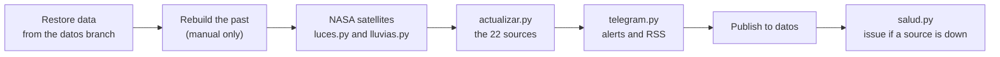

# Data sources

[Español](fuentes.md) · **English**

Reference for every atalaya data source: what it requests, what it keeps, what it filters out, how it fails and how to check it by hand. It is meant for maintaining the sources without reading the code first.

- Source code: [`scripts/actualizar.py`](../scripts/actualizar.py)
- Satellites: [`scripts/luces.py`](../scripts/luces.py) and [`scripts/lluvias.py`](../scripts/lluvias.py)
- Failing-source watch: [`scripts/salud.py`](../scripts/salud.py)
- Rebuilding the past: [`scripts/retroceso.py`](../scripts/retroceso.py)
- Workflow: [`.github/workflows/actualizar.yml`](../.github/workflows/actualizar.yml)
- Tests: [`tests/test_actualizar.py`](../tests/test_actualizar.py) and [`tests/test_satelites.py`](../tests/test_satelites.py)

> [!NOTE]
> The numbers and names on this page come from the code. If they ever disagree, the code wins: fix this page.
>
> Names in `code` (functions, constants, event types, file names, source names in `FUENTES`) are kept in Spanish, as they appear in the code and data.

---

## Contents

- [Source overview](#source-overview)
- [How and when they run](#how-and-when-they-run)
- [The source contract](#the-source-contract)
- [Failing sources and the health issue](#failing-sources-and-the-health-issue)
- [First steps to check a source](#first-steps-to-check-a-source)
- Source sheets
  - Earthquakes: [USGS](#usgs) · [EMSC](#emsc) · [IGN](#ign)
  - Disasters: [GDACS](#gdacs) · [Copernicus EMS](#copernicus-ems) · [NASA EONET](#nasa-eonet)
  - Press: [GDELT](#gdelt) · [Headlines](#headlines) · [Analysis](#analysis)
  - Internet and censorship: [IODA](#ioda) · [Cloudflare Radar](#cloudflare-radar) · [OONI](#ooni)
  - Travel advice: [Spanish Foreign Ministry](#spanish-foreign-ministry) · [US travel advisories](#us-travel-advisories)
  - Health, crises and deaths: [WHO](#who) · [ReliefWeb](#reliefweb) · [UCDP](#ucdp)
  - Early signals: [Exchange rates](#exchange-rates) · [Elections (Wikidata)](#elections-wikidata)
  - Satellites: [NASA FIRMS](#nasa-firms) · [NASA Black Marble](#nasa-black-marble) · [NASA GPM IMERG](#nasa-gpm-imerg)
  - [Fixed data](#fixed-data)
- [Adding a new source](#adding-a-new-source)
- [Secrets and variables](#secrets-and-variables)

---

## Source overview

The 22 sources in the `FUENTES` list in `actualizar.py`, in the order they run. The *key* column says which secret or variable is needed; without it, the source switches itself off.

| Source | What it provides | Family | Key | File/function | Frequency |
|---|---|---|---|---|---|
| [USGS](#usgs) | Magnitude 4.5+ earthquakes worldwide, with PAGER alert | `oficial` | No | `actualizar.py` · `usgs()` | Every run |
| [EMSC](#emsc) | Magnitude 4+ earthquakes in Europe, the Mediterranean and the Middle East | `oficial` | No | `actualizar.py` · `emsc()` | Every run |
| [IGN](#ign) | Earthquakes in and around Spain | `oficial` | No | `actualizar.py` · `ign()` | Every run |
| [GDACS](#gdacs) | Alerts for cyclones, floods, volcanoes, droughts, wildfires and tsunamis | `oficial` | No | `actualizar.py` · `gdacs()` | Every run |
| [Copernicus EMS](#copernicus-ems) | EU emergency mapping activations | `oficial` | No | `actualizar.py` · `copernicus()` | Every run |
| [NASA EONET](#nasa-eonet) | Active natural events | `oficial` | No | `actualizar.py` · `eonet()` | Every run |
| [GDELT](#gdelt) | Political violence and protests in the world's press; risk at maritime chokepoints | `prensa` | No | `actualizar.py` · `gdelt()` | Every run (96 files, 24 h) |
| [Headlines](#headlines) (`Titulares`) | Spanish-language headlines from the last few hours | (no events) | No | `actualizar.py` · `titulares()` | Every run |
| [Analysis](#analysis) (`Análisis`) | Analysis by Elcano, IEEE and CIDOB per country | (no events) | No | `actualizar.py` · `analisis()` | Every run |
| [IODA](#ioda) | Large internet outages per country | `tecnica` | No | `actualizar.py` · `ioda()` | Every run |
| [Cloudflare Radar](#cloudflare-radar) | Internet outages with their cause (for example, government-ordered) | `tecnica` | `CLOUDFLARE_TOKEN` | `actualizar.py` · `cloudflare()` | Every run |
| [OONI](#ooni) | Blocking of WhatsApp, Telegram, Signal and Messenger | `tecnica` | No | `actualizar.py` · `ooni()` | Every run |
| [Spanish Foreign Ministry](#spanish-foreign-ministry) (`Exteriores (España)`) | Travel advice from Spain's Ministry of Foreign Affairs | `oficial` | No | `actualizar.py` · `exteriores()` | At most every 12 h |
| [US travel advisories](#us-travel-advisories) (`Avisos de viaje EE. UU.`) | US State Department advisory level | `oficial` | No | `actualizar.py` · `avisos_viaje()` | Every run |
| [WHO](#who) (`OMS`) | Disease outbreaks (Disease Outbreak News) | `sanitaria` | No | `actualizar.py` · `oms()` | Every run |
| [ReliefWeb](#reliefweb) | Open humanitarian crises (OCHA) | `humanitaria` | `RELIEFWEB_APPNAME` | `actualizar.py` · `reliefweb()` | Every run |
| [UCDP](#ucdp) | Verified conflict deaths in 90 days | `academica` (added separately) | `UCDP_TOKEN` (+ `UCDP_VERSION`) | `actualizar.py` · `ucdp()` | Every run |
| [Exchange rates](#exchange-rates) (`Tipos de cambio`) | Currencies that collapse against the dollar in 7 days | `tecnica` | No | `actualizar.py` · `divisas()` | Every run (one snapshot per day) |
| [Elections (Wikidata)](#elections-wikidata) (`Elecciones (Wikidata)`) | Elections and referendums in the next 45 days | (no events) | No | `actualizar.py` · `elecciones()` | At most every 12 h |
| [Fires (NASA FIRMS)](#nasa-firms) (`Incendios (NASA FIRMS)`) | Satellite heat spots compared with the country's usual level | `tecnica` | `FIRMS_KEY` | `actualizar.py` · `incendios()` | Every run (last 24 h) |
| [Night lights (NASA Black Marble)](#nasa-black-marble) (`Luces nocturnas (NASA Black Marble)`) | Blackouts in cities at war or on alert | `tecnica` | `EARTHDATA_TOKEN` | `luces.py` · `principal()`; read by `actualizar.py` · `luces()` | One new day per day (about 2 days' delay) |
| [Rainfall (NASA GPM IMERG)](#nasa-gpm-imerg) (`Lluvias (NASA GPM IMERG)`) | Extreme rainfall per country | `tecnica` | `EARTHDATA_TOKEN` | `lluvias.py` · `principal()`; read by `actualizar.py` · `lluvias()` | One new day per day (1 day's delay) |

### What each source produces

The **weight** (`peso`) adds points to the country in the given component (`PARTE_DE`). The event **level** (`nivel`) sets a minimum level for the country: an `ambar` or `rojo` event from the last 48 hours puts the country at least on *watch* or *alert* (reason «Alerta oficial naranja» or «roja»). That is why sources that are not official alerts emit their events as `verde`.

| Source | Event `tipo` | Score component | `peso` | `nivel` |
|---|---|---|---|---|
| USGS | `terremoto` | `desastres` | `(magnitude − 4)²` + 3 / 10 / 25 if the PAGER alert is `yellow` / `orange` / `red` | By weight: `rojo` ≥ 12, `ambar` ≥ 4 |
| EMSC, IGN | `terremoto` | `desastres` | `(magnitude − 4)²` | By weight: `rojo` ≥ 12, `ambar` ≥ 4 |
| GDACS | `desastre` | `desastres` | 1 / 6 / 15 (green / orange / red); droughts 0 | The alert's level |
| Copernicus EMS | `desastre` | `desastres` | 5 | `ambar` |
| NASA EONET | `desastre` | `desastres` | 0.5 to 2 depending on type | `verde` |
| GDELT | `conflicto`, `protesta` | `conflicto`, `protestas` (computed separately) | 0 on the event; the score comes from per-country aggregates | `verde` |
| IODA | `internet` | `internet` | `3 × (log10(score + 1) − 5)`, from 0 to 12 | `ambar` if weight ≥ 9 |
| Cloudflare Radar | `internet` | `internet` | 12 / 8 / 3 | `rojo` if 12, otherwise `ambar` |
| OONI | `censura` | `censura` | 6 if the block is new, 0 if it is ongoing | `ambar` if new |
| Spanish Foreign Ministry | `aviso` | `avisos` | 5 per level raised; 1 if updated without raising | `ambar` if raised to 3 or more |
| US | `aviso` | `avisos` | 4 per level raised; 0 if lowered | `ambar` if raised to 3 or more |
| WHO | `epidemia` | `epidemias` | 8 if severe, otherwise 3 | `ambar` if severe |
| ReliefWeb | `crisis` | `humanitaria` | 6 for `alert`, 0 for `current` | `ambar` for `alert` |
| UCDP | (no events) | (adds no points) | | Raises the level separately (≥ 100 and ≥ 1000 deaths) |
| Exchange rates | `economia` | `economia` | 1.5, or 3 if the fall is ≥ 15 % | `verde` |
| NASA FIRMS | `incendios` | `incendios` | 2, or 3 if ≥ 4 times the usual | `verde` |
| NASA Black Marble | `apagon` | `apagon` | 2, or 3 if light falls to 30 % or less | `verde` |
| NASA GPM IMERG | `lluvia` | `lluvias` | 2, or 3 if it covers ≥ 2,500 km² | `verde` |

The **family** (`familia`) feeds the confidence: two or more matching families give *high* confidence; one that is not `prensa` gives *medium*; press only gives *low* (`confianza()`). An event only contributes its family if it has `peso > 0` or a level other than `verde`.

---

## How and when they run

The [`actualizar.yml`](../.github/workflows/actualizar.yml) workflow runs on the cron `7,37 * * * *` (every 30 minutes; GitHub may delay or skip runs), after every merge to `main` that touches `scripts/`, `data/paises.json`, `data/mundo.geojson` or the workflow itself, and by hand. The steps, in order:



1. **Restore previous data** from the `datos` branch into `salida/data` (`ATALAYA_SALIDA`). If the branch exists but cannot be read, or has no `historial.json`, the run fails so that the history is not wiped.
2. **Rebuild the past** with GDELT, only when run by hand with `retroceso_dias` other than `0` ([`retroceso.py`](../scripts/retroceso.py), see [GDELT](#gdelt)).
3. **NASA satellites**: only if `EARTHDATA_TOKEN` exists. Installs `h5py` and `numpy`, runs `luces.py` and then `lluvias.py`. It has `continue-on-error: true` and `timeout-minutes: 15`: if it fails, the rest carries on.
4. **Download sources and compute alerts**: `actualizar.py` runs the sources one after another, in `FUENTES` order.
5. **Telegram alerts and RSS**: only in publishing runs; it never breaks the update. See [`docs/telegram.en.md`](telegram.en.md).
6. **Publish the data** to `datos` (or to `datos-prueba` if *Publicar* is unticked).
7. **Warn if a source has been down for a while** (`salud.py`), only in publishing runs.

Time windows in `actualizar.py`:

| Constant | Value | Purpose |
|---|---|---|
| `VENTANA_PUNTUACION` | 48 hours | Events that count for today's score |
| `VENTANA_MAPA` | 7 days | Events kept and drawn on the map |
| `VENTANA_EPIDEMIAS` | 30 days | Outbreaks (and humanitarian crises on the map); open crises count even when old |
| `DIAS_HISTORIAL` | 30 | Days in `historial.json` used to know what is usual |
| `FALLOS_PARA_AVISAR` | 6 | Consecutive failing runs before the issue is opened |

Events that trigger a key signal on Telegram (`SEÑALES` in `telegram.py`), if they are from the last 24 hours: `censura` and `internet` with a level other than `verde`, `aviso` with `peso > 0`, `desastre` and `terremoto` at `rojo`, and `epidemia` other than `verde`.

---

## The source contract

Each source is a function `fuente(paises)` in `actualizar.py`. It receives the `Paises` object (which assigns an ISO alpha-3 country by name or by coordinates) and returns one of these four things:

| Returns | Meaning | What `main()` does |
|---|---|---|
| `{"eventos": [...], ...}` | All good. It may carry other keys with aggregated data (`paises`, `pasos`, `avisos`, `exteriores`, `ucdp`, `divisas`, `incendios`, `luces`, `lluvias`, `titulares`, `analisis`, `elecciones`…). | Stores the events and merges the other keys into `extra`. Status `ok`. |
| `None` | The source does not respond. | Error `no responde`. Keeps the previous data. |
| Raises `FormatoInesperado` | It responds, but with a different shape. Raised with `exigir(condition, message)`. | Error `formato inesperado: …`. Keeps the previous data. |
| `{"eventos": [], "desactivada": True}` | Its key is missing. | Skipped: does not count as a failure and does not appear in *Source status*. |

Any other exception is caught too (`error al leer los datos: Type: message`), so that a broken source cannot bring down the others. If **no** source responds, `actualizar.py` exits with an error (`Ninguna fuente respondió`) and nothing is published.

### How previous data is kept

When a source fails, `main()` reads the `eventos.json` from the previous run:

- **Events**: it reuses previous events whose `fuente` field is **exactly equal** to the source's name in `FUENTES`.
- **Sources without events** (`DATOS_DE_FUENTE`): `Titulares` → `titulares`, `Análisis` → `analisis` and `Elecciones (Wikidata)` → `elecciones`. The whole list is reused.
- **Aggregates**: those from GDELT (`gdelt_paises`, `gdelt_pasos`), UCDP, exchange rates, fires, lights and rainfall are taken from the previous `eventos.json` if the current run does not provide them. US advisories come from `avisos.json` and the Spanish Foreign Ministry's from `exteriores.json`.

> [!NOTE]
> The three satellite sources emit events with a `fuente` different from their name in `FUENTES` (`NASA FIRMS` vs `Incendios (NASA FIRMS)`, etc.). The `ETIQUETA_EVENTOS` table in `actualizar.py` maps the two names so that, if one fails, its previous events are kept too. If a new source uses another label on its events, add it there.

### Status of each source

`main()` writes one record per source to `eventos.json` → `fuentes`:

| Field | Content |
|---|---|
| `ok` | `true` if there was no error |
| `error` | `no responde`, `formato inesperado: …` or `error al leer los datos: …` |
| `eventos` | How many events (or list items, for sources without events) it provides, including kept ones |
| `fallos_seguidos` | Consecutive runs with an error; back to 0 as soon as it responds |
| `ultimo_ok` | Time of the last good run |

The website shows it under *Report → Source status*.

### How `descargar()` downloads

Almost every source uses `descargar(url, como="json", intentos=3, espera=6, cabeceras=None)`:

- `User-Agent`: `Mozilla/5.0 (compatible; atalaya/1.0; +https://github.com/serbenda/atalaya)`.
- Timeout per request: 60 seconds.
- Up to `intentos` attempts, waiting `espera × n` seconds between them (6 s and 12 s by default).
- `como`: `json` (returns `{}` if the body is empty), `texto` or `bytes`.
- A 404 with `como="bytes"` is not retried (it is a GDELT file that does not exist).
- Returns `None` if it does not succeed. Errors go to the log as `fallo i/n en <url>: <error>`.

FIRMS, Black Marble and IMERG have their own download functions (`firms_pedir()` and `pedir()`), described in their sheets.

---

## Failing sources and the health issue

[`salud.py`](../scripts/salud.py) runs at the end of the workflow, only in publishing runs:

1. It reads `fuentes` from `eventos.json`.
2. If any source has `fallos_seguidos ≥ FALLOS_PARA_AVISAR` (6 runs, about 3 hours), it prints a Markdown table (source, error, consecutive failures, last good data and a link to the run) and exits with code 1.
3. The workflow looks for an open issue titled **Fuentes de datos caídas**. If there is one, it adds a comment with the table; if not, it creates it.

Keep in mind:

- The issue gets a comment when a source **has just reached** the threshold, and then **once a day** (every `AVISO_CADA = 48` runs) while it is still down. On other runs `salud.py` exits with code 2 and nothing is done.
- **The issue closes by itself** when all sources respond again (code 0), with a comment.
- The map keeps showing the source's last good data.
- Switched-off sources (no key) never open the issue.
- The Spanish Foreign Ministry and Wikidata use a 12-hour cache and almost never reach 6 consecutive failures (see their sheets).

---

## First steps to check a source

**1. See the status in production**, without cloning anything:

```bash
curl -s https://raw.githubusercontent.com/serbenda/atalaya/datos/data/eventos.json \
  | python3 -c "import json,sys; [print(f'{n:40} {f}') for n, f in json.load(sys.stdin)['fuentes'].items()]"
```

**2. Read the log**: Actions → *Actualizar datos* → the latest run → step *Descargar fuentes y calcular alertas*. Each source writes `Descargando <name>…` and, if it fails, `<name>: <error>` and the `fallo i/n en <url>` lines. At the end, `Listo: {...}` shows the status and number of events of each one.

**3. Run a single source locally.** From the repository root, with the real data from the `datos` branch in a separate folder (some sources read the previous state: Spanish Foreign Ministry, US advisories, exchange rates, FIRMS):

```bash
mkdir -p /tmp/atalaya-prueba
git fetch origin datos
git archive origin/datos data | tar -x -C /tmp/atalaya-prueba
ATALAYA_SALIDA=/tmp/atalaya-prueba/data python3 -c "
import sys; sys.path.insert(0, 'scripts'); import actualizar as a
r = a.usgs(a.Paises())   # replace usgs with the source's function
print(r if r is None else {k: (len(v) if isinstance(v, (list, dict)) else v) for k, v in r.items()})"
```

To see the exact URL a source requests, print its constant: `python3 -c "import sys; sys.path.insert(0, 'scripts'); import actualizar as a; print(a.OMS_URL)"`.

> [!CAUTION]
> Some sources **write** to `ATALAYA_SALIDA` (`avisos.json`, `exteriores.json`, `divisas_historial.json`, `elecciones.json`, `incendios_historial.json`). Always use a test folder, never the repository's `data/` folder.

In the commands on the sheets, `<YOUR_KEY>` is a placeholder: put your key only in your own terminal and never paste it into issues, commits or chats.

---

## Earthquakes

The three seismic sources overlap. `sin_duplicados_sismicos()` keeps a single event when two arrive less than **120 seconds** and less than **100 km** apart, with this order of preference: USGS, EMSC, IGN.

### USGS

| | |
|---|---|
| Organisation | United States Geological Survey (USGS) |
| Name in `FUENTES` | `USGS` |
| Function | `usgs()` in [`actualizar.py`](../scripts/actualizar.py) |
| Request | `USGS_URL` = `https://earthquake.usgs.gov/earthquakes/feed/v1.0/summary/4.5_week.geojson` |
| Format | GeoJSON |
| Key | No |
| Frequency | Every run |
| Output | `tipo: terremoto`, `familia: oficial`, `fuente: USGS`; in `eventos.json` |

**What it measures and why it matters.** Every magnitude 4.5+ earthquake from the last week, with the PAGER alert, which estimates the impact on people and damage. A severe earthquake can trigger a humanitarian crisis within hours.

**What is kept.** All items in `features`. Country by coordinates; if it falls at sea, by place name (`null` if not found).

**Weight and level.** `peso = max(magnitude − 4, 0)²`, plus 3 (`yellow`), 10 (`orange`) or 25 (`red`) depending on the PAGER alert. Level with `nivel_por_peso()`: `rojo` if the weight is ≥ 12, `ambar` if it is ≥ 4, otherwise `verde`.

**Failures.** If `features` is not a list, `FormatoInesperado`.

**Check by hand.**

```bash
curl -s https://earthquake.usgs.gov/earthquakes/feed/v1.0/summary/4.5_week.geojson \
  | python3 -c "import json,sys; f=json.load(sys.stdin)['features']; print(len(f), f[0]['properties']['place'])"
```

**Licence.** US Government data, in the public domain. The source is cited on every event.

### EMSC

| | |
|---|---|
| Organisation | European-Mediterranean Seismological Centre (EMSC) |
| Name in `FUENTES` | `EMSC` |
| Function | `emsc()` |
| Request | `EMSC_URL`: FDSN service `https://www.seismicportal.eu/fdsnws/event/1/query` with `format=json`, `minmag=4`, `limit=300`, `start` = 7 days ago, `minlat=24`, `maxlat=50`, `minlon=-25`, `maxlon=45` |
| Format | GeoJSON |
| Key | No |
| Frequency | Every run |
| Output | `tipo: terremoto`, `familia: oficial`, `fuente: EMSC` |

**What it measures.** Magnitude 4+ earthquakes inside the Europe, Mediterranean and Middle East box, often earlier or in more detail than USGS in that area.

**What is kept.** Rows with numeric `lat`, `lon` and `mag`. Place: `flynn_region`.

**Weight and level.** `peso = max(magnitude − 4, 0)²`; level with `nivel_por_peso()`. No PAGER alert.

**Failures.** If `features` is not a list, `FormatoInesperado`.

**Check by hand.**

```bash
curl -s "https://www.seismicportal.eu/fdsnws/event/1/query?format=json&minmag=4&limit=5&start=YYYY-MM-DD&minlat=24&maxlat=50&minlon=-25&maxlon=45" | python3 -m json.tool | head -40
```

**Licence.** Free to use with credit to EMSC. Check its terms at seismicportal.eu.

### IGN

| | |
|---|---|
| Organisation | Instituto Geográfico Nacional (Spain's national geographic institute) |
| Name in `FUENTES` | `IGN` |
| Function | `ign()` |
| Request | `IGN_URL` = `http://www.ign.es/ign/RssTools/sismologia.xml` (http, not https) |
| Format | RSS (XML) |
| Key | No |
| Frequency | Every run |
| Output | `tipo: terremoto`, `familia: oficial`, `fuente: IGN` |

**What it measures.** Earthquakes in and around Spain over the last 10 days, according to the feed itself.

**What is kept.** Magnitude and place are extracted from `description` with the expression `magnitud ([\d.,]+) en (.+?) en la fecha`, and the coordinates from `lat` and `long`. Earthquakes of magnitude **below 2.5** are dropped.

**Weight and level.** `peso = max(magnitude − 4, 0)²`: below 4 they appear on the map but add 0. Level with `nivel_por_peso()`.

**Failures.** It does not use `exigir`. If the XML is not valid, `xml_items()` raises `FormatoInesperado`. If the wording of `description` changes, earthquakes are dropped without an error: the source shows `ok` with 0 events. If IGN shows 0 events for several days, check that expression.

**Check by hand.**

```bash
curl -s http://www.ign.es/ign/RssTools/sismologia.xml | grep -o '<description>[^<]*' | head -5
```

**Licence.** IGN information may be reused with credit. Check the terms at ign.es.

---

## Disasters

### GDACS

| | |
|---|---|
| Organisation | Global Disaster Alert and Coordination System (UN and European Commission) |
| Name in `FUENTES` | `GDACS` |
| Function | `gdacs()` |
| Request | `GDACS_URLS`: first `https://www.gdacs.org/xml/rss_7d.xml` and, if it fails, `https://www.gdacs.org/xml/rss.xml`; 2 attempts each |
| Format | RSS (XML) with `gdacs:` and `geo:` tags |
| Key | No |
| Frequency | Every run |
| Output | `tipo: desastre`, `familia: oficial`, `fuente: GDACS` |

**What it measures.** Green, orange and red alerts for tropical cyclones (`TC`), floods (`FL`), eruptions (`VO`), droughts (`DR`), wildfires (`WF`) and tsunamis (`TS`).

**What is kept and what is filtered out.**

- Only the types in `GDACS_TIPOS`. Earthquakes (`EQ`) are dropped because they already come from USGS.
- **Green** wildfires and droughts are dropped: they happen almost daily.
- No duplicates by `gdacs-<type>-<eventid>`.
- Country: the feed's `iso3` if it has 3 letters; otherwise by name and coordinates.
- **Droughts** are drawn but not assigned to a country (`pais: null`) and weigh 0, because they span many countries and move slowly.

**Weight and level.** Green 1, orange 6, red 15. The event level is the alert's.

**Failures.** If there are items but none has `eventtype`, `FormatoInesperado`. An empty feed is valid.

**Check by hand.**

```bash
curl -s https://www.gdacs.org/xml/rss_7d.xml | grep -o '<gdacs:eventtype>[A-Z]*' | sort | uniq -c
```

**Licence.** Free to use with credit to GDACS. Check its terms at gdacs.org.

### Copernicus EMS

| | |
|---|---|
| Organisation | Copernicus Emergency Management Service (European Union) |
| Name in `FUENTES` | `Copernicus EMS` |
| Function | `copernicus()` |
| Request | `COPERNICUS_URL` = `https://mapping.emergency.copernicus.eu/activations/api/activations/?limit=40` |
| Format | JSON |
| Key | No |
| Frequency | Every run |
| Output | `tipo: desastre`, `familia: oficial`, `fuente: Copernicus EMS` |

**What it measures.** Rapid mapping activations. They are only requested for severe disasters, so an activation is already a strong signal.

**What is kept.** The last 40 activations and, of those, the ones from the last **10 days** (`activationTime`) with a `centroid` of the form `POINT (lon lat)`. The title translates the category with `COPERNICUS_TIPOS`.

**Weight and level.** Weight 5, level `ambar`.

**Failures.** If `results` is not a list, `FormatoInesperado`.

**Check by hand.**

```bash
curl -s "https://mapping.emergency.copernicus.eu/activations/api/activations/?limit=5" | python3 -m json.tool | head -60
```

**Licence.** Free, citing the source with this text (Commission Delegated Regulation (EU) 1159/2013, art. 8). The website uses the Spanish text:

> «Contiene información modificada del servicio Copernicus [año]» (English: "Contains modified Copernicus Service information [year]")

The website shows it in `index.html` (the `atribucion` paragraph, with the year in `data-anio`), in Spanish and English. Do not remove it.

### NASA EONET

| | |
|---|---|
| Organisation | NASA, Earth Observatory Natural Event Tracker |
| Name in `FUENTES` | `NASA EONET` |
| Function | `eonet()` |
| Request | `EONET_URL` = `https://eonet.gsfc.nasa.gov/api/v3/events?status=open&days=7` |
| Format | JSON |
| Key | No |
| Frequency | Every run |
| Output | `tipo: desastre`, `familia: oficial`, `fuente: NASA EONET`, always `nivel: verde` |

**What it measures.** Open natural events from the last 7 days: wildfires, storms, volcanoes, floods, landslides, dust, drought and snow.

**What is kept.** The last `Point` geometry of each event. Country by coordinates only. The `earthquakes` (already from USGS) and `seaLakeIce` categories are dropped.

**Weight** (`EONET_TIPOS`):

| Category | Title | Weight |
|---|---|---|
| `wildfires` | Incendio | 0.5 |
| `severeStorms` | Tormenta severa | 2 |
| `volcanoes` | Volcán activo | 2 |
| `floods` | Inundación | 2 |
| `landslides` | Deslizamiento de tierra | 2 |
| `dustHaze` | Polvo o calima | 0.5 |
| `drought` | Sequía | 1 |
| `snow` | Nevada | 0.5 |
| other | Fenómeno natural | 1 |

**Failures.** If `events` is not a list, `FormatoInesperado`.

**Check by hand.**

```bash
curl -s "https://eonet.gsfc.nasa.gov/api/v3/events?status=open&days=7" \
  | python3 -c "import json,sys; e=json.load(sys.stdin)['events']; print(len(e)); [print(x['categories'][0]['id'], x['title']) for x in e[:5]]"
```

**Licence.** NASA open data; citation of the source is requested.

---

## Press

### GDELT

| | |
|---|---|
| Organisation | The GDELT Project |
| Name in `FUENTES` | `GDELT` |
| Functions | `gdelt()`, `gdelt_ficheros()`, `gdelt_filas()`, `es_politico()`, `es_estatal()`, `region_de()` |
| Request | `GDELT_ULTIMO_URL` = `http://data.gdeltproject.org/gdeltv2/lastupdate.txt` and then `GDELT_FICHERO_URL` = `http://data.gdeltproject.org/gdeltv2/{stamp}.export.CSV.zip` |
| Format | ZIP with a tab-separated CSV, 61 columns (GDELT 2.0 events) |
| Key | No |
| Frequency | Every run: `GDELT_FICHEROS` = 96 files of 15 minutes (24 hours), 8 parallel downloads, 2 attempts each |
| Output | `conflicto` and `protesta` events (`familia: prensa`), per-country aggregates (`gdelt_paises`) and per-chokepoint counts (`gdelt_pasos`) in `eventos.json`; chokepoints with their level in `alertas.json` |

**What it measures and why it matters.** Events coded automatically from the world's press (CAMEO codes), with actors, place and link. It is the main source for the conflict and protest score, and the only one that can be rebuilt backwards.

The static files are used instead of the API, because the GEO API returned 404 and the files include the actor type.

**What is kept.** Row by row:

1. Coordinates are required (columns 56 and 57).
2. **Only the main event** of each story: `IsRootEvent` (column 25) equal to `1`. Passing mentions of old attacks add noise.
3. **Conflict**: CAMEO root code (column 28) in `GDELT_VIOLENCIA` = `18` (assault), `19` (fight), `20` (mass violence), and `es_politico()` must be true.
4. **Protest**: root code in `GDELT_PROTESTA` = `14`.
5. `es_politico()` is true if one of these holds:
   - an actor type (columns 12–14 and 22–24) is in `ACTORES_POLITICOS` = `MIL` (military), `REB` (rebels), `INS` (insurgents), `SEP` (separatists), `UAF` (non-state armed forces), `GOV` (government), `SPY` (intelligence), `OPP` (opposition);
   - an actor has a known group (columns 8 or 18 not empty);
   - the two actors are from different countries (columns 7 and 17).
   
   Police (`COP`) is **not** included: in the press it is almost always crime reporting.
6. **De-escalation**: main event with base code (column 27) in `GDELT_DESESCALADA` = `086` (allow humanitarian aid) or `087` (military de-escalation, includes ceasefire `0871`), and a political actor. "Negotiate" (`046`) is not included because it appears every day.
7. **Once per story**: a row is dropped if the same URL (column 60) has already been counted for the same country and type.
8. **State media**: if the URL's domain contains one of `MEDIOS_ESTATALES`, the event counts `PESO_ESTATAL` = **0.5**. The list: `rt.com`, `sputniknews`, `sputnikglobe`, `tass.ru`, `tass.com`, `ria.ru`, `xinhuanet`, `news.cn`, `globaltimes.cn`, `cgtn.com`, `chinadaily.com.cn`, `presstv`, `irna.ir`, `tasnimnews`, `farsnews`, `mehrnews`, `kcna`, `rodong.rep.kp`, `telesurtv`, `granma.cu`, `sana.sy`, `belta.by`, `almanar.com.lb`. They are not dropped (sometimes they are the only source), but they cannot light up a country on their own.

**Per-country aggregates** (`paises` → `gdelt_paises`): `total`, `conflicto`, `protesta`, `interestatal` (actors from two countries), `militar` (`MIL`, `REB`, `INS` or `UAF`), `disturbios` (base code `145`), `desescalada`, `estatal` (events from state media), and the halves `*_12h` and `*_12h_antes` for acceleration. With 5 or more conflict events, these are added:

- `regiones`: up to 3 regions (first administrative division) with at least 10 % of events;
- `actores`: up to 3 actor pairs with at least 3 events.

**Score** (in `puntuar()`): `conflicto = 3 × log2(1 + events) × min(1, share / CUOTA_PLENA)`, with `share = events / max(total, 20)` and `CUOTA_PLENA` = 0.05. Protests the same way with 1.5 instead of 3. The `prensa` family counts for confidence if either reaches 3 points. Acceleration (`aceleracion()`) compares the last 12 h with the previous 12 h and is only computed with 8 or more events.

**Map events.** Grouped by (type, place, latitude and longitude rounded to 0.1°). Place type `1` (country only, which falls in the centre) is dropped. The **500** places with most mentions are kept and, of those, the ones with **3 or more** mentions. Each one carries up to 3 links. Weight 0 and level `verde`: the score comes from the aggregates.

**Maritime chokepoints** (`PASOS`). Conflict events (with a place type other than `1`) are counted when they fall within the radius of any of the chokepoint's zone points and less than 6° of latitude from its centre. They are counted before the URL dedupe and without discounting state media. Level in `calcular_pasos()`: `rojo` with 25 or more events, `ambar` with 6 or more.

| `id` | Chokepoint | Zone points (lon, lat) | Radius |
|---|---|---|---|
| `ormuz` | Strait of Hormuz | (56.4, 26.6) | 220 km |
| `bab` | Bab el-Mandeb and southern Red Sea | (43.4, 12.6), (42.0, 15.5) | 250 km |
| `suez` | Suez Canal | (32.3, 31.2), (32.35, 30.6), (32.55, 29.95) | 90 km |
| `bosforo` | Bosphorus | (29.05, 41.1), (26.4, 40.2) | 80 km |
| `gibraltar` | Strait of Gibraltar | (-5.6, 35.95) | 120 km |
| `malaca` | Strait of Malacca | (98.5, 5.0), (100.4, 3.0), (103.8, 1.25) | 250 km |
| `taiwan` | Taiwan Strait | (119.5, 24.0) | 200 km |
| `panama` | Panama Canal | (-79.7, 9.1) | 100 km |

The zones are drawn to leave out cities unrelated to the route (for example, Gaza and Cairo are outside Suez).

**Failures and known problems.**

- `lastupdate.txt` without the form `/<14 digits>.export.CSV.zip`: `FormatoInesperado`.
- More than half of the 96 files missing: `FormatoInesperado`. A file that does not exist (404) is not retried.
- First row without 61 columns: `FormatoInesperado`.
- If GDELT fails, `gdelt_paises` and `gdelt_pasos` from the previous run are reused so that the conflict score does not drop to zero.
- It is the heaviest download of every run.

**Rebuilding the past.** [`retroceso.py`](../scripts/retroceso.py) reprocesses GDELT's historical files with the same rules. By default it takes 48 of each day's 96 files and scales the counts (`96 / files read`); at most 90 days. It skips a day if more than half of its files are missing. It writes to `historico.json` and `retroceso.json`, never to `historial.json`. Start it from Actions with `retroceso_dias`.

**Check by hand.**

```bash
curl -s http://data.gdeltproject.org/gdeltv2/lastupdate.txt
# Take the 14-digit stamp from the .export.CSV.zip line and check the columns:
curl -s -o /tmp/g.zip http://data.gdeltproject.org/gdeltv2/YYYYMMDDHHMMSS.export.CSV.zip
unzip -p /tmp/g.zip | head -1 | awk -F'\t' '{print NF}'    # should print 61
```

**Licence.** GDELT open data, free to use with credit. Every event links to the original news stories.

### Headlines

| | |
|---|---|
| Organisation | Google News (Spanish-language search), EFE and RTVE (through Google News) and El País |
| Name in `FUENTES` | `Titulares` (in `DATOS_DE_FUENTE` → `titulares`) |
| Function | `titulares()` |
| Request | `TITULARES_URL` (Google News search with crisis terms, no sport, `when:1d`), `TITULARES_MAS` (`site:efe.com` and `site:rtve.es`, `when:1d`) and `ELPAIS_URL` (International front page); 2 attempts each |
| Format | RSS (XML) |
| Key | No |
| Frequency | Every run |
| Output | `titulares` list (no events) in `eventos.json`; the first 20 in the daily snapshot in `archivo/` |

**What it provides.** Spanish-language press from the last few hours, in the *Headlines* tab and on each country sheet. In addition, `main()` searches the headlines for «golpe de estado», «golpista» or «asonada» (indicator *the press talks about a coup*) and «alto el fuego», «tregua», «negociaciones de paz», «acuerdo de paz», «cese de hostilidades» or «desescalada» (counter-signal).

**What is kept and what is filtered out.**

- The « - Outlet» that Google adds at the end is removed.
- Anniversaries are dropped: headlines with a year before last year («el bombardeo de 1937»).
- No duplicates by the first 70 normalised characters.
- Dropped: older than 36 hours, fewer than 5 words, outlets whose name contains «comunica» (press releases) and those saying «en directo» (live).
- Each headline carries the countries it names (`Paises.en_texto()`).
- The 60 most recent are kept.

**Failures.** It only returns `None` if all four feeds fail. If one is not valid XML, `FormatoInesperado`. If it fails, the previous list is reused.

**Check by hand.**

```bash
URL=$(python3 -c "import sys; sys.path.insert(0, 'scripts'); import actualizar as a; print(a.TITULARES_URL)")
curl -s "$URL" | grep -o '<title>[^<]*' | head
```

**Licence.** Headlines belong to each outlet. Only the headline and the link to the original story are shown.

### Analysis

| | |
|---|---|
| Organisation | Real Instituto Elcano, Instituto Español de Estudios Estratégicos (IEEE) and CIDOB, through Google News |
| Name in `FUENTES` | `Análisis` (in `DATOS_DE_FUENTE` → `analisis`) |
| Function | `analisis()` |
| Request | `ANALISIS_URLS`: `site:realinstitutoelcano.org when:60d`, `site:ieee.es when:90d` and `site:cidob.org when:90d`; 2 attempts each |
| Format | RSS (XML) |
| Key | No |
| Frequency | Every run |
| Output | `analisis` list (no events) in `eventos.json` |

**What it provides.** Expert analysis on each country sheet.

**What is kept.** Only titles that name a country, except those starting with «novedades», «boletín» or «agenda». The 150 most recent are kept.

**Failures.** If **no** analysis is left, it returns `None` (counts as down), even if the feeds responded. If it fails, the previous list is reused.

**Check by hand.**

```bash
URL=$(python3 -c "import sys; sys.path.insert(0, 'scripts'); import actualizar as a; print(a.ANALISIS_URLS['CIDOB'])")
curl -s "$URL" | grep -o '<title>[^<]*' | head
```

**Licence.** Texts belong to each centre. Only the title and the link are shown.

---

## Internet and censorship

### IODA

| | |
|---|---|
| Organisation | Internet Outage Detection and Analysis (Georgia Tech) |
| Name in `FUENTES` | `IODA` |
| Function | `ioda()` |
| Request | `IODA_URL` = `https://api.ioda.inetintel.cc.gatech.edu/v2/outages/summary?from=<24 h ago>&until=<now>&entityType=country` (Unix timestamps) |
| Format | JSON |
| Key | No |
| Frequency | Every run |
| Output | `tipo: internet`, `familia: tecnica`, `fuente: IODA`, at the centre of the country |

**What it measures and why it matters.** Connectivity drops per country. A large internet outage often comes with coups, protests or attacks on infrastructure.

**What is kept.** Country by the ISO alpha-2 code in `entity.code`. IODA detects small drops in many countries every day, so only large outages count: `peso = min(12, max(0, 3 × (log10(score + 1) − 5)))`. With a `scores.overall` below **10⁵** the weight is 0 and the event is dropped.

**Level.** `ambar` if the weight is 9 or more (score of 10⁸ or more); otherwise `verde`.

**Failures.** If `data` is not a list, `FormatoInesperado`. The window is computed when the module is imported.

**Check by hand.**

```bash
from=$(date -u -d '24 hours ago' +%s); until=$(date -u +%s)
curl -s "https://api.ioda.inetintel.cc.gatech.edu/v2/outages/summary?from=$from&until=$until&entityType=country" \
  | python3 -c "import json,sys; d=json.load(sys.stdin)['data']; [print(x['entity']['code'], x['scores']['overall']) for x in sorted(d, key=lambda x: -x['scores']['overall'])[:10]]"
```

**Licence.** IODA open data, with credit. Check its terms at ioda.inetintel.cc.gatech.edu.

### Cloudflare Radar

| | |
|---|---|
| Organisation | Cloudflare Radar |
| Name in `FUENTES` | `Cloudflare Radar` |
| Function | `cloudflare()` |
| Request | `CLOUDFLARE_URL` = `https://api.cloudflare.com/client/v4/radar/annotations/outages?dateRange=1d&format=json&limit=100`, with the header `Authorization: Bearer <token>` |
| Format | JSON |
| Key | Secret `CLOUDFLARE_TOKEN`: a Cloudflare API token with Radar read permission. Without it, the source switches off |
| Frequency | Every run |
| Output | `tipo: internet`, `familia: tecnica`, `fuente: Cloudflare Radar` |

**What it measures.** Internet outages from the last day with their cause and scope. It tells a technical outage apart from one ordered by a government.

**What is kept.** Each country in `locations` of each annotation. It checks whether `outage.outageCause` contains `GOVERNMENT` and whether `outage.outageType` is `NATIONWIDE`.

**Weight and level.**

| Cause | Scope | Weight | Level |
|---|---|---|---|
| Government | Nationwide | 12 | `rojo` |
| Government | Partial | 8 | `ambar` |
| Other | Nationwide | 3 | `ambar` |
| Other | Partial | 0 (dropped) | |

**Failures.** If `result.annotations` is not a list, `FormatoInesperado`. An expired token or one without permission gives an HTTP error and the source shows `no responde`.

**Check by hand.**

```bash
curl -s -H "Authorization: Bearer <YOUR_KEY>" \
  "https://api.cloudflare.com/client/v4/radar/annotations/outages?dateRange=1d&format=json&limit=5" | python3 -m json.tool | head -40
```

**Licence.** Check the terms of use for Cloudflare Radar data at radar.cloudflare.com before any commercial use.

### OONI

| | |
|---|---|
| Organisation | Open Observatory of Network Interference |
| Name in `FUENTES` | `OONI` |
| Function | `ooni()` |
| Request | `OONI_URL` = `https://api.ooni.io/api/v1/aggregation?test_name={app}&since={from}&until={to}&axis_x=probe_cc`, for each app in `OONI_APPS` (`whatsapp`, `telegram`, `signal`, `facebook_messenger`) and two windows: 8 requests, 2 attempts each |
| Format | JSON |
| Key | No |
| Frequency | Every run |
| Output | `tipo: censura`, `familia: tecnica`, `fuente: OONI`, at the centre of the country |

**What it measures and why it matters.** Volunteer measurements of whether messaging apps are blocked. A new block often signals protests, tense elections or a coup.

**What is kept.**

- *Now* window: from 2 days ago to tomorrow. *Before* window: from 14 days ago to 2 days ago.
- Only rows with **10 or more** measurements. Rate = `anomaly_count / measurement_count`.
- **New block**: *now* rate ≥ 0.5 and *before* rate < 0.25.
- **Ongoing block**: *now* rate ≥ 0.5 without meeting the above.
- An ongoing block **only counts if it affects 2 or more apps**: with a single app it is usually measurement noise.

**Weight and level.** New block: weight 6, `ambar`. Ongoing block: weight 0, `verde` (informative only).

**Failures.** If **any** of the 8 requests fails, the whole source returns `None`. If `result` is not a list, `FormatoInesperado`.

**Check by hand.**

```bash
curl -s "https://api.ooni.io/api/v1/aggregation?test_name=whatsapp&since=YYYY-MM-DD&until=YYYY-MM-DD&axis_x=probe_cc" \
  | python3 -c "import json,sys; r=json.load(sys.stdin)['result']; [print(x['probe_cc'], x['anomaly_count'], x['measurement_count']) for x in r if x['measurement_count'] >= 10 and x['anomaly_count'] / x['measurement_count'] >= 0.5]"
```

**Licence.** OONI open data, with credit. Check its terms at ooni.org.

---

## Travel advice

Travel advice also reflects the foreign policy of whoever issues it. That is why it **reinforces, but does not colour a country on its own**.

### Spanish Foreign Ministry

| | |
|---|---|
| Organisation | Ministerio de Asuntos Exteriores, Unión Europea y Cooperación (Spain's Ministry of Foreign Affairs) |
| Name in `FUENTES` | `Exteriores (España)` |
| Functions | `exteriores()`, `exteriores_ficha()`, `exteriores_nivel()`, `normalizar_frases()` |
| Request | `EXTERIORES_INDICE` = `https://www.exteriores.gob.es/es/ServiciosAlCiudadano/Paginas/Recomendaciones-de-viaje.aspx` and, for each country, `.../Detalle-recomendaciones-de-viaje.aspx?trc=<country>`; 6 parallel downloads, 2 attempts per page |
| Format | HTML (there is no API: the website is scraped) |
| Key | No |
| Frequency | At most every `EXTERIORES_CADA` = 12 hours |
| Output | Events `tipo: aviso`, `familia: oficial`, `fuente: Exteriores (España)`; `exteriores` summary per country; persisted in `exteriores.json` |

**What it measures and why it matters.** Spain's travel advice for each country. It is the reference that matters in Spain.

**How it is read.**

1. The index yields the `Detalle-recomendaciones-de-viaje.aspx?trc=…` links. **More than 100** are required.
2. From each country page it takes the date in «Última actualización el D de mes de AAAA» and the text under **Notas importantes** (up to 600 characters, cut at the next section).
3. `exteriores_nivel()` reads the notes sentence by sentence:

| Level | Text | When |
|---|---|---|
| 4 | se desaconseja viajar bajo cualquier circunstancia (advise against all travel) | «abandonen el país», «recomienda/insta/aconseja… abandonar el país», or a sentence against travel with «cualquier/ninguna circunstancia» or with «totalmente/absolutamente/completamente» |
| 3 | se desaconseja viajar salvo necesidad (advise against all but essential travel) | Sentence against travel with «salvo» or «excepto», or with no qualifier |
| 2 | precaución o zonas desaconsejadas (caution or areas to avoid) | Sentence against travel that mentions areas, regions, borders, provinces… (`ZONAS`) without saying «todo el país/territorio», or «extremar la precaución» / «máxima precaución» |
| 1 | sin restricciones especiales (no special restrictions) | None of the above |

The highest level across all sentences is kept. Within a sentence against travel, the mention of areas is checked first: if present, that sentence gives level 2. Only sentences about travelling to the country count («se desaconseja participar en manifestaciones», advising against joining demonstrations, does not). `normalizar_frases()` joins single spaced capital letters («S E DESACONSEJA»).

**Changes.** A change is recorded when the page's **update date** differs from the one in `exteriores.json`. Changes are kept for 7 days.

**Event weight and level.** If the level goes up: weight `5 × (new level − previous level)` and title «Exteriores eleva su recomendación: …»; `ambar` if the new level is 3 or more. Otherwise: weight 1, `verde`, «Exteriores actualiza sus recomendaciones de viaje».

**Effect on the country level** (in `main()`): at level 4, the reason «Exteriores desaconseja viajar» is added; if the country also has 3 or more points and is `verde`, it becomes `ambar`. At level 3 or more, the *Spain advises against travel* indicator switches on in the scenarios.

**Failures and known problems.**

- Index with 100 links or fewer: `FormatoInesperado`.
- Half of the pages cannot be read: `FormatoInesperado`. A page that fails keeps its previous data.
- **HTTP 429 (too many requests)**: the ministry's website may rate-limit requests (seen in operation; the code does not handle it separately). `descargar()` retries and, if it does not succeed, the page or the index counts as a failure. If the index fails, `exteriores.json` is not rewritten, so the 12-hour cache is not renewed and **it tries again on the next run**, 30 minutes later. If 429 keeps happening, lower `max_workers=6` or space out the retries.
- While the cache is valid, the source shows `ok` even if the website is down: the failure only shows up when it is time to read it again.
- If the website changes the text «Notas importantes» or «Última actualización el…», pages are read without an error but at level 1 and with no date. Check `exteriores.json` if everything suddenly shows level 1.

**Check by hand.**

```bash
UA='Mozilla/5.0 (compatible; atalaya/1.0; +https://github.com/serbenda/atalaya)'
curl -s -A "$UA" -o /tmp/ext.html -w '%{http_code}\n' \
  'https://www.exteriores.gob.es/es/ServiciosAlCiudadano/Paginas/Recomendaciones-de-viaje.aspx'   # 200, or 429
grep -o 'Detalle-recomendaciones-de-viaje\.aspx?trc=[^"&]*' /tmp/ext.html | sort -u | wc -l     # more than 100
```

To see how one page is read, run `exteriores_ficha(url)` with the snippet in [First steps](#first-steps-to-check-a-source).

**Licence.** Public information from the Government of Spain, reusable with credit. Check the legal notice at exteriores.gob.es.

### US travel advisories

| | |
|---|---|
| Organisation | US Department of State (travel.state.gov) |
| Name in `FUENTES` | `Avisos de viaje EE. UU.` |
| Function | `avisos_viaje()` |
| Request | `AVISOS_URL` = `https://travel.state.gov/_res/rss/TAsTWs.xml` |
| Format | RSS (XML) |
| Key | No |
| Frequency | Every run |
| Output | Events `tipo: aviso`, `familia: oficial`; `avisos` levels per country; persisted in `avisos.json` |

**What it measures.** Each country's advisory level, from 1 to 4 (`AVISO_NIVELES`: normal precautions, increased caution, reconsider travel, do not travel).

**What is kept.** Titles of the form `<Country> - Level <N>`. If a country appears several times, the highest level. A change is recorded when the level differs from the one in `avisos.json`; changes are kept for 7 days.

**Event weight and level.** If raised: weight `4 × (new level − previous level)`, `ambar` if the new level is 3 or more. If lowered: weight 0, `verde`.

**Effect on the country level** (in `calcular_alertas()`): at level 4 and with at least 3 points of its own, the country becomes at least `ambar` («EE. UU. desaconseja viajar») and adds the `oficial` family to the confidence.

**Failures.** RSS with no items: `FormatoInesperado`. The first time there are no changes because there is nothing to compare with.

**Check by hand.**

```bash
curl -s https://travel.state.gov/_res/rss/TAsTWs.xml | grep -o '<title>[^<]*Level [0-9]' | head
```

**Licence.** US Government information, in the public domain.

---

## Health, crises and deaths

### WHO

| | |
|---|---|
| Organisation | World Health Organization, Disease Outbreak News |
| Name in `FUENTES` | `OMS` |
| Function | `oms()` |
| Request | `OMS_URL` = `https://www.who.int/api/news/diseaseoutbreaknews?$orderby=PublicationDateAndTime desc&$top=30` (encoded) |
| Format | JSON (OData) |
| Key | No |
| Frequency | Every run |
| Output | `tipo: epidemia`, `familia: sanitaria`, `fuente: OMS`, at the centre of the country |

**What it measures.** The last 30 outbreak notices. They count for the score for 30 days (`VENTANA_EPIDEMIAS`), because outbreaks evolve slowly.

**What is kept.** Notices published in the last 30 days whose title has the form "Disease - Country" with a recognised country. Global notices ("Cholera - Global situation") are dropped.

**Weight and level.** Severe if the title matches `EPIDEMIAS_GRAVES`: Ebola, Marburg, Lassa, plague, Nipah, cholera, yellow fever, MERS, avian influenza A(H5, mpox clade I, diphtheria or anthrax. Severe: weight 8, `ambar`. Otherwise: weight 3, `verde`.

**Failures.** If `value` is not a list, `FormatoInesperado`.

**Check by hand.**

```bash
URL=$(python3 -c "import sys; sys.path.insert(0, 'scripts'); import actualizar as a; print(a.OMS_URL)")
curl -s "$URL" | python3 -c "import json,sys; [print(x['PublicationDateAndTime'][:10], x['Title']) for x in json.load(sys.stdin)['value'][:10]]"
```

**Licence.** WHO content, under its terms of use. Only the title and the link are shown.

### ReliefWeb

| | |
|---|---|
| Organisation | ReliefWeb (OCHA, United Nations) |
| Name in `FUENTES` | `ReliefWeb` |
| Function | `reliefweb()` |
| Request | `RELIEFWEB_URL` = `https://api.reliefweb.int/v2/disasters?appname=<name>&limit=200&preset=latest&filter[field]=status&filter[value][]=alert&filter[value][]=current&fields[include][]=…` |
| Format | JSON |
| Key | Variable `RELIEFWEB_APPNAME`: an application name **approved** by ReliefWeb ([apidoc.reliefweb.int](https://apidoc.reliefweb.int/)). Without it, the source switches off |
| Frequency | Every run |
| Output | `tipo: crisis`, `familia: humanitaria`, `fuente: ReliefWeb`, at the centre of each affected country |

**What it measures.** Disasters and humanitarian crises with status `alert` or `current`.

**What is kept.** One event per crisis and country (`country.iso3`), if the country is on the map.

**Weight and level.** `alert`: weight 6, `ambar`. `current`: weight 0, `verde`. An open crisis counts **while it stays open**, even if it is old (`crisis_abierta`), and puts the country at least at `ambar` («Crisis humanitaria abierta»).

**Failures.** If `data` is not a list, `FormatoInesperado`. With an unapproved name, the API returns an HTTP error: `no responde`.

**Check by hand.**

```bash
curl -s "https://api.reliefweb.int/v2/disasters?appname=<YOUR_APPNAME>&limit=3&preset=latest" | python3 -m json.tool | head -30
```

**Licence.** ReliefWeb content belongs to each publishing organisation; check the API terms.

### UCDP

| | |
|---|---|
| Organisation | Uppsala Conflict Data Program (Uppsala University) |
| Name in `FUENTES` | `UCDP` |
| Function | `ucdp()` |
| Request | `UCDP_URL` = `https://ucdpapi.pcr.uu.se/api/gedevents/{UCDP_VERSION}?pagesize=1000&StartDate=<90 days ago>`, with the header `x-ucdp-access-token`; follows `NextPageUrl` up to 15 pages |
| Format | JSON |
| Key | Secret `UCDP_TOKEN` (requested by email from the API maintainer, [ucdp.uu.se/apidocs](https://ucdp.uu.se/apidocs/)) and optional variable `UCDP_VERSION` (default `26.0.9`) |
| Frequency | Every run |
| Output | No events; `ucdp` dictionary (deaths per country) in `eventos.json` |

**What it measures and why it matters.** Conflict deaths **verified** by researchers, from the monthly candidate version of the Georeferenced Event Dataset. It corrects for long wars dropping out of the news.

**What is kept.** It adds up the `best` field (best estimate of deaths) per country over the last 90 days.

**Effect on the level** (in `main()`, not in the score):

| Deaths in 90 days | Effect |
|---|---|
| ≥ 25 | Reason «N muertes verificadas en 90 días (UCDP)», `academica` family and *verified deaths* indicator |
| ≥ 100 | If the country is `verde`, it becomes `ambar` |
| ≥ 1000 | The country becomes `rojo` |

**Failures and maintenance.** If `Result` is not a list, `FormatoInesperado`. When UCDP publishes a new monthly version, update the `UCDP_VERSION` variable; if the version does not exist, the API returns an error and the source shows `no responde`.

**Check by hand.**

```bash
curl -s -H "x-ucdp-access-token: <YOUR_KEY>" \
  "https://ucdpapi.pcr.uu.se/api/gedevents/26.0.9?pagesize=1&StartDate=YYYY-MM-DD" | python3 -m json.tool | head -30
```

**Licence.** UCDP data, free to use with credit. Check its terms at ucdp.uu.se.

---

## Early signals

### Exchange rates

| | |
|---|---|
| Organisation | ExchangeRate-API (open access) |
| Name in `FUENTES` | `Tipos de cambio` |
| Function | `divisas()` |
| Request | `DIVISAS_URL` = `https://open.er-api.com/v6/latest/USD` |
| Format | JSON |
| Key | No |
| Frequency | Every run; one snapshot is kept per day (the one from the day's last run) |
| Output | `tipo: economia`, `familia: tecnica`, `fuente: Tipos de cambio`; `divisas` dictionary; persisted in `divisas_historial.json` (30 days) |

**What it measures and why it matters.** A currency that collapses within a few days often comes before protests, shortages or a government crisis.

**What is kept.** The 103 currencies in `DIVISAS` (116 countries; no dollar, no euro and no currencies pegged to them without a band). Today's rate is compared with the latest snapshot from 7 or more days ago: `fall = 1 − rate_before / rate_today`.

**Weight and level.** Fall ≥ `CAIDA_DIVISA` (8 %): weight 1.5. Fall ≥ `CAIDA_DIVISA_GRAVE` (15 %): weight 3. Always `verde`. One event per country using the currency (for example, `XOF` gives 8 countries). At 8 % or more, the *currency collapses* indicator switches on.

**Failures.** If `result` is not `success` or `rates` is missing, `FormatoInesperado`. In the first week there are no events: there is no snapshot from 7 days ago yet.

**Check by hand.**

```bash
curl -s https://open.er-api.com/v6/latest/USD | python3 -c "import json,sys; d=json.load(sys.stdin); print(d['result'], d['time_last_update_utc'], d['rates']['ARS'])"
```

**Licence.** ExchangeRate-API's open access asks for attribution; each event links to exchangerate-api.com. Check its terms.

### Elections (Wikidata)

| | |
|---|---|
| Organisation | Wikidata (Wikimedia Foundation) |
| Name in `FUENTES` | `Elecciones (Wikidata)` (in `DATOS_DE_FUENTE` → `elecciones`) |
| Function | `elecciones()` |
| Request | `WIKIDATA_URL` = `https://query.wikidata.org/sparql?format=json&query=<SPARQL>`, header `Accept: application/sparql-results+json`, **a single attempt** |
| Format | JSON (SPARQL results) |
| Key | No |
| Frequency | At most every 12 hours, also after a failure; persisted in `elecciones.json` |
| Output | `elecciones` list (no events) in `eventos.json`; `elecciones` on each country sheet |

**What it provides.** Elections and referendums in the next `DIAS_ELECCIONES` = 45 days. They are risk dates: protests, internet shutdowns and government crises cluster around them. They switch on the *upcoming elections* indicator and appear under *Key dates*.

**The query.** Items of the types `wd:Q40231`, `wd:Q152450`, `wd:Q858439`, `wd:Q1076105` and `wd:Q43109` (or their direct subclasses), with a date (`P585`) inside the window, a country (`P17`) and the country's ISO alpha-3 code (`P298`). The label is taken in Spanish or, if missing, in English, without the label service (which is the slowest part). `LIMIT 400`.

**What is kept.** Countries in `paises.json`, with a date and a name, without labels that are a `Q…` identifier and without repeats of (country, name). At most **3 per country**, by date. In cached runs, past ones are removed.

**Failures and known problems.**

- **Wikidata is very slow or times out from GitHub** (seen in operation). That is why there is a single attempt, of up to 60 seconds.
- If it fails, `elecciones.json` is written with the current time and the previous list, so **it is not retried for 12 hours**. That run shows `no responde`; the following ones use the cache and show `ok`. That is why Wikidata almost never opens the health issue, even after days without responding. To know if it responds, look at the `consultado` date in `elecciones.json` and search the logs for `Elecciones (Wikidata): no responde`.
- If `results.bindings` is not a list, `FormatoInesperado`.

**Check by hand.**

```bash
curl -s -G https://query.wikidata.org/sparql -H 'Accept: application/sparql-results+json' \
  --data-urlencode 'query=SELECT ?e WHERE { ?e wdt:P31 wd:Q40231 } LIMIT 1' -w '\n%{http_code} in %{time_total} s\n'
```

**Licence.** Wikidata data is CC0 (public domain).

---

## Satellites

Black Marble and IMERG need to read HDF5 files, so they are not in `actualizar.py` (which only uses the standard library). They run earlier, in the workflow's **Satélites de la NASA** step, with `h5py` and `numpy`. They write `luces.json` and `lluvias.json`, and `actualizar.py` reads them as two more sources with `luces()` and `lluvias()`:

| Situation | Result in `actualizar.py` |
|---|---|
| The file does not exist (`EARTHDATA_TOKEN` has never been set) | `desactivada` |
| `actualizado` is more than **3 days** old | `None` (shows as down and can open the issue) |
| The `eventos` list is missing | `FormatoInesperado` |

If you remove `EARTHDATA_TOKEN` after having used it, the files stay on the `datos` branch and, after 3 days, both sources show as down.

### NASA FIRMS

| | |
|---|---|
| Organisation | NASA, Fire Information for Resource Management System |
| Name in `FUENTES` | `Incendios (NASA FIRMS)` (events carry `fuente: NASA FIRMS`) |
| Functions | `incendios()`, `firms_pedir()`, `caja_pais()` |
| Request | `FIRMS_URL` = `https://firms.modaps.eosdis.nasa.gov/api/area/csv/{key}/{sensor}/{box}/1` (area API; the box is west,south,east,north; `1` = last day) |
| Format | CSV |
| Key | Secret `FIRMS_KEY` (free, instant MAP_KEY at [firms.modaps.eosdis.nasa.gov/api/map_key](https://firms.modaps.eosdis.nasa.gov/api/map_key/)). Without it, the source switches off |
| Frequency | Every run, with the heat spots from the last 24 hours |
| Output | `tipo: incendios`, `familia: tecnica`; `incendios` dictionary (times the usual); persisted in `incendios_historial.json` (45 days) |

**What it measures and why it matters.** Heat spots detected by the VIIRS sensor. In a combat zone, many more fires than usual reveal bombing and active front lines, often before the press.

**Which countries are watched.**

- Countries with a conflict score above 0 in the previous `alertas.json`, from highest to lowest, up to `FIRMS_MAX` = 18.
- Plus those in `FIRMS_FIJOS`, always watched (open wars): `UKR`, `RUS`, `SDN`, `PSE`, `ISR`, `MMR`, `COD`, `SYR`, `YEM`, `LBN`, `SSD`, `ETH`.
- At most 30 countries per run. For each one, the box of the country's **largest polygon** is requested (so Russia or Fiji do not ask for half the world).

**Sensors** (`FIRMS_SENSORES`), in order: `VIIRS_NOAA20_NRT`, `VIIRS_NOAA21_NRT`, `VIIRS_SNPP_NRT`. It moves on to the next only if the previous one fails or returns no rows: one satellite is enough, because each covers the planet at least twice a day. That is up to 3 requests per country; the API limit is 5000 every 10 minutes.

**What is kept.**

- Spots with `confidence` other than `l` (low).
- Only those **inside** the country (the box includes pieces of its neighbours).
- `n` = today's number of spots. It is stored in the country's history.
- It needs **7 or more days** of history and `n ≥ FIRMS_MIN` = **30**.
- Usual = `max(median of the last 30 stored days, 5)`.
- There is an event if `n / usual ≥ FIRMS_VECES` = **2.5**.

**Weight and level.** Weight 2, or 3 if it is 4 or more times the usual. Always `verde`. It switches on the *fires* indicator of the escalation scenario.

**Failures and known problems.**

- `firms_pedir()` makes 2 attempts. On a 4xx error it does not retry. It logs `FIRMS ha rechazado la petición: HTTP <code> <reason>`, with the key masked as `***`.
- The response must start with `latitude` (or be empty); otherwise, `FormatoInesperado`. An invalid key can cause this error.
- It only returns `None` if **all** countries fail.
- **API change**: FIRMS no longer documents the country API; the code uses the area API with each country's box. If you see URL errors again, compare with FIRMS's current documentation.
- **Suomi NPP** (`VIIRS_SNPP_NRT`) no longer returns data (seen in operation). It is last in the list, so it has no effect while NOAA-20 or NOAA-21 respond.
- If it fails, its last data and events are kept (see [the contract](#how-previous-data-is-kept)).

**Check by hand.**

```bash
# Key status (requests used in the last 10 minutes)
curl -s "https://firms.modaps.eosdis.nasa.gov/mapserver/mapkey_status/?MAP_KEY=<YOUR_KEY>"
# Spots from the last day in a box (west,south,east,north); must start with "latitude"
curl -s "https://firms.modaps.eosdis.nasa.gov/api/area/csv/<YOUR_KEY>/VIIRS_NOAA20_NRT/22.1,44.3,40.2,52.4/1" | head -3
```

**Licence.** NASA open data (LANCE FIRMS); citation of the source is requested.

### NASA Black Marble

| | |
|---|---|
| Organisation | NASA, Black Marble (VIIRS on the NOAA-20 satellite), distributed by LAADS DAAC |
| Name in `FUENTES` | `Luces nocturnas (NASA Black Marble)` (events carry `fuente: NASA Black Marble`) |
| Script | [`luces.py`](../scripts/luces.py) · `principal()`; read by `luces()` in `actualizar.py` |
| Request | Day listing: `https://ladsweb.modaps.eosdis.nasa.gov/archive/allData/5200/VJ146A1/<year>/<day of year>.json`; otherwise the `LAADS` API = `https://ladsweb.modaps.eosdis.nasa.gov/api/v2/content/details/...`, page by page. Then each needed `.h5` tile is downloaded. Header `Authorization: Bearer <token>`, 3 attempts, 180 s per request |
| Format | HDF5 (daily product `VJ146A1`, group `HDFEOS/GRIDS/VIIRS_Grid_DNB_2d/Data Fields/`) |
| Key | Secret `EARTHDATA_TOKEN` (see [Secrets and variables](#secrets-and-variables)) |
| Frequency | The step runs every time, but only reads a new day when there is one (about 2 days' delay), plus up to 3 past days per run to backfill |
| Output | `tipo: apagon`, `familia: tecnica`; `luces` (country → lowest ratio) and `luces_lugares`; files `luces.json`, `luces_puntos.json`, `luces_historial.json` (60 days) and `luces_estado.json` |

**What it measures and why it matters.** The light each city emits at night. When a city suddenly goes dark (attacks on the power grid, supply cuts, a city emptying), it shows from space without relying on the press.

**Which places are watched** (`elegir_puntos()`):

- Countries with 5 or more conflict points and level `rojo` or `ambar` in the previous `alertas.json`, up to `MAX_PAISES` = 20, plus those in `FIJOS` (the same 12 as FIRMS).
- Places from GDELT `conflicto` events in those countries with the form "city, region, country" (3 parts) and without "(general)".
- At most `PUNTOS_POR_PAIS` = 3 per country, and never two less than 0.2° apart (about 20 km).
- A place stops being watched after 60 days without appearing in the news.

**Which day is read.** The most recent one with more than **150 tiles** (a complete day), searching from yesterday back 10 days. Tiles of 10° (`h00`–`h35`, `v00`–`v17`).

**Per-pixel filters** (`mascara_buena()`):

| Filter | Condition |
|---|---|
| Clouds | `QF_Cloud_Mask` bits 6–7 ≤ 1 (confident or probably clear) |
| Quality | `QF_DNB` = 0 |
| Viewing angle | `Sensor_Zenith × 0.01` < 60° |
| Moon | `Moon_Illumination_Fraction × 0.01` ≤ 50 %, or `Lunar_Zenith × 0.01` ≥ 90° (moon below the horizon) |
| Value | Radiance (`DNB_At_Sensor_Radiance`) between 0 and 10000 |

It takes the mean of the good pixels in a square of `RADIO` = 6 pixels of 15″ around the place (about 3 km). The value only counts if at least `MIN_VALIDOS` = 40 % of the square is measurable.

**When there is an alert.**

- Normal = median of the good nights in the previous 30 days (`ATRAS`), leaving out the last two. `MIN_NOCHES` = 6 are needed.
- If normal is below `MIN_BASE` = 8 nW/cm²/sr, the place is too dark to judge and is dropped.
- Alert if the last night is at ≤ `CAIDA` = 0.5 of normal, the one before at ≤ 0.6, and the two are 7 days or less apart. A single night may be a missed cloud.
- Weight 2, or 3 if light falls to ≤ `CAIDA_GRAVE` = 0.3. Always `verde`. It switches on escalation and humanitarian emergency indicators.

**Failures and known problems.**

- **The uncorrected A1 product is used.** The moon- and atmosphere-corrected products (A2, daily, and A3, monthly) only cover part of the planet (192 tiles, as seen in operation). That is why `VJ146A1` is read and filtered by hand.
- **The near-real-time version (NRT)** is served from LANCE and returns **HTTP 401** if the Earthdata account has not authorised that application (seen in operation). The code uses the standard LAADS archive (`allData/5200`), with about 2 days' delay.
- **HTTP 401 or 403** from LAADS: the script stops with `El token de Earthdata no vale o falta autorizar LAADS DAAC en tu cuenta.` The step fails, but the workflow carries on (`continue-on-error`). If not fixed, after 3 days the source shows as down.
- `Black Marble: no hay un día completo reciente.`: none of the last 10 days has more than 150 tiles. `luces.json` is not written.
- A 404 on a tile is skipped without an error.
- If it fails, its last data and events are kept (see [the contract](#how-previous-data-is-kept)).

**Check by hand.**

```bash
# Tiles for one day (three-digit day of year); more than 150 = complete day
curl -s -H "Authorization: Bearer <YOUR_KEY>" \
  "https://ladsweb.modaps.eosdis.nasa.gov/archive/allData/5200/VJ146A1/YYYY/DDD.json" \
  | python3 -c "import json,sys; d=json.load(sys.stdin); d=d.get('content', d) if isinstance(d, dict) else d; print(sum(1 for x in d if x['name'].endswith('.h5')))"
```

Locally, with `h5py` and `numpy`: `ATALAYA_SALIDA=/tmp/atalaya-prueba/data ATALAYA_DEPURAR=1 EARTHDATA_TOKEN=<YOUR_KEY> python3 scripts/luces.py`. `ATALAYA_DEPURAR=1` logs what share of each place was measurable.

**Licence.** NASA open data; citation of Black Marble and LAADS DAAC is requested.

### NASA GPM IMERG

| | |
|---|---|
| Organisation | NASA, Global Precipitation Measurement (IMERG), distributed by GES DISC |
| Name in `FUENTES` | `Lluvias (NASA GPM IMERG)` (events carry `fuente: NASA GPM IMERG`) |
| Script | [`lluvias.py`](../scripts/lluvias.py) · `principal()`; read by `lluvias()` in `actualizar.py` |
| Request | `BASE` = `https://gpm1.gesdisc.eosdis.nasa.gov/data/GPM_L3/GPM_3IMERGDE.07`: HTML listing of `<year>/<month>/` (this month and the previous one) and files `3B-DAY-E.MS.MRG.3IMERG.<YYYYMMDD>-….nc4`. Header `Authorization: Bearer <token>`, 3 attempts, 180 s |
| Format | NetCDF4 (HDF5): daily IMERG quick run (*Early*), version 07, 0.1° cells |
| Key | Secret `EARTHDATA_TOKEN` |
| Frequency | The step runs every time, but only downloads the days it does not have yet among the last 5 (1 day's delay) |
| Output | `tipo: lluvia`, `familia: tecnica`; `lluvias` per country (`mm`, `km2`, `dias`); files `lluvias.json` and `lluvias_dias.json` (4 days) |

**What it measures and why it matters.** Rainfall over the whole planet. Severe floods come after days of exceptional rain, before there is an official alert or images of the damage.

**What is kept.**

- From each day, only cells with `MINIMO_GUARDAR` = **50 mm** or more, within ±`LAT_MAX` = 60° latitude (IMERG measures poorly over snow and ice).
- The last 3 days are added up. A cell is **extreme** if it adds up to `EXTREMO_TRES` = **250 mm** or more in 3 days, or if the last day has `EXTREMO_DIA` = **150 mm** or more. The thresholds are deliberately high: in the tropics, 100 mm in a day is common.
- Grouped by country on land, without Greenland (`GRL`) or Antarctica (`ATA`).
- There is an event if the country has `CELDAS_MIN` = **3** or more extreme cells.
- Area: `KM2_CELDA` = 123 km² × cos(latitude) per cell.

**Weight and level.** Weight 2, or 3 if it covers 2500 km² or more. Always `verde`. It switches on the *extreme rainfall* indicator of the humanitarian emergency scenario.

**Failures and known problems.**

- **HTTP 401 or 403**: the script stops with `El token de Earthdata no vale o falta autorizar GES DISC en tu cuenta.`
- If GES DISC does not respond or there are no new days, `actualizado` in `lluvias.json` **only moves forward if the latest day is at most 3 days old**. So if data stops arriving, after 3 days `actualizar.py` sees the file as stale and the source counts as down. Look for `IMERG <day>: … celdas` in the log of the *Satélites de la NASA* step to see whether new days arrive.
- If it fails, its last data and events are kept (see [the contract](#how-previous-data-is-kept)).

**Check by hand.**

```bash
curl -s -H "Authorization: Bearer <YOUR_KEY>" \
  "https://gpm1.gesdisc.eosdis.nasa.gov/data/GPM_L3/GPM_3IMERGDE.07/YYYY/MM/" \
  | grep -o '3B-DAY-E\.MS\.MRG\.3IMERG\.[0-9]\{8\}' | sort -u | tail -3
```

**Licence.** NASA open data; citation of GPM IMERG and GES DISC is requested.

---

## Fixed data

These are not downloaded sources: they live in `data/` on the `main` branch.

| File | Content | Origin |
|---|---|---|
| `data/paises.json` | 252 countries and territories: ISO alpha-2 and alpha-3 codes, names in English and Spanish | ISO 3166 |
| `data/mundo.geojson` | Borders used to assign a country by coordinates and draw the map | [world.geo.json](https://github.com/johan/world.geo.json), public domain |
| `data/intereses_espana.json` | Spain's interests per country (indicative, editable) | Own |
| `data/modelo.json` | Model version, changes and acknowledged errors | Own |

`TERRITORIOS` in `actualizar.py` fixes places that sources label with the neighbouring country (Gaza, West Bank, Ramallah, Khan Yunis, Rafah, Jenin and Nablus go to `PSE`).

---

## Adding a new source

Checklist. Tick each step in the PR.

- [ ] **1. Write the function** in [`actualizar.py`](../scripts/actualizar.py), in the `fuentes` section, as `def mi_fuente(paises):`.
  - Put the URL in an upper-case constant at the top of the file (`MI_FUENTE_URL`), and the thresholds in constants too, with a comment.
  - Download with `descargar()`. If it returns `None`, return `None`.
  - Check the shape of the response with `exigir(condition, "message")` before using it.
  - If it needs a key, read it with `os.environ.get("MI_CLAVE", "").strip()` and, if it is missing, return `{"eventos": [], "desactivada": True}`.
  - Return `{"eventos": [...]}` and, if it provides aggregated data, add another key with its own name (one that does not clash with existing ones).
  - If it needs packages outside the standard library, make it a separate script in `scripts/` that writes a JSON file, add it to the *Satélites de la NASA* step (or to a new one with `continue-on-error`) and read that JSON from `actualizar.py`, like `luces()` and `lluvias()`.
- [ ] **2. Give every event all its fields**: `id` (unique and stable across runs), `tipo`, `titulo` (in Spanish), `lugar`, `pais` (ISO alpha-3 with `paises.asignar()`, `paises.nombre()` or `paises.punto()`, or `None`), `lat`, `lon`, `fecha` (with `iso()`), `peso`, `nivel` (`verde`, `ambar` or `rojo`), `fuente`, `familia` and `url`.
  - **`fuente` must be equal to the name in `FUENTES`**, or add the label to `ETIQUETA_EVENTOS`; otherwise its events are lost when the source fails.
  - Use `ambar` or `rojo` only for official alerts: they raise the country's minimum level.
  - Choose the `familia` carefully: it counts for confidence.
- [ ] **3. Add it to `FUENTES`** with its display name: `("Mi fuente", mi_fuente)`. The order is the run order.
  - If it provides no events but other data, add it to `DATOS_DE_FUENTE` (`"Mi fuente": "mi_clave"`) so the data is kept if it fails.
  - If its aggregated data is used in `main()` or in `inteligencia.py`, add the fallback `extra.get("mi_clave") or anterior.get("mi_clave")` and save it in `eventos.json`.
- [ ] **4. If it scores**, with a new `tipo`:
  - add the type to `PARTE_DE` (`"mi_tipo": "mi_apartado"`); otherwise it adds to `desastres`;
  - add the component to `CLAVES_PUNTOS`;
  - if it should appear in the daily snapshot, add the component to `campos_pais` in `archivar()`;
  - if it should alert on Telegram, add a rule to `SEÑALES` in [`telegram.py`](../scripts/telegram.py).
- [ ] **5. Add a test** in [`tests/test_actualizar.py`](../tests/test_actualizar.py):
  - a sample response in `RESPUESTAS`, keyed by a piece of the URL (the longest matching key wins); it can be a dict, a string or a function that receives the URL;
  - a test that checks the events (country, weight, level, filters);
  - a changed-format test that expects `FormatoInesperado`;
  - if it needs a key, set a test one in the environment and remove it in `tearDown`, as in [`tests/test_satelites.py`](../tests/test_satelites.py).
  - Run `python3 -m unittest discover -s tests -v`.
- [ ] **6. Translate the texts** in [`js/i18n.js`](../js/i18n.js):
  - the source's display name and fixed titles in `FRASES`;
  - titles with variable parts (numbers, names) in `PATRONES`, with a regular expression;
  - any new reasons or indicators. Anything untranslated shows in Spanish.
- [ ] **7. If it has a key**, add it to `env:` in [`actualizar.yml`](../.github/workflows/actualizar.yml) (`secrets.` or `vars.`).
- [ ] **8. If the licence requires attribution**, add it to the `atribucion` paragraph in `index.html` (Spanish and English).
- [ ] **9. Document** the source in [`README.md`](../README.md) (*Fuentes* table, *Puntuación* if it scores, *Variables y secretos* if it has a key, *Datos* if it persists a file) and in [`README.en.md`](../README.en.md).
- [ ] **10. Add its sheet to this page** and to [`fuentes.md`](fuentes.md), and a row in the [overview](#source-overview).
- [ ] **11. Record the change** in [`data/modelo.json`](../data/modelo.json): a new entry in `cambios` with version, date and text, and bump `version` too. Translate the text in `FRASES` in `js/i18n.js`.
- [ ] **12. Try it with real data** without touching the website: Actions → *Actualizar datos* → *Run workflow* on `development` with **Publicar** unticked, and check `datos-prueba`.

---

## Secrets and variables

Settings → Secrets and variables → Actions. All are optional: without them, the source switches itself off and the rest carries on.

| Name | Type | Enables | Where to get it | Expiry |
|---|---|---|---|---|
| `FIRMS_KEY` | Secret | [NASA FIRMS](#nasa-firms) | Free and instant at [firms.modaps.eosdis.nasa.gov/api/map_key](https://firms.modaps.eosdis.nasa.gov/api/map_key/) | |
| `EARTHDATA_TOKEN` | Secret | [Black Marble](#nasa-black-marble) and [IMERG](#nasa-gpm-imerg) | Free account at [urs.earthdata.nasa.gov](https://urs.earthdata.nasa.gov/). Under *Applications*, authorise *LAADS Web*, *LAADS DAAC Cumulus (PROD)* and *GES DISC*. Then *Generate Token* | **60 days**: renew it before then; an expired token gives 401 |
| `CLOUDFLARE_TOKEN` | Secret | [Cloudflare Radar](#cloudflare-radar) | Cloudflare dashboard → *My Profile → API Tokens*, with Radar read permission | Whatever you choose when creating it |
| `UCDP_TOKEN` | Secret | [UCDP](#ucdp) | By email from the API maintainer ([ucdp.uu.se/apidocs](https://ucdp.uu.se/apidocs/)) | Whatever UCDP states |
| `UCDP_VERSION` | Variable | UCDP monthly version (default `26.0.9`) | The latest candidate version at [ucdp.uu.se/apidocs](https://ucdp.uu.se/apidocs/) | Change it when a new one is out |
| `RELIEFWEB_APPNAME` | Variable | [ReliefWeb](#reliefweb) | Approved application name at [apidoc.reliefweb.int](https://apidoc.reliefweb.int/) | |
| `TELEGRAM_TOKEN` | Secret | Telegram alerts | [@BotFather](https://t.me/BotFather); see [`telegram.en.md`](telegram.en.md) | Until revoked |
| `TELEGRAM_CHAT` | Secret | Channel or chat for alerts | See [`telegram.en.md`](telegram.en.md) | |
| `ATALAYA_URL` | Variable | Link from the alerts to the website (default `https://serbenda.github.io/atalaya/`) | The GitHub Pages address | |

Environment variables that are not secrets (set by the workflow or used locally):

| Name | Purpose |
|---|---|
| `ATALAYA_SALIDA` | Folder where data is read and written. In the Action, `salida/data`; locally, `data/` by default |
| `ATALAYA_DEPURAR` | With `1`, `luces.py` logs what share of each place was measurable |
| `GH_TOKEN` | The Action's automatic token, used to publish to `datos` and open the health issue |

> [!IMPORTANT]
> Never paste a key into an issue, a commit, a screenshot or a chat. GitHub masks secrets as `***` in the logs, and `firms_pedir()` masks the FIRMS key in its messages. If a key leaks, revoke it on the provider's website and save the new one with **Update**.
