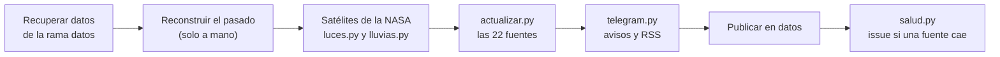

# Fuentes de datos

**Español** · [English](fuentes.en.md)

Referencia de todas las fuentes de atalaya: qué piden, qué guardan, qué descartan, cómo fallan y cómo comprobarlas a mano. Está pensada para mantener las fuentes sin tener que leer antes el código.

- Código de las fuentes: [`scripts/actualizar.py`](../scripts/actualizar.py)
- Satélites: [`scripts/luces.py`](../scripts/luces.py) y [`scripts/lluvias.py`](../scripts/lluvias.py)
- Vigilancia de fuentes caídas: [`scripts/salud.py`](../scripts/salud.py)
- Reconstrucción del pasado: [`scripts/retroceso.py`](../scripts/retroceso.py)
- Workflow: [`.github/workflows/actualizar.yml`](../.github/workflows/actualizar.yml)
- Pruebas: [`tests/test_actualizar.py`](../tests/test_actualizar.py) y [`tests/test_satelites.py`](../tests/test_satelites.py)

> [!NOTE]
> Los números y nombres de esta página salen del código. Si algún día no coinciden, manda el código: corrige esta página.

---

## Índice

- [Resumen de las fuentes](#resumen-de-las-fuentes)
- [Cómo y cuándo se ejecutan](#cómo-y-cuándo-se-ejecutan)
- [El contrato de una fuente](#el-contrato-de-una-fuente)
- [Fuentes caídas y el issue de salud](#fuentes-caídas-y-el-issue-de-salud)
- [Primeros pasos para revisar una fuente](#primeros-pasos-para-revisar-una-fuente)
- Fichas
  - Terremotos: [USGS](#usgs) · [EMSC](#emsc) · [IGN](#ign)
  - Desastres: [GDACS](#gdacs) · [Copernicus EMS](#copernicus-ems) · [NASA EONET](#nasa-eonet)
  - Prensa: [GDELT](#gdelt) · [Titulares](#titulares) · [Análisis](#análisis)
  - Internet y censura: [IODA](#ioda) · [Cloudflare Radar](#cloudflare-radar) · [OONI](#ooni)
  - Avisos de viaje: [Exteriores (España)](#exteriores-españa) · [Avisos de viaje EE. UU.](#avisos-de-viaje-ee-uu)
  - Salud, crisis y muertes: [OMS](#oms) · [ReliefWeb](#reliefweb) · [UCDP](#ucdp)
  - Señales tempranas: [Tipos de cambio](#tipos-de-cambio) · [Elecciones (Wikidata)](#elecciones-wikidata)
  - Satélites: [NASA FIRMS](#nasa-firms) · [NASA Black Marble](#nasa-black-marble) · [NASA GPM IMERG](#nasa-gpm-imerg)
  - [Datos fijos](#datos-fijos)
- [Añadir una fuente nueva](#añadir-una-fuente-nueva)
- [Secretos y variables](#secretos-y-variables)

---

## Resumen de las fuentes

Las 22 fuentes de la lista `FUENTES` de `actualizar.py`, en el mismo orden en que se ejecutan. La columna *clave* indica qué secreto o variable hace falta; sin ella, la fuente se desactiva sola.

| Fuente | Qué aporta | Familia | Clave | Archivo/función | Frecuencia |
|---|---|---|---|---|---|
| [USGS](#usgs) | Terremotos de magnitud 4,5 o más en todo el mundo, con alerta PAGER | `oficial` | No | `actualizar.py` · `usgs()` | Cada ejecución |
| [EMSC](#emsc) | Terremotos de magnitud 4 o más en Europa, el Mediterráneo y Oriente Medio | `oficial` | No | `actualizar.py` · `emsc()` | Cada ejecución |
| [IGN](#ign) | Terremotos en España y su entorno | `oficial` | No | `actualizar.py` · `ign()` | Cada ejecución |
| [GDACS](#gdacs) | Alertas de ciclones, inundaciones, volcanes, sequías, incendios y tsunamis | `oficial` | No | `actualizar.py` · `gdacs()` | Cada ejecución |
| [Copernicus EMS](#copernicus-ems) | Activaciones de cartografía de emergencia de la UE | `oficial` | No | `actualizar.py` · `copernicus()` | Cada ejecución |
| [NASA EONET](#nasa-eonet) | Fenómenos naturales activos | `oficial` | No | `actualizar.py` · `eonet()` | Cada ejecución |
| [GDELT](#gdelt) | Violencia política y protestas en la prensa mundial; riesgo en los pasos marítimos | `prensa` | No | `actualizar.py` · `gdelt()` | Cada ejecución (96 ficheros, 24 h) |
| [Titulares](#titulares) | Titulares en español de las últimas horas | (sin eventos) | No | `actualizar.py` · `titulares()` | Cada ejecución |
| [Análisis](#análisis) | Análisis de Elcano, IEEE y CIDOB por país | (sin eventos) | No | `actualizar.py` · `analisis()` | Cada ejecución |
| [IODA](#ioda) | Cortes de internet grandes por país | `tecnica` | No | `actualizar.py` · `ioda()` | Cada ejecución |
| [Cloudflare Radar](#cloudflare-radar) | Cortes de internet con su causa (por ejemplo, orden del gobierno) | `tecnica` | `CLOUDFLARE_TOKEN` | `actualizar.py` · `cloudflare()` | Cada ejecución |
| [OONI](#ooni) | Bloqueos de WhatsApp, Telegram, Signal y Messenger | `tecnica` | No | `actualizar.py` · `ooni()` | Cada ejecución |
| [Exteriores (España)](#exteriores-españa) | Recomendaciones de viaje del Ministerio de Asuntos Exteriores | `oficial` | No | `actualizar.py` · `exteriores()` | Como mucho cada 12 h |
| [Avisos de viaje EE. UU.](#avisos-de-viaje-ee-uu) | Nivel de los avisos de viaje del Departamento de Estado | `oficial` | No | `actualizar.py` · `avisos_viaje()` | Cada ejecución |
| [OMS](#oms) | Brotes epidémicos (Disease Outbreak News) | `sanitaria` | No | `actualizar.py` · `oms()` | Cada ejecución |
| [ReliefWeb](#reliefweb) | Crisis humanitarias abiertas (OCHA) | `humanitaria` | `RELIEFWEB_APPNAME` | `actualizar.py` · `reliefweb()` | Cada ejecución |
| [UCDP](#ucdp) | Muertes en conflictos verificadas en 90 días | `academica` (se añade aparte) | `UCDP_TOKEN` (+ `UCDP_VERSION`) | `actualizar.py` · `ucdp()` | Cada ejecución |
| [Tipos de cambio](#tipos-de-cambio) | Monedas que se hunden frente al dólar en 7 días | `tecnica` | No | `actualizar.py` · `divisas()` | Cada ejecución (una foto por día) |
| [Elecciones (Wikidata)](#elecciones-wikidata) | Elecciones y referendos en los próximos 45 días | (sin eventos) | No | `actualizar.py` · `elecciones()` | Como mucho cada 12 h |
| [Incendios (NASA FIRMS)](#nasa-firms) | Focos de calor por satélite frente a lo habitual del país | `tecnica` | `FIRMS_KEY` | `actualizar.py` · `incendios()` | Cada ejecución (últimas 24 h) |
| [Luces nocturnas (NASA Black Marble)](#nasa-black-marble) | Apagones en ciudades en guerra o en alerta | `tecnica` | `EARTHDATA_TOKEN` | `luces.py` · `principal()`; lo lee `actualizar.py` · `luces()` | Un día nuevo al día (unos 2 días de retraso) |
| [Lluvias (NASA GPM IMERG)](#nasa-gpm-imerg) | Lluvias extremas por país | `tecnica` | `EARTHDATA_TOKEN` | `lluvias.py` · `principal()`; lo lee `actualizar.py` · `lluvias()` | Un día nuevo al día (1 día de retraso) |

### Qué produce cada fuente

El **peso** suma puntos al país en el apartado indicado (`PARTE_DE`). El **nivel** del evento fija un nivel mínimo para el país: un evento `ambar` o `rojo` de las últimas 48 horas pone al país, como poco, en *vigilar* o *alerta* (motivo «Alerta oficial naranja» o «roja»). Por eso las fuentes que no son alertas oficiales emiten sus eventos en `verde`.

| Fuente | `tipo` del evento | Apartado de la puntuación | `peso` | `nivel` |
|---|---|---|---|---|
| USGS | `terremoto` | `desastres` | `(magnitud − 4)²` + 3 / 10 / 25 si la alerta PAGER es `yellow` / `orange` / `red` | Por peso: `rojo` ≥ 12, `ambar` ≥ 4 |
| EMSC, IGN | `terremoto` | `desastres` | `(magnitud − 4)²` | Por peso: `rojo` ≥ 12, `ambar` ≥ 4 |
| GDACS | `desastre` | `desastres` | 1 / 6 / 15 (verde / naranja / roja); sequías 0 | El de la alerta |
| Copernicus EMS | `desastre` | `desastres` | 5 | `ambar` |
| NASA EONET | `desastre` | `desastres` | 0,5 a 2 según el tipo | `verde` |
| GDELT | `conflicto`, `protesta` | `conflicto`, `protestas` (calculado aparte) | 0 en el evento; la puntuación sale de los agregados por país | `verde` |
| IODA | `internet` | `internet` | `3 × (log10(puntuación + 1) − 5)`, de 0 a 12 | `ambar` si peso ≥ 9 |
| Cloudflare Radar | `internet` | `internet` | 12 / 8 / 3 | `rojo` si 12, si no `ambar` |
| OONI | `censura` | `censura` | 6 si el bloqueo es nuevo, 0 si es habitual | `ambar` si nuevo |
| Exteriores | `aviso` | `avisos` | 5 por nivel que sube; 1 si actualiza sin subir | `ambar` si sube a 3 o más |
| EE. UU. | `aviso` | `avisos` | 4 por nivel que sube; 0 si baja | `ambar` si sube a 3 o más |
| OMS | `epidemia` | `epidemias` | 8 si es grave, 3 si no | `ambar` si es grave |
| ReliefWeb | `crisis` | `humanitaria` | 6 en `alert`, 0 en `current` | `ambar` en `alert` |
| UCDP | (sin eventos) | (no suma puntos) | | Sube el nivel aparte (≥ 100 y ≥ 1000 muertes) |
| Tipos de cambio | `economia` | `economia` | 1,5, o 3 si cae ≥ 15 % | `verde` |
| NASA FIRMS | `incendios` | `incendios` | 2, o 3 si ≥ 4 veces lo habitual | `verde` |
| NASA Black Marble | `apagon` | `apagon` | 2, o 3 si la luz cae al 30 % o menos | `verde` |
| NASA GPM IMERG | `lluvia` | `lluvias` | 2, o 3 si cubre ≥ 2.500 km² | `verde` |

**Familia** sirve para la confianza: si coinciden dos o más familias, la confianza es *alta*; si hay una que no es `prensa`, *media*; si solo hay prensa, *baja* (`confianza()`). Un evento solo aporta su familia si tiene `peso > 0` o un nivel distinto de `verde`.

---

## Cómo y cuándo se ejecutan

El workflow [`actualizar.yml`](../.github/workflows/actualizar.yml) se lanza con el cron `7,37 * * * *` (cada 30 minutos; GitHub puede retrasarlo o saltarse turnos), tras cada merge a `main` que toque `scripts/`, `data/paises.json`, `data/mundo.geojson` o el propio workflow, y a mano. Los pasos, en orden:



1. **Recuperar los datos anteriores** de la rama `datos` en `salida/data` (`ATALAYA_SALIDA`). Si la rama existe pero no se puede leer, o no tiene `historial.json`, la ejecución falla para no borrar el histórico.
2. **Reconstruir el pasado** con GDELT, solo si se lanza a mano con `retroceso_dias` distinto de `0` ([`retroceso.py`](../scripts/retroceso.py), ver [GDELT](#gdelt)).
3. **Satélites de la NASA**: solo si existe `EARTHDATA_TOKEN`. Instala `h5py` y `numpy`, ejecuta `luces.py` y después `lluvias.py`. Tiene `continue-on-error: true` y `timeout-minutes: 15`: si falla, el resto sigue.
4. **Descargar fuentes y calcular alertas**: `actualizar.py` ejecuta las fuentes una tras otra, en el orden de `FUENTES`.
5. **Avisos por Telegram y RSS**: solo en ejecuciones que publican; nunca rompe la actualización. Ver [`docs/telegram.md`](telegram.md).
6. **Publicar los datos** en `datos` (o en `datos-prueba` si se desmarca *Publicar*).
7. **Avisar si una fuente lleva tiempo caída** (`salud.py`), solo en ejecuciones que publican.

Ventanas de tiempo en `actualizar.py`:

| Constante | Valor | Para qué |
|---|---|---|
| `VENTANA_PUNTUACION` | 48 horas | Eventos que cuentan para la puntuación de hoy |
| `VENTANA_MAPA` | 7 días | Eventos que se guardan y se pintan en el mapa |
| `VENTANA_EPIDEMIAS` | 30 días | Brotes (y crisis humanitarias en el mapa); las crisis abiertas cuentan aunque sean antiguas |
| `DIAS_HISTORIAL` | 30 | Días de `historial.json` para saber qué es lo habitual |
| `FALLOS_PARA_AVISAR` | 6 | Ejecuciones seguidas fallando antes de abrir el issue |

Eventos que generan una señal clave en Telegram (`SEÑALES` en `telegram.py`), si son de las últimas 24 horas: `censura` e `internet` con nivel distinto de `verde`, `aviso` con `peso > 0`, `desastre` y `terremoto` en `rojo`, y `epidemia` distinta de `verde`.

---

## El contrato de una fuente

Cada fuente es una función `fuente(paises)` en `actualizar.py`. Recibe el objeto `Paises` (asigna un país ISO alfa-3 por nombre o por coordenadas) y devuelve una de estas cuatro cosas:

| Devuelve | Significa | Qué hace `main()` |
|---|---|---|
| `{"eventos": [...], ...}` | Todo bien. Puede llevar otras claves con datos agregados (`paises`, `pasos`, `avisos`, `exteriores`, `ucdp`, `divisas`, `incendios`, `luces`, `lluvias`, `titulares`, `analisis`, `elecciones`…). | Guarda los eventos y mezcla las otras claves en `extra`. Estado `ok`. |
| `None` | La fuente no responde. | Error `no responde`. Conserva los datos anteriores. |
| Lanza `FormatoInesperado` | Responde, pero con otra forma. Se lanza con `exigir(condición, mensaje)`. | Error `formato inesperado: …`. Conserva los datos anteriores. |
| `{"eventos": [], "desactivada": True}` | Falta su clave. | Se salta: no cuenta como fallo y no aparece en *Estado de las fuentes*. |

Cualquier otra excepción se captura también (`error al leer los datos: Tipo: mensaje`), para que una fuente rota no tumbe a las demás. Si **ninguna** fuente responde, `actualizar.py` termina con error (`Ninguna fuente respondió`) y no se publica nada.

### Cómo se conservan los datos anteriores

Cuando una fuente falla, `main()` lee el `eventos.json` de la ejecución anterior:

- **Eventos**: se reutilizan los eventos anteriores cuyo campo `fuente` es **exactamente igual** al nombre de la fuente en `FUENTES`.
- **Fuentes sin eventos** (`DATOS_DE_FUENTE`): `Titulares` → `titulares`, `Análisis` → `analisis` y `Elecciones (Wikidata)` → `elecciones`. Se reutiliza esa lista entera.
- **Agregados**: los de GDELT (`gdelt_paises`, `gdelt_pasos`), UCDP, divisas, incendios, luces y lluvias se toman de `eventos.json` anterior si la ejecución actual no los trae. Los avisos de EE. UU. salen de `avisos.json` y los de Exteriores de `exteriores.json`.

> [!NOTE]
> Las tres fuentes de satélite emiten eventos con un `fuente` distinto de su nombre en `FUENTES` (`NASA FIRMS` frente a `Incendios (NASA FIRMS)`, etc.). La tabla `ETIQUETA_EVENTOS` de `actualizar.py` relaciona los dos nombres para que, si una falla, se conserven también sus eventos anteriores. Si una fuente nueva usa otra etiqueta en sus eventos, añádela ahí.

### Estado de cada fuente

`main()` escribe en `eventos.json` → `fuentes` un registro por fuente:

| Campo | Contenido |
|---|---|
| `ok` | `true` si no hubo error |
| `error` | `no responde`, `formato inesperado: …` o `error al leer los datos: …` |
| `eventos` | Cuántos eventos (o elementos de su lista, en las fuentes sin eventos) aporta, incluidos los conservados |
| `fallos_seguidos` | Ejecuciones seguidas con error; vuelve a 0 en cuanto responde |
| `ultimo_ok` | Fecha de la última ejecución buena |

La web lo muestra en *Informe → Estado de las fuentes*.

### Cómo descarga `descargar()`

Casi todas las fuentes usan `descargar(url, como="json", intentos=3, espera=6, cabeceras=None)`:

- `User-Agent`: `Mozilla/5.0 (compatible; atalaya/1.0; +https://github.com/serbenda/atalaya)`.
- Tiempo máximo por petición: 60 segundos.
- Hasta `intentos` intentos, esperando `espera × n` segundos entre ellos (6 s y 12 s por defecto).
- `como`: `json` (devuelve `{}` si el cuerpo está vacío), `texto` o `bytes`.
- Un 404 con `como="bytes"` no se reintenta (es un fichero de GDELT que no existe).
- Devuelve `None` si no lo consigue. Los errores van al registro como `fallo i/n en <url>: <error>`.

FIRMS, Black Marble e IMERG tienen su propia función de descarga (`firms_pedir()` y `pedir()`), descritas en sus fichas.

---

## Fuentes caídas y el issue de salud

[`salud.py`](../scripts/salud.py) se ejecuta al final del workflow, solo si la ejecución publica:

1. Lee `fuentes` de `eventos.json`.
2. Si alguna tiene `fallos_seguidos ≥ FALLOS_PARA_AVISAR` (6 ejecuciones, unas 3 horas), imprime una tabla Markdown (fuente, error, fallos seguidos, último dato bueno y enlace a la ejecución) y sale con código 1.
3. El workflow busca un issue abierto titulado **Fuentes de datos caídas**. Con código 1, si existe añade un comentario con la tabla y si no lo crea.

A tener en cuenta:

- Se comenta en el issue cuando una fuente **acaba de llegar** al umbral, y después **una vez al día** (cada `AVISO_CADA = 48` ejecuciones) mientras siga caída. En las demás ejecuciones `salud.py` sale con código 2 y no se hace nada.
- **El issue se cierra solo** cuando todas las fuentes vuelven a responder (código 0), con un comentario.
- El mapa sigue mostrando los últimos datos buenos de la fuente.
- Las fuentes desactivadas (sin clave) nunca abren el issue.
- Exteriores y Wikidata usan caché de 12 horas y casi nunca llegan a 6 fallos seguidos (ver sus fichas).

---

## Primeros pasos para revisar una fuente

**1. Ver el estado en producción**, sin clonar nada:

```bash
curl -s https://raw.githubusercontent.com/serbenda/atalaya/datos/data/eventos.json \
  | python3 -c "import json,sys; [print(f'{n:40} {f}') for n, f in json.load(sys.stdin)['fuentes'].items()]"
```

**2. Leer el registro**: Actions → *Actualizar datos* → la última ejecución → paso *Descargar fuentes y calcular alertas*. Cada fuente escribe `Descargando <nombre>…` y, si falla, `<nombre>: <error>` y los `fallo i/n en <url>`. Al final sale `Listo: {...}` con el estado y el número de eventos de cada una.

**3. Ejecutar una sola fuente en local.** Desde la raíz del repositorio, con los datos reales de la rama `datos` en una carpeta aparte (algunas fuentes leen el estado anterior: Exteriores, avisos de EE. UU., divisas, FIRMS):

```bash
mkdir -p /tmp/atalaya-prueba
git fetch origin datos
git archive origin/datos data | tar -x -C /tmp/atalaya-prueba
ATALAYA_SALIDA=/tmp/atalaya-prueba/data python3 -c "
import sys; sys.path.insert(0, 'scripts'); import actualizar as a
r = a.usgs(a.Paises())   # cambia usgs por la función de la fuente
print(r if r is None else {k: (len(v) if isinstance(v, (list, dict)) else v) for k, v in r.items()})"
```

Para ver la URL exacta que pide una fuente, imprime su constante: `python3 -c "import sys; sys.path.insert(0, 'scripts'); import actualizar as a; print(a.OMS_URL)"`.

> [!CAUTION]
> Algunas fuentes **escriben** en `ATALAYA_SALIDA` (`avisos.json`, `exteriores.json`, `divisas_historial.json`, `elecciones.json`, `incendios_historial.json`). Usa siempre una carpeta de prueba, nunca la carpeta `data/` del repositorio.

En los comandos de las fichas, `<TU_CLAVE>` es un marcador: pon tu clave solo en tu terminal y no la pegues en issues, commits ni chats.

---

## Terremotos

Los tres sismógrafos se solapan. `sin_duplicados_sismicos()` se queda con un solo evento cuando dos llegan a menos de **120 segundos** y a menos de **100 km**, con este orden de preferencia: USGS, EMSC, IGN.

### USGS

| | |
|---|---|
| Organización | Servicio Geológico de Estados Unidos (USGS) |
| Nombre en `FUENTES` | `USGS` |
| Función | `usgs()` en [`actualizar.py`](../scripts/actualizar.py) |
| Petición | `USGS_URL` = `https://earthquake.usgs.gov/earthquakes/feed/v1.0/summary/4.5_week.geojson` |
| Formato | GeoJSON |
| Clave | No |
| Frecuencia | Cada ejecución |
| Salida | `tipo: terremoto`, `familia: oficial`, `fuente: USGS`; en `eventos.json` |

**Qué mide y por qué importa.** Todos los terremotos de magnitud 4,5 o más de la última semana, con la alerta PAGER, que estima el impacto en personas y daños. Un terremoto grave puede provocar una crisis humanitaria en horas.

**Qué se queda.** Todos los elementos de `features`. País por coordenadas; si cae en el mar, por el nombre del lugar (`null` si no se encuentra).

**Peso y nivel.** `peso = max(magnitud − 4, 0)²`, más 3 (`yellow`), 10 (`orange`) o 25 (`red`) según la alerta PAGER. Nivel con `nivel_por_peso()`: `rojo` si el peso es ≥ 12, `ambar` si es ≥ 4, si no `verde`.

**Fallos.** Si no trae `features` como lista, `FormatoInesperado`.

**Comprobar a mano.**

```bash
curl -s https://earthquake.usgs.gov/earthquakes/feed/v1.0/summary/4.5_week.geojson \
  | python3 -c "import json,sys; f=json.load(sys.stdin)['features']; print(len(f), f[0]['properties']['place'])"
```

**Licencia.** Datos del Gobierno de EE. UU., de dominio público. Se cita la fuente en cada evento.

### EMSC

| | |
|---|---|
| Organización | Centro Sismológico Euromediterráneo (EMSC) |
| Nombre en `FUENTES` | `EMSC` |
| Función | `emsc()` |
| Petición | `EMSC_URL`: servicio FDSN `https://www.seismicportal.eu/fdsnws/event/1/query` con `format=json`, `minmag=4`, `limit=300`, `start` = hace 7 días, `minlat=24`, `maxlat=50`, `minlon=-25`, `maxlon=45` |
| Formato | GeoJSON |
| Clave | No |
| Frecuencia | Cada ejecución |
| Salida | `tipo: terremoto`, `familia: oficial`, `fuente: EMSC` |

**Qué mide.** Terremotos de magnitud 4 o más en la caja de Europa, el Mediterráneo y Oriente Medio, a menudo antes o con más detalle que USGS en esa zona.

**Qué se queda.** Las filas con `lat`, `lon` y `mag` numéricos. Lugar: `flynn_region`.

**Peso y nivel.** `peso = max(magnitud − 4, 0)²`; nivel con `nivel_por_peso()`. Sin alerta PAGER.

**Fallos.** Sin `features` como lista, `FormatoInesperado`.

**Comprobar a mano.**

```bash
curl -s "https://www.seismicportal.eu/fdsnws/event/1/query?format=json&minmag=4&limit=5&start=AAAA-MM-DD&minlat=24&maxlat=50&minlon=-25&maxlon=45" | python3 -m json.tool | head -40
```

**Licencia.** Datos de libre uso citando a EMSC. Revisa sus condiciones en seismicportal.eu.

### IGN

| | |
|---|---|
| Organización | Instituto Geográfico Nacional (España) |
| Nombre en `FUENTES` | `IGN` |
| Función | `ign()` |
| Petición | `IGN_URL` = `http://www.ign.es/ign/RssTools/sismologia.xml` (http, no https) |
| Formato | RSS (XML) |
| Clave | No |
| Frecuencia | Cada ejecución |
| Salida | `tipo: terremoto`, `familia: oficial`, `fuente: IGN` |

**Qué mide.** Terremotos de España y su entorno de los últimos 10 días, según el propio feed.

**Qué se queda.** Se extraen la magnitud y el lugar de `description` con la expresión `magnitud ([\d.,]+) en (.+?) en la fecha`, y las coordenadas de `lat` y `long`. Se descartan los de magnitud **menor de 2,5**.

**Peso y nivel.** `peso = max(magnitud − 4, 0)²`: por debajo de 4 aparecen en el mapa pero suman 0. Nivel con `nivel_por_peso()`.

**Fallos.** No usa `exigir`. Si el XML no es válido, `xml_items()` lanza `FormatoInesperado`. Si cambia el texto de `description`, los terremotos se descartan sin error: la fuente sale `ok` con 0 eventos. Si ves IGN con 0 eventos varios días, revisa esa expresión.

**Comprobar a mano.**

```bash
curl -s http://www.ign.es/ign/RssTools/sismologia.xml | grep -o '<description>[^<]*' | head -5
```

**Licencia.** Información del IGN reutilizable citando la fuente. Revisa las condiciones en ign.es.

---

## Desastres

### GDACS

| | |
|---|---|
| Organización | Sistema Mundial de Alerta y Coordinación de Desastres (ONU y Comisión Europea) |
| Nombre en `FUENTES` | `GDACS` |
| Función | `gdacs()` |
| Petición | `GDACS_URLS`: primero `https://www.gdacs.org/xml/rss_7d.xml` y, si falla, `https://www.gdacs.org/xml/rss.xml`; 2 intentos cada una |
| Formato | RSS (XML) con etiquetas `gdacs:` y `geo:` |
| Clave | No |
| Frecuencia | Cada ejecución |
| Salida | `tipo: desastre`, `familia: oficial`, `fuente: GDACS` |

**Qué mide.** Alertas verde, naranja y roja de ciclones tropicales (`TC`), inundaciones (`FL`), erupciones (`VO`), sequías (`DR`), incendios forestales (`WF`) y tsunamis (`TS`).

**Qué se queda y qué se descarta.**

- Solo los tipos de `GDACS_TIPOS`. Los terremotos (`EQ`) se descartan porque ya vienen de USGS.
- Se descartan los incendios y sequías en **verde**: son casi diarios.
- Sin duplicados por `gdacs-<tipo>-<eventid>`.
- País: `iso3` del feed si tiene 3 letras; si no, por nombre y coordenadas.
- Las **sequías** se pintan pero no se atribuyen a un país (`pais: null`) y pesan 0, porque abarcan muchos países y avanzan despacio.

**Peso y nivel.** Verde 1, naranja 6, roja 15. El nivel del evento es el de la alerta.

**Fallos.** Si hay elementos pero ninguno trae `eventtype`, `FormatoInesperado`. Un feed vacío es válido.

**Comprobar a mano.**

```bash
curl -s https://www.gdacs.org/xml/rss_7d.xml | grep -o '<gdacs:eventtype>[A-Z]*' | sort | uniq -c
```

**Licencia.** Uso libre citando GDACS. Revisa sus condiciones en gdacs.org.

### Copernicus EMS

| | |
|---|---|
| Organización | Servicio de Gestión de Emergencias de Copernicus (Unión Europea) |
| Nombre en `FUENTES` | `Copernicus EMS` |
| Función | `copernicus()` |
| Petición | `COPERNICUS_URL` = `https://mapping.emergency.copernicus.eu/activations/api/activations/?limit=40` |
| Formato | JSON |
| Clave | No |
| Frecuencia | Cada ejecución |
| Salida | `tipo: desastre`, `familia: oficial`, `fuente: Copernicus EMS` |

**Qué mide.** Las activaciones de cartografía rápida. Solo se piden en desastres graves, así que una activación ya es una señal fuerte.

**Qué se queda.** Las 40 últimas activaciones, y de ellas las de los últimos **10 días** (`activationTime`) con un `centroid` del tipo `POINT (lon lat)`. El título traduce la categoría con `COPERNICUS_TIPOS`.

**Peso y nivel.** Peso 5, nivel `ambar`.

**Fallos.** Sin `results` como lista, `FormatoInesperado`.

**Comprobar a mano.**

```bash
curl -s "https://mapping.emergency.copernicus.eu/activations/api/activations/?limit=5" | python3 -m json.tool | head -60
```

**Licencia.** Libre, citando la fuente con este texto (Reglamento Delegado (UE) 1159/2013, art. 8):

> «Contiene información modificada del servicio Copernicus [año]»

La web lo muestra en `index.html` (párrafo `atribucion`, con el año en `data-anio`). No lo quites.

### NASA EONET

| | |
|---|---|
| Organización | NASA, Earth Observatory Natural Event Tracker |
| Nombre en `FUENTES` | `NASA EONET` |
| Función | `eonet()` |
| Petición | `EONET_URL` = `https://eonet.gsfc.nasa.gov/api/v3/events?status=open&days=7` |
| Formato | JSON |
| Clave | No |
| Frecuencia | Cada ejecución |
| Salida | `tipo: desastre`, `familia: oficial`, `fuente: NASA EONET`, siempre `nivel: verde` |

**Qué mide.** Fenómenos naturales abiertos de los últimos 7 días: incendios, tormentas, volcanes, inundaciones, deslizamientos, polvo, sequía y nieve.

**Qué se queda.** La última geometría de tipo `Point` de cada evento. País solo por coordenadas. Se descartan las categorías `earthquakes` (ya vienen de USGS) y `seaLakeIce`.

**Peso** (`EONET_TIPOS`):

| Categoría | Título | Peso |
|---|---|---|
| `wildfires` | Incendio | 0,5 |
| `severeStorms` | Tormenta severa | 2 |
| `volcanoes` | Volcán activo | 2 |
| `floods` | Inundación | 2 |
| `landslides` | Deslizamiento de tierra | 2 |
| `dustHaze` | Polvo o calima | 0,5 |
| `drought` | Sequía | 1 |
| `snow` | Nevada | 0,5 |
| otra | Fenómeno natural | 1 |

**Fallos.** Sin `events` como lista, `FormatoInesperado`.

**Comprobar a mano.**

```bash
curl -s "https://eonet.gsfc.nasa.gov/api/v3/events?status=open&days=7" \
  | python3 -c "import json,sys; e=json.load(sys.stdin)['events']; print(len(e)); [print(x['categories'][0]['id'], x['title']) for x in e[:5]]"
```

**Licencia.** Datos abiertos de la NASA; se pide citar la fuente.

---

## Prensa

### GDELT

| | |
|---|---|
| Organización | The GDELT Project |
| Nombre en `FUENTES` | `GDELT` |
| Funciones | `gdelt()`, `gdelt_ficheros()`, `gdelt_filas()`, `es_politico()`, `es_estatal()`, `region_de()` |
| Petición | `GDELT_ULTIMO_URL` = `http://data.gdeltproject.org/gdeltv2/lastupdate.txt` y después `GDELT_FICHERO_URL` = `http://data.gdeltproject.org/gdeltv2/{marca}.export.CSV.zip` |
| Formato | ZIP con un CSV separado por tabuladores, 61 columnas (eventos de GDELT 2.0) |
| Clave | No |
| Frecuencia | Cada ejecución: `GDELT_FICHEROS` = 96 ficheros de 15 minutos (24 horas), con 8 descargas en paralelo y 2 intentos cada una |
| Salida | Eventos `conflicto` y `protesta` (`familia: prensa`), agregados por país (`gdelt_paises`) y por paso marítimo (`gdelt_pasos`) en `eventos.json`; los pasos con nivel en `alertas.json` |

**Qué mide y por qué importa.** Hechos codificados automáticamente de la prensa mundial (códigos CAMEO), con actores, lugar y enlace. Es la fuente principal de la puntuación de conflicto y protestas, y la única que se puede reconstruir hacia atrás.

Se usan los ficheros estáticos y no la API, porque la API GEO devolvía 404 y los ficheros traen el tipo de actor.

**Qué se queda.** Fila a fila:

1. Hacen falta coordenadas (columnas 56 y 57).
2. **Solo el hecho principal** de cada noticia: `IsRootEvent` (columna 25) igual a `1`. Las menciones de pasada a ataques antiguos meten ruido.
3. **Conflicto**: código raíz CAMEO (columna 28) en `GDELT_VIOLENCIA` = `18` (agresiones), `19` (combates), `20` (violencia masiva), y además que `es_politico()` sea cierto.
4. **Protesta**: código raíz en `GDELT_PROTESTA` = `14`.
5. `es_politico()` es cierto si se cumple una de estas:
   - algún tipo de actor (columnas 12–14 y 22–24) está en `ACTORES_POLITICOS` = `MIL` (ejército), `REB` (rebeldes), `INS` (insurgentes), `SEP` (separatistas), `UAF` (fuerzas armadas no estatales), `GOV` (gobierno), `SPY` (inteligencia), `OPP` (oposición);
   - algún actor tiene grupo conocido (columnas 8 o 18 no vacías);
   - los dos actores son de países distintos (columnas 7 y 17).
   
   La policía (`COP`) **no** entra: en la prensa casi siempre es crónica de sucesos.
6. **Desescalada**: hecho principal con código base (columna 27) en `GDELT_DESESCALADA` = `086` (permitir ayuda humanitaria) o `087` (desescalada militar, incluye el alto el fuego `0871`), y actor político. «Negociar» (`046`) no entra porque aparece a diario.
7. **Una vez por noticia**: se descarta una fila si ya se ha contado la misma URL (columna 60) para el mismo país y el mismo tipo.
8. **Medios estatales**: si el dominio de la URL contiene uno de `MEDIOS_ESTATALES`, el hecho cuenta `PESO_ESTATAL` = **0,5**. La lista: `rt.com`, `sputniknews`, `sputnikglobe`, `tass.ru`, `tass.com`, `ria.ru`, `xinhuanet`, `news.cn`, `globaltimes.cn`, `cgtn.com`, `chinadaily.com.cn`, `presstv`, `irna.ir`, `tasnimnews`, `farsnews`, `mehrnews`, `kcna`, `rodong.rep.kp`, `telesurtv`, `granma.cu`, `sana.sy`, `belta.by`, `almanar.com.lb`. No se descartan (a veces son la única fuente), pero no pueden encender un país solos.

**Agregados por país** (`paises` → `gdelt_paises`): `total`, `conflicto`, `protesta`, `interestatal` (actores de dos países), `militar` (`MIL`, `REB`, `INS` o `UAF`), `disturbios` (código base `145`), `desescalada`, `estatal` (hechos de medios estatales), y las mitades `*_12h` y `*_12h_antes` para la aceleración. Con 5 o más hechos de conflicto se añaden:

- `regiones`: hasta 3 regiones (primera división administrativa) con al menos el 10 % de los hechos;
- `actores`: hasta 3 parejas de actores con al menos 3 hechos.

**Puntuación** (en `puntuar()`): `conflicto = 3 × log2(1 + hechos) × min(1, cuota / CUOTA_PLENA)`, con `cuota = hechos / max(total, 20)` y `CUOTA_PLENA` = 0,05. Las protestas igual con 1,5 en vez de 3. La familia `prensa` cuenta para la confianza si alguna de las dos llega a 3 puntos. La aceleración (`aceleracion()`) compara las últimas 12 h con las 12 h anteriores y solo se calcula con 8 o más hechos.

**Eventos del mapa.** Se agrupan por (tipo, lugar, latitud y longitud redondeadas a 0,1°). Se descarta el tipo de lugar `1` (solo el país, que cae en el centro). Se quedan los **500** lugares con más menciones y, de ellos, los que tienen **3 o más** menciones. Cada uno lleva hasta 3 enlaces. Peso 0 y nivel `verde`: la puntuación sale de los agregados.

**Pasos marítimos** (`PASOS`). Se cuentan los hechos de conflicto (con lugar distinto del tipo `1`) que caen dentro del radio de alguno de los puntos de la zona del paso y a menos de 6° de latitud de su centro. Se cuentan antes de quitar duplicados por URL y sin rebajar los medios estatales. Nivel en `calcular_pasos()`: `rojo` con 25 o más hechos, `ambar` con 6 o más.

| `id` | Paso | Puntos de la zona (lon, lat) | Radio |
|---|---|---|---|
| `ormuz` | Estrecho de Ormuz | (56.4, 26.6) | 220 km |
| `bab` | Bab el-Mandeb y mar Rojo sur | (43.4, 12.6), (42.0, 15.5) | 250 km |
| `suez` | Canal de Suez | (32.3, 31.2), (32.35, 30.6), (32.55, 29.95) | 90 km |
| `bosforo` | Bósforo | (29.05, 41.1), (26.4, 40.2) | 80 km |
| `gibraltar` | Estrecho de Gibraltar | (-5.6, 35.95) | 120 km |
| `malaca` | Estrecho de Malaca | (98.5, 5.0), (100.4, 3.0), (103.8, 1.25) | 250 km |
| `taiwan` | Estrecho de Taiwán | (119.5, 24.0) | 200 km |
| `panama` | Canal de Panamá | (-79.7, 9.1) | 100 km |

Las zonas están dibujadas para no meter ciudades ajenas a la ruta (por ejemplo, Gaza o El Cairo quedan fuera de Suez).

**Fallos y problemas conocidos.**

- `lastupdate.txt` sin la forma `/<14 cifras>.export.CSV.zip`: `FormatoInesperado`.
- Faltan más de la mitad de los 96 ficheros: `FormatoInesperado`. Un fichero que no existe (404) no se reintenta.
- La primera fila no tiene 61 columnas: `FormatoInesperado`.
- Si GDELT falla, se reutilizan `gdelt_paises` y `gdelt_pasos` de la ejecución anterior para que la puntuación de conflicto no caiga a cero.
- Es la descarga más pesada de cada ejecución.

**Reconstruir el pasado.** [`retroceso.py`](../scripts/retroceso.py) reprocesa los ficheros históricos de GDELT con las mismas reglas. Por defecto toma 48 de los 96 ficheros de cada día y escala los recuentos (`96 / ficheros leídos`); como mucho 90 días. Salta un día si faltan más de la mitad de sus ficheros. Escribe en `historico.json` y `retroceso.json`, nunca en `historial.json`. Se lanza desde Actions con `retroceso_dias`.

**Comprobar a mano.**

```bash
curl -s http://data.gdeltproject.org/gdeltv2/lastupdate.txt
# Toma la marca de 14 cifras de la línea .export.CSV.zip y comprueba las columnas:
curl -s -o /tmp/g.zip http://data.gdeltproject.org/gdeltv2/AAAAMMDDHHMMSS.export.CSV.zip
unzip -p /tmp/g.zip | head -1 | awk -F'\t' '{print NF}'    # debe dar 61
```

**Licencia.** Datos abiertos de GDELT, de uso libre citando la fuente. Cada evento enlaza a las noticias originales.

### Titulares

| | |
|---|---|
| Organización | Google Noticias (búsqueda en español), EFE y RTVE (a través de Google Noticias) y El País |
| Nombre en `FUENTES` | `Titulares` (en `DATOS_DE_FUENTE` → `titulares`) |
| Función | `titulares()` |
| Petición | `TITULARES_URL` (búsqueda de Google Noticias con términos de crisis, sin deportes, `when:1d`), `TITULARES_MAS` (`site:efe.com` y `site:rtve.es`, `when:1d`) y `ELPAIS_URL` (portada de Internacional); 2 intentos cada una |
| Formato | RSS (XML) |
| Clave | No |
| Frecuencia | Cada ejecución |
| Salida | Lista `titulares` (sin eventos) en `eventos.json`; los 20 primeros en la foto del día de `archivo/` |

**Qué aporta.** La prensa en español de las últimas horas, en la pestaña *Titulares* y en la ficha de cada país. Además, `main()` busca en los titulares «golpe de estado», «golpista» o «asonada» (indicador *la prensa habla de golpe*) y «alto el fuego», «tregua», «negociaciones de paz», «acuerdo de paz», «cese de hostilidades» o «desescalada» (señal en contra).

**Qué se queda y qué se descarta.**

- Se quita el « - Medio» que Google añade al final.
- Se descartan las efemérides: titulares con un año anterior al año pasado («el bombardeo de 1937»).
- Sin duplicados por los 70 primeros caracteres normalizados.
- Se descartan los de más de 36 horas, los de menos de 5 palabras, los de medios cuyo nombre contiene «comunica» (notas de prensa) y los que dicen «en directo».
- Cada titular lleva los países que nombra (`Paises.en_texto()`).
- Se quedan los 60 más recientes.

**Fallos.** Solo devuelve `None` si fallan los cuatro feeds. Si uno no es XML válido, `FormatoInesperado`. Si falla, se reutiliza la lista anterior.

**Comprobar a mano.**

```bash
URL=$(python3 -c "import sys; sys.path.insert(0, 'scripts'); import actualizar as a; print(a.TITULARES_URL)")
curl -s "$URL" | grep -o '<title>[^<]*' | head
```

**Licencia.** Los titulares son de cada medio. Solo se muestran el titular y el enlace a la noticia original.

### Análisis

| | |
|---|---|
| Organización | Real Instituto Elcano, Instituto Español de Estudios Estratégicos (IEEE) y CIDOB, a través de Google Noticias |
| Nombre en `FUENTES` | `Análisis` (en `DATOS_DE_FUENTE` → `analisis`) |
| Función | `analisis()` |
| Petición | `ANALISIS_URLS`: `site:realinstitutoelcano.org when:60d`, `site:ieee.es when:90d` y `site:cidob.org when:90d`; 2 intentos cada una |
| Formato | RSS (XML) |
| Clave | No |
| Frecuencia | Cada ejecución |
| Salida | Lista `analisis` (sin eventos) en `eventos.json` |

**Qué aporta.** Análisis de expertos en la ficha de cada país.

**Qué se queda.** Solo los títulos que nombran algún país, salvo los que empiezan por «novedades», «boletín» o «agenda». Se quedan los 150 más recientes.

**Fallos.** Si no queda **ningún** análisis, devuelve `None` (cuenta como caída), aunque los feeds hayan respondido. Si falla, se reutiliza la lista anterior.

**Comprobar a mano.**

```bash
URL=$(python3 -c "import sys; sys.path.insert(0, 'scripts'); import actualizar as a; print(a.ANALISIS_URLS['CIDOB'])")
curl -s "$URL" | grep -o '<title>[^<]*' | head
```

**Licencia.** Los textos son de cada centro. Solo se muestran el título y el enlace.

---

## Internet y censura

### IODA

| | |
|---|---|
| Organización | Internet Outage Detection and Analysis (Georgia Tech) |
| Nombre en `FUENTES` | `IODA` |
| Función | `ioda()` |
| Petición | `IODA_URL` = `https://api.ioda.inetintel.cc.gatech.edu/v2/outages/summary?from=<hace 24 h>&until=<ahora>&entityType=country` (marcas Unix) |
| Formato | JSON |
| Clave | No |
| Frecuencia | Cada ejecución |
| Salida | `tipo: internet`, `familia: tecnica`, `fuente: IODA`, en el centro del país |

**Qué mide y por qué importa.** Caídas de conectividad por país. Un corte de internet grande suele acompañar a golpes, protestas o ataques a infraestructuras.

**Qué se queda.** País por el código ISO alfa-2 de `entity.code`. IODA detecta a diario caídas pequeñas en muchos países, así que solo cuentan los cortes grandes: `peso = min(12, max(0, 3 × (log10(puntuación + 1) − 5)))`. Con una puntuación `scores.overall` por debajo de **10⁵** el peso es 0 y el evento se descarta.

**Nivel.** `ambar` si el peso es 9 o más (puntuación de 10⁸ o más); si no, `verde`.

**Fallos.** Si `data` no es una lista, `FormatoInesperado`. La ventana se calcula al importar el módulo.

**Comprobar a mano.**

```bash
desde=$(date -u -d '24 hours ago' +%s); hasta=$(date -u +%s)
curl -s "https://api.ioda.inetintel.cc.gatech.edu/v2/outages/summary?from=$desde&until=$hasta&entityType=country" \
  | python3 -c "import json,sys; d=json.load(sys.stdin)['data']; [print(x['entity']['code'], x['scores']['overall']) for x in sorted(d, key=lambda x: -x['scores']['overall'])[:10]]"
```

**Licencia.** Datos abiertos de IODA citando la fuente. Revisa sus condiciones en ioda.inetintel.cc.gatech.edu.

### Cloudflare Radar

| | |
|---|---|
| Organización | Cloudflare Radar |
| Nombre en `FUENTES` | `Cloudflare Radar` |
| Función | `cloudflare()` |
| Petición | `CLOUDFLARE_URL` = `https://api.cloudflare.com/client/v4/radar/annotations/outages?dateRange=1d&format=json&limit=100`, con la cabecera `Authorization: Bearer <token>` |
| Formato | JSON |
| Clave | Secreto `CLOUDFLARE_TOKEN`: token de API de Cloudflare con permiso de lectura de Radar. Sin él, la fuente se desactiva |
| Frecuencia | Cada ejecución |
| Salida | `tipo: internet`, `familia: tecnica`, `fuente: Cloudflare Radar` |

**Qué mide.** Cortes de internet del último día con su causa y alcance. Distingue un corte técnico de uno ordenado por un gobierno.

**Qué se queda.** Cada país de `locations` de cada anotación. Se mira si `outage.outageCause` contiene `GOVERNMENT` y si `outage.outageType` es `NATIONWIDE`.

**Peso y nivel.**

| Causa | Alcance | Peso | Nivel |
|---|---|---|---|
| Gobierno | Todo el país | 12 | `rojo` |
| Gobierno | Parcial | 8 | `ambar` |
| Otra | Todo el país | 3 | `ambar` |
| Otra | Parcial | 0 (se descarta) | |

**Fallos.** Sin `result.annotations` como lista, `FormatoInesperado`. Un token caducado o sin permiso da un error HTTP y la fuente sale como `no responde`.

**Comprobar a mano.**

```bash
curl -s -H "Authorization: Bearer <TU_CLAVE>" \
  "https://api.cloudflare.com/client/v4/radar/annotations/outages?dateRange=1d&format=json&limit=5" | python3 -m json.tool | head -40
```

**Licencia.** Revisa las condiciones de uso de los datos de Cloudflare Radar en radar.cloudflare.com antes de cualquier uso comercial.

### OONI

| | |
|---|---|
| Organización | Open Observatory of Network Interference |
| Nombre en `FUENTES` | `OONI` |
| Función | `ooni()` |
| Petición | `OONI_URL` = `https://api.ooni.io/api/v1/aggregation?test_name={app}&since={desde}&until={hasta}&axis_x=probe_cc`, para cada app de `OONI_APPS` (`whatsapp`, `telegram`, `signal`, `facebook_messenger`) y dos ventanas: 8 peticiones, 2 intentos cada una |
| Formato | JSON |
| Clave | No |
| Frecuencia | Cada ejecución |
| Salida | `tipo: censura`, `familia: tecnica`, `fuente: OONI`, en el centro del país |

**Qué mide y por qué importa.** Mediciones de voluntarios sobre si las apps de mensajería están bloqueadas. Un bloqueo nuevo suele anunciar protestas, elecciones tensas o un golpe.

**Qué se queda.**

- Ventana *ahora*: de hace 2 días a mañana. Ventana *antes*: de hace 14 días a hace 2 días.
- Solo las filas con **10 o más** mediciones. Tasa = `anomaly_count / measurement_count`.
- **Bloqueo nuevo**: tasa *ahora* ≥ 0,5 y tasa *antes* < 0,25.
- **Bloqueo habitual**: tasa *ahora* ≥ 0,5 sin cumplir lo anterior.
- Un bloqueo habitual **solo cuenta si afecta a 2 o más apps**: con una sola suele ser ruido de medida.

**Peso y nivel.** Bloqueo nuevo: peso 6, `ambar`. Bloqueo habitual: peso 0, `verde` (solo informa).

**Fallos.** Si **cualquiera** de las 8 peticiones falla, toda la fuente devuelve `None`. Sin `result` como lista, `FormatoInesperado`.

**Comprobar a mano.**

```bash
curl -s "https://api.ooni.io/api/v1/aggregation?test_name=whatsapp&since=AAAA-MM-DD&until=AAAA-MM-DD&axis_x=probe_cc" \
  | python3 -c "import json,sys; r=json.load(sys.stdin)['result']; [print(x['probe_cc'], x['anomaly_count'], x['measurement_count']) for x in r if x['measurement_count'] >= 10 and x['anomaly_count'] / x['measurement_count'] >= 0.5]"
```

**Licencia.** Datos abiertos de OONI citando la fuente. Revisa sus condiciones en ooni.org.

---

## Avisos de viaje

Los avisos de viaje también reflejan la política exterior de quien los emite. Por eso **refuerzan, pero no colorean solos** un país.

### Exteriores (España)

| | |
|---|---|
| Organización | Ministerio de Asuntos Exteriores, Unión Europea y Cooperación |
| Nombre en `FUENTES` | `Exteriores (España)` |
| Funciones | `exteriores()`, `exteriores_ficha()`, `exteriores_nivel()`, `normalizar_frases()` |
| Petición | `EXTERIORES_INDICE` = `https://www.exteriores.gob.es/es/ServiciosAlCiudadano/Paginas/Recomendaciones-de-viaje.aspx` y, para cada país, `.../Detalle-recomendaciones-de-viaje.aspx?trc=<país>`; 6 descargas en paralelo, 2 intentos por ficha |
| Formato | HTML (no tiene API: se lee la web) |
| Clave | No |
| Frecuencia | Como mucho cada `EXTERIORES_CADA` = 12 horas |
| Salida | Eventos `tipo: aviso`, `familia: oficial`, `fuente: Exteriores (España)`; resumen `exteriores` por país; persiste en `exteriores.json` |

**Qué mide y por qué importa.** La recomendación de viaje de España para cada país. Es la referencia que importa en España.

**Cómo se lee.**

1. Del índice salen los enlaces `Detalle-recomendaciones-de-viaje.aspx?trc=…`. Hacen falta **más de 100**.
2. De cada ficha se toma la fecha de «Última actualización el D de mes de AAAA» y el texto de **Notas importantes** (hasta 600 caracteres, cortado en la siguiente sección).
3. `exteriores_nivel()` lee las notas frase a frase:

| Nivel | Texto | Cuándo |
|---|---|---|
| 4 | se desaconseja viajar bajo cualquier circunstancia | «abandonen el país», «recomienda/insta/aconseja… abandonar el país», o una frase contra el viaje con «cualquier/ninguna circunstancia» o con «totalmente/absolutamente/completamente» |
| 3 | se desaconseja viajar salvo necesidad | Frase contra el viaje con «salvo» o «excepto», o sin matiz |
| 2 | precaución o zonas desaconsejadas | Frase contra el viaje que habla de zonas, regiones, fronteras, provincias… (`ZONAS`) sin decir «todo el país/territorio», o «extremar la precaución» / «máxima precaución» |
| 1 | sin restricciones especiales | Ninguna de las anteriores |

Se queda el nivel más alto de todas las frases. Dentro de una frase contra el viaje, la mención de zonas se mira primero: si la hay, la frase da nivel 2. Solo cuentan las frases sobre viajar al país («se desaconseja participar en manifestaciones» no cuenta). `normalizar_frases()` junta las letras sueltas en mayúsculas («S E DESACONSEJA»).

**Cambios.** Hay un cambio cuando cambia la **fecha de actualización** de la ficha respecto a `exteriores.json`. Los cambios se guardan 7 días.

**Peso y nivel del evento.** Si el nivel sube: peso `5 × (nivel nuevo − nivel anterior)` y título «Exteriores eleva su recomendación: …»; `ambar` si el nivel nuevo es 3 o más. Si no sube: peso 1, `verde`, «Exteriores actualiza sus recomendaciones de viaje».

**Efecto en el nivel del país** (en `main()`): con nivel 4, se añade el motivo «Exteriores desaconseja viajar»; si además el país tiene 3 o más puntos y está en `verde`, pasa a `ambar`. Con nivel 3 o más se enciende el indicador *España desaconseja viajar* en los escenarios.

**Fallos y problemas conocidos.**

- Índice con 100 enlaces o menos: `FormatoInesperado`.
- No se pueden leer la mitad de las fichas: `FormatoInesperado`. Una ficha que falla conserva sus datos anteriores.
- **HTTP 429 (demasiadas peticiones)**: la web de Exteriores puede limitar las peticiones (observado en operación; el código no lo trata aparte). `descargar()` reintenta y, si no lo consigue, la ficha o el índice cuentan como fallo. Si falla el índice, `exteriores.json` no se reescribe, así que la caché de 12 horas no se renueva y **se vuelve a intentar en la siguiente ejecución**, 30 minutos después. Si el 429 se repite, baja `max_workers=6` o separa más los reintentos.
- Con la caché vigente, la fuente sale `ok` aunque la web esté caída: el fallo solo se ve cuando toca volver a leerla.
- Si la web cambia el texto «Notas importantes» o «Última actualización el…», las fichas se leen sin error pero con nivel 1 y sin fecha. Revisa `exteriores.json` si de repente todo sale en nivel 1.

**Comprobar a mano.**

```bash
UA='Mozilla/5.0 (compatible; atalaya/1.0; +https://github.com/serbenda/atalaya)'
curl -s -A "$UA" -o /tmp/ext.html -w '%{http_code}\n' \
  'https://www.exteriores.gob.es/es/ServiciosAlCiudadano/Paginas/Recomendaciones-de-viaje.aspx'   # 200, o 429
grep -o 'Detalle-recomendaciones-de-viaje\.aspx?trc=[^"&]*' /tmp/ext.html | sort -u | wc -l     # más de 100
```

Para ver cómo se lee una ficha concreta, ejecuta `exteriores_ficha(url)` con el snippet de [Primeros pasos](#primeros-pasos-para-revisar-una-fuente).

**Licencia.** Información pública del Gobierno de España, reutilizable citando la fuente. Revisa el aviso legal de exteriores.gob.es.

### Avisos de viaje EE. UU.

| | |
|---|---|
| Organización | Departamento de Estado de EE. UU. (travel.state.gov) |
| Nombre en `FUENTES` | `Avisos de viaje EE. UU.` |
| Función | `avisos_viaje()` |
| Petición | `AVISOS_URL` = `https://travel.state.gov/_res/rss/TAsTWs.xml` |
| Formato | RSS (XML) |
| Clave | No |
| Frecuencia | Cada ejecución |
| Salida | Eventos `tipo: aviso`, `familia: oficial`; niveles `avisos` por país; persiste en `avisos.json` |

**Qué mide.** El nivel de aviso de cada país, de 1 a 4 (`AVISO_NIVELES`: precauciones normales, más precaución, reconsiderar el viaje, no viajar).

**Qué se queda.** Los títulos con la forma `<País> - Level <N>`. Si un país sale varias veces, el nivel más alto. Hay un cambio cuando el nivel difiere del de `avisos.json`; los cambios se guardan 7 días.

**Peso y nivel del evento.** Si sube: peso `4 × (nivel nuevo − nivel anterior)`, `ambar` si el nivel nuevo es 3 o más. Si baja: peso 0, `verde`.

**Efecto en el nivel del país** (en `calcular_alertas()`): con nivel 4 y al menos 3 puntos propios, el país pasa como poco a `ambar` («EE. UU. desaconseja viajar») y suma la familia `oficial` a la confianza.

**Fallos.** RSS sin elementos: `FormatoInesperado`. La primera vez no hay cambios porque no hay con qué comparar.

**Comprobar a mano.**

```bash
curl -s https://travel.state.gov/_res/rss/TAsTWs.xml | grep -o '<title>[^<]*Level [0-9]' | head
```

**Licencia.** Información del Gobierno de EE. UU., de dominio público.

---

## Salud, crisis y muertes

### OMS

| | |
|---|---|
| Organización | Organización Mundial de la Salud, Disease Outbreak News |
| Nombre en `FUENTES` | `OMS` |
| Función | `oms()` |
| Petición | `OMS_URL` = `https://www.who.int/api/news/diseaseoutbreaknews?$orderby=PublicationDateAndTime desc&$top=30` (codificada) |
| Formato | JSON (OData) |
| Clave | No |
| Frecuencia | Cada ejecución |
| Salida | `tipo: epidemia`, `familia: sanitaria`, `fuente: OMS`, en el centro del país |

**Qué mide.** Los 30 últimos avisos de brotes. Cuentan para la puntuación durante 30 días (`VENTANA_EPIDEMIAS`), porque los brotes evolucionan despacio.

**Qué se queda.** Los publicados en los últimos 30 días cuyo título tiene la forma «Enfermedad - País» y el país se reconoce. Los avisos globales («Cholera - Global situation») se descartan.

**Peso y nivel.** Grave si el título coincide con `EPIDEMIAS_GRAVES`: ébola, Marburgo, Lassa, peste, Nipah, cólera, fiebre amarilla, MERS, gripe aviar A(H5, mpox clado I, difteria o carbunco. Grave: peso 8, `ambar`. Si no: peso 3, `verde`.

**Fallos.** Sin `value` como lista, `FormatoInesperado`.

**Comprobar a mano.**

```bash
URL=$(python3 -c "import sys; sys.path.insert(0, 'scripts'); import actualizar as a; print(a.OMS_URL)")
curl -s "$URL" | python3 -c "import json,sys; [print(x['PublicationDateAndTime'][:10], x['Title']) for x in json.load(sys.stdin)['value'][:10]]"
```

**Licencia.** Contenido de la OMS, con sus condiciones de uso. Solo se muestra el título y el enlace.

### ReliefWeb

| | |
|---|---|
| Organización | ReliefWeb (OCHA, Naciones Unidas) |
| Nombre en `FUENTES` | `ReliefWeb` |
| Función | `reliefweb()` |
| Petición | `RELIEFWEB_URL` = `https://api.reliefweb.int/v2/disasters?appname=<nombre>&limit=200&preset=latest&filter[field]=status&filter[value][]=alert&filter[value][]=current&fields[include][]=…` |
| Formato | JSON |
| Clave | Variable `RELIEFWEB_APPNAME`: nombre de aplicación **aprobado** por ReliefWeb ([apidoc.reliefweb.int](https://apidoc.reliefweb.int/)). Sin él, la fuente se desactiva |
| Frecuencia | Cada ejecución |
| Salida | `tipo: crisis`, `familia: humanitaria`, `fuente: ReliefWeb`, en el centro de cada país afectado |

**Qué mide.** Desastres y crisis humanitarias en estado `alert` (en alerta) o `current` (en curso).

**Qué se queda.** Un evento por crisis y país (`country.iso3`), si el país está en el mapa.

**Peso y nivel.** `alert`: peso 6, `ambar`. `current`: peso 0, `verde`. Una crisis abierta cuenta **mientras siga abierta**, aunque sea antigua (`crisis_abierta`), y pone al país como poco en `ambar` («Crisis humanitaria abierta»).

**Fallos.** Sin `data` como lista, `FormatoInesperado`. Con un nombre no aprobado, la API responde con error HTTP: `no responde`.

**Comprobar a mano.**

```bash
curl -s "https://api.reliefweb.int/v2/disasters?appname=<TU_APPNAME>&limit=3&preset=latest" | python3 -m json.tool | head -30
```

**Licencia.** El contenido de ReliefWeb es de cada organización que lo publica; revisa las condiciones de la API.

### UCDP

| | |
|---|---|
| Organización | Uppsala Conflict Data Program (Universidad de Uppsala) |
| Nombre en `FUENTES` | `UCDP` |
| Función | `ucdp()` |
| Petición | `UCDP_URL` = `https://ucdpapi.pcr.uu.se/api/gedevents/{UCDP_VERSION}?pagesize=1000&StartDate=<hace 90 días>`, con la cabecera `x-ucdp-access-token`; sigue `NextPageUrl` hasta 15 páginas |
| Formato | JSON |
| Clave | Secreto `UCDP_TOKEN` (se pide por email al responsable de la API, [ucdp.uu.se/apidocs](https://ucdp.uu.se/apidocs/)) y variable opcional `UCDP_VERSION` (por defecto `26.0.9`) |
| Frecuencia | Cada ejecución |
| Salida | Sin eventos; diccionario `ucdp` (muertes por país) en `eventos.json` |

**Qué mide y por qué importa.** Muertes en conflictos **verificadas** por investigadores, de la versión mensual candidata del Georeferenced Event Dataset. Corrige que las guerras largas dejan de ser noticia.

**Qué se queda.** Suma el campo `best` (mejor estimación de muertes) por país en los últimos 90 días.

**Efecto en el nivel** (en `main()`, no en la puntuación):

| Muertes en 90 días | Efecto |
|---|---|
| ≥ 25 | Motivo «N muertes verificadas en 90 días (UCDP)», familia `academica` e indicador *muertes verificadas* |
| ≥ 100 | Si el país está en `verde`, pasa a `ambar` |
| ≥ 1000 | El país pasa a `rojo` |

**Fallos y mantenimiento.** Sin `Result` como lista, `FormatoInesperado`. Cuando UCDP publica una versión mensual nueva, actualiza la variable `UCDP_VERSION`; si la versión no existe, la API da error y la fuente sale `no responde`.

**Comprobar a mano.**

```bash
curl -s -H "x-ucdp-access-token: <TU_CLAVE>" \
  "https://ucdpapi.pcr.uu.se/api/gedevents/26.0.9?pagesize=1&StartDate=AAAA-MM-DD" | python3 -m json.tool | head -30
```

**Licencia.** Datos de UCDP de uso libre citando la fuente. Revisa sus condiciones en ucdp.uu.se.

---

## Señales tempranas

### Tipos de cambio

| | |
|---|---|
| Organización | ExchangeRate-API (acceso abierto) |
| Nombre en `FUENTES` | `Tipos de cambio` |
| Función | `divisas()` |
| Petición | `DIVISAS_URL` = `https://open.er-api.com/v6/latest/USD` |
| Formato | JSON |
| Clave | No |
| Frecuencia | Cada ejecución; se guarda una foto por día (la de la última ejecución del día) |
| Salida | `tipo: economia`, `familia: tecnica`, `fuente: Tipos de cambio`; diccionario `divisas`; persiste en `divisas_historial.json` (30 días) |

**Qué mide y por qué importa.** Una moneda que se hunde en pocos días suele adelantarse a protestas, escasez o crisis de gobierno.

**Qué se queda.** Las 103 monedas de `DIVISAS` (116 países; sin el dólar, el euro ni monedas fijadas a ellos sin margen). Se compara el tipo de hoy con la última foto de hace 7 días o más: `caída = 1 − tipo_antes / tipo_hoy`.

**Peso y nivel.** Caída ≥ `CAIDA_DIVISA` (8 %): peso 1,5. Caída ≥ `CAIDA_DIVISA_GRAVE` (15 %): peso 3. Siempre `verde`. Un evento por país que usa la moneda (por ejemplo, `XOF` da 8 países). Con 8 % o más se enciende el indicador *la moneda se hunde*.

**Fallos.** Si `result` no es `success` o falta `rates`, `FormatoInesperado`. La primera semana no hay eventos: aún no hay foto de hace 7 días.

**Comprobar a mano.**

```bash
curl -s https://open.er-api.com/v6/latest/USD | python3 -c "import json,sys; d=json.load(sys.stdin); print(d['result'], d['time_last_update_utc'], d['rates']['ARS'])"
```

**Licencia.** El acceso abierto de ExchangeRate-API pide atribución; cada evento enlaza a exchangerate-api.com. Revisa sus condiciones.

### Elecciones (Wikidata)

| | |
|---|---|
| Organización | Wikidata (Fundación Wikimedia) |
| Nombre en `FUENTES` | `Elecciones (Wikidata)` (en `DATOS_DE_FUENTE` → `elecciones`) |
| Función | `elecciones()` |
| Petición | `WIKIDATA_URL` = `https://query.wikidata.org/sparql?format=json&query=<SPARQL>`, cabecera `Accept: application/sparql-results+json`, **1 solo intento** |
| Formato | JSON (resultados SPARQL) |
| Clave | No |
| Frecuencia | Como mucho cada 12 horas, también tras un fallo; persiste en `elecciones.json` |
| Salida | Lista `elecciones` (sin eventos) en `eventos.json`; `elecciones` en la ficha de cada país |

**Qué aporta.** Elecciones y referendos en los próximos `DIAS_ELECCIONES` = 45 días. Son fechas de riesgo: protestas, cortes de internet y crisis de gobierno se concentran alrededor de ellas. Encienden el indicador *elecciones próximas* y salen en *Fechas clave*.

**La consulta.** Elementos de los tipos `wd:Q40231`, `wd:Q152450`, `wd:Q858439`, `wd:Q1076105` y `wd:Q43109` (o de sus subclases directas), con fecha (`P585`) en la ventana, país (`P17`) y código ISO alfa-3 del país (`P298`). La etiqueta se toma en español o, si no hay, en inglés, sin el servicio de etiquetas (que es lo que más tarda). `LIMIT 400`.

**Qué se queda.** Países de `paises.json`, con fecha y nombre, sin etiquetas que sean un identificador `Q…` y sin repetir (país, nombre). Como mucho **3 por país**, por orden de fecha. En las ejecuciones con caché se quitan las ya pasadas.

**Fallos y problemas conocidos.**

- **Wikidata tarda mucho o no responde desde GitHub** (observado en operación). Por eso hay 1 solo intento, de hasta 60 segundos.
- Si falla, se escribe `elecciones.json` con la hora actual y la lista anterior, así que **no se reintenta hasta 12 horas después**. Esa ejecución sale como `no responde`; las siguientes usan la caché y salen `ok`. Por eso Wikidata casi nunca llega a abrir el issue de salud, aunque lleve días sin responder. Para saber si responde, mira la fecha `consultado` de `elecciones.json` y busca `Elecciones (Wikidata): no responde` en los registros.
- Sin `results.bindings` como lista, `FormatoInesperado`.

**Comprobar a mano.**

```bash
curl -s -G https://query.wikidata.org/sparql -H 'Accept: application/sparql-results+json' \
  --data-urlencode 'query=SELECT ?e WHERE { ?e wdt:P31 wd:Q40231 } LIMIT 1' -w '\n%{http_code} en %{time_total} s\n'
```

**Licencia.** Los datos de Wikidata son CC0 (dominio público).

---

## Satélites

Black Marble e IMERG necesitan leer ficheros HDF5, así que no van en `actualizar.py` (que solo usa la biblioteca estándar). Corren antes, en el paso **Satélites de la NASA** del workflow, con `h5py` y `numpy`. Escriben `luces.json` y `lluvias.json`, y `actualizar.py` los lee como dos fuentes más con `luces()` y `lluvias()`:

| Situación | Resultado en `actualizar.py` |
|---|---|
| No existe el fichero (nunca se ha configurado `EARTHDATA_TOKEN`) | `desactivada` |
| `actualizado` tiene más de **3 días** | `None` (sale como caída y puede abrir el issue) |
| Falta la lista `eventos` | `FormatoInesperado` |

Si quitas `EARTHDATA_TOKEN` después de haberlo usado, los ficheros siguen en la rama `datos` y, a los 3 días, las dos fuentes salen como caídas.

### NASA FIRMS

| | |
|---|---|
| Organización | NASA, Fire Information for Resource Management System |
| Nombre en `FUENTES` | `Incendios (NASA FIRMS)` (los eventos llevan `fuente: NASA FIRMS`) |
| Funciones | `incendios()`, `firms_pedir()`, `caja_pais()` |
| Petición | `FIRMS_URL` = `https://firms.modaps.eosdis.nasa.gov/api/area/csv/{clave}/{sensor}/{caja}/1` (API de áreas; la caja es oeste,sur,este,norte; `1` = último día) |
| Formato | CSV |
| Clave | Secreto `FIRMS_KEY` (MAP_KEY gratuita e inmediata en [firms.modaps.eosdis.nasa.gov/api/map_key](https://firms.modaps.eosdis.nasa.gov/api/map_key/)). Sin ella, la fuente se desactiva |
| Frecuencia | Cada ejecución, con los focos de las últimas 24 horas |
| Salida | `tipo: incendios`, `familia: tecnica`; diccionario `incendios` (veces lo habitual); persiste en `incendios_historial.json` (45 días) |

**Qué mide y por qué importa.** Focos de calor detectados por el sensor VIIRS. En una zona de combates, muchos más incendios de lo habitual delatan bombardeos y frentes activos, a menudo antes que la prensa.

**Qué países se miran.**

- Los países con puntuación de conflicto mayor que 0 en el `alertas.json` anterior, ordenados de más a menos, hasta `FIRMS_MAX` = 18.
- Más los de `FIRMS_FIJOS`, que se vigilan siempre (guerras abiertas): `UKR`, `RUS`, `SDN`, `PSE`, `ISR`, `MMR`, `COD`, `SYR`, `YEM`, `LBN`, `SSD`, `ETH`.
- Como mucho 30 países por ejecución. Para cada uno se pide la caja del **polígono más grande** del país (así Rusia o Fiyi no piden medio mundo).

**Sensores** (`FIRMS_SENSORES`), por orden: `VIIRS_NOAA20_NRT`, `VIIRS_NOAA21_NRT`, `VIIRS_SNPP_NRT`. Se pasa al siguiente solo si el anterior falla o no trae filas: basta un satélite, porque cada uno cubre el planeta al menos dos veces al día. Son hasta 3 peticiones por país; el límite de la API es 5000 cada 10 minutos.

**Qué se queda.**

- Los focos con `confidence` distinta de `l` (baja).
- Solo los que caen **dentro** del país (la caja incluye trozos de los vecinos).
- `n` = número de focos de hoy. Se guarda en el historial del país.
- Hace falta historial de **7 días o más** y `n ≥ FIRMS_MIN` = **30**.
- Lo habitual = `max(mediana de los últimos 30 días guardados, 5)`.
- Hay evento si `n / habitual ≥ FIRMS_VECES` = **2,5**.

**Peso y nivel.** Peso 2, o 3 si son 4 veces lo habitual o más. Siempre `verde`. Enciende el indicador *incendios* del escenario de escalada.

**Fallos y problemas conocidos.**

- `firms_pedir()` hace 2 intentos. Con un error 4xx no reintenta. En el registro escribe `FIRMS ha rechazado la petición: HTTP <código> <motivo>`, con la clave tapada por `***`.
- La respuesta tiene que empezar por `latitude` (o estar vacía); si no, `FormatoInesperado`. Una clave inválida puede dar este error.
- Solo devuelve `None` si fallan **todos** los países.
- **Cambio de API**: FIRMS ya no documenta la API por países; el código usa la API de áreas con la caja de cada país. Si vuelves a ver errores de URL, compara con la documentación actual de FIRMS.
- **Suomi NPP** (`VIIRS_SNPP_NRT`) ya no devuelve datos (observado en operación). Es el último de la lista, así que no afecta mientras NOAA-20 o NOAA-21 respondan.
- Si falla, se conservan sus últimos datos y eventos (ver [el contrato](#cómo-se-conservan-los-datos-anteriores)).

**Comprobar a mano.**

```bash
# Estado de la clave (peticiones usadas en los últimos 10 minutos)
curl -s "https://firms.modaps.eosdis.nasa.gov/mapserver/mapkey_status/?MAP_KEY=<TU_CLAVE>"
# Focos del último día en una caja (oeste,sur,este,norte); debe empezar por "latitude"
curl -s "https://firms.modaps.eosdis.nasa.gov/api/area/csv/<TU_CLAVE>/VIIRS_NOAA20_NRT/22.1,44.3,40.2,52.4/1" | head -3
```

**Licencia.** Datos abiertos de la NASA (LANCE FIRMS); se pide citar la fuente.

### NASA Black Marble

| | |
|---|---|
| Organización | NASA, Black Marble (VIIRS del satélite NOAA-20), distribuido por LAADS DAAC |
| Nombre en `FUENTES` | `Luces nocturnas (NASA Black Marble)` (los eventos llevan `fuente: NASA Black Marble`) |
| Script | [`luces.py`](../scripts/luces.py) · `principal()`; lo lee `luces()` en `actualizar.py` |
| Petición | Listado del día: `https://ladsweb.modaps.eosdis.nasa.gov/archive/allData/5200/VJ146A1/<año>/<día del año>.json`; si no, la API `LAADS` = `https://ladsweb.modaps.eosdis.nasa.gov/api/v2/content/details/...` por páginas. Después se descarga cada baldosa `.h5` necesaria. Cabecera `Authorization: Bearer <token>`, 3 intentos, 180 s por petición |
| Formato | HDF5 (producto diario `VJ146A1`, grupo `HDFEOS/GRIDS/VIIRS_Grid_DNB_2d/Data Fields/`) |
| Clave | Secreto `EARTHDATA_TOKEN` (ver [Secretos y variables](#secretos-y-variables)) |
| Frecuencia | El paso corre en cada ejecución, pero solo lee un día nuevo cuando lo hay (unos 2 días de retraso), más hasta 3 días pasados por ejecución para rellenar |
| Salida | `tipo: apagon`, `familia: tecnica`; `luces` (país → razón más baja) y `luces_lugares`; ficheros `luces.json`, `luces_puntos.json`, `luces_historial.json` (60 días) y `luces_estado.json` |

**Qué mide y por qué importa.** La luz que emite cada ciudad de noche. Cuando una ciudad se apaga de golpe (ataques a la red eléctrica, cortes de suministro, una ciudad que se vacía), se ve desde el espacio sin depender de la prensa.

**Qué lugares se vigilan** (`elegir_puntos()`):

- Países con 5 o más puntos de conflicto y nivel `rojo` o `ambar` en el `alertas.json` anterior, hasta `MAX_PAISES` = 20, más los de `FIJOS` (los mismos 12 que FIRMS).
- Lugares de eventos de GDELT `conflicto` de esos países con forma «ciudad, región, país» (3 partes) y sin «(general)».
- Como mucho `PUNTOS_POR_PAIS` = 3 por país, y nunca dos a menos de 0,2° (unos 20 km).
- Un lugar se deja de vigilar si lleva 60 días sin aparecer en las noticias.

**Qué día se lee.** El más reciente con más de **150 baldosas** (día completo), buscando desde ayer hasta 10 días atrás. Baldosas de 10° (`h00`–`h35`, `v00`–`v17`).

**Filtros de cada píxel** (`mascara_buena()`):

| Filtro | Condición |
|---|---|
| Nubes | `QF_Cloud_Mask` bits 6–7 ≤ 1 (despejado seguro o probable) |
| Calidad | `QF_DNB` = 0 |
| Ángulo del satélite | `Sensor_Zenith × 0,01` < 60° |
| Luna | `Moon_Illumination_Fraction × 0,01` ≤ 50 %, o `Lunar_Zenith × 0,01` ≥ 90° (luna bajo el horizonte) |
| Valor | Radiancia (`DNB_At_Sensor_Radiance`) entre 0 y 10000 |

Se mide la media de los píxeles buenos en un cuadrado de `RADIO` = 6 píxeles de 15″ alrededor del lugar (unos 3 km). El dato solo vale si al menos `MIN_VALIDOS` = 40 % del cuadrado es medible.

**Cuándo hay aviso.**

- Lo normal = mediana de las noches buenas de los 30 días anteriores (`ATRAS`), sin contar las dos últimas. Hacen falta `MIN_NOCHES` = 6.
- Si lo normal es menor que `MIN_BASE` = 8 nW/cm²/sr, el sitio es demasiado oscuro para juzgar y se descarta.
- Aviso si la última noche está a ≤ `CAIDA` = 0,5 de lo normal, la penúltima a ≤ 0,6, y entre las dos hay 7 días o menos. Una sola noche puede ser una nube mal detectada.
- Peso 2, o 3 si la luz cae a ≤ `CAIDA_GRAVE` = 0,3. Siempre `verde`. Enciende indicadores de escalada y de emergencia humanitaria.

**Fallos y problemas conocidos.**

- **Se usa el producto A1 sin corregir.** Los productos corregidos de luna y atmósfera (A2, diario, y A3, mensual) solo cubren una parte del planeta (192 baldosas, según lo observado en operación). Por eso se lee `VJ146A1` y se filtra a mano.
- **La versión casi en tiempo real (NRT)** se sirve desde LANCE y responde **HTTP 401** si la cuenta de Earthdata no tiene autorizada esa aplicación (observado en operación). El código usa el archivo estándar de LAADS (`allData/5200`), con unos 2 días de retraso.
- **HTTP 401 o 403** en LAADS: el script se para con `El token de Earthdata no vale o falta autorizar LAADS DAAC en tu cuenta.` El paso falla, pero el workflow sigue (`continue-on-error`). Si no se arregla, a los 3 días la fuente sale como caída.
- `Black Marble: no hay un día completo reciente.`: ningún día de los últimos 10 tiene más de 150 baldosas. No escribe `luces.json`.
- Un 404 de una baldosa se salta sin error.
- Si falla, se conservan sus últimos datos y eventos (ver [el contrato](#cómo-se-conservan-los-datos-anteriores)).

**Comprobar a mano.**

```bash
# Baldosas de un día (día del año con tres cifras); más de 150 = día completo
curl -s -H "Authorization: Bearer <TU_CLAVE>" \
  "https://ladsweb.modaps.eosdis.nasa.gov/archive/allData/5200/VJ146A1/AAAA/DDD.json" \
  | python3 -c "import json,sys; d=json.load(sys.stdin); d=d.get('content', d) if isinstance(d, dict) else d; print(sum(1 for x in d if x['name'].endswith('.h5')))"
```

En local, con `h5py` y `numpy`: `ATALAYA_SALIDA=/tmp/atalaya-prueba/data ATALAYA_DEPURAR=1 EARTHDATA_TOKEN=<TU_CLAVE> python3 scripts/luces.py`. `ATALAYA_DEPURAR=1` escribe qué parte de cada lugar era medible.

**Licencia.** Datos abiertos de la NASA; se pide citar Black Marble y LAADS DAAC.

### NASA GPM IMERG

| | |
|---|---|
| Organización | NASA, Global Precipitation Measurement (IMERG), distribuido por GES DISC |
| Nombre en `FUENTES` | `Lluvias (NASA GPM IMERG)` (los eventos llevan `fuente: NASA GPM IMERG`) |
| Script | [`lluvias.py`](../scripts/lluvias.py) · `principal()`; lo lee `lluvias()` en `actualizar.py` |
| Petición | `BASE` = `https://gpm1.gesdisc.eosdis.nasa.gov/data/GPM_L3/GPM_3IMERGDE.07`: listado HTML de `<año>/<mes>/` (este mes y el anterior) y ficheros `3B-DAY-E.MS.MRG.3IMERG.<AAAAMMDD>-….nc4`. Cabecera `Authorization: Bearer <token>`, 3 intentos, 180 s |
| Formato | NetCDF4 (HDF5): IMERG diario rápido (*Early*), versión 07, celdas de 0,1° |
| Clave | Secreto `EARTHDATA_TOKEN` |
| Frecuencia | El paso corre en cada ejecución, pero solo descarga los días que aún no tiene de los últimos 5 (1 día de retraso) |
| Salida | `tipo: lluvia`, `familia: tecnica`; `lluvias` por país (`mm`, `km2`, `dias`); ficheros `lluvias.json` y `lluvias_dias.json` (4 días) |

**Qué mide y por qué importa.** La lluvia de todo el planeta. Las inundaciones graves llegan tras días de lluvia excepcional, antes de que haya alerta oficial o imágenes de los daños.

**Qué se queda.**

- De cada día, solo las celdas con `MINIMO_GUARDAR` = **50 mm** o más, entre ±`LAT_MAX` = 60° de latitud (IMERG mide mal sobre nieve y hielo).
- Se suman los 3 últimos días. Una celda es **extrema** si suma `EXTREMO_TRES` = **250 mm** o más en 3 días, o si el último día tiene `EXTREMO_DIA` = **150 mm** o más. Son umbrales altos a propósito: en los trópicos, 100 mm en un día es frecuente.
- Se agrupan por país en tierra, sin Groenlandia (`GRL`) ni la Antártida (`ATA`).
- Hay evento si el país tiene `CELDAS_MIN` = **3** celdas extremas o más.
- Superficie: `KM2_CELDA` = 123 km² × cos(latitud) por celda.

**Peso y nivel.** Peso 2, o 3 si cubre 2500 km² o más. Siempre `verde`. Enciende el indicador *lluvias extremas* del escenario de emergencia humanitaria.

**Fallos y problemas conocidos.**

- **HTTP 401 o 403**: el script se para con `El token de Earthdata no vale o falta autorizar GES DISC en tu cuenta.`
- Si GES DISC no responde o no hay días nuevos, `actualizado` de `lluvias.json` **solo avanza si el último día tiene 3 días o menos**. Así, si dejan de llegar datos, a los 3 días `actualizar.py` ve el fichero caducado y la fuente cuenta como caída. Mira `IMERG <día>: … celdas` en el registro del paso *Satélites de la NASA* para ver si llegan días nuevos.
- Si falla, se conservan sus últimos datos y eventos (ver [el contrato](#cómo-se-conservan-los-datos-anteriores)).

**Comprobar a mano.**

```bash
curl -s -H "Authorization: Bearer <TU_CLAVE>" \
  "https://gpm1.gesdisc.eosdis.nasa.gov/data/GPM_L3/GPM_3IMERGDE.07/AAAA/MM/" \
  | grep -o '3B-DAY-E\.MS\.MRG\.3IMERG\.[0-9]\{8\}' | sort -u | tail -3
```

**Licencia.** Datos abiertos de la NASA; se pide citar GPM IMERG y GES DISC.

---

## Datos fijos

No son fuentes que se descarguen: viven en `data/` de la rama `main`.

| Fichero | Contenido | Origen |
|---|---|---|
| `data/paises.json` | 252 países y territorios: códigos ISO alfa-2 y alfa-3, nombres en inglés y en español | ISO 3166 |
| `data/mundo.geojson` | Fronteras para asignar país por coordenadas y dibujar el mapa | [world.geo.json](https://github.com/johan/world.geo.json), dominio público |
| `data/intereses_espana.json` | Intereses de España por país (orientativo, editable) | Propio |
| `data/modelo.json` | Versión del modelo, cambios y errores reconocidos | Propio |

`TERRITORIOS` en `actualizar.py` corrige lugares que las fuentes etiquetan con el país vecino (Gaza, Cisjordania, Ramala, Jan Yunis, Rafah, Yenín y Nablus van a `PSE`).

---

## Añadir una fuente nueva

Lista de comprobación. Marca cada paso en la PR.

- [ ] **1. Escribe la función** en [`actualizar.py`](../scripts/actualizar.py), en la sección `fuentes`, con la forma `def mi_fuente(paises):`.
  - Pon la URL en una constante en mayúsculas al principio del fichero (`MI_FUENTE_URL`), y los umbrales también en constantes con un comentario.
  - Descarga con `descargar()`. Si devuelve `None`, devuelve `None`.
  - Comprueba la forma de la respuesta con `exigir(condición, "mensaje")` antes de usarla.
  - Si necesita clave, léela con `os.environ.get("MI_CLAVE", "").strip()` y, si falta, devuelve `{"eventos": [], "desactivada": True}`.
  - Devuelve `{"eventos": [...]}` y, si aporta datos agregados, añade otra clave con nombre propio (que no choque con las existentes).
  - Si necesita paquetes fuera de la biblioteca estándar, hazla como un script aparte en `scripts/` que escriba un JSON, añádelo al paso *Satélites de la NASA* (o a uno nuevo con `continue-on-error`) y lee ese JSON desde `actualizar.py`, como `luces()` y `lluvias()`.
- [ ] **2. Da a cada evento todos los campos**: `id` (único y estable entre ejecuciones), `tipo`, `titulo` (en español), `lugar`, `pais` (ISO alfa-3 con `paises.asignar()`, `paises.nombre()` o `paises.punto()`, o `None`), `lat`, `lon`, `fecha` (con `iso()`), `peso`, `nivel` (`verde`, `ambar` o `rojo`), `fuente`, `familia` y `url`.
  - **`fuente` tiene que ser igual al nombre en `FUENTES`**, o añadir la etiqueta en `ETIQUETA_EVENTOS`; si no, sus eventos se pierden cuando la fuente falla.
  - Usa `ambar` o `rojo` solo para alertas oficiales: suben el nivel mínimo del país.
  - Elige la `familia` con cuidado: cuenta para la confianza.
- [ ] **3. Añádela a `FUENTES`** con su nombre visible: `("Mi fuente", mi_fuente)`. El orden es el de ejecución.
  - Si no aporta eventos sino otros datos, añádela a `DATOS_DE_FUENTE` (`"Mi fuente": "mi_clave"`) para que se conserven si falla.
  - Si sus datos agregados se usan en `main()` o en `inteligencia.py`, añade la reserva `extra.get("mi_clave") or anterior.get("mi_clave")` y guárdalos en `eventos.json`.
- [ ] **4. Si puntúa**, con un `tipo` nuevo:
  - añade el tipo a `PARTE_DE` (`"mi_tipo": "mi_apartado"`); si no, suma en `desastres`;
  - añade el apartado a `CLAVES_PUNTOS`;
  - si quieres que salga en la foto diaria, añade el apartado a `campos_pais` en `archivar()`;
  - si debe avisar por Telegram, añade una regla a `SEÑALES` en [`telegram.py`](../scripts/telegram.py).
- [ ] **5. Añade una prueba** en [`tests/test_actualizar.py`](../tests/test_actualizar.py):
  - una respuesta de ejemplo en `RESPUESTAS`, con un trozo de la URL como clave (gana la clave más larga que coincida); puede ser un dict, un texto o una función que recibe la URL;
  - un test que compruebe los eventos (país, peso, nivel, filtros);
  - un test de formato cambiado que espere `FormatoInesperado`;
  - si necesita clave, pon una de prueba en el entorno y quítala en `tearDown`, como en [`tests/test_satelites.py`](../tests/test_satelites.py).
  - Ejecuta `python3 -m unittest discover -s tests -v`.
- [ ] **6. Traduce los textos** en [`js/i18n.js`](../js/i18n.js):
  - el nombre visible de la fuente y los títulos fijos en `FRASES`;
  - los títulos con partes variables (números, nombres) en `PATRONES`, con una expresión regular;
  - los motivos o indicadores nuevos, si los hay. Lo que no se traduce sale en español.
- [ ] **7. Si tiene clave**, añádela a `env:` en [`actualizar.yml`](../.github/workflows/actualizar.yml) (`secrets.` o `vars.`).
- [ ] **8. Si la licencia pide atribución**, añádela al párrafo `atribucion` de `index.html` (español e inglés).
- [ ] **9. Documenta** la fuente en el [`README.md`](../README.md) (tabla *Fuentes*, *Puntuación* si puntúa, *Variables y secretos* si tiene clave, *Datos* si persiste un fichero) y en [`README.en.md`](../README.en.md).
- [ ] **10. Añade su ficha a esta página** y a [`fuentes.en.md`](fuentes.en.md), y una fila en el [resumen](#resumen-de-las-fuentes).
- [ ] **11. Apunta el cambio** en [`data/modelo.json`](../data/modelo.json): nueva entrada en `cambios` con versión, fecha y texto, y súbelo también a `version`. Traduce el texto en `FRASES` de `js/i18n.js`.
- [ ] **12. Pruébala con datos reales** sin tocar la web: Actions → *Actualizar datos* → *Run workflow* en `development` con **Publicar** desmarcado, y revisa `datos-prueba`.

---

## Secretos y variables

Settings → Secrets and variables → Actions. Todos son opcionales: sin ellos, la fuente se desactiva sola y el resto sigue.

| Nombre | Tipo | Activa | Dónde se consigue | Caducidad |
|---|---|---|---|---|
| `FIRMS_KEY` | Secreto | [NASA FIRMS](#nasa-firms) | Gratis e inmediata en [firms.modaps.eosdis.nasa.gov/api/map_key](https://firms.modaps.eosdis.nasa.gov/api/map_key/) | |
| `EARTHDATA_TOKEN` | Secreto | [Black Marble](#nasa-black-marble) e [IMERG](#nasa-gpm-imerg) | Cuenta gratuita en [urs.earthdata.nasa.gov](https://urs.earthdata.nasa.gov/). En *Applications*, autoriza *LAADS Web*, *LAADS DAAC Cumulus (PROD)* y *GES DISC*. Después, *Generate Token* | **60 días**: renuévalo antes; un token caducado da 401 |
| `CLOUDFLARE_TOKEN` | Secreto | [Cloudflare Radar](#cloudflare-radar) | Panel de Cloudflare → *My Profile → API Tokens*, con permiso de lectura de Radar | La que elijas al crearlo |
| `UCDP_TOKEN` | Secreto | [UCDP](#ucdp) | Por email al responsable de la API ([ucdp.uu.se/apidocs](https://ucdp.uu.se/apidocs/)) | La que indique UCDP |
| `UCDP_VERSION` | Variable | Versión mensual de UCDP (por defecto `26.0.9`) | La última versión candidata en [ucdp.uu.se/apidocs](https://ucdp.uu.se/apidocs/) | Cámbiala cuando salga una nueva |
| `RELIEFWEB_APPNAME` | Variable | [ReliefWeb](#reliefweb) | Nombre de aplicación aprobado en [apidoc.reliefweb.int](https://apidoc.reliefweb.int/) | |
| `TELEGRAM_TOKEN` | Secreto | Avisos por Telegram | [@BotFather](https://t.me/BotFather); ver [`telegram.md`](telegram.md) | Hasta que se revoque |
| `TELEGRAM_CHAT` | Secreto | Canal o chat de los avisos | Ver [`telegram.md`](telegram.md) | |
| `ATALAYA_URL` | Variable | Enlace de los avisos a la web (por defecto `https://serbenda.github.io/atalaya/`) | La dirección de GitHub Pages | |

Variables de entorno que no son secretos (las pone el workflow o se usan en local):

| Nombre | Para qué |
|---|---|
| `ATALAYA_SALIDA` | Carpeta donde se leen y escriben los datos. En la Action, `salida/data`; en local, `data/` por defecto |
| `ATALAYA_DEPURAR` | Con `1`, `luces.py` escribe qué parte de cada lugar era medible |
| `GH_TOKEN` | Token automático de la Action para publicar en `datos` y abrir el issue de salud |

> [!IMPORTANT]
> Nunca pegues una clave en un issue, un commit, una captura o un chat. GitHub tapa los secretos con `***` en los registros, y `firms_pedir()` tapa la clave de FIRMS en sus mensajes. Si una clave se filtra, revócala en la web del proveedor y guarda la nueva con **Update**.
