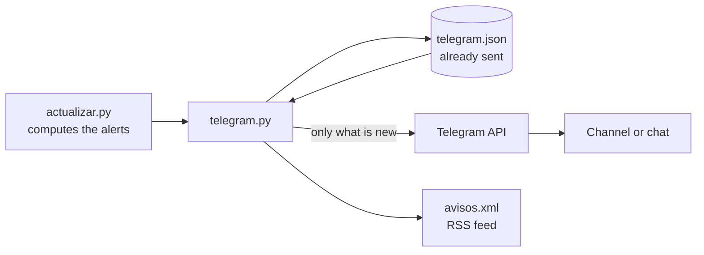

# Telegram alerts and RSS

[Español](telegram.md) · **English**


atalaya can send alerts over Telegram when something changes in the world. No server is needed: the same GitHub Action that updates the data every 30 minutes sends them.

- Project bot: [@atalaya_world_bot](https://t.me/atalaya_world_bot)
- Script: [`scripts/telegram.py`](../scripts/telegram.py)
- Tests: [`tests/test_telegram.py`](../tests/test_telegram.py)

> [!IMPORTANT]
> Alerts are automatic estimates from public sources and **have no official validity**. Every message says so.

---

## Contents

- [What it sends](#what-it-sends)
- [How it works](#how-it-works)
- [Setting it up](#setting-it-up)
- [Checking that it works](#checking-that-it-works)
- [If nothing arrives](#if-nothing-arrives)
- [Token security](#token-security)
- [RSS feed](#rss-feed)
- [Settings](#settings)

---

## What it sends

Only **what is new** since the previous run:

| Alert | When |
|---|---|
| 🔴 🟠 A country goes up a level | From *no alert* to *watch*, or from *watch* to *alert*. Includes the reasons, the confidence and the 7-day forecast. |
| 📈 A country is worsening | It is worse than usual for that country, even if its level does not change. |
| ⚠️ Key signal | A new internet shutdown or messaging block, a raised travel advisory, a disaster or earthquake with a red alert, or a serious disease outbreak, within the last 24 hours. |
| ⚓ Shipping route at high risk | Hormuz, Bab el-Mandeb, Suez, Taiwan and the other strategic straits. |
| 🗺️ Daily summary | Once a day: countries on alert, main conclusion, key judgements, relevance for Spain and what has the highest risk of escalating in the simulation. |

Messages are written in Spanish. Example:

```
🔴 Sudán pasa a alerta (lo confirman varios tipos de fuente)
Muy por encima de lo habitual. Crisis humanitaria abierta
Probable que empeore en los próximos 7 días.
Ver en atalaya

Estimación automática a partir de fuentes públicas, sin validez oficial.
```

*Ver en atalaya* opens the country's sheet on the website.

## How it works



1. After the alerts are computed, the workflow runs `telegram.py` (step *Avisos por Telegram y RSS*), only in runs that publish.
2. It compares with the previous situation, stored in `telegram.json` on the `datos` branch.
3. It removes repeats:
   - An alert already sent is not repeated within 7 days.
   - No further alert for the same country within 6 hours, unless it goes to *alert*.
4. If there are more than 5 alerts at once, they are grouped into a single message.
5. The daily summary goes out with the first run after 07:00 UTC.
6. **The first run sends no alerts**: it only saves the situation, so it does not send every crisis already under way at once. The daily summary may still go out.
7. If Telegram fails, the data update carries on: the step uses `continue-on-error`.

## Setting it up

It takes about 10 minutes and is done once.

### 1. Create the bot

1. In Telegram, open [@BotFather](https://t.me/BotFather), the official account with the blue verified mark.
2. Send `/newbot`.
3. **Display name**: what people see; spaces allowed. For example `atalaya alerts`.
4. **Username**: unique across Telegram, no spaces, must end in `bot`. The obvious ones are often taken (`atalaya_bot` and `atalaya_alerts_bot` were); this project uses `atalaya_world_bot`.
5. BotFather replies with the **token**, a line like `123456789:AAH…`. **Do not paste it into any chat or file**: it goes straight into GitHub (step 4). If it leaks, see [Token security](#token-security).

Optional, also in BotFather:

| Command | What for |
|---|---|
| `/setname` | Change the display name |
| `/setuserpic` | Set the logo: send [`docs/img/atalaya-logo.png`](img/atalaya-logo.png) as a photo |
| `/setdescription` | Text shown when opening the bot. For example: *Automatic alerts from atalaya based on public sources. No official validity.* |
| `/setabouttext` | Short profile text. For example: *Early warning of the world situation: serbenda.github.io/atalaya* |

### 2. Choose where alerts go

| Option | For whom | `TELEGRAM_CHAT` |
|---|---|---|
| **Public channel** (recommended) | Anyone who joins | `@channel_name`, for example `@atalaya_alerts` |
| Private channel or group | Only people with the invite | A number starting with `-100` |
| Your chat with the bot | Only you | Your chat number |

#### Public channel

1. In Telegram: new message pencil → **New channel**. Name: `atalaya`.
2. Channel type **Public**, with a free link, for example `t.me/atalaya_alerts`.
3. Optional: set the same logo as the photo (channel name → **Edit** → **Set photo**).

To join, open `t.me/atalaya_alerts` or search for `@atalaya_alerts` and tap **Join**. Whoever creates the channel is already in it as owner.

> The **bot** and the **channel** are different things: opening the bot shows an empty chat. Alerts appear in the channel.

#### Only for you

1. Open `t.me/atalaya_world_bot` and tap **Start** (`/start`). Without this, the bot cannot write to you.
2. Send it any message.
3. Follow step 3 to get your number.

### 3. Add the bot and get the identifier

**In a channel or group**, add the bot as an administrator:

1. Tap the channel name → **Administrators** → **Add administrator**.
2. Search for `atalaya_world_bot`.
3. Leave only the **Post messages** permission.

**Identifier**:

- Public channel: its link with an at sign, `@atalaya_alerts`.
- Private channel, group or your own chat:
  1. Post a message in the channel, or write to the bot.
  2. Open `https://api.telegram.org/botTOKEN/getUpdates` in your browser, replacing `TOKEN` with yours. Do it in your own browser and do not share that address, because it contains the token.
  3. Look for `"chat":{"id":`. The number that follows is the identifier; for channels and groups it starts with `-100`.
  4. If you get `"result":[]`, send another message and reload.

### 4. Store the secrets in GitHub

In the repository: **Settings → Secrets and variables → Actions**.

| Name | Where | Value |
|---|---|---|
| `TELEGRAM_TOKEN` | *Secrets* tab → **New repository secret** | The token from BotFather |
| `TELEGRAM_CHAT` | *Secrets* tab → **New repository secret** | `@atalaya_alerts`, or the `-100…` number |
| `ATALAYA_URL` *(optional)* | *Variables* tab → **New repository variable** | The website address, if not `https://serbenda.github.io/atalaya/` |

Secrets are not visible in the code or in the Actions logs: GitHub masks them as `***`. To change one, open it and click **Update**.

### 5. Turn it on

The code has to be on `main`, merged through a PR. From then on it runs on its own with every update. To avoid waiting for the next cron slot: **Actions → Actualizar datos → Run workflow** on `main`.

## Checking that it works

In **Actions → Actualizar datos →** latest run **→ Avisos por Telegram y RSS**:

| Log line | Meaning |
|---|---|
| `Telegram: 0 avisos, primera ejecución: solo se guarda el estado.` | All good. First run; alerts start with the next one. |
| `Telegram: 3 avisos.` | 3 alerts were sent. |
| `Telegram: 0 avisos.` | All good: nothing has changed since last time. |
| `Telegram sin configurar … solo se actualiza el RSS.` | The secrets are missing or have a different name. |
| `Telegram no ha aceptado el mensaje: …` | See the next table. |

## If nothing arrives

| Error in the log | Cause | Fix |
|---|---|---|
| `HTTP Error 401: Unauthorized` | Wrong or revoked token | Copy the current token into `TELEGRAM_TOKEN` again |
| `HTTP Error 400: Bad Request` (*chat not found*) | Wrong `TELEGRAM_CHAT` | Check the at sign and the name, or the full `-100…` number |
| `HTTP Error 403: Forbidden` | The bot is not a channel administrator, or you have not sent it `/start` | Add it as an administrator (step 3), or tap *Start* in the bot |
| The step does not appear | It was a test run (*Publicar* unchecked) | Expected: alerts are only sent in runs that publish |
| The summary arrives but no alerts | Nothing has changed | Expected on quiet days |

## Token security

Anyone with the token can post in your name in the channel.

- Do not paste it into chats, issues, commits or screenshots.
- If it has been seen: in BotFather, `/revoke` → choose the bot. The old token stops working immediately. Store the new one in `TELEGRAM_TOKEN` with **Update**.
- The bot only needs the *Post messages* permission in the channel.

## RSS feed

With or without a bot, every run publishes the same alerts as an RSS feed on the `datos` branch:

```
https://raw.githubusercontent.com/serbenda/atalaya/datos/data/avisos.xml
```

It can be added to any feed reader (Feedly, Inoreader, NetNewsWire…). The website links to it in *How it is calculated*. It keeps the last 50 alerts.

## Settings

At the top of [`scripts/telegram.py`](../scripts/telegram.py):

| Constant | Default | What it controls |
|---|---|---|
| `HORA_RESUMEN_UTC` | `7` | From what UTC hour the daily summary is sent |
| `MAX_MENSAJES` | `5` | Above this many alerts at once, they are grouped into one |
| `ESPERA_PAIS` | 6 hours | Minimum time between alerts for the same country (unless it goes to *alert*) |
| `SEÑALES` | | Which event types count as key signals, and at what level |

Messages, the RSS feed and the summary are in Spanish; the texts live in the script itself.
