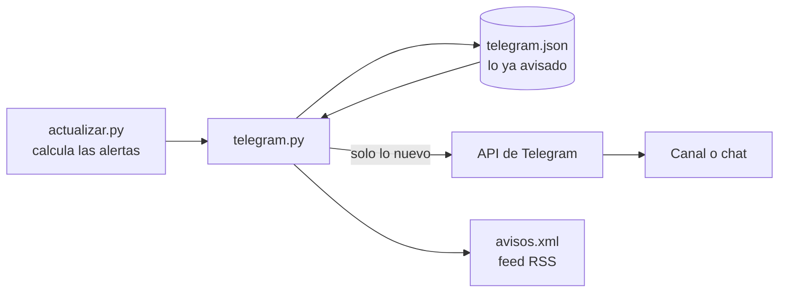

# Avisos por Telegram y RSS

**Español** · [English](telegram.en.md)


atalaya puede avisar por Telegram cuando algo cambia en el mundo. No hace falta ningún servidor: lo hace la misma GitHub Action que actualiza los datos cada 30 minutos.

- Bot del proyecto: [@atalaya_world_bot](https://t.me/atalaya_world_bot)
- Script: [`scripts/telegram.py`](../scripts/telegram.py)
- Pruebas: [`tests/test_telegram.py`](../tests/test_telegram.py)

> [!IMPORTANT]
> Los avisos son estimaciones automáticas a partir de fuentes públicas y **no tienen validez oficial**. Cada mensaje lo recuerda.

---

## Índice

- [Qué avisa](#qué-avisa)
- [Cómo funciona](#cómo-funciona)
- [Ponerlo en marcha](#ponerlo-en-marcha)
- [Comprobar que funciona](#comprobar-que-funciona)
- [Si no llega nada](#si-no-llega-nada)
- [Seguridad del token](#seguridad-del-token)
- [Feed RSS](#feed-rss)
- [Ajustes](#ajustes)

---

## Qué avisa

Solo avisa de **lo nuevo** respecto a la ejecución anterior:

| Aviso | Cuándo |
|---|---|
| 🔴 🟠 Un país sube de nivel | Pasa de *sin alerta* a *vigilar*, o de *vigilar* a *alerta*. Incluye los motivos, la confianza y el pronóstico a 7 días. |
| 📈 Un país empeora | Está peor de lo que es habitual para él, aunque no cambie de nivel. |
| ⚠️ Señal clave | Corte de internet o bloqueo de mensajería nuevo, subida de un aviso de viaje, desastre o terremoto con alerta roja, o brote epidémico grave, de las últimas 24 horas. |
| ⚓ Ruta marítima en riesgo alto | Ormuz, Bab el-Mandeb, Suez, Taiwán y el resto de pasos estratégicos. |
| 🗺️ Resumen diario | Una vez al día: países en alerta, conclusión principal, juicios clave, interés para España y lo que más riesgo tiene de escalar en la simulación. |

Ejemplo de aviso:

```
🔴 Sudán pasa a alerta (lo confirman varios tipos de fuente)
Muy por encima de lo habitual. Crisis humanitaria abierta
Probable que empeore en los próximos 7 días.
Ver en atalaya

Estimación automática a partir de fuentes públicas, sin validez oficial.
```

*Ver en atalaya* abre directamente la ficha del país en la web.

## Cómo funciona



1. Tras calcular las alertas, el workflow ejecuta `telegram.py` (paso *Avisos por Telegram y RSS*), solo en las ejecuciones que publican.
2. Compara con la situación anterior, guardada en `telegram.json` en la rama `datos`.
3. Quita repeticiones:
   - Un aviso ya enviado no se repite en 7 días.
   - Del mismo país no llega otro aviso en 6 horas, salvo que pase a *alerta*.
4. Si hay más de 5 avisos a la vez, los agrupa en un solo mensaje para no saturar.
5. El resumen diario sale con la primera ejecución a partir de las 7:00 UTC: las 8:00 en España en invierno y las 9:00 en verano.
6. **La primera ejecución no manda avisos**: solo guarda la situación, para no enviar de golpe todas las crisis que ya están abiertas. El resumen diario sí puede salir.
7. Si Telegram falla, la actualización de datos sigue igual: el paso está marcado con `continue-on-error`.

## Ponerlo en marcha

Se tarda unos 10 minutos y solo se hace una vez.

### 1. Crear el bot

1. En Telegram, abre [@BotFather](https://t.me/BotFather). Es la cuenta oficial, con la marca azul de verificado.
2. Envía `/newbot`.
3. **Nombre visible**: el que verá la gente, puede llevar espacios. Por ejemplo `atalaya alerts`.
4. **Usuario**: único en todo Telegram, sin espacios, y tiene que acabar en `bot`. Los más evidentes suelen estar cogidos (`atalaya_bot` y `atalaya_alerts_bot` lo estaban); este proyecto usa `atalaya_world_bot`.
5. BotFather responde con el **token**, una línea como `123456789:AAH…`. **No lo pegues en ningún chat ni archivo**: va directo a GitHub (paso 4). Si se te escapa, ver [Seguridad del token](#seguridad-del-token).

Opcional, también en BotFather:

| Comando | Para qué |
|---|---|
| `/setname` | Cambiar el nombre visible, por ejemplo a `atalaya alerts` |
| `/setuserpic` | Poner el logo: envía [`docs/img/atalaya-logo.png`](img/atalaya-logo.png) como foto |
| `/setdescription` | Texto que se ve al abrir el bot. Por ejemplo: *Avisos automáticos de atalaya a partir de fuentes públicas. Sin validez oficial.* |
| `/setabouttext` | Texto corto del perfil. Por ejemplo: *Alerta temprana de la situación mundial: serbenda.github.io/atalaya* |

### 2. Elegir dónde llegan los avisos

| Opción | Para quién | `TELEGRAM_CHAT` |
|---|---|---|
| **Canal público** (recomendado) | Cualquiera que se una | `@nombre_del_canal`, por ejemplo `@atalaya_alerts` |
| Canal o grupo privado | Solo quien tenga la invitación | Un número que empieza por `-100` |
| Tu chat con el bot | Solo tú | Tu número de chat |

#### Canal público

1. En Telegram: lápiz de nuevo mensaje → **Nuevo canal**. Nombre: `atalaya`.
2. Tipo de canal **Público**, con un enlace libre, por ejemplo `t.me/atalaya_alerts`.
3. Opcional: pon de foto el mismo logo (nombre del canal → **Editar** → **Poner foto**).

Para unirse, basta abrir `t.me/atalaya_alerts` o buscar `@atalaya_alerts` y pulsar **Unirse**. Quien crea el canal ya está dentro como propietario.

> El **bot** y el **canal** son cosas distintas: si abres el bot verás un chat vacío. Los avisos salen en el canal.

#### Solo para ti

1. Abre `t.me/atalaya_world_bot` y pulsa **Iniciar** (`/start`). Sin esto, el bot no puede escribirte.
2. Escríbele cualquier cosa.
3. Sigue el paso 3 para sacar tu número.

### 3. Añadir el bot y sacar el identificador

**En un canal o grupo**, añade el bot como administrador:

1. Toca el nombre del canal → **Administradores** → **Añadir administrador**.
2. Busca `atalaya_world_bot`.
3. Deja solo el permiso **Publicar mensajes**.

**Identificador**:

- Canal público: su enlace con arroba, `@atalaya_alerts`.
- Canal privado, grupo o chat contigo:
  1. Publica un mensaje en el canal, o escribe al bot.
  2. Abre en el navegador `https://api.telegram.org/botTOKEN/getUpdates`, sustituyendo `TOKEN` por el tuyo. Hazlo en tu propio navegador y no compartas esa dirección, porque lleva el token.
  3. Busca `"chat":{"id":`. El número que sigue es el identificador; en canales y grupos empieza por `-100`.
  4. Si sale `"result":[]`, escribe otro mensaje y recarga.

### 4. Guardar los secretos en GitHub

En el repositorio: **Settings → Secrets and variables → Actions**.

| Nombre | Dónde | Valor |
|---|---|---|
| `TELEGRAM_TOKEN` | Pestaña *Secrets* → **New repository secret** | El token de BotFather |
| `TELEGRAM_CHAT` | Pestaña *Secrets* → **New repository secret** | `@atalaya_alerts`, o el número `-100…` |
| `ATALAYA_URL` *(opcional)* | Pestaña *Variables* → **New repository variable** | La dirección de la web, si no es `https://serbenda.github.io/atalaya/` |

Los secretos no se ven en el código ni en los registros de las Actions: GitHub los tapa con `***`. Para cambiar uno, entra en él y pulsa **Update**.

### 5. Activarlo

El código tiene que estar en `main`, es decir, fusionado por PR. A partir de ahí funciona solo con cada ejecución. Para no esperar al siguiente turno del cron: **Actions → Actualizar datos → Run workflow** en la rama `main`.

## Comprobar que funciona

En **Actions → Actualizar datos →** la última ejecución **→ Avisos por Telegram y RSS**:

| Registro | Significa |
|---|---|
| `Telegram: 0 avisos, primera ejecución: solo se guarda el estado.` | Todo bien. Es la primera vez; los avisos llegan desde la siguiente. |
| `Telegram: 3 avisos.` | Se han enviado 3 avisos. |
| `Telegram: 0 avisos.` | Todo bien: no ha cambiado nada desde la última vez. |
| `Telegram sin configurar … solo se actualiza el RSS.` | Faltan los secretos, o tienen otro nombre. |
| `Telegram no ha aceptado el mensaje: …` | Ver la tabla siguiente. |

## Si no llega nada

| Error en el registro | Causa | Solución |
|---|---|---|
| `HTTP 401 Unauthorized` | El token está mal o se ha revocado | Copia de nuevo el token actual en `TELEGRAM_TOKEN` |
| `HTTP 400 Bad Request: chat not found` | `TELEGRAM_CHAT` está mal | Revisa la arroba y el nombre, o el `-100…` completo |
| `HTTP 403 Forbidden: bot is not a member…` | El bot no es administrador del canal, o no le has escrito `/start` | Añádelo como administrador (paso 3), o pulsa *Iniciar* en el bot |
| No aparece el paso | Era una ejecución de prueba (*Publicar* desmarcado) | Es normal: solo avisa en las ejecuciones que publican |
| Llega el resumen pero ningún aviso | No ha habido cambios | Es normal en días tranquilos |

## Seguridad del token

Quien tenga el token puede escribir en tu nombre en el canal.

- No lo pegues en chats, issues, commits ni capturas.
- Si se ha visto: en BotFather, `/revoke` → elige el bot. El token antiguo deja de funcionar al momento. Guarda el nuevo en `TELEGRAM_TOKEN` con **Update**.
- El bot solo necesita el permiso *Publicar mensajes* en el canal.

## Feed RSS

Haya bot o no, cada ejecución publica los mismos avisos como feed RSS en la rama `datos`:

```
https://raw.githubusercontent.com/serbenda/atalaya/datos/data/avisos.xml
```

Se puede añadir a cualquier lector de feeds (Feedly, Inoreader, NetNewsWire…). La web lo enlaza en *Cómo se calcula*. Guarda los últimos 50 avisos.

## Ajustes

En la cabecera de [`scripts/telegram.py`](../scripts/telegram.py):

| Constante | Por defecto | Qué controla |
|---|---|---|
| `HORA_RESUMEN_UTC` | `7` | A partir de qué hora UTC sale el resumen diario |
| `MAX_MENSAJES` | `5` | Con más avisos a la vez, se agrupan en uno |
| `ESPERA_PAIS` | 6 horas | Tiempo mínimo entre avisos del mismo país (salvo que pase a *alerta*) |
| `SEÑALES` | | Qué tipos de evento cuentan como señal clave y con qué nivel |

Los mensajes, el RSS y el resumen están en español. Los textos se escriben en el propio script.
